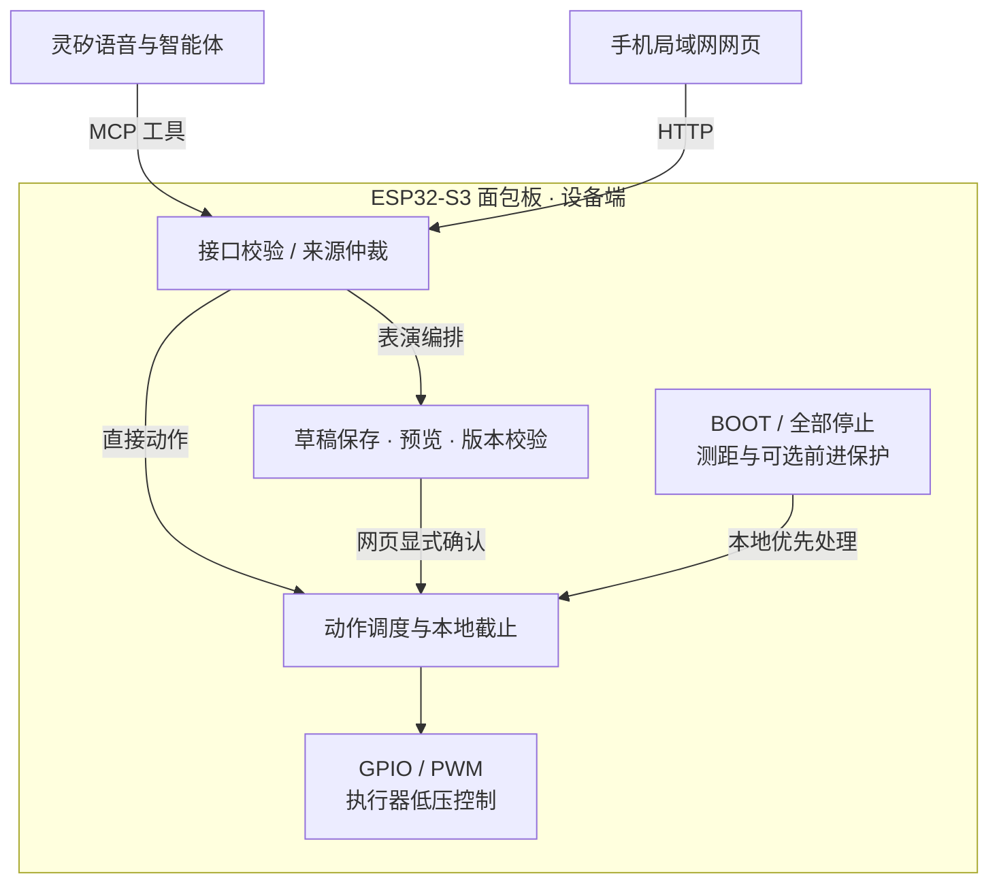
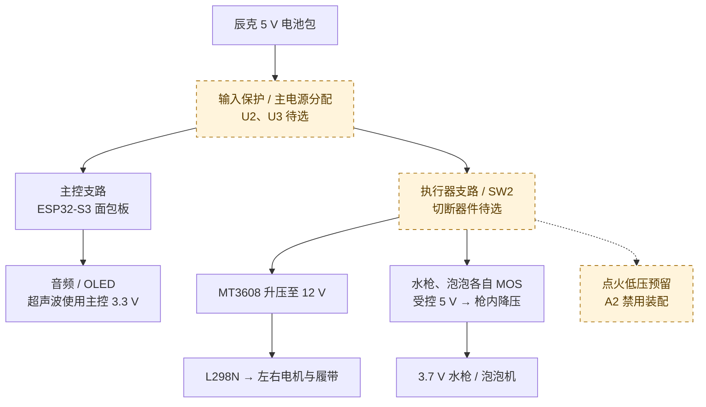

<h1 align="center">CyberTrack</h1>

<p align="center"><strong>让 AI 开进生活，让想象变成一场机器人表演。</strong></p>
<p align="center">基于灵矽的开源双履带交互机器人 · 语音互动 · 泡泡剧场 · 3D 打印与模型改造</p>

<p align="center">
  <a href="LICENSE"></a>
  <a href="firmware/esp32-audio/README.md"></a>
  <a href="hardware/model/README.md"></a>
</p>

<p align="center">
  <a href="#样机演示">演示</a> ·
  <a href="#项目亮点">亮点</a> ·
  <a href="#应用场景与商业价值">应用价值</a> ·
  <a href="#软件架构">架构</a> ·
  <a href="#从这里开始">快速开始</a> ·
  <a href="TODO.md">进度</a>
</p>

<p align="center">
  <a href="artifact/cybertrack-cover.png"></a>
  <br><sub><a href="artifact/README.md#项目封面">项目展示封面</a></sub>
</p>

**认识小D：一个可以聊天、行走、喷水、吹泡泡，也可以和你一起改造的机器人。** CyberTrack 面向家长陪同的亲子互动，把灵矽的语音与智能体能力接入真实硬件：孩子提出创意，家长参与编排，小D用履带动作与泡泡回应。从一句话、一段表演，到一个自己打印的零件，让互动自然延伸到创作。

项目提供固件、原生 CAD、打印项目、原理图、BOM 和设计工具，方便创作者沿着同一套工程继续制作与开发。

> 当前为开发样机。功能进度、最新部署及验收证据见 [TODO](TODO.md) → [当前状态](docs/current-status.md)；下文的应用方向不代表成品上市或商业验证。

## 样机演示

**先看小D动起来。** 6 分钟实拍展示地面移动、转向和泡泡效果。

https://github.com/user-attachments/assets/127dc3f1-0a8f-4abf-b4e5-f43b6fe16fb7

[在 B 站观看](https://www.bilibili.com/video/BV1rLxM6sEF6/) · [下载原始视频](artifact/cybertrack-prototype-demo-6min.mp4) · [浏览 33 张制作照片与 2 段视频](artifact/README.md)

*视频记录拍摄时的样机表现；当前固件、供电配置与验证结果见[工程记录](docs/current-status.md)。*

### 从模型到样机

<table>
  <tr>
    <td width="50%" align="center"><a href="hardware/model/readme-views/front-iso.png"></a><br><sub>CAD · 2026-10-27</sub></td>
    <td width="50%" align="center"><a href="artifact/31-prototype-front-floor.jpg"></a><br><sub>实物 · 制作样机</sub></td>
  </tr>
</table>

## 项目亮点

### 01 · 一句话，变成看得见的行动

“左转一秒”“边走边吹泡泡”“先后退，再右转”——用日常语言表达动作和先后关系。灵矽负责理解与工具选择，设备负责动作时序；最多 **16 步序列**，步骤内多路并发，让机器人有节奏地回应创意。[了解动作编排](docs/action-sequences.md)

### 02 · 从遥控机器人，到一起创作泡泡剧场

登场、庆祝、谢幕，三个短表演模板提供创作起点。修改方向、速度和时长，预览每一步，再由家长在网页确认开始。让孩子参与“怎么演”，让家长看清“将要做什么”。[打开泡泡剧场指南](docs/show-composer.md)

### 03 · 能自己制作，也能继续改造

切面头盔、双履带、前部双枪构成小D的外形；可拆冠盖、独立面包板托盘和底部维护结构，让内部器件也成为可理解的设计。仓库提供 **FreeCAD 原生模型、STEP、STL 与 3MF**，把外观、装配、打印和维护放在一起迭代。[查看模型与打印资料](hardware/model/README.md)

### 04 · 点选零件，把修改想法留在模型上

在完整整机中选中零件或面，写下“冠盖上移一点”。评论关联模型位置与版本，当前对话协助完成原生 CAD 修改、对照和恢复，让改造建议有明确的对象和可检查的结果。[体验模型辅助设计](tools/solidcue/README.md)

### 05 · 语音、手机与本地控制协同

语音用于自然表达，手机网页用于直接操控和查看状态，本机 BOOT 与“全部停止”用于及时中止动作。日常语音经设备直接连接灵矽，**无需电脑转发**；距离提示音、可选前进保护与设备端计时共同参与控制。[了解控制方式](docs/lan-control.md)

## 应用场景与商业价值

**CyberTrack 的价值在于把角色体验、实体动作和可改造硬件组织成一套可复用的机器人方案。** 同一套工程可以承接不同内容与外观设计，为后续产品探索提供原型基础。

<table>
  <thead><tr><th width="96">场景</th><th>使用价值与产品方向</th></tr></thead>
  <tbody>
    <tr><td><strong>亲子互动</strong></td><td>把说想法、改步骤和看机器人回应组织成共同创作的活动。可探索陪同体验套件、主题表演内容与外观配件。</td></tr>
    <tr><td><strong>创客教育</strong></td><td>沿着一个完整项目理解语音工具、嵌入式控制、机械装配与 3D 打印。可探索制作工作坊、项目制课程与改造任务。</td></tr>
    <tr><td><strong>展览活动</strong></td><td>用有角色感的造型、移动和泡泡呈现可见的 AI 互动。可探索主题展示原型、互动脚本与外观定制。</td></tr>
    <tr><td><strong>生态集成</strong></td><td>为灵矽生态与硬件开发者提供角色、设备工具契约、参考硬件和验证材料。可探索参考设计、设备适配与方案集成服务。</td></tr>
  </tbody>
</table>

这些方向共享三类已有资产：**可演示的样机、可修改的软硬件工程、可追溯的接入与验证资料**。它们让后续团队能够从现有实现继续试验，也让内容、造型和硬件迭代有共同依据。

下一步先通过小规模陪同体验验证上手难度与主动重玩，再结合维护、可靠性和成本数据判断产品形态。用户需求、定价、量产成本与付费意愿尚未验证；完整路径见[灵矽解决方案](docs/lingxi-solution.md)。

## 一起编排小D的泡泡剧场

**提出想法 → 修改步骤 → 预览草稿 → 家长确认。**

1. **选一段开场。** 在手机网页选择“登场”“庆祝”或“谢幕”，也可以明确说“编排表演，先别执行”来提出草稿。
2. **一起改一改。** 调整某一步的方向、行走时长或泡泡时长，再保存到设备并预览。草稿编辑本身不启动执行器。
3. **决定什么时候演。** 家长核对网页中的步骤与版本，确认开始；需要中止时，使用“全部停止”或本机 BOOT。

普通语音动作仍会直接请求执行；需要预览时，应明确进入编排。当前剧场只编排行走与泡泡，台词是供亲子一起说的网页提示。机器人自动播报台词、表情联动属于后续方向；自然语言改稿与确认后的实机表演仍在验证，详见[编排进度与证据](docs/show-composer.md)。

## 在完整机器人上，直接说出修改想法

从“玩什么”进一步走到“怎样改造它”。通过随仓库提供的模型辅助设计工具，在整机上下文中选中冠盖、枪座或外壳，描述调整意图，再检查原生 CAD 的变化。

<p align="center">
  <a href="docs/images/model-design/whole-model-host-adjusted.png"></a>
</p>

*真实设计卡片：在独立研究副本中将冠盖上移 8 mm，保留评论、AI 回执和修改历史。修改与恢复经 FreeCAD 保存、重开核对，正式模型保持不变。*

这条流程把**设计讨论、原生修改与版本对照**连在一起。当前整机编辑支持受限静态零件的位置调整；任意外形重建、装配约束求解和制造验收仍需相应 CAD 工作。设计工具在电脑上运行，与机器人日常语音链路独立。

[安装与操作流程](tools/solidcue/README.md) · [工具源码](tools/model-design/README.md) · [真实消息驱动验证](tools/solidcue/verification-message-20261031.json)

## 为灵矽提供可复用的实体机器人方案

CyberTrack 将灵矽的对话能力落到三个相互配合的层面：

- **交互层：** 小D的角色、语音表达、设备状态解释与亲子上手流程。
- **执行层：** 同一设备会话的 MCP 业务工具、参数校验、动作计时、来源仲裁与本地停止。
- **工程层：** 固件与角色版本、原理图、BOM、原生 CAD，以及分层回归和现场验证记录。

开发者可以沿着“理解表达 → 调用工具 → 设备执行 → 返回状态”的链路定位问题，并通过参考材料包复用角色、接口与评测方法。项目也整理了角色版本管理、工具试运行和分层日志等平台建议，供方案迭代讨论。

[完整解决方案](docs/lingxi-solution.md) · [导出参考材料包](tools/lingxi-solution/README.md) · [设备能力契约](firmware/CAPABILITIES.md) · [角色配置](docs/agent-role.md)

## 软件架构

**云端理解意图，设备管理动作。** 日常语音由面包板直接连接灵矽，音频、角色对话与 MCP 工具调用沿同一设备会话运行；手机网页由设备本地提供。两种控制入口汇入同一套设备端会话、编排和执行逻辑，无需电脑代理。



*图示为动作请求路径；音频传输、只读状态查询和回执返回为并行链路。草稿编辑不产生输出，普通直接动作不经过草稿确认。*

<table>
  <thead><tr><th width="112">模块</th><th>负责什么</th></tr></thead>
  <tbody>
    <tr><td><strong>语音与网页</strong></td><td>灵矽选择受限业务工具；网页发送操控与编排请求。两者查询设备状态，不暴露通用 GPIO 云端控制。</td></tr>
    <tr><td><strong>会话与编排</strong></td><td>校验参数、请求时效和来源；处理网页租期与同通道优先级；管理草稿版本、确认、取消及最多 16 步序列。</td></tr>
    <tr><td><strong>本地执行</strong></td><td>步骤内并发、步骤间串行，行走／喷水／泡泡／点火低压四路独立计时；停止、故障及连接变化按各自规则处理，不自动恢复旧动作。</td></tr>
    <tr><td><strong>状态与反馈</strong></td><td>返回逻辑输出、剩余时间、动作回执及有效测距，供网页和语音解释；当前没有轮速、水流或电流反馈。</td></tr>
  </tbody>
</table>

本地截止不依赖云端再次发送停止。BOOT／全部停止与 Wi-Fi 断线全停；语音断线、网页失租按来源处理。前进保护每次开机默认关闭，开启后才根据距离阻止或停止前进，解锁后仍需新指令。

当前整机实现位于 [esp32-audio](firmware/esp32-audio/README.md)，通过 overlay 接入固定小智源码与 ESP-IDF v5.5.1。仓库另有用于主机验证的通用 C11 控制核心；它的本地使能和持久化契约不等于面包板已部署能力。CAD 辅助设计在电脑端独立运行，也不参与机器人实时控制。

[系统架构详解](docs/architecture.md) · [能力与接口](firmware/CAPABILITIES.md) · [编排契约](docs/show-composer.md) · [当前部署与验证](docs/current-status.md)

## 硬件架构

**主控、动力与效果分支各司其职，结构围绕装配和维护组织。** 头舱容纳面包板、音频、OLED 与超声波；底盘承载电池、电机驱动和双履带；水枪与泡泡枪各有独立控制支路，降压模块集成在各自枪体内。

下图概括 **A2 模块级供电设计**。标注“待选”或“禁用”的部分尚未落实为已验收硬件，整图不表示样机当前已按图接线。



*连线表示供电功能关系，省略了支路保护、控制信号和回流端点；具体连接以原理图和接线表为准。*

- **主控与执行器分域：** SW2 的设计目标是切断执行器供能、保留主控运行。它与 BOOT 软件停止不同，器件额定、残余储能及实际切断仍需验证。
- **功率路径与信号分开：** ESP32-S3 通过 GPIO／PWM 控制 L298N 和 MOS，负载由对应功率支路供电。水枪与泡泡的 MOS 位于降压前，各路受控负极不能额外并回系统地。
- **模块可拆、接口可查：** 可拆冠盖、面包板托盘、底部维护入口与独立枪体便于分模块检修；原生 CAD、BOM 和六页 KiCad 原理图共同记录结构及接口。

电池带载能力、完整电流预算、保护定值和温升仍待实测。四路软件并发不代表组合负载已验收；点火低压固件能力也不改变 A2 的禁用装配边界。

[硬件架构与电源预算](hardware/architecture/README.md) · [KiCad 原理图](hardware/schematic/README.md) · [接线总表](docs/wiring.md) · [BOM](hardware/BOM.md) · [机械模型](hardware/model/README.md)

## 从这里开始

### 体验已有样机

先读[首次互动上手卡](docs/quick-start.md)。已部署对应固件的设备联网后，让手机加入同一可互通局域网，打开 OLED 显示的 `http://<设备 IP>:8080/`，即可进入遥控与泡泡剧场，无需安装手机 App。

先找到页面底部“全部停止”和本机 BOOT。网页按住方向键行走、松开停止；语音与网页的详细规则见[操作指南](docs/lan-control.md)。距离提示音与前进保护独立，保护每次开机默认关闭，开启后是近距离停止前进，不会自动绕行。当前网页无用户身份认证，应在可信局域网内使用。

### 制作、补打或改造一台

1. **了解物料与结构。** 从 [BOM](hardware/BOM.md)、[接线总表](docs/wiring.md)和[装配说明](docs/assembly.md)开始，结合实物确认器件与接口。
2. **打开原生模型。** 使用 FreeCAD 查看 [CyberTrack.FCStd](hardware/model/CyberTrack.FCStd)；FCStd 是几何依据，当前修订与交换文件检查见[模型说明](hardware/model/README.md)。
3. **按需选择打印件。** [Lean 项目](hardware/model/lean-print/README.md)提供 27 件／6 盘及 [3MF 文件](hardware/model/lean-print/CyberTrack-Lean-6plates.3mf)。当前第 3、6 盘需重新切片；[Ready 排盘](hardware/model/print-ready/README.md)是独立方案，不混用盘号。头部与单件补打见[头部打印说明](docs/head-shell-print.md)和[单件目录](hardware/model/print-parts/README.md)。

当前仍处于样机联调阶段。打印配合、整机供电、持续负载、停止性能及儿童使用验收尚未完成；点火仅有低压控制实现，高压、绝缘、液体共存及 EMC 尚未验收。首次亲子流程不含点火或狂暴模式，具体边界见[效果控制](docs/effects-control.md)与[待办](TODO.md)。

### 开发固件与设计工具

无需连接设备，即可在电脑上构建通用控制核心。准备 C11 编译器、CMake ≥ 3.16 和 Python ≥ 3.9，在仓库根目录执行：

```sh
cmake -S firmware -B build/firmware-host -DCMAKE_BUILD_TYPE=Debug
cmake --build build/firmware-host
ctest --test-dir build/firmware-host --output-on-failure
```

这组命令检查通用控制核心、协议与运行层。现用面包板的语音、网页和执行器功能从 [firmware/esp32-audio/](firmware/esp32-audio/README.md) 开始，使用固定小智源码、overlay 与 ESP-IDF v5.5.1，依赖准备和构建按该目录说明执行。网络配置见 [Wi-Fi 指南](docs/wifi-configuration.md)，本地凭据不进入 Git。

模型辅助设计的依赖与启动流程见[工具指南](tools/solidcue/README.md)；固件与设计工具的检查入口见[统一软件检查](docs/current-status.md#统一软件检查)。

## 文档导航

| 想了解什么 | 从这里进入 |
|---|---|
| **体验与玩法** | [首次互动](docs/quick-start.md) · [手机控制](docs/lan-control.md) · [泡泡剧场](docs/show-composer.md) |
| **产品与方案** | [需求](docs/requirements.md) · [设计决策](docs/decisions.md) · [灵矽解决方案](docs/lingxi-solution.md) |
| **模型与制造** | [整机 CAD](hardware/model/README.md) · [打印项目](hardware/model/lean-print/README.md) · [装配维护图册](hardware/model/CyberTrack-assembly-and-service.pdf) |
| **电气与采购** | [硬件架构](hardware/architecture/README.md) · [电源与接口](docs/power-and-interfaces.md) · [KiCad 原理图](hardware/schematic/README.md) · [BOM](hardware/BOM.md) |
| **控制与开发** | [系统架构](docs/architecture.md) · [固件总览](firmware/README.md) · [能力与接口](firmware/CAPABILITIES.md) · [智能体角色](docs/agent-role.md) |
| **进度与证据** | [TODO](TODO.md) · [当前状态](docs/current-status.md) · [改进计划](docs/improvement-plan.md) · [验收计划](docs/verification-plan.md) |
| **制作与来源** | [照片和视频](artifact/README.md) · [部件资料](hardware/components/) · [参考资料](docs/references.md) |

<details>
<summary><strong>展开仓库结构</strong></summary>

```text
artifact/              制作照片、样机视频与素材索引
docs/                  产品、设计、操作与验证记录
hardware/components/   独立部件模型与厂商资料
hardware/model/        整机 CAD、打印项目与装配图纸
hardware/schematic/    KiCad 原理图与审图资料
firmware/              控制核心、板级工程与测试
  esp32-audio/         现用面包板的语音、网页与执行器适配
tools/model-design/    随仓库提供的模型辅助设计源码
tools/lingxi-solution/  灵矽参考材料打包工具
scripts/               建模、检查与工程辅助脚本
```

</details>

## 参与项目

欢迎通过 [Issue](https://github.com/miclle/cybertrack/issues) 分享复现问题、玩法与改造想法，也欢迎提交改进。开始前可先查看 [TODO](TODO.md)，找到当前需要验证的方向。

有价值的反馈包括：清楚的复现步骤、固件或模型版本、打印与装配记录，以及遇到的交互问题。请区分软件回执、CAD 检查与实物现象，避免上传网络凭据或私人录音。

## 许可证

项目采用 [Apache License 2.0](LICENSE)。随仓库分发的第三方代码按各自许可证与声明使用；模型设计工具保留 [SolidCue 来源与修改说明](tools/model-design/NOTICE)及[许可证](tools/model-design/LICENSE)。供应商图片、原理图和数据手册的权利归原权利人，归档不改变其授权条件。
