# CyberTrack

**和小D聊天，一起编排会动、会吹泡泡的机器人表演。**

CyberTrack 基于**灵矽语音与智能体能力**，面向家长陪同的亲子互动：孩子提出想法，家长参与控制和创作，小D用语音、履带动作与泡泡作出回应。项目结合可维护的 3D 打印整机、语音与手机控制，并持续开发表演编排和自然语言辅助 CAD 设计。

## 值得期待，也正在实现

| 亮点 | 能带来什么 | 进度 |
|---|---|---|
| **听懂先后，也能同时行动** | “先左转，再边走边吹泡泡”；语音转换为最多 16 步动作，一步内多路独立计时 | 已实现；已有分项现场反馈，完整语音回归待完成 |
| **小D 泡泡剧场** | 登场、庆祝、谢幕，把台词、表情、履带和泡泡组合成可以一起创作的表演 | 规划中；首版聚焦行走与泡泡 |
| **先编排，再开始** | 看清步骤后说“第二步短一点”或“去掉转向”，由家长明确开始表演 | 开发计划；现有普通语音指令会直接请求动作 |
| **点选 3D 模型，说出修改想法** | 通过 SolidCue 将评论绑定到零件、面、位置和版本，由当前对话协助原生 CAD 修改与恢复 | 接入中；先支持受限单实体，不宣称任意整机修改 |
| **自己打印，也能维护和改造** | 切面头盔、履带底盘、前部双枪与可拆维护结构，提供 FreeCAD、STEP 和打印项目 | 已交付模型与 27 件／6 盘打印项目；实物适配按版本验证 |
| **从电源到外壳，一起设计** | 电源分域、独立执行器断电、可维护线束与参数化部件模型，让外观和内部结构共同迭代 | 已有原理图与 CAD；电源管理与硬件架构专项推进中 |
| **手机和语音一起用** | 行走、喷水、泡泡各自控制；距离提示音、可选近距离停车和统一停止 | 已实现；实机停止性能与组合负载仍待验收 |

规划中的功能也是产品方向，进度持续更新。亲子体验由家长负责启动、停止和设备管理；当前为开发样机，尚未完成儿童使用验收。首次亲子玩法不包含点火或狂暴模式。

[第一次和小D互动](docs/quick-start.md) · [当前能力与版本](docs/current-status.md) · [产品改进计划](docs/improvement-plan.md) · [模型与图纸](hardware/model/README.md) · [打印项目](hardware/model/lean-print/README.md)

## 让灵矽从对话走进真实机器人

CyberTrack 是面向亲子互动的灵矽实体机器人方案：灵矽负责理解表达、塑造小D的角色和选择工具，设备负责参数校验、动作时序、状态回执与本地停止。现有语音链路通过同一设备会话的 MCP 工具控制机器人，日常运行不依赖电脑转发。

- **场景落地**：从语音遥控走向家长和孩子共同创作的泡泡短剧；预览、修改、明确开始是下一阶段体验重点。
- **工程落地**：把角色、工具契约、固件、硬件接口和版本证据放在同一工程中维护，减少“模型会说，但设备行为不一致”。
- **交付落地**：提供参考整机、打印与原理图资料，并建设语义评测、上手卡、异常矩阵和维护流程，逐步形成别人可以复现的解决方案包。
- **生态反馈**：整理工具试运行、角色版本管理、设备能力声明与分层日志的改进建议；这些是方案建议，不冒充灵矽已提供的功能。

[完整灵矽解决方案：场景、架构、验证与推广](docs/lingxi-solution.md) · [现用工具契约](firmware/CAPABILITIES.md) · [角色配置与同步](docs/agent-role.md)

## 样机演示

**6 分钟实拍**：样机在地面上的移动、转向与泡泡效果展示。点击下方播放器即可播放。

https://github.com/user-attachments/assets/127dc3f1-0a8f-4abf-b4e5-f43b6fe16fb7

[B 站播放](https://www.bilibili.com/video/BV1rLxM6sEF6/) · [下载原始视频](artifact/cybertrack-prototype-demo-6min.mp4) · [制作过程与全部素材](artifact/README.md)

影像记录了制作与演示时的样机状态；具体固件、供电配置与工程验收以对应验证记录为准。

## 制作过程与样机照片

从双电机台架、底盘装配到头部电子件安装，再看样机的正面、侧面和背面。点击照片可查看原图。

<table>
  <tr>
    <td width="50%" valign="top"><a href="artifact/03-dual-motor-bench.jpg">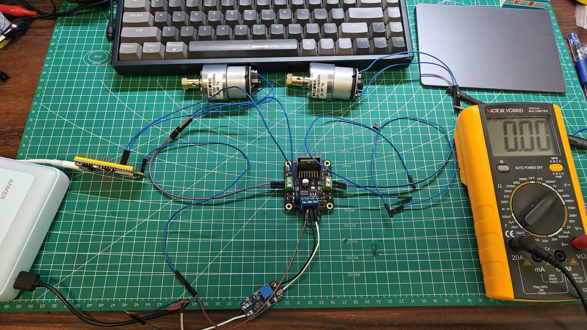</a><br>双电机台架接线</td>
    <td width="50%" valign="top"><a href="artifact/19-chassis-assembly-14.jpg">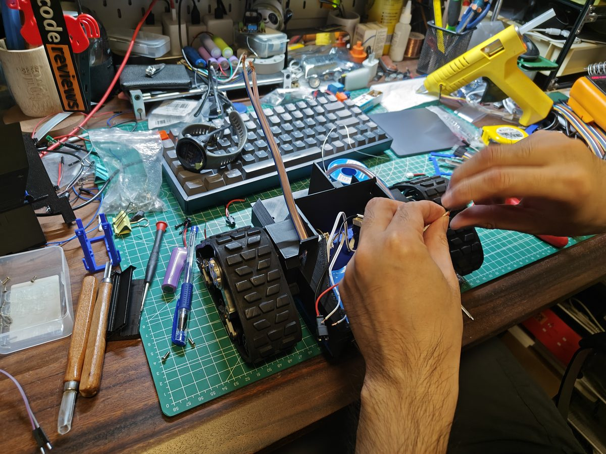</a><br>底盘装配与接线</td>
  </tr>
  <tr>
    <td width="50%" valign="top"><a href="artifact/26-head-breadboard-installation.jpg">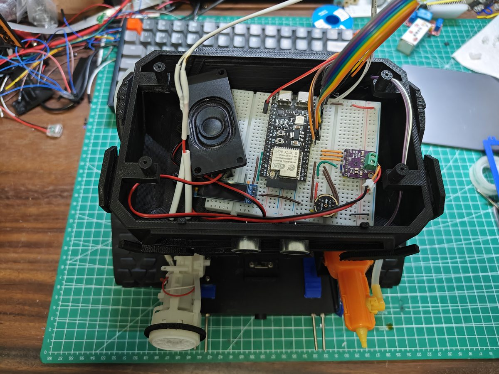</a><br>头部面包板与扬声器安装</td>
    <td width="50%" valign="top"><a href="artifact/27-prototype-front-workbench.jpg">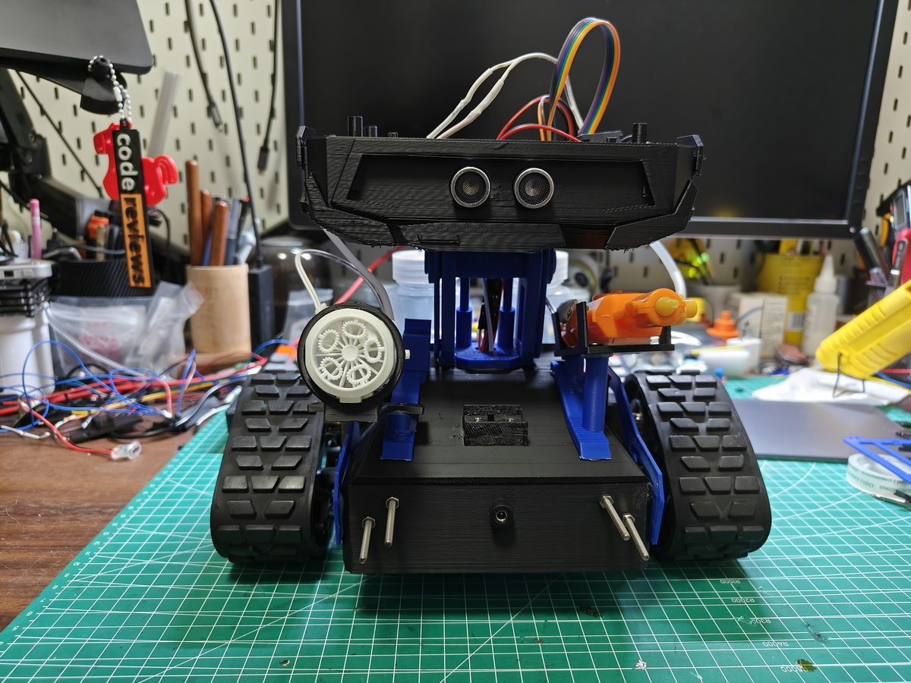</a><br>样机正面：超声波模块与双枪布局</td>
  </tr>
  <tr>
    <td width="50%" valign="top"><a href="artifact/28-prototype-water-gun-side.jpg">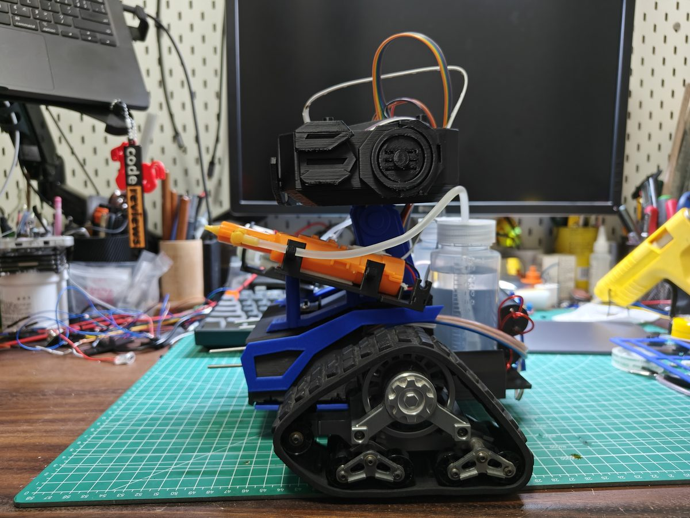</a><br>样机侧面：履带、颈架与水枪</td>
    <td width="50%" valign="top"><a href="artifact/29-prototype-rear-reservoirs.jpg">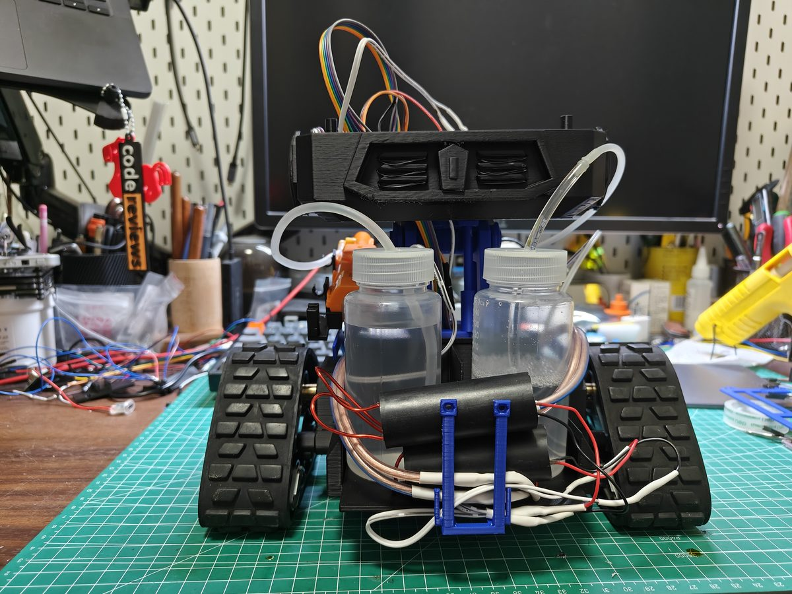</a><br>样机背面：双液体瓶与管路</td>
  </tr>
</table>

[查看全部 33 张照片与 2 段视频](artifact/README.md)

## CAD 模型

以下视图于 **2026-10-27** 从当前 [CyberTrack.FCStd](hardware/model/CyberTrack.FCStd) 导出，展示整机外形、双枪与履带布局，以及背部双瓶结构。点击图片可查看大图。

<table>
  <tr>
    <td width="50%" valign="top"><a href="hardware/model/readme-views/front-iso.png">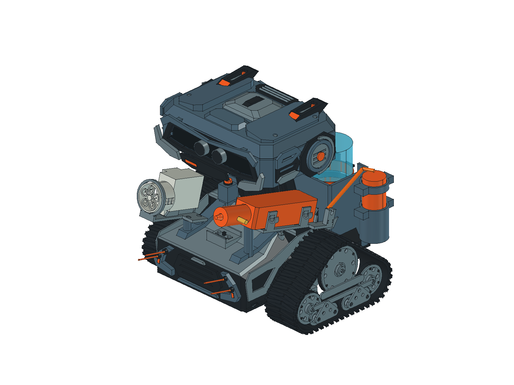</a><br>前侧整体视图</td>
    <td width="50%" valign="top"><a href="hardware/model/readme-views/front.png">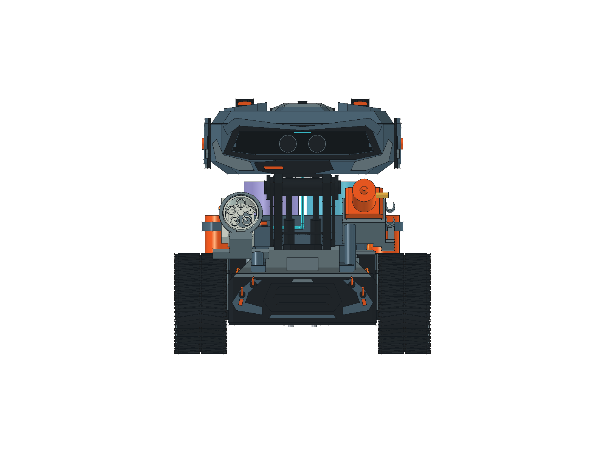</a><br>正面布局</td>
  </tr>
  <tr>
    <td width="50%" valign="top"><a href="hardware/model/readme-views/side.png">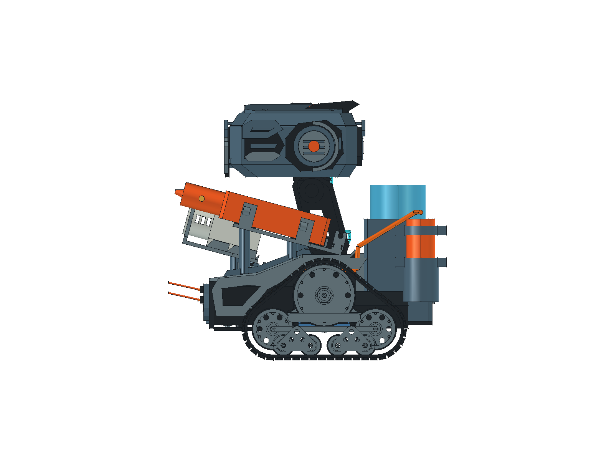</a><br>侧面结构</td>
    <td width="50%" valign="top"><a href="hardware/model/readme-views/rear-iso.png">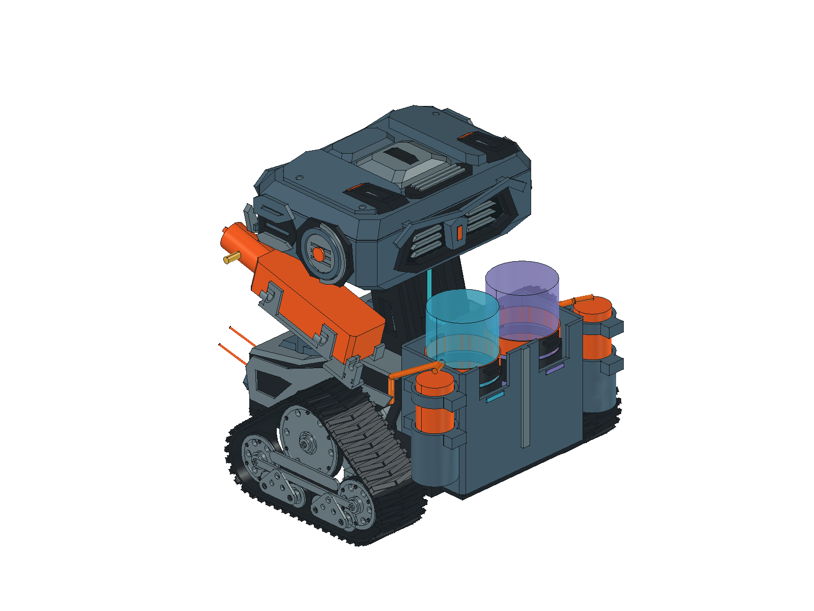</a><br>后侧与双瓶背包</td>
  </tr>
</table>

*以上为 CAD 模型视图，颜色用于区分零件，不代表实物材料或打印配色；样机状态见上方实拍。模型修订见[模型入口](hardware/model/README.md)，装配、打印工艺与持续带载的完整验收仍待完成。*

## 当前状态

2026-10-31 核对：最近记录的面包板部署为 **2.0.3-ct42**。支持语音与手机网页控制、60–100% 行走输出、四路独立计时、16 步并发动作序列和前方测距。距离提示音独立于行走状态；可选前进保护每次开机默认关闭，开启后小于 15 cm 停前进、至少 20 cm 解锁但不续走。

当前版本、参数和证据统一见 [当前状态](docs/current-status.md)及[接口手册](firmware/CAPABILITIES.md)。[产品改进执行计划](docs/improvement-plan.md)跟踪上手体验、语音回归、编排玩法、实机验收及 SolidCue 单件设计接入；计划功能不代表已经部署。

已有基本装配样机、运行影像和分项现场反馈。整机供电、持续带载、停止性能和完整故障验收尚未完成；CAD、主机测试、部署回读与实物结果分别记录。现用电源为辰克 5 V 电池包及 12 V 升压电机支路，旧电源台架结果不迁移。点火低压控制不代表高压、绝缘、液体共存或 EMC 验收。

## 从这里开始

### 查看模型、补打与装配

使用 FreeCAD 打开 [CyberTrack.FCStd](hardware/model/CyberTrack.FCStd)，当前几何、局部修订及检查入口见[模型说明](hardware/model/README.md)。原生 FCStd 是几何依据，STEP 用于交换；部分历史 STEP 体积比较仍超过阈值，不能把交换文件一概视为原生几何等价。

- **现行打印项目**：[Lean 27 件／6 盘](hardware/model/lean-print/README.md)及[3MF 文件](hardware/model/lean-print/CyberTrack-Lean-6plates.3mf)。已按 P2S、0.4 mm 喷嘴与 PLA Basic 配置各零件的朝向、层高、墙数和支撑，原 29 件版本完成切片与相应几何／路径检查；当前背包调整后第 3、6 盘需重切，旧时间及路径结果不适用于这些盘。用于补打或复现样机时，按所需零件选盘，已打印件不重复打印；切片估算与检查不代表实物强度、配合或整机验收。
- **头部与单件文件**：[0.58 头部整体打印与螺丝适配](docs/head-shell-print.md)说明 PP07 头壳、配套 PP05 冠盖及独立面包板托盘；[单件目录](hardware/model/print-parts/README.md)提供 STL／STEP 与专项记录。导孔试拧、螺丝保持力与重复拆装仍待实物核验，单件 STL 不包含支撑配置。
- **装配与维护参考**：[装配说明](docs/assembly.md)与[装配维护图册](hardware/model/CyberTrack-assembly-and-service.pdf)保留各修订的特征定位和拆装参考，其中旧分件、孔形及配合状态须结合现行模型与专项记录阅读。实际打印分件以 Lean 清单为准，已合并的源特征不独立打印；[0.51 六件图册](hardware/model/print-parts/print-parts.pdf)仅作历史合并参考。

[Ready 用户排盘快照](hardware/model/print-ready/README.md)与 Lean 分别保留，盘序和零件范围不同，不混用盘号或切片估算。样机基本装配已有实拍记录；剩余适配、紧固、拆装与承载验证继续按 [TODO](TODO.md) 跟进。

### 开发固件

控制核心可在电脑上构建和测试，无需连接设备。需要 C11 编译器、CMake ≥ 3.16 和 Python ≥ 3.9，在仓库根目录执行：

```sh
cmake -S firmware -B build/firmware-host -DCMAKE_BUILD_TYPE=Debug
cmake --build build/firmware-host
ctest --test-dir build/firmware-host --output-on-failure
```

这组命令验证通用控制核心及协议／运行层，不包含当前面包板的全部功能。现用语音与网页控制从 `firmware/esp32-audio/` 开始，默认源码与最近记录的部署为 `2.0.3-ct42`，保留按已保存顺序连接 Wi-Fi；通过 overlay 接入固定的上游源码，构建仍使用 ESP-IDF v5.5.1、原始源码及组件缓存。源码导出还需满足面包板适配说明中的 Python 与依赖要求。各工程的 GPIO 与工具语义须分别查阅：

- [面包板适配](firmware/esp32-audio/README.md)：现用语音、网页和四路控制的构建、部署及逐版本记录。
- [固件总览](firmware/README.md)与[能力及接口手册](firmware/CAPABILITIES.md)：通用核心、工程差异和接口；现用面包板的四路控制、60–100% 电机 PWM 与左右履带映射以[面包板当前记录](firmware/esp32-audio/README.md)为准，旧台架记录保留各自版本边界。
- [ESP32 无负载检查](firmware/esp32/README.md)、[电机台架](firmware/esp32-motor-bench/README.md)与[MOS 台架](firmware/esp32-mos-bench/README.md)：各自的接线、版本和测试记录。

### 使用局域网控制

已部署对应面包板固件的设备与手机接入同一可互通局域网后，打开 `http://<设备 IP>:8080/`，页面自动申请控制会话；设备 IP 可从 OLED 或串口读取。以下为当前软件操作规则，各执行器的实物验证状态见上表。

<a href="docs/images/lan-control-ct41.jpg">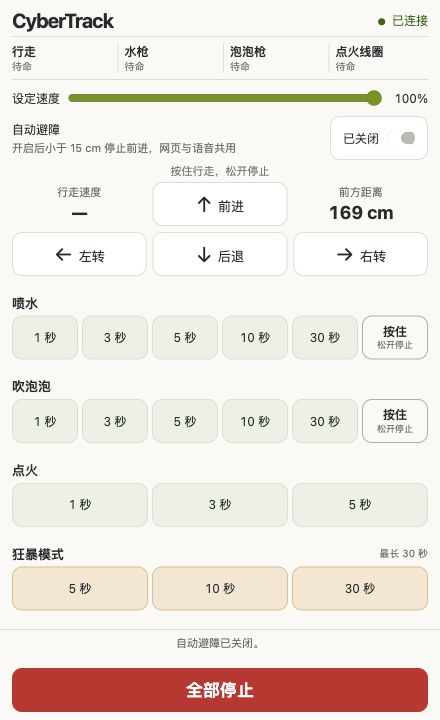</a>

2026-10-30 的 ct41 实机页面截图，自动避障处于关闭状态。该开关每次开机默认关闭，网页与语音共用；开启后有效距离小于 15 cm 时停止前进。截图中的距离是当时读数。详情见[自动避障规则](docs/ultrasonic-ranging.md#ct41自动避障开关已部署)。

- **距离提示音**：有效距离小于 50 cm 时滴声，40–50 cm 慢滴、小于 40 cm 快滴；与自动避障开关及行走状态无关，无效／过期读数时安静。
- **行走**：按住方向键持续行走，松开停止本路；语音按指定整数毫秒执行，具体默认值与范围见接口手册。
- **喷水／泡泡**：各有 1／3／5／10／30 秒按钮和“按住持续”；长按由短租期续约维持，松开只停止本路。
- **点火**：提供 1／3／5 秒按钮，软件单次上限 5 秒；停止后至少等待本次实际软件开启时长。该间隔不代表热保护或硬件时限验收。
- **狂暴模式**：网页提供 5／10／30 秒，语音默认 5 秒、最多 30 秒；四路就绪后整体启动，点火按 1 秒开启与至少等长间隔调度。
- **停止与冲突**：“全部停止”、BOOT 或语音停止关闭四路；旧动作不自动恢复。普通动作同通道冲突时网页优先，行走／喷水／泡泡停止后间隔 200 ms；组合模式的抢占规则见专项说明。

完整操作、失租／断连处理和验证记录见[局域网控制说明](docs/lan-control.md)。当前网页没有用户身份认证，同局域网可访问设备的客户端可申请控制会话；页面显示固件逻辑回执，没有轮速、水流或火花的物理反馈。

## 文档导航

| 想了解什么 | 入口 |
|---|---|
| 产品目标与已确认决定 | [产品需求](docs/requirements.md) · [决策和待补资料](docs/decisions.md) |
| 添加或修改普通 Wi-Fi | 编辑仓库根目录的 `secrets/wifi.json`（本地私密文件，Git 忽略）；见[配置说明](docs/wifi-configuration.md)与[格式示例](firmware/esp32-audio/wifi.example.json)。填写后需构建、刷入设备才生效。 |
| 机械布局、打印与装配 | [模型与当前修订](hardware/model/README.md) · [Lean 六盘打印项目](hardware/model/lean-print/README.md) · [头部打印与螺丝](docs/head-shell-print.md) · [装配参考](docs/assembly.md) |
| 电源、接线与采购 | [电源与接口](docs/power-and-interfaces.md) · [接线总表](docs/wiring.md) · [BOM](hardware/BOM.md) · [采购清单](hardware/procurement.md) |
| 原理图设计与 PCB 打板 | [KiCad 原理图工程](hardware/schematic/README.md) · [六页原理图 PDF](hardware/schematic/CyberTrack-schematic.pdf) · [设计与制板要求](docs/schematic-and-pcb.md)；A2 已包含主控侧超声波接口，为模块级审图稿，尚未达到 PCB 制造放行状态；[待确认参数](hardware/schematic/parameter-confirmation.md) |
| 控制架构与语音配置 | [系统架构](docs/architecture.md) · [智能体角色](docs/agent-role.md) · [灵矽接入](docs/linx-integration.md) |
| 网页操作与效果控制 | [局域网控制](docs/lan-control.md) · [泡泡与点火](docs/effects-control.md) · [面包板固件](firmware/esp32-audio/README.md) |
| 固件接口与后续开发 | [固件入口](firmware/README.md) · [能力与接口](firmware/CAPABILITIES.md) · [固件计划](firmware/PLAN.md) |
| 当前待办与验收范围 | [TODO](TODO.md) · [实施及验收计划](docs/verification-plan.md) |
| 部件资料与来源 | [资料索引](docs/references.md) · [部件资产](hardware/components/) |

## 仓库结构

```text
artifact/              制作过程照片、样机演示视频与素材索引
docs/                  需求、决策、设计、接线与验证记录
hardware/components/   独立部件模型、厂商资料与实测记录
hardware/model/        整机 CAD、视图、装配图纸与检查报告
  lean-print/          现行 27 件六盘项目、切片与交付检查
  print-parts/         单件 STL／STEP、头部打印及历史合并记录
  print-ready/         用户 Ready 排盘快照与精简前历史记录
firmware/              控制核心、板级工程、协议与测试
  esp32-audio/         现用面包板的语音、网页及执行器适配
scripts/               CAD 生成、布局检查与图纸生成脚本
```

## 许可证

项目采用 [Apache License 2.0](LICENSE)。供应商图片、原理图及数据手册的权利归原权利人，归档不改变其授权条件。
