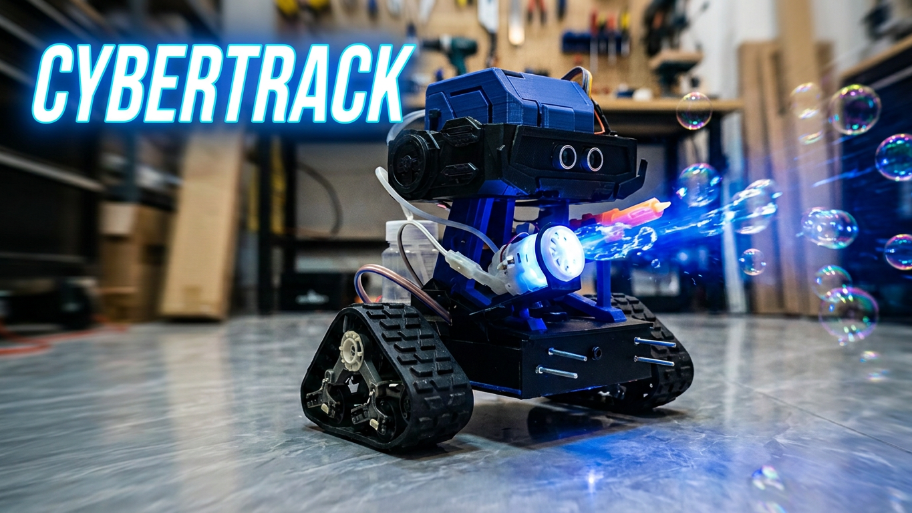
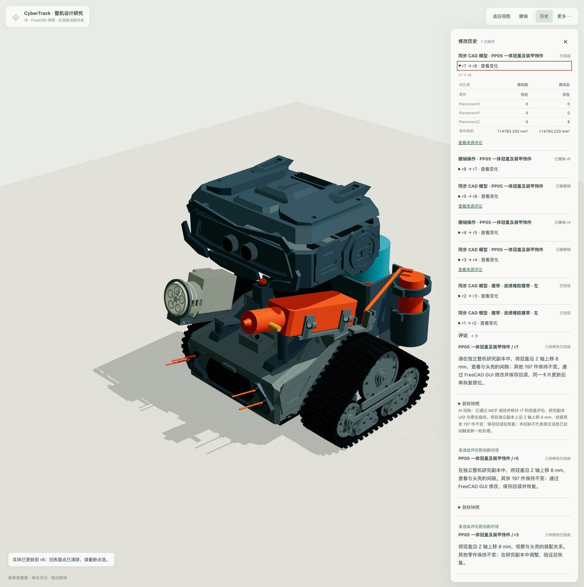

<h1 align="center">CyberTrack</h1>

<strong>一句话让小D动起来，从模型到代码都能亲手改造。</strong>

基于灵矽的开源双履带交互机器人 · 语音互动 · 组合动作 · 3D 打印与模型改造

  
  
  

  
   <a href="artifact/README.md#项目封面">项目展示封面</a>

小D 是一台可以用语音和手机控制的双履带机器人。说“左转一秒，同时吹泡泡三秒”，两路动作可以同时开始、分别结束。手机连入同一网络即可遥控，本机 BOOT 和网页“全部停止”都可以中止动作。

**v2 按一块定制 PCB 进行量产设计，A1 对应现行整机装配，A2 增加前摄，A3 增加运动反馈。** [A3 双编码器与 IMU 修订](hardware/pcb/motion-feedback/README.md) · [主板设计](hardware/pcb/README.md) · [前置摄像头试装](hardware/model/studies/front-camera/README.md)。 源码保留行走、喷水与泡泡，已移除点火和狂暴模式。ct80 固件与配套角色待部署，旧面包板样机最近一次应用部署为 ct78。已有样机演示和分项现场记录，整机负载、机械停止和儿童使用仍待验收。[当前状态](docs/current-status.md) · [早期样机分支](https://github.com/miclle/cybertrack/tree/main)

## 旧版样机演示

### 最新样机演示 · 2 分 46 秒

**先看小D动起来。** 2026-11-01 收录的最新样机视频。

https://github.com/user-attachments/assets/ee478fe1-ac43-49b4-ba31-2930058c963d

[在 B 站观看](https://www.bilibili.com/video/BV1BRx466E1b/) · [下载原始视频](artifact/cybertrack-prototype-demo-2026-11-01.mp4)

### 地面移动与泡泡 · 6 分钟

样机在地面上的移动、转向与泡泡效果，保留更完整的实拍过程。

https://github.com/user-attachments/assets/127dc3f1-0a8f-4abf-b4e5-f43b6fe16fb7

[在 B 站观看](https://www.bilibili.com/video/BV1rLxM6sEF6/) · [下载原始视频](artifact/cybertrack-prototype-demo-6min.mp4)

[浏览全部制作记录 → 33 张照片与 3 段视频](artifact/README.md)

以上视频记录的是 v2 之前的样机。

## 从这里开始

| 想做什么 | 入口 |
|---|---|
| 使用样机 | [首次互动与停止](docs/quick-start.md) · [手机控制](docs/lan-control.md) · [网络配置](docs/wifi-configuration.md) |
| 打印和装配 | [整机 CAD 与排盘](hardware/model/README.md) · [装配顺序](docs/assembly.md) · [BOM](hardware/BOM.md) · [接线表](docs/wiring.md) |
| 开发固件或验证动作 | [固件工程与 A1 构建](firmware/esp32-audio/README.md) · [控制接口](firmware/CAPABILITIES.md) · [通用核心构建](firmware/README.md#本地编译与验证) |
| 了解项目进度 | [文档目录](docs/README.md) · [项目待办](docs/TODO.md) · [验收矩阵](docs/verification-plan.md) |

### 在浏览器中查看文档和三维模型

在仓库根目录运行 `make serve`，打开[本地文档站](http://127.0.0.1:24173/)。三维视图支持旋转、隐藏零件和展开装配。可用 `make serve PORT=8080` 更改端口，或用 `make build` 导出静态站点到 `build/web/`。

构建需要 Node.js 22 或更高版本。首次导出或 CAD 更新后需要 FreeCAD Python，macOS 默认从 `/Applications/FreeCAD.app` 查找，也可设置 `FREECAD_PYTHON`。部署后的静态站点只需要 HTTP 服务，查看三维模型需要 WebGL 2。

## 灵矽实体机器人方案

旧版样机通过同一设备会话与灵矽交换音频和工具调用。灵矽理解语音、选择工具，固件检查参数与控制来源，并执行计时、互斥和停止。网页控制走局域网，无需电脑转发。亲子互动、创客教学与展览是拟验证的使用场景。[方案与应用场景](docs/lingxi-solution.md) · [参考材料包](tools/lingxi-solution/README.md) · [语音角色维护](docs/agent-role.md)

## 在完整机器人上，直接说出修改想法

从“玩什么”进一步走到“怎样改造它”。用 CyberTrack 的模型辅助设计工具，在整机中选中冠盖、枪座或外壳，描述调整意图，再检查原生 CAD 的变化。

  

*真实设计卡片：在独立研究副本中将冠盖上移 8 mm，保留评论、AI 回执和修改历史。修改与恢复经 FreeCAD 保存、重开核对，正式模型保持不变。*

[SolidCue 安装、操作与验证记录](tools/solidcue/README.md)

## 参与项目

欢迎通过 [Issue](https://github.com/miclle/cybertrack/issues) 分享复现问题、玩法与改造想法，也欢迎提交改进。

有价值的反馈包括：清楚的复现步骤、固件或模型版本、打印与装配记录，以及遇到的交互问题。请区分软件回执、CAD 检查与实物现象，避免上传网络凭据或私人录音。

## 许可证

项目采用 [Apache License 2.0](LICENSE)。随仓库分发的第三方代码按各自许可证与声明使用；模型设计工具保留 [SolidCue 来源与修改说明](tools/model-design/NOTICE)及[许可证](tools/model-design/LICENSE)。供应商图片、原理图和数据手册的权利归原权利人，归档不改变其授权条件。
