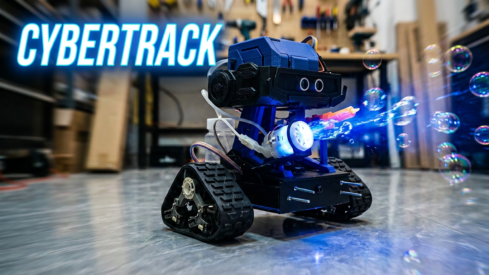
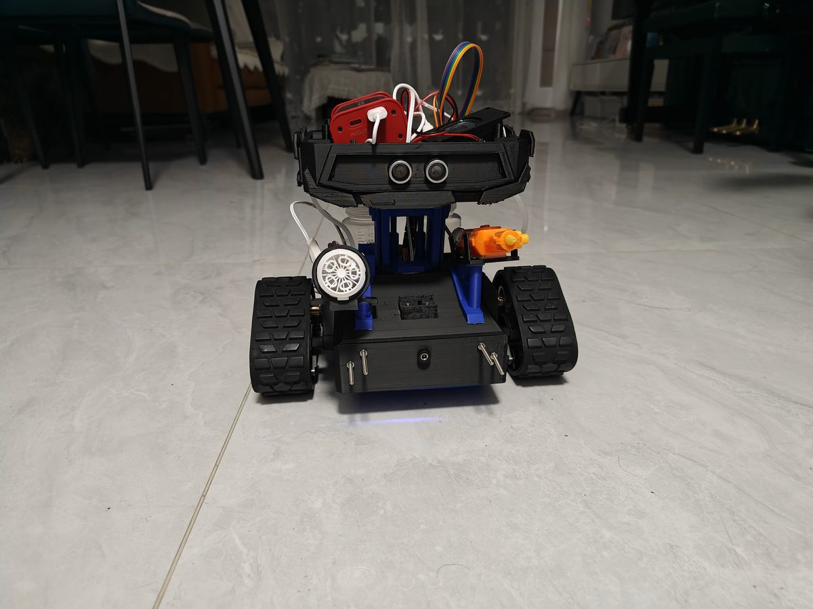
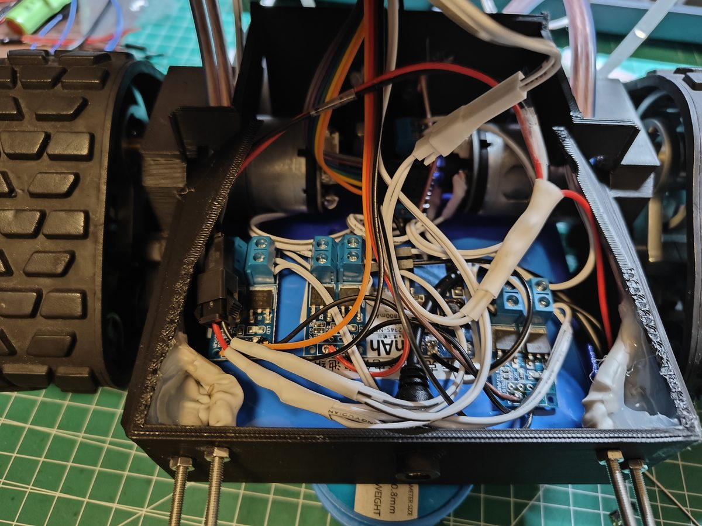
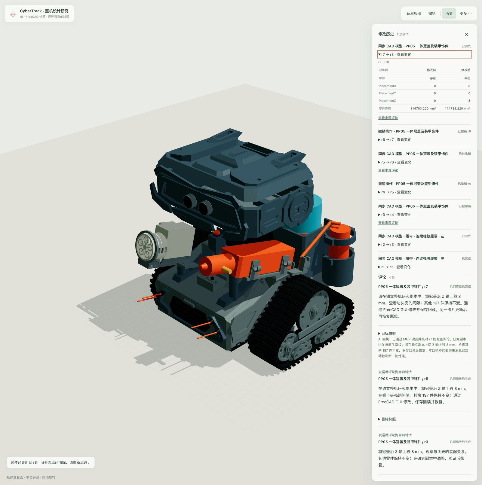
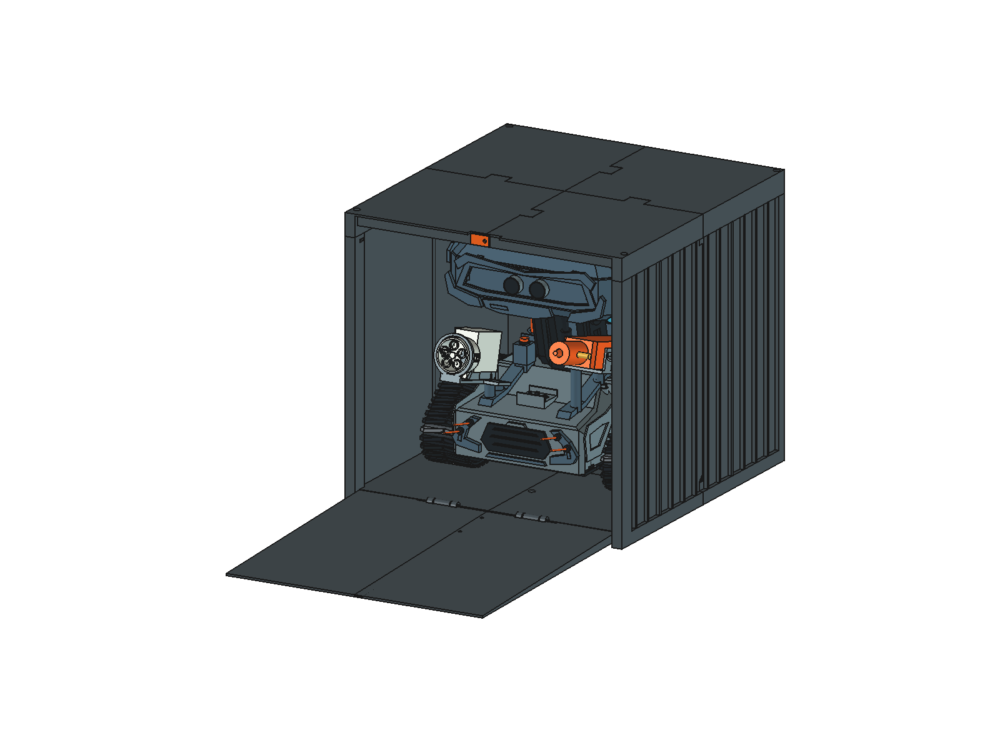
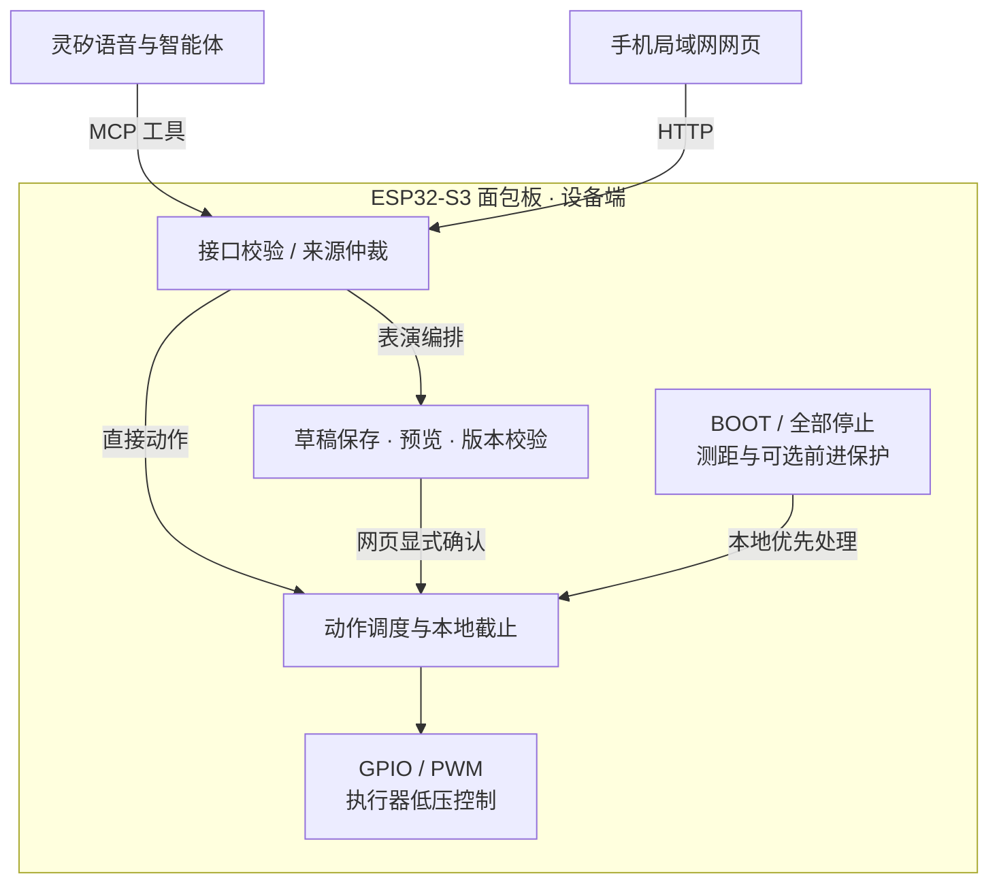
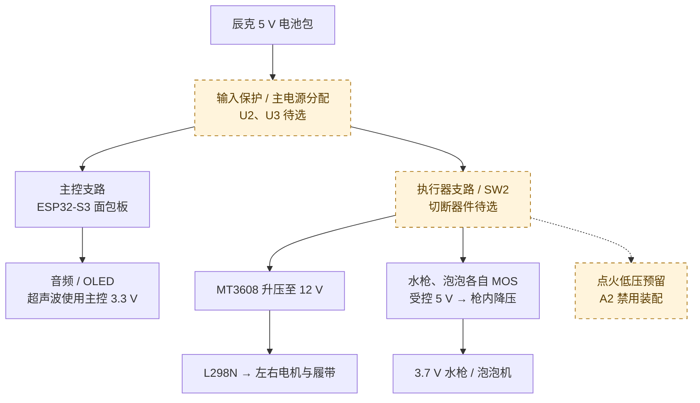

<h1 align="center">CyberTrack</h1>

<p align="center"><strong>一句话指挥小D转身，一步步编出自己的泡泡剧。</strong></p>
<p align="center">基于灵矽的开源双履带交互机器人 · 语音互动 · 泡泡剧场 · 3D 打印与模型改造</p>

<p align="center">
  <a href="LICENSE"></a>
  <a href="firmware/esp32-audio/README.md"></a>
  <a href="hardware/model/README.md"></a>
</p>

<p align="center">
  <a href="#样机演示">演示</a> ·
  <a href="#项目亮点">功能</a> ·
  <a href="#应用场景与商业价值">应用价值</a> ·
  <a href="#可打印的整机与维护设计">制作</a> ·
  <a href="#软件架构">架构</a> ·
  <a href="#从这里开始">快速开始</a> ·
  <a href="docs/TODO.md">TODO</a>
</p>

<p align="center">
  <a href="artifact/cybertrack-cover.png"></a>
  <br><sub><a href="artifact/README.md#项目封面">项目展示封面</a></sub>
</p>

**小D 是一台能听指令、能演泡泡剧场，也能自己动手改造的双履带机器人。** 你可以用一句话让它做几个动作，也可以先在手机上编排：选“庆祝”，把右转改短一点，预览后再决定什么时候开演。想改它的造型？同一套工程里就有可以打开的 FreeCAD 整机和可以补打的零件。

> **项目阶段：已有可运行样机，正在完善交互与整机验证。** 语音、网页控制和基础动作已有部署及分项现场记录；泡泡剧场、模型辅助设计和配套制作资料持续完善。

## 样机演示

**先看小D动起来。** 6 分钟实拍展示地面移动、转向和泡泡效果。

https://github.com/user-attachments/assets/127dc3f1-0a8f-4abf-b4e5-f43b6fe16fb7

[在 B 站观看](https://www.bilibili.com/video/BV1rLxM6sEF6/) · [下载原始视频](artifact/cybertrack-prototype-demo-6min.mp4) · [浏览 33 张制作照片与 2 段视频](artifact/README.md)

*视频记录拍摄时的样机表现；当前固件、供电配置与验证结果见[工程记录](docs/current-status.md)。*

### 从模型到样机

<table>
  <tr>
    <td width="50%" align="center"><a href="hardware/model/readme-views/front-iso.png"></a><br><sub>CAD · 2026-10-27</sub></td>
    <td width="50%" align="center"><a href="artifact/31-prototype-front-floor.jpg"></a><br><sub>实物 · 制作样机</sub></td>
  </tr>
</table>

## 项目亮点

- **指挥小D。** 一句话能让两路动作持续不同的时间；移动中还可以说“慢一点”。见[语音互动](#语音交互与角色表达)、[行走调速](#履带行走与实时调速)和[多路协同](#喷水泡泡与多路协同)。
- **自己编排和改造。** 在[泡泡剧场](#一起编排小d的泡泡剧场)改一段表演，在[整机模型](#在完整机器人上直接说出修改想法)上选中一个零件提出改动，或者制作配套的[收纳车库](#配套集装箱车库)。
- **在现场掌控动作。** [手机](#手机控制与多网络接入)上看距离、按住遥控、松开即发停止；[前进保护](#距离感知与前进保护)与[状态解释](#看得懂的状态与可中止的动作)让操作者知道设备为什么拒绝或停止。
- **从现有工程继续开发。** [打印与装配资料](#可打印的整机与维护设计)、设备固件、原理图和[灵矽接入方案](#为灵矽提供可复用的实体机器人方案)均可用于二次开发。已有测试和现场记录见[验证结果](#验证与可复现工程)。

## 语音交互与角色表达

**问它“你叫什么名字？”，也可以直接说“左转一秒”。** 面包板保留麦克风、扬声器、OLED 与原有唤醒路径；灵矽负责语音对话、角色表达和工具选择，设备负责校验与执行。普通交流与动作指令通过同一套设备会话连接起来，日常运行不需要电脑转发。

下面展示当前支持的指令形式与控制语义；实际自然语言效果仍以对应版本的语音回归为准。

| 你可以怎么表达 | 小D的控制语义 |
|---|---|
| “左转一秒” | 请求一次指定方向、指定时长的行走 |
| “左转一秒，同时喷水三秒” | 两路同时开始，转向先结束，喷水按自己的计时结束 |
| “先前进五秒，再左转三秒，转的时候喷水三秒” | 将先后与同时关系组织成一个动作序列 |
| 移动时说“慢一点”或“调到 80%” | 调整当前电机输出，不重新开始计时 |
| “前面还有多远？” | 查询有效测距，不因查询启动动作 |
| “编排表演，先别执行” | 进入草稿创作，保存后在网页预览，确认才开始 |

小D的角色配置还定义了否定、引用、含糊时长、未知状态和异常回复的处理约定。角色源与固件一起维护，方便在改变玩法时同步检查“怎么理解”和“实际怎么执行”。当前平台仍有冗余播报与部分解释偏差，工具选对不等于整段交互已通过。

**动作之后少打扰。** 对完整匹配的单项、组合、序列与目标速度指令，端侧结合成功回执抑制重复确认，让动作衔接更利落；状态、拒绝与澄清仍可回应。[播放匹配与验证](docs/validation/plan-feedback.md)

[角色与同步流程](docs/agent-role.md) · [角色源文件](firmware/esp32-audio/role-prompt.txt) · [真实平台联调](docs/validation/README.md)

## 履带行走与实时调速

**用速度和节奏表达动作。** 双履带支持前进、后退、原地左转与右转；语音可指定方向、时长和输出比例，手机可直接长按方向键。运行中说“快一点”“慢一点”，或者拖动滑块，都可以调整当前动作。

- **60–100% 输出范围，默认 100%。** “快一点／慢一点”每次增减 10 个百分点；“调到 80%”直接设定目标值。
- **调速保留原动作。** 同方向调速不重启行走、不延长截止，也不重启喷水或泡泡；空闲时的语音调速不会把车启动起来。
- **每一步都有自己的节奏。** 动作序列可以为不同步骤分别设置速度和时长；改变当前步骤的速度，不改写后续步骤。

未指定时长的普通动作默认 1 秒，全速左右转默认 0.88 秒；明确说出的时长优先。这里的百分比是电机 PWM 设置，当前没有编码器里程计，不把它换算成已校准的厘米、转角或实际车速。

[速度控制与现场记录](docs/action-sequences.md#速度与时长) · [动作序列规则](docs/action-sequences.md)

## 喷水泡泡与多路协同

**让移动带上效果，也让各路动作保持自己的节奏。** 水枪与泡泡机独立控制，既可以单独运行，也可以与履带动作组合。网页提供 1／3／5／10／30 秒按钮和长按操作；普通语音喷水、泡泡的单次上限均为 30 秒。

组合动作支持“同时开始、分别结束”。例如“左转一秒，同时喷水三秒”，设备先结束转向，喷水继续到自己的截止；需要多段动作时，一次提交最多 16 步，由本地控制器负责步骤间衔接。已有对应版本的直接语音并发、后续步骤并发、独立截止与运行中取消现场记录。

### 四路控制与组合模式

固件将行走、喷水、泡泡和点火低压接口作为四个独立计时通道。行走加喷水组合会在两路均就绪时整体接受；其他序列在执行前校验整份步骤，取消后不补做剩余动作。

另有“狂暴模式”的有界组合调度：左转、喷水和泡泡配合间歇点火低压控制，软件总时长最多 30 秒。**点火与包含它的组合模式不属于当前亲子体验范围。** 点火低压单次上限为 5 秒、关闭间隔至少等于本次软件开启时长；高压、绝缘、液体共存与 EMC 尚未验收，A2 原理图仍保持该预留支路禁用装配。

现场试验中，喷水曾比转向稍晚开始；软件同时输出不等于效果在同一瞬间出现，也不代表当前电源已通过四路组合负载验收。

[当前能力与参数](firmware/CAPABILITIES.md) · [并发现场证据](docs/action-sequences.md) · [低压效果控制](docs/effects-control.md)

## 手机控制与多网络接入

**打开浏览器，就能看到和控制小D。** 已部署对应固件的设备联网后，OLED 待机显示 `IPv4:8080`；手机加入同一可互通局域网，打开 `http://<设备 IP>:8080/`，无需安装手机 App。

<p align="center">
  <a href="docs/images/lan-control-ct41.jpg"></a>
</p>

*ct41 实机控制页截图，展示基础遥控布局；后续 ct45 增加泡泡剧场与上手／状态帮助。截图中的距离是拍摄时读数。*

- **直接操控：** 按住方向键行走、松开停止；喷水与泡泡可定时或长按，速度滑块与距离读数集中展示。
- **与语音协同：** 不同空闲通道可并用；同通道网页优先，避免两种入口争用同一个动作。
- **清晰的控制归属：** 同时只允许一个网页控制会话；长按通过短租期维持，页面失效后按来源停止，重连不恢复旧动作。

### 家中网络与手机热点

普通多 Wi-Fi 配置支持 **1–10 组网络**，按保存顺序尝试，失败后回退下一组。连接成功后保持当前网络；OLED 地址随换网更新，断网后清除旧地址。这样可以为家庭与展示场地预先准备连接方式，而不必让电脑一直充当代理。

有序网络导入需要按 Wi-Fi 构建流程启用，修改本地配置文件后还需重新构建、刷入；热点若开启客户端隔离，手机可能无法访问设备。云端语音需要互联网，网页控制依赖局域网可达，二者分别判断。当前网页会话机制不提供用户身份认证，应使用可信网络。

[网页操作与会话规则](docs/lan-control.md) · [Wi-Fi 配置与验证范围](docs/wifi-configuration.md)

## 距离感知与前进保护

**让“离前面多近”成为可以看见、听见的信息。** 头部超声波距离显示在网页上，也可通过语音查询。设备约每 100 ms 采样，超过 500 ms 的旧读数失效；无效读数不会继续冒充实时距离。

| 距离与开关条件 | 设备行为 |
|---|---|
| 有效距离 40 cm 至不足 50 cm | 慢节奏滴声，间隔约 800 ms |
| 有效距离不足 40 cm | 快节奏滴声，间隔约 400 ms |
| 至少 50 cm，或读数无效／过期 | 不产生普通距离滴声 |
| 开启前进保护，距离不足 15 cm | 阻止或停止前进；正在前进时播放停车提示 |
| 锁定后重新取得至少 20 cm 的有效距离 | 解除锁定，等待新指令，不自动续走 |

提示音与行走状态、保护开关独立。网页的“自动避障”开关实际提供的是**前进保护**，每次开机默认关闭；当前没有自动绕行、路径规划或自主导航。阈值属于软件规则，机械停止距离、装壳声学与实际听感仍需分项测量。

[测距、提示音与保护细节](docs/ultrasonic-ranging.md)

## 看得懂的状态与可中止的动作

**互动中发生了什么，应当能查到，也应当能停下来。** 网页“第一次使用 · 为什么没动”把当前状态与最近一次请求分开说明：是在运行、等待间隔、前进受阻，还是请求被拒绝。缺失、过期或未细分的数据会保留为未知，打开帮助本身不启动或重试动作。

对使用者来说，几个区别很重要：设备“接受了请求”不等于已经实际移动；“当前没有运行”不等于能推断电池没电；“障碍解除”也不意味着旧动作将继续。网页按确定规则显示说明，灵矽的自然语言解释另有独立评测，目前仍在修正。

- **随时中止：** 本机 BOOT、网页“全部停止”和语音停止可取消动作、序列与草稿。BOOT 属于软件停止，与硬件供能切断分开。
- **在设备上计时：** 定时动作到期由本地截止处理；网页长按需持续续租，语音不靠云端再次下发命令来结束普通定时动作。
- **恢复后重新决定：** Wi-Fi 断线全停；语音会话关闭、网页失效按来源取消。松开停止键、重新联网或再次打开页面，不补做旧动作。

这些是当前控制机制；电气输出归零与机器人实际停止分别验证，不能将租期或软件计时当作制动性能。

[状态解释](docs/status-explanation.md) · [停止与断连验证方法](docs/validation/stop-trials.md)

## 一起编排小D的泡泡剧场

**把“让它动一下”变成“我们一起设计怎么演”。** 孩子提出故事和节奏，家长一起修改步骤、核对场地并决定何时开始。预览会标明哪些动作一起开始、哪个先停。比如后退两秒时吹一秒泡泡，家长能看到泡泡先停，履带还要走一秒。可以从下面三个模板开始改。

| 模板 | 可以从哪里开始改 |
|---|---|
| **登场** | 前进 0.6 秒，再原地吹泡泡 1 秒；给自己的角色安排一个开场 |
| **庆祝** | 左转 0.6 秒并吹泡泡 1 秒，再右转 0.6 秒并吹泡泡 1 秒；改变两边的节奏 |
| **谢幕** | 原地吹泡泡 1 秒，再后退 0.6 秒；为一段互动安排收尾 |

模板使用 100% PWM，时长是编辑起点，不代表已经校准的位移或转角。台词提示供家长和孩子一起说，当前不会自动触发机器人台词播报或表情联动。

**提出想法 → 修改步骤 → 预览草稿 → 家长确认。**

1. 在手机网页选模板，或明确说“编排表演，先别执行”提出草稿。
2. 调整某一步的方向、速度、行走／泡泡时长，也可以追加或删除步骤；最多 16 步。
3. 保存后在手机上核对设备返回的草稿。孩子把结尾泡泡从一秒改成三秒时，家长可以先对照新版和手里的预览，再载入确认。[泡泡剧场操作说明](docs/show-composer.md)
4. 家长核对后在网页明确开始；改变版本、草稿到期或停止后，旧确认不再有效。

手边没有机器人，也可以打开离线泡泡剧场。孩子当导演，家长把结尾的泡泡改成两秒，一起看小D每一步会做什么，随时可以停下来重编。[打开屏幕排演的方法](docs/show-composer.md#不连接机器人的屏幕排演)

这个设计保留了创作中的试改空间：先把“将要做什么”看清楚，再决定执行。草稿在最后修改后 5 分钟失效；一次确认只消费对应版本一次，失败不排队补做。普通直接语音动作仍会直接请求执行，需要预览时应明确进入编排。

当前剧场只编排行走与泡泡。设备草稿编辑、过期与拒绝路径已有检查；自然语言改稿、有效确认后的实机表演与亲子重玩体验仍在验证。

[剧场操作、确认机制与证据](docs/show-composer.md)

## 应用场景与商业价值

**CyberTrack 的价值在于把角色体验、实体动作和可改造硬件组织成一套可复用的机器人方案。** 同一套工程可以承接不同内容与外观设计，为后续产品探索提供原型基础。

<table>
  <thead><tr><th width="96">场景</th><th>使用价值与产品方向</th></tr></thead>
  <tbody>
    <tr><td><strong>亲子互动</strong></td><td>把说想法、改步骤和看机器人回应组织成共同创作的活动。可探索陪同体验套件、主题表演内容与外观配件。</td></tr>
    <tr><td><strong>创客教育</strong></td><td>沿着一个完整项目理解语音工具、嵌入式控制、机械装配与 3D 打印。可探索制作工作坊、项目制课程与改造任务。</td></tr>
    <tr><td><strong>展览活动</strong></td><td>用有角色感的造型、移动和泡泡呈现可见的 AI 互动。可探索主题展示原型、互动脚本与外观定制。</td></tr>
    <tr><td><strong>生态集成</strong></td><td>为灵矽生态与硬件开发者提供角色、设备工具契约、参考硬件和验证材料。可探索参考设计、设备适配与方案集成服务。</td></tr>
  </tbody>
</table>

这些方向共享三类已有资产：**可演示的样机、可修改的软硬件工程、可追溯的接入与验证资料**。它们让后续团队能够从现有实现继续试验，也让内容、造型和硬件迭代有共同依据。

### 价值怎样继续增长

主题故事和表演可以丰富互动内容；打印外壳、附件与车库可以扩展角色外观和展示场景；设备契约、源码和验证材料则支持其他硬件变体的开发。例如，同一个“庆祝”模板，家庭可以改成生日开场，工作坊则可以让学员比较“同时左转并吹泡泡”和“转完再吹”的区别。两种活动都能从现有设备和动作出发，无需为每个主题再做一台机器人。

这些方向需要分别验证：先通过小规模陪同体验观察上手难度与主动重玩，再结合维护、可靠性和成本数据判断产品形态。用户需求、定价、量产成本与付费意愿尚未验证；完整路径见[灵矽解决方案](docs/lingxi-solution.md)。

## 可打印的整机与维护设计

**自己制作一台，也能理解它为什么这样组装。** 小D以切面头盔、颈架、双履带和前部双枪形成角色外形；内部同时考虑电池、驱动、音频、线束和拆装位置。外观设计与内部工程使用同一套整机模型迭代。

<table>
  <tr>
    <td width="50%" align="center"><a href="artifact/26-head-breadboard-installation.jpg"></a><br><sub>头舱面包板与音频安装</sub></td>
    <td width="50%" align="center"><a href="artifact/25-chassis-wiring-overview.jpg"></a><br><sub>底盘安装与内部布线</sub></td>
  </tr>
</table>

### 从原生模型到打印件

整机使用 FreeCAD 管理，**FCStd 是几何依据**。STEP 用于交换，STL 用于单件制作，3MF 保存排盘和工艺配置；这些不同格式分别检查，不能把交换成功等同于制造通过。

现行 Lean 项目为 **27 件、6 盘**，按动力、电控、枪座、头部与背包等安装需要组织；已有零件可按需补打。头部固定结构尽量合并，冠盖与面包板托盘保留独立拆装，减少细碎零件的同时保留维护入口。另有用户 Ready 排盘，盘序独立维护。

### 为使用后的维护留位置

可拆冠盖用于头舱访问，底部维护入口服务电池与驱动检查；两枪的降压模块集成在各自枪体，减少底盘占位。线束、管路、插拔和工具空间也在 CAD 中单独考虑，便于判断一次改造会影响哪些接口。

想知道拆开冠盖后先拔哪根线，可以从[装配说明](docs/assembly.md)查到拆装顺序；69 页装配图册保留了 0.56 版的视图和零件图卡，制作时应与现行 FCStd 核对。当前 Lean 第 3、6 盘需按修订重新切片；实际配合、紧固、承载及反复拆装仍需实物验证，完整打印耗时和成本尚无现行实测结论。

[原生模型与修订](hardware/model/README.md) · [Lean 打印项目](hardware/model/lean-print/README.md) · [单件文件](hardware/model/print-parts/README.md) · [装配维护图册](hardware/model/CyberTrack-assembly-and-service.pdf) · [BOM](hardware/BOM.md)

## 在完整机器人上，直接说出修改想法

从“玩什么”进一步走到“怎样改造它”。用 CyberTrack 的模型辅助设计工具，在整机中选中冠盖、枪座或外壳，描述调整意图，再检查原生 CAD 的变化。

<p align="center">
  <a href="docs/images/model-design/whole-model-host-adjusted.png"></a>
</p>

*真实设计卡片：在独立研究副本中将冠盖上移 8 mm，保留评论、AI 回执和修改历史。修改与恢复经 FreeCAD 保存、重开核对，正式模型保持不变。*

### 一次改动怎样被检查

1. **选中再描述：** 在整机上下文点选零件或面，评论绑定目标位置、原生对象与模型版本。
2. **修改后回读：** 在独立研究副本中执行原生 CAD 修改，保存并重新打开，比较修改前后的坐标与几何。
3. **对照并恢复：** 同一设计卡片显示新版本和回执，核对其他零件的位置没有改变，再执行原生恢复。

已完成的真实消息驱动案例覆盖 **198 个可见形状的整机**：评论触发冠盖位置修改和恢复，其余 197 个形状和正式模型保持不变。

这条流程把**设计讨论、原生修改与版本对照**连在一起。当前整机编辑支持受限静态零件的位置调整；任意外形重建、装配约束求解和制造验收仍需相应 CAD 工作。设计工具在电脑上运行，与机器人日常语音链路独立。

[安装与操作流程](tools/solidcue/README.md) · [工具源码](tools/model-design/README.md) · [真实消息驱动验证](tools/solidcue/verification-message-20261031.json)

## 配套集装箱车库

**给机器人一个可以收纳、也可以参与展示的空间。** 独立车库采用集装箱造型，同一块前门向下翻成坡道；设计使用方式为倒车入库、正向驶出，收纳时断电。

<p align="center">
  <a href="hardware/model/container-garage/printed/open.png"></a>
</p>

制作候选外形为 **298 × 280 × 270 mm**，拆成 **11 件、10 盘**，按 256 × 256 × 256 mm 成型空间设计。顶盖可拆，门闩手动转动；提供原生模型、STL、切片工程及门板／进出空间检查记录，可作为配套外观与收纳设计的起点。

这是独立的试制研究，图中机器人及验证基于 2026-10-27 快照，尚未按后续背包修订重新验证。承载、装配与实际爬坡未验收；没有自动泊车、自动门或箱内充电功能。

[车库设计与制作候选](hardware/model/container-garage/printed/README.md)

## 软件架构

**云端理解意图，设备管理动作。** 日常语音由面包板直接连接灵矽，音频、角色对话与 MCP 工具调用沿同一设备会话运行；手机网页由设备本地提供。两种控制入口汇入同一套设备端会话、编排和执行逻辑，无需电脑代理。



*图示为动作请求路径；音频传输、只读状态查询和回执返回为并行链路。草稿编辑不产生输出，普通直接动作不经过草稿确认。*

<table>
  <thead><tr><th width="112">模块</th><th>负责什么</th></tr></thead>
  <tbody>
    <tr><td><strong>语音与网页</strong></td><td>灵矽选择受限业务工具；网页发送操控与编排请求。两者查询设备状态，不暴露通用 GPIO 云端控制。</td></tr>
    <tr><td><strong>会话与编排</strong></td><td>校验参数、请求时效和来源；处理网页租期与同通道优先级；管理草稿版本、确认、取消及最多 16 步序列。</td></tr>
    <tr><td><strong>本地执行</strong></td><td>步骤内并发、步骤间串行，行走／喷水／泡泡／点火低压四路独立计时；停止、故障及连接变化按各自规则处理，不自动恢复旧动作。</td></tr>
    <tr><td><strong>状态与反馈</strong></td><td>返回逻辑输出、剩余时间、动作回执及有效测距，供网页和语音解释；当前没有轮速、水流或电流反馈。</td></tr>
  </tbody>
</table>

本地截止不依赖云端再次发送停止。BOOT／全部停止与 Wi-Fi 断线全停；语音断线、网页失租按来源处理。前进保护每次开机默认关闭，开启后才根据距离阻止或停止前进，解锁后仍需新指令。

当前整机实现位于 [esp32-audio](firmware/esp32-audio/README.md)，通过 overlay 接入固定小智源码与 ESP-IDF v5.5.1。仓库另有用于主机验证的通用 C11 控制核心；它的本地使能和持久化契约不等于面包板已部署能力。CAD 辅助设计在电脑端独立运行，也不参与机器人实时控制。

[系统架构详解](docs/architecture.md) · [能力与接口](firmware/CAPABILITIES.md) · [编排契约](docs/show-composer.md) · [当前部署与验证](docs/current-status.md)

## 硬件架构

**主控、动力与效果分支各司其职，结构围绕装配和维护组织。** 头舱容纳面包板、音频、OLED 与超声波；底盘承载电池、电机驱动和双履带；水枪与泡泡枪各有独立控制支路，降压模块集成在各自枪体内。

下图概括 **A2 模块级供电设计**。标注“待选”或“禁用”的部分尚未落实为已验收硬件，整图不表示样机当前已按图接线。



*连线表示供电功能关系，省略了支路保护、控制信号和回流端点；具体连接以原理图和接线表为准。*

- **主控与执行器分域：** SW2 的设计目标是切断执行器供能、保留主控运行。它与 BOOT 软件停止不同，器件额定、残余储能及实际切断仍需验证。
- **功率路径与信号分开：** ESP32-S3 通过 GPIO／PWM 控制 L298N 和 MOS，负载由对应功率支路供电。水枪与泡泡的 MOS 位于降压前，各路受控负极不能额外并回系统地。
- **模块可拆、接口可查：** 可拆冠盖、面包板托盘、底部维护入口与独立枪体便于分模块检修；原生 CAD、BOM 和六页 KiCad 原理图共同记录结构及接口。

电池带载能力、完整电流预算、保护定值和温升仍待实测。四路软件并发不代表组合负载已验收；点火低压固件能力也不改变 A2 的禁用装配边界。

[硬件架构与电源预算](hardware/architecture/README.md) · [KiCad 原理图](hardware/schematic/README.md) · [接线总表](docs/wiring.md) · [BOM](hardware/BOM.md) · [机械模型](hardware/model/README.md)

## 为灵矽提供可复用的实体机器人方案

**让平台能力变成一套可观察、可维护、可继续开发的设备体验。** CyberTrack 将灵矽的语音与智能体能力连接到小D的实体动作，并把角色、接口、参考硬件与验证方法放在同一工程内维护。

设备侧提供 12 个 `self.tank.*` 业务工具，覆盖状态与停止、四方向行走、绝对／相对调速、喷水、泡泡、点火低压、组合动作、序列、狂暴模式及草稿编排。角色负责表达与工具选择，本地固件执行参数限制和状态检查；复制角色文本不会绕过或自动增加设备能力。

### 开发者可以复用什么

- **场景与角色：** 亲子上手流程、小D的角色源、直接动作与编排语义、异常对话样例。
- **设备接入：** 固定上游源码与 overlay、MCP 工具契约、局域网接口、来源仲裁与回执设计。
- **参考硬件：** 电源分域、模块级原理图、BOM、结构模型与维护设计依据。
- **验证方法：** 从实际固件导出工具描述，将灵矽的工具选择接到同版 MCP 分发、工具回调和控制守卫，在电脑上复现参数拒绝、计时与停止，追溯每次请求和终态。[完整主机验证](docs/validation/firmware-host.md)

项目也据联调问题整理了角色版本绑定、工具试运行、设备能力声明及分层日志等平台建议。这些建议来自具体开发过程，当前不代表灵矽已有功能、官方认证或商业合作。

### 可导出的参考材料包

**用一台没有连接机器人的电脑，也能审查小D怎样执行一句话。** 参考包带有真实灵矽会话的工具调用、评分器、用例和角色。接手者可以离线重算成绩，定位哪句话漏查了状态、哪个参数与预期有差异。包内清单分别给出源码候选和最近部署版本的应用文件哈希。

```sh
python3 scripts/package_lingxi_solution.py
```

将 `output/lingxi-solution/` 中生成的 ZIP 解压，在解压目录运行 `python3 scripts/review_lingxi_reference.py`。程序核对文件后，会列出每组的匹配数、未匹配用例编号及是否达到门槛。原始固件和模型的开发入口见完整仓库。

[完整解决方案](docs/lingxi-solution.md) · [参考包内容与使用](tools/lingxi-solution/README.md) · [设备能力契约](firmware/CAPABILITIES.md)

## 验证与可复现工程

**如果把“左转”说成“向左转一下”，怎样知道改对了？** 平台评测先检查灵矽选了哪个工具、用了什么参数；本地测试再检查固件是否接受请求、何时停止输出。最后还要上车测量，因为前两步都看不到履带实际走了多远。

- **语音语义**：80 条固定工具用例、8 条编排用例、20 条真人语音用例及评分器；真实平台调用可由同版固件主机生成控制回执，参数、截止和最终逻辑状态逐条留存。
- **固件与网页**：主机控制测试、实际 MCP／HTTP 适配检查、浏览器竞态与多尺寸界面检查；编译、部署和设备回读分别记录。
- **机械与模型**：原生 CAD 保存重开、几何与非目标对象核对、打印文件及指定空间检查；实际装配与承载另验。
- **停止与供电**：17 类停止场景的采集／分析工具，以及分支电流预算、续航与成本记录模板；未知输入保留为未知。
- **工程追踪**：当前版本元数据、统一检查报告、角色哈希、真实修改与返工记录工具，方便定位版本差异。

用相同的 5991 字符角色和 ct45 工具，灵矽在 **78/80 条固定文本（97.5%）**上选对了工具、参数和调用顺序，八条明确停止原话都直接请求全停。编排组匹配 **7/8**。例如“把草稿第二步泡泡改成两秒”这条，改动参数正确，却漏了修改前的版本查询；评分器会指出这一步。测试通过隔离环境返回设备回执。真人拾音和带载停车分别验收。

已准备依赖的开发环境可从统一入口运行检查：

```sh
python3 scripts/verify_improvements.py
```

该命令记录源码哈希、退出码与未覆盖范围，不刷机、不操纵执行器。额外传入准备好的固件源码目录或模型设计选项，可以增加实际适配与工具检查；完整构建和现场验收仍分别执行。

这套资料也为成本、维护和开发效率的后续分析提供基础。目前没有完整家庭体验样本、现行续航结论或可比的效率提升比例，相关工具不会用缺值补造结果。

[当前检查入口](docs/current-status.md#统一软件检查) · [平台复测与失败样例](docs/validation/lingxi-role-5991.md) · [实机验证材料](docs/validation/README.md) · [工程修改记录](docs/validation/engineering-log.md)

## 从这里开始

### 体验已有样机

先读[首次互动上手卡](docs/quick-start.md)。已部署对应固件的设备联网后，让手机加入同一可互通局域网，打开 OLED 显示的 `http://<设备 IP>:8080/`，即可进入遥控与泡泡剧场，无需安装手机 App。

先找到页面底部“全部停止”和本机 BOOT。网页按住方向键行走、松开停止；语音与网页的详细规则见[操作指南](docs/lan-control.md)。距离提示音与前进保护独立，保护每次开机默认关闭，开启后是近距离停止前进，不会自动绕行。当前网页无用户身份认证，应在可信局域网内使用。

### 获取工程并选择一条制作路径

完整工程需要 Git；不同开发路径的工具要求分别列出。可先获取仓库：

```sh
git clone https://github.com/miclle/cybertrack.git
cd cybertrack
```

只浏览外形和说明可直接阅读仓库；制作机器人需要 3D 打印、电子装配和调试条件。购买与接线前先核对物料版本及待确认项。

1. **了解物料与结构。** 从 [BOM](hardware/BOM.md)、[接线总表](docs/wiring.md)和[装配说明](docs/assembly.md)开始，结合实物确认器件与接口。
2. **打开原生模型。** 使用 FreeCAD 查看 [CyberTrack.FCStd](hardware/model/CyberTrack.FCStd)；FCStd 是几何依据，当前修订与交换文件检查见[模型说明](hardware/model/README.md)。
3. **按需选择打印件。** [Lean 项目](hardware/model/lean-print/README.md)提供 27 件／6 盘及 [3MF 文件](hardware/model/lean-print/CyberTrack-Lean-6plates.3mf)。当前第 3、6 盘需重新切片；[Ready 排盘](hardware/model/print-ready/README.md)是独立方案，不混用盘号。头部与单件补打见[头部打印说明](docs/head-shell-print.md)和[单件目录](hardware/model/print-parts/README.md)。

当前仍处于样机联调阶段。打印配合、整机供电、持续负载、停止性能及儿童使用验收尚未完成；点火仅有低压控制实现，高压、绝缘、液体共存及 EMC 尚未验收。首次亲子流程不含点火或狂暴模式，具体边界见[效果控制](docs/effects-control.md)。

### 先在电脑上开发与验证

无需连接设备，即可在电脑上构建通用控制核心。准备 C11 编译器、CMake ≥ 3.16 和 Python ≥ 3.9，在仓库根目录执行：

```sh
cmake -S firmware -B build/firmware-host -DCMAKE_BUILD_TYPE=Debug
cmake --build build/firmware-host
ctest --test-dir build/firmware-host --output-on-failure
```

这组命令检查通用控制核心、协议与运行层。现用面包板的语音、网页和执行器功能从 [firmware/esp32-audio/](firmware/esp32-audio/README.md) 开始，使用固定小智源码、overlay 与 ESP-IDF v5.5.1，依赖准备和构建按该目录说明执行。网络配置见 [Wi-Fi 指南](docs/wifi-configuration.md)，本地凭据不进入 Git。

模型辅助设计另需 Node.js ≥ 24、npm、uv、Python 3.12、FreeCAD 与已连接的 FreeCAD MCP；准备依赖后使用本地服务和设计卡片。它不是机器人日常运行的前置条件。安装和插件配置按[工具指南](tools/solidcue/README.md)执行，检查入口见[统一软件检查](docs/current-status.md#统一软件检查)。

## 文档导航

[按任务浏览项目文档](docs/README.md)

| 想了解什么 | 从这里进入 |
|---|---|
| **体验与玩法** | [首次互动](docs/quick-start.md) · [手机控制](docs/lan-control.md) · [泡泡剧场](docs/show-composer.md) · [测距保护](docs/ultrasonic-ranging.md) |
| **产品与方案** | [需求](docs/requirements.md) · [设计决策](docs/decisions.md) · [灵矽解决方案](docs/lingxi-solution.md) |
| **模型与制造** | [整机 CAD](hardware/model/README.md) · [打印项目](hardware/model/lean-print/README.md) · [装配维护图册](hardware/model/CyberTrack-assembly-and-service.pdf) |
| **改造与配套** | [模型辅助设计](tools/solidcue/README.md) · [集装箱车库](hardware/model/container-garage/printed/README.md) |
| **电气与采购** | [硬件架构与电源](hardware/architecture/README.md) · [接线表](docs/wiring.md) · [KiCad 原理图](hardware/schematic/README.md) · [BOM](hardware/BOM.md) |
| **控制与开发** | [系统架构](docs/architecture.md) · [固件总览](firmware/README.md) · [能力与接口](firmware/CAPABILITIES.md) · [智能体角色](docs/agent-role.md) |
| **进度与证据** | [当前状态](docs/current-status.md) · [改进计划](docs/improvement-plan.md) · [验收计划](docs/verification-plan.md) |
| **制作与来源** | [照片和视频](artifact/README.md) · [部件资料](hardware/components/) · [参考资料](docs/references.md) |

<details>
<summary><strong>展开仓库结构</strong></summary>

```text
artifact/              制作照片、样机视频与素材索引
docs/                  产品、设计、操作与验证记录
hardware/components/   独立部件模型与厂商资料
hardware/model/        整机 CAD、打印项目与装配图纸
hardware/schematic/    KiCad 原理图与审图资料
firmware/              控制核心、板级工程与测试
  esp32-audio/         现用面包板的语音、网页与执行器适配
tools/model-design/    模型辅助设计工具源码
tools/lingxi-solution/  灵矽参考材料打包工具
scripts/               建模、检查与工程辅助脚本
```

</details>

## 参与项目

欢迎通过 [Issue](https://github.com/miclle/cybertrack/issues) 分享复现问题、玩法与改造想法，也欢迎提交改进。

有价值的反馈包括：清楚的复现步骤、固件或模型版本、打印与装配记录，以及遇到的交互问题。请区分软件回执、CAD 检查与实物现象，避免上传网络凭据或私人录音。

## 许可证

项目采用 [Apache License 2.0](LICENSE)。随仓库分发的第三方代码按各自许可证与声明使用；模型设计工具保留 [SolidCue 来源与修改说明](tools/model-design/NOTICE)及[许可证](tools/model-design/LICENSE)。供应商图片、原理图和数据手册的权利归原权利人，归档不改变其授权条件。
