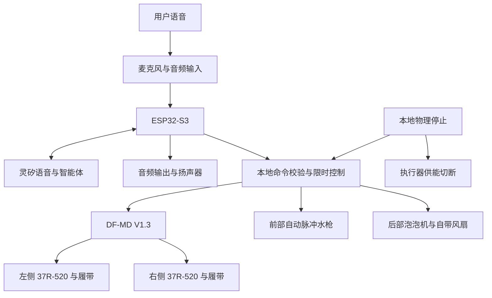

# 系统架构

状态：方案级，尚未实现。部件选择与信号数量见 [BOM](../hardware/BOM.md) 和[硬件接口](power-and-interfaces.md)。

## 系统组成

图中为功能关系，不是电气接线图。顶部双火花效果尚未进入执行器架构；不设置可调用的高压工具或 GPIO。执行器电源切断应独立于云端与 MCU 正常运行，具体器件待负载确定。

## 模块职责

| 模块 | 职责 | 不承担的职责 |
|---|---|---|
| 语音与平台适配 | 配网、绑定、音频、消息封装、状态提示 | 不决定 GPIO 电平或绕过本地限制 |
| 命令入口 | 验证工具、类型、范围、会话、重复与时效 | 不根据转写文本直接启动电机 |
| 本地动作控制 | 输出互斥／限时、停止优先、拒绝不具备条件的动作 | 不依赖网络定时关断 |
| 行走驱动 | 左右方向与 PWM、编码器计数；后续按实测闭环 | 不承诺未校准的厘米或角度精度 |
| 效果控制 | 经已核实的功率开关控制水枪和泡泡机供能 | 不重新生成模块已有脉冲机构的节拍 |
| 电源与状态 | 复位、欠压／故障处理；可用传感器按硬件确认 | 不凭 USB 电压推算准确剩余电量 |

## 状态与优先级

- `BOOT`：所有动作禁止，硬件默认关闭；自检完成进入 `DISARMED`。
- `DISARMED`：可联网与交流，拒绝执行器动作；本地明确使能后进入 `READY`。
- `READY`：接收合法短时命令；执行时进入 `ACTIVE`，到时回到 `READY`。
- `FAULT`：停止、欠压、控制异常或活动中的会话丢失均撤销输出并锁定。恢复条件满足后仍需本地重新使能。

优先级为：物理断电／停止 > 故障与时限 > 正常动作。掉电、重连和 OTA 结束不重放动作队列。TTS 播报“已停止”不等于已经停止，必须先撤销输出。

网络停顿有两层限制：已知断开立即取消，尚未检测到断开时由本地动作时限兜底。应用存活检测的具体阈值待接入联调，不允许无期限持续行驶。

## 并发策略

首轮台架逐个测试行走、水枪、泡泡。组合动作属于后续验收项：只有完成供电、EMC、滴液和停止验证后才启用；不能根据单模块成功推导整机同时运行成功。音频与 Wi-Fi 在每轮负载测试中保持运行，记录语音丢帧及 MCU 复位。

## 固件边界

拟采用 ESP-IDF；主控已指定 ESP32-S3 N16R8，具体开发板与引脚仍待核实。SDK 稳定版本、Flash／PSRAM 实物配置、麦克风、功放及音频编码依赖在板卡资料补齐后锁定。当前不建立伪可编译工程或随意 GPIO 表。后续优先实现本地停止与空载安全状态，再接平台动作工具。
