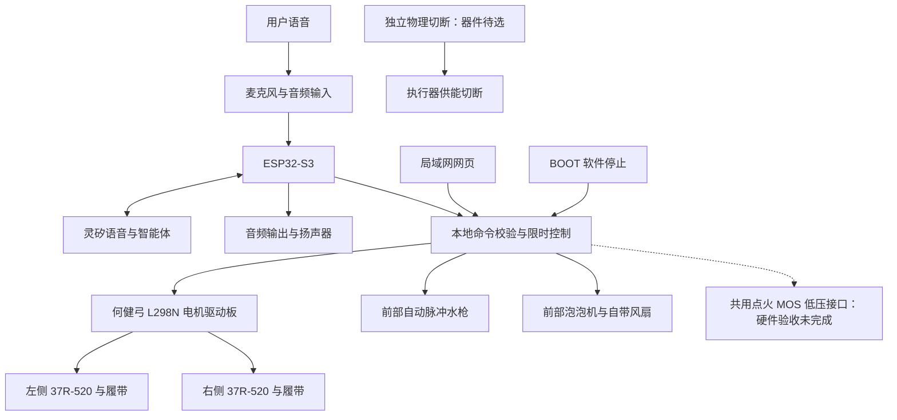

# 系统架构

核对日期：2026-10-27。当前已完成基本打印、装配并进入样机联调，现有面包板已部署 `2.0.3-ct21`。音频／屏幕、喷水、双电机和并发台架已有分项，装车四方向获用户确认，另有[运行影像](../artifact/README.md)；定量负载、停止、供电与整机验收仍未完成。当前设备实现与通用 C11 控制核心分别维护，不能将通用核心的本地使能／持久化契约当成已部署面包板行为；见[固件总览](../firmware/README.md)与[能力边界](../firmware/CAPABILITIES.md)。

## 系统组成

图中为功能关系，不是电气接线或已通过的物理切断系统。GPIO21 低压固件已部署；前方双火花的高压接线、安全、液体共存和 EMC 未验收，A1 保持该功率预留禁用。SW2 已确认只切执行器供能、主控继续运行；器件、残余储能和恢复行为待验。BOOT 仅软件停止，与 SW2 分开。

日常设备路径为麦克风→面包板→灵矽→同一设备会话中的 MCP 工具，保留原音频、OLED 和绑定，不依赖 Mac／USB 转发或用户专用云服务。当前八工具包含状态、停止、行走、水枪、泡泡、点火低压、行走加喷水及狂暴模式；GPIO 与限制见[固件能力](../firmware/CAPABILITIES.md#当前面包板-ct21-接口)和[接线表](wiring.md)。本地 HTTP 8080 网页由面包板提供，支持与语音并用；历史灵矽网页跨设备工具路由未闭环，与此局域网入口不同，见[网页控制](lan-control.md)与[独立联网历史](linx-validation.md)。

## 模块职责

| 模块 | 职责 | 不承担的职责 |
|---|---|---|
| 语音与平台适配 | 配网、绑定、音频、消息封装、状态提示 | 不决定 GPIO 电平或绕过本地限制 |
| 命令入口 | 验证工具、类型、范围、会话、重复与时效 | 不根据转写文本直接启动电机 |
| 本地动作控制 | 四路独立计时、同路忙碌／冷却拒绝、停止优先及模式管理 | 不依赖网络定时关断 |
| 行走驱动 | 左右方向与固定约 80% PWM；编码器尚未接入，闭环待实现 | 不承诺未校准的厘米或角度精度 |
| 效果控制 | 水枪／泡泡／共用点火 MOS 的低压控制；器件完整适配另验 | 不重新生成模块已有脉冲机构的节拍 |
| 电源与状态 | 记录软件状态与故障；物理保护、欠压检测和传感器另行选型／验证 | 不凭 USB 电压推算准确剩余电量 |

## 状态与优先级

**当前面包板：** 不要求逐次本地使能或 ct3 permit，接受新明确指令仍须通过固件参数、通道、冷却、来源与故障检查。状态中的逻辑输出和剩余时间不等于传感反馈。BOOT／统一停止、Wi-Fi 故障和输出故障关闭全部动作；语音会话关闭仅停止语音来源，网页停止／释放按来源处理。停止、重连或松开不恢复旧动作，当前语义见[接口说明](../firmware/CAPABILITIES.md)。

**以下为通用 C11 核心／F2a 运行层契约，不是当前面包板的使能流程：**

- `BOOT`：所有逻辑动作禁止；实物默认关闭需板级验证，自检完成进入 `DISARMED`。
- `DISARMED`：可联网与交流，拒绝执行器动作；本地明确使能后进入 `READY`。
- `READY`：接收合法短时命令；执行时进入 `ACTIVE`，到时回到 `READY`。
- `FAULT`：停止、欠压、控制异常或活动中的会话丢失均撤销输出并锁定。恢复条件满足后仍需本地重新使能。

优先级为：物理断电／停止 > 故障与时限 > 正常动作。掉电、重连和 OTA 结束不重放动作队列。TTS 播报“已停止”不等于已经停止，必须先撤销输出。

F2a [运行层](../firmware/RUNTIME.md)已实现启动先关断、周期输入采样、输出调用及失败锁定、条件喂狗。运行层故障关闭协议会话并抑制本轮响应；普通停止解除后仍需新的本地使能按键边沿。通用输入去抖、已观察短脉冲锁存及有界接收队列已通过主机测试；真实电平映射、中断捕获、跨任务交接、调度及硬件看门狗尚待 F2b。

已完成[接收边界与连接流程模拟](../firmware/TRANSPORT.md)：两层分片、首次接收元数据保持、阶段超时、旧连接事件隔离和发送失败关闭。网络事件只登记断线，周期控制服务优先应用；传输工作线程持有按连接代次绑定的响应副本，不阻塞本地控制。该通用运行层的真实板级交接仍待集成；独立状态／停止工程已接入 ESP-IDF、TLS／hello 和有界接收队列，正式核心动作能力固定关闭；0.2.0 的水枪台架通道单独维护本机一次性授权，见[实测记录](linx-validation.md)。

当前面包板定时动作依本地截止关闭；网页行走／喷水／泡泡长按使用 600 ms 短租期续租，允许在有效续租期间超过普通定时上限，语音不能续租。语音断线按来源停止，Wi-Fi 断线全停；实际检测与停止时延仍待测。通用运行层的传输交接和应用存活阈值按自身计划继续验证，不把模拟结果记为面包板现场通过。

## 并发策略

当前四路软件允许并行、各自计时；行走加喷水组合原子接受或拒绝，狂暴模式另有统一启动／停止规则。ct7 已完成行走／喷水的短时并发、独立截止、BOOT 与语音停止台架，见[并发记录](concurrent-actions.md)。四路组合供电、EMC、液体共存、重复／持续负载和完整停止仍待验；允许软件并发不等于硬件验收。音频丢帧、断音、重启和资源峰值仍须在实际负载中记录。

## 固件边界

当前面包板使用固定上游小智源码与 ESP-IDF v5.5.1，原音频／显示配置已核对，项目 GPIO 已分配并部署，见[面包板工程](../firmware/esp32-audio/README.md)。当前电源为辰克 5 V 电池及 12 V 升压电机支路，旧电源台架结果不沿用。实物逐线、供电／热、故障和最新角色语音回归仍开放。

独立 `esp32`、`esp32-motor-bench`、`esp32-mos-bench`、`esp32-linx` 各保留其源码版本与历史板卡用途；GPIO4 单次喷水和 0x10000 应用偏移不适用于现用面包板。通用 C11 核心的认证／持久化边界另行保留：F1 已加入 16 槽 FIFO 原响应、跨连接保留的启动期防重放过滤器和本地使能代次检查；淘汰／重连不恢复旧动作，过滤器碰撞保守拒绝。跨复位记录恢复已通过双槽存储与假板卡模拟，真实 Flash／NVS 尚未接入；设备限时窗口和独立稳定意图 ID 已通过离线模拟；真实传输必须提供经过认证并绑定动作内容的命令新鲜度证据，不能只凭刚收到消息开放动作。按[固件独立计划](../firmware/PLAN.md)继续验证板级停止与默认关闭，最后开放已通过台架的动作能力。

**历史时长调整（2026-10-24）：**面包板 ct5 改为按用户指定时长执行，单次最多 30 秒，保留 BOOT／语音停止及断线关断；明确要求喷水但未指定时长时默认一次 1 秒，不循环补足超限请求。此调整仅适用于面包板，原固定五秒台架结果保留为历史证据；ct5 语音验证及 30 秒带载边界见[喷水记录](audio-water-validation.md)。
