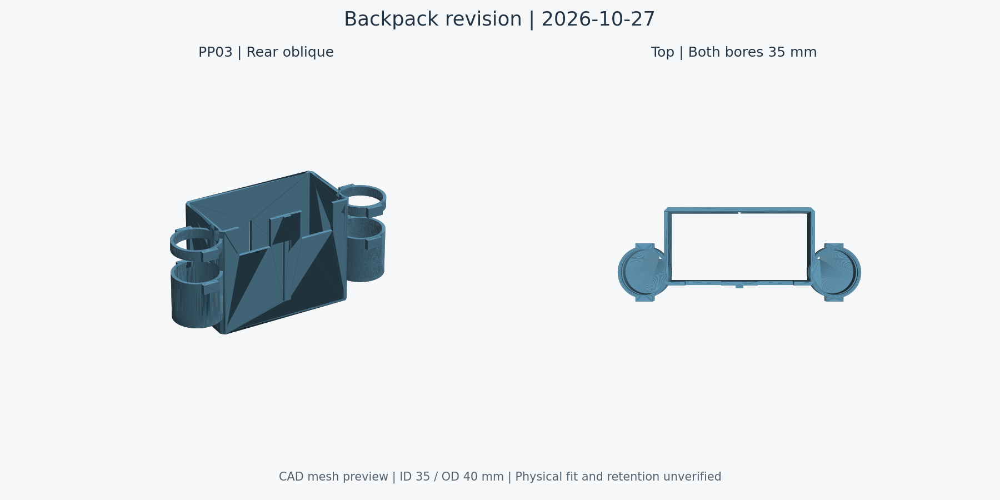

# 背包 Ø35 桶座与打印清单调整

2026-10-27，按用户最新要求同步 CAD 和打印件：移除全部“泡泡液瓶 ·”零件，两侧点火线圈筒内径改为 **35 mm**。

## 当前几何

- 主模型和设计源移除泡泡液瓶组 12 件：瓶体、底托、底垫、2 个环形侧垫、绑带、搭接片、识别条、2 颗底托螺钉及 2 个嵌件；同时撤销源档的 4 个专用检查空间。清水瓶、泡泡枪及其供液路线保持，新的泡泡液容器与供液连接尚未指定。
- 两侧桶座和上导环内径 35 mm、外径 40 mm，名义壁厚 2.5 mm；轴线仍在 X±74、Y85 mm，底面 Z51.5、内底面 Z53 mm。下部前内侧扩大原避让缺口以避开底盘，该处局部开口；其余底盘几何不变。
- 移除 8 片失去筒壁支承的旧 0.5 mm 软衬占位。模块 Ø25.5×70 mm 仍是历史规划包络，不能据 Ø35 孔推定模块新尺寸；原轴线下径向空隙为 4.75 mm，底垫保留，防脱及填充方案尚未验证。
- PP03 仍为一个有效实体。主模型、设计源、整机 STEP、PP03 STL/STEP/BRep 和六盘项目内的 PP03 网格已同步；历史整机生成脚本不是当前增量入口。

## 打印文件

| 文件 | 当前件数 | 本轮变更 | 需要重切的盘 |
|---|---:|---|---|
| [Lean 六盘](../hardware/model/lean-print/CyberTrack-Lean-6plates.3mf) | 27 | 移除泡泡液瓶底托和识别条；更新 PP03 | 第 3、6 盘 |
| [用户 Ready 项目（现为七盘）](../hardware/model/print-ready/CyberTrack-Ready-6plates.3mf) | 28 | 以 2026-10-28 最新界面排盘为输入，移除识别条并更新 PP03；背包从第 6 盘移到独立第 7 盘 | 第 6、7 盘；输入文件所有盘均无 G-code |
| [背包 STL](../hardware/model/print-parts/PP03-Backpack.stl)／[STEP](../hardware/model/print-parts/PP03-Backpack.step) | 1 | 同一原生 PP03 导出，底面归零 | 导入后重新切片 |

2026-10-28 按用户要求，Ready 新增第 7 盘“背包 Ø35 · 独立盘”，仅放 PP03，保留原文件名。其他零件的位置、模型和工艺沿用最新界面快照，不能套用 Lean 盘号。它仍包含旧控制板压框，故仅作为用户现场项目；本轮只核对背包与泡泡液瓶的差异。两份文件本轮受影响盘的旧 G-code 和缩略图已失效清除，未重新切片、未发送打印。旧时间与耗材不再代表修改后的盘。

已删除 `completion-print/BubblePod.*`、`BubbleLidMark.*` 六份旧独立打印导出；历史归档保持历史状态，不作为当前打印入口。

2026-10-28，第 7 盘改为底面贴床的直立朝向，尺寸 188 × 72.5 × 90 mm，圆筒轴线沿打印 Z 向。保留原自动支撑、3 mm brim 和其他工艺；相同设置的第 7 盘 CLI 试切片均成功且 warning 为空：横放约 229.3 g／4 小时 20 分，直立约 157.0 g／2 小时 39 分，总耗材减少约 31.5%。直立仍有局部支撑；这不是无支撑或实物稳定性验收。已在 Bambu Studio 显示直立版本，项目未嵌入试切片 G-code，打印前仍需界面切片。详见[朝向与切片对比](../hardware/model/backpack-upright-audit.json)，仅朝向与对应装配变换改变，其他零件、网格与工艺保持。

## 验证与复现

[原生几何回读](../hardware/model/backpack-35mm-audit.json)验证两侧解析圆柱面半径 17.5 mm、孔内净空、保留底托、单实体、无保留零件实体干涉和无关零件几何保持。STL 闭合、单连通、无非流形；STEP 与原生几何双向差小于 0.01 mm³。[打印更新报告](../hardware/model/backpack-print-update.json)记录两份输入哈希、删除清单、保留条目和重切盘。

从报告记录的修改前模型运行 FreeCAD Python `scripts/update_backpack.py`，再运行 `python3 scripts/update_backpack_prints.py`。只读检查：`python3 scripts/check_backpack_release.py` 或 `python3 scripts/check_print_release.py`。检查结果明确区分文件一致性和切片／实物验收；没有新增保持力、强度、公差、电气或液体共存验收。

## 2026-10-28 显示配置修复

无界面保存曾遗漏 `GuiDocument.xml`，导致打开后不显示零件。现从修改前主模型恢复保留零件的可见性、颜色和相机，并为设计源保留整机显示、隐藏额外融合输入和检查空间；全部原生几何与对象属性字节未改。增量脚本新增 GUI 状态保留，交付检查新增显示配置缺失拦截。见[修复记录](../hardware/model/cad-visibility-repair.json)。文件回读检查通过；自动界面复核受 FreeCAD 的 macOS 辅助功能崩溃阻断，未记录为可视通过。
