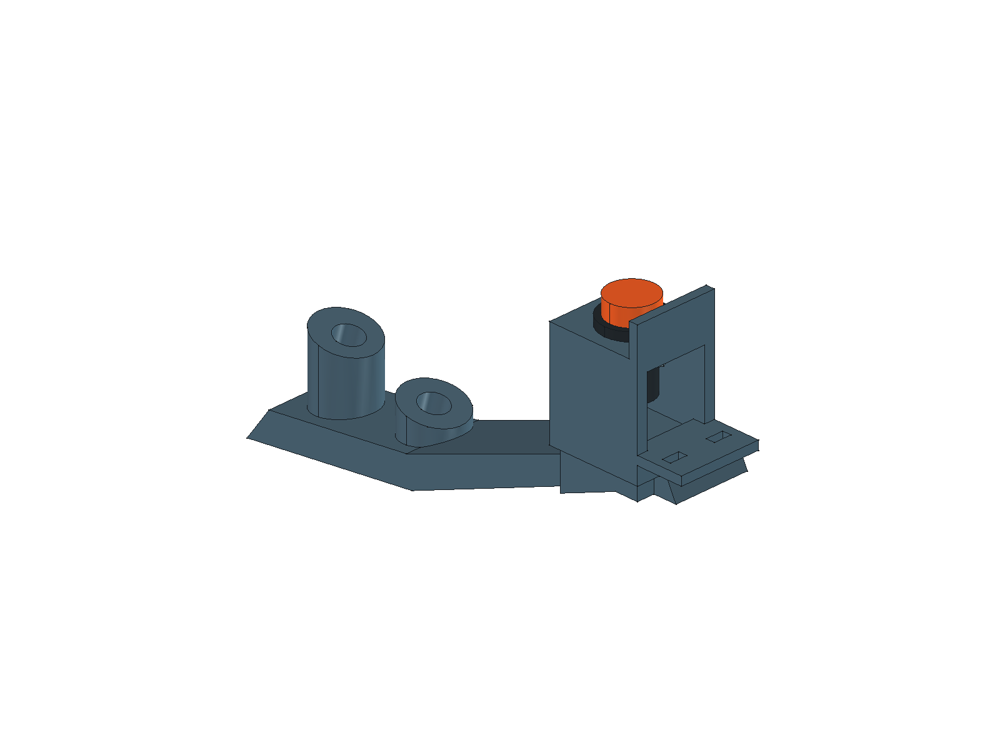
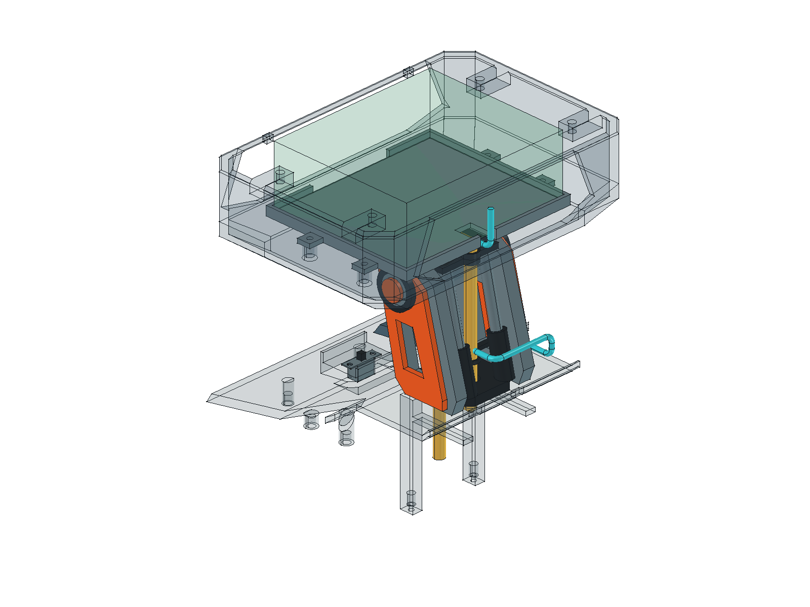

# 外接 BOOT 停止按钮候选 0.54

**0.55更新：**BOOT两根计入15芯净径10总预算，头舱段改走板下至左侧X60/Y6/Z194；本页旧Ø6、后槽终点及旧长度为0.54历史值，按[通道专项](cable-passage.md)替代。按钮本体与安装座保持。

本轮在电源开关任务完成的 `ad9aefc` 基线上，落实外接 BOOT 按钮的机械安装和低压走线候选。现有固件把 GPIO0 拉低解释为全部动作停止；不改变固件、角色提示词、总电源开关及独立供能切断的验收状态。

## 位置与安装结构

保留原“后肩本地停止按钮占位”所在的**右肩内侧、泡泡枪后内侧**区域。原圆柱中心 X−35／Y−22、底面 Z100；新安装中心 X−36／Y−22，法兰贴合面 Z114 mm。向外移动1 mm、抬高安装面14 mm，为杆体、螺母及端子留空间。坐标沿用 X向左、Y向后、Z向上，前方−Y。

原 `StopPlinth` 是无安装孔的独立实心占位，本轮移除；其支承区域与新安装座融合到 `ShoulderRailR`，右肩梁成为一个连续实体，不另加安装座固定螺丝。按钮包含杆体／法兰、按帽和后插螺母三个候选对象。安装板后侧开口可放入螺母，腔壁限制螺母转动；后护边比未按下的按帽高1 mm，前侧开放，供手指进入。

**按钮尚未选定，以下均是可调整的设计预算，不是任何商品的尺寸或采购推荐。** 选型后必须用其图纸和实测替换参数，尤其要核对螺纹、端子、按帽与行程。

| 项目 | 候选尺寸 |
|---|---|
| 触点形式 | 常开、自复位、无灯、两端干接点；适合低电流逻辑输入 |
| 安装通孔／板厚 | Ø7.3／2 mm |
| 杆体预算 | Ø7，法兰下深10 mm；没有建螺纹 |
| 法兰／按帽 | Ø10×1.5／Ø8×3 mm |
| 按帽顶面／后护边顶面 | Z118.5／Z119.5 mm |
| 按压行程预算 | 1.5 mm |
| 螺母 | 对边10、厚2 mm；与按钮螺纹配套，不按模型指定标准 |
| 后开口腔 | 横向净宽10.4 mm；螺母占 Z110…112 |
| 出线固定 | 安装座后方一体鞍座，两个3×1.5 mm穿线槽；暂按Ø1 mm柔软绑线固定 |

从正上方接近会遇到固定颈架横梁，因此本方案规定**手指从前方伸入再向下按压**。检查预算仅为Ø12指端，不代表整手、戴手套或儿童操作已验收。后护边只能降低部分误碰机会，不作为防误触认证。

装配顺序：断开所有电源；从后口放入配套螺母；按钮从上方穿孔旋入并固定；在后开口处理两端引线及各自绝缘，再用可穿过1.5 mm窄向的柔软绑线固定到出线鞍座。普通2.5 mm宽扎带不能直接按此槽位穿入，若选用该规格须调整槽向／尺寸。不得用线束承担旋紧扭矩。采购按钮若不允许旋转本体安装，应改成与其配套的普通螺母安装结构，不能强行套用本候选。

维护时先断电、断开并释放引线，再旋出按钮，上提12 mm后向前取出30 mm；随后螺母可从后口取出。检查的是解除螺纹后的刚体路径，未模拟螺纹旋转、焊接工具或完整手部。肩梁自身的连接工艺仍沿用原模型状态。

## GPIO0 与 GND 走线

```text
GPIO0 ───── 常开自复位按钮 ───── 面包板 GND
```

与板载 BOOT 并联；只连接低压信号，不接5 V，也不接MOS开关后的负极。按[现有实物照片](../hardware/components/breadboard/front-20261025.jpg)，两个USB向下时 GPIO0 是右侧标“0”、位于“35”和“45”之间的排针。照片确定排针身份，不确定这块板在100×85×36整组规划包络内的准确姿态。

模型中的青色 `StopSignalRoute` 是**Ø2.8 mm双线走廊**，不是导线实体或保护套管：

1. 从按钮下方后开口出线，在一体鞍座上固定。
2. 沿右肩内侧向后，到Y22附近绕过固定颈架的后缘，再转入中央线束通道。直接横穿颈架会碰到侧板，已避开。
3. 中央段沿X0／Y6向上，经现有头舱护口进入头舱底部；从托盘后槽转到X0／Y19／Z190。
4. 从此处接入面包板内的GPIO0及GND。板内最后一段与端子焊线形状未获得实物尺寸，尚未几何闭合；利用整组包络内的线束预算，不虚构针脚坐标。

路线圆角中心半径暂取4 mm，中心线长约186.7 mm，**不是裁线长度**。需另外量取按钮端焊线、板内连接段和维护余量；建议试装时预留可收置的松弛段，保证断开头舱接头后托盘可以独立提取，不允许靠拉扯GPIO排针取出托盘。接头型号、端子绝缘、线径、弯曲半径和余量按实物确定；不要在未建模空间塞入任意大插头。

中央一段与原 `PowerCableRoute` 重叠是有意的：BOOT线对**包含在原Ø6总线束预算内**，不能把两个包络当成两束已排好且互不挤占的线。需按最终线束重新验证护口填充率。信号线成对靠近布置，依次在按钮出线鞍座、现有颈架线束桥及头舱护口处整理／固定；避免扎带勒伤线皮，接头端保留应力释放。几何远离点火走廊不构成电气隔离或EMC合格结论。

GPIO0同时是启动绑带脚，上电或复位时按住可能进入下载模式；正常使用应释放后启动。[乐鑫启动模式说明](https://docs.espressif.com/projects/esptool/en/latest/esp32s3/advanced-topics/boot-mode-selection.html)说明了这一限制。此按钮依赖固件读取，不能替代独立断电；松开不恢复旧动作。接线完成后的实际输入、电气干扰和停止验证另行安排，本轮没有烧录或带电试验。

## 验证与交付

[专项报告](../hardware/model/boot-button-audit.json)记录按钮静态、指端接近／按压、杆体上提与前移、螺母后取、走廊避让和三组反例；[范围审计](../hardware/model/boot-button-change-audit.json)用于确认电源开关和无关部件保持。范围审计对改动特征执行布尔差比较；其余重新生成对象核对拓扑数、体积、面积、边界及顶点，不冒充全模型逐件布尔等价证明。整机回归以当前[回读报告](../hardware/model/readback.json)为准。本轮1094对整机静态布尔检查无超阈值重叠，现有维护路径及信号走廊作为障碍的维护回归通过；412个原有特征按上述方法核对一致。STEP回读体积差约59.43 mm³，超过0.01 mm³严格阈值，只作布局交换。实体与路径检查均是名义CAD证据，不等于采购定版、实物配合、固定强度、密封、防误触或电气验收。

本页尺寸表和下列视图为本轮安装图；旧装配PDF仍是其标注版本的历史图册，不包含本按钮的新结构。精确几何以FCStd为准，STEP只作交换。




