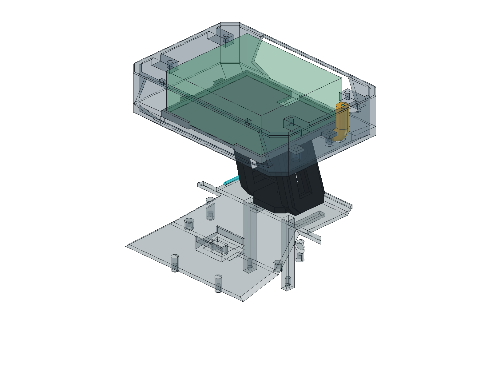
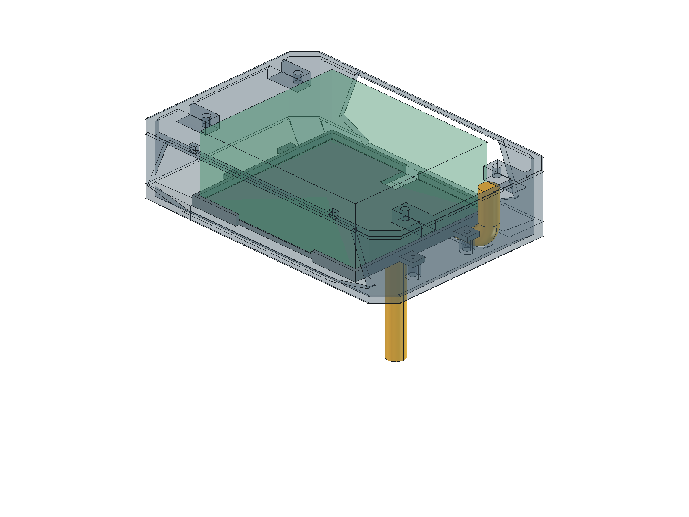

# 15 根线与净径 10 mm 穿线通道 · 0.55

**2026-10-26 后续变更：用户明确取消上下两个独立线束护口，当前源档/交付模型均已移除。既有安装让位、净径10限位桥及路线保持，不重打现有五盘；下表护口尺寸与护口反例检查属于取消前0.55记录。当前不再打印或采购这两个护口，穿线前清理孔缘毛刺并由限位桥固定。**

2026-10-26，用户确认按原 13 根跨区导线加外接 BOOT 的 GPIO0／GND 两根，共 **15 根**规划。点火两根仍按本接线图的悬空接口预留；既有低压固件候选不等于这次完成接线。导线外径、连接器和实际束径未定，15 根是数量预算，不证明任意 15 芯电缆都能穿过。

本次在当前保存模型上局部更新，保留 PP02 泡泡枪底座的既有几何和配合冲突。没有执行整机重建覆盖其他任务。权威模型为 [CyberTrack.FCStd](../hardware/model/CyberTrack.FCStd)，设计特征源为 [CyberTrack-design.FCStd](../hardware/model/source/CyberTrack-design.FCStd)。

## 通道与护口

| 位置 | 本轮几何 |
|---|---|
| 底盘顶盖及颈架基座安装孔 | Ø12.6 mm；用于容纳护口，不是净通道尺寸 |
| 下护口 | 内径10、外径12.4 mm，Z90…93；名义壁厚1.2 mm、座孔单边间隙0.1 mm |
| 颈架限位桥 | 内径10、外径12.4 mm，Z107…109；保留横向连接段 |
| 上护口 | 沿弯曲路径净径10、壁厚1.2 mm；裁切范围Z158…164；不再是原直圆筒 |
| 头部通道安装让位 | 上护口外侧按路径Ø12.6让位；板下/侧缘按Ø10.6留位 |
| 面包板及外形 | 面包板原位，外壳外包络不变；只调整壳内局部材料及托盘侧缘让位 |

坐标为毫米，+X向左、+Y向后、+Z向上。中心线控制点：

```text
底盘交接位 (0,6,84)
  → (0,6,166)
  → (60,6,166)
  → 头舱左侧交接位 (60,6,194)
```

拐角按中心线 R10 圆弧过渡；这只是布置假设，不是电缆厂家允许弯曲半径。路径在托盘下方转向左侧，再从面包板左边向上，替代原后槽 X0／Y19 路线。原后部10 mm开口保留，但不再承担这条主线束的上行路径。新通道与面包板包络最近3 mm，与托盘让位面约0.3 mm；这些是名义CAD值，必须计入打印误差和真实线束变形。

`PowerCableRoute` 现在表示从Z84交接位开始的**Ø10总空间预算**，不是护管或线缆实物。底盘各模块至交接位、头部交接位至实际排针尚未完成端接几何；不延用旧电池插头的位置假设。BOOT双线保持独立接口，中央段包含在这15根总预算内，不在Ø10预算外再加一束。高压输出线不属于本通道。

## 维护与物料

先断电、断开头舱对外接口并释放/收置线束，再取面包板托盘；不承诺保持接线时可整盘上提。不能把净径10当作允许任意外径10的线束零间隙装配，也未证明整只接头可穿过。护口材料、固定方式、线皮耐磨、应力释放和最终线径/束径须实物确认。

护口仍为上下各1件、限位桥1件，不增加电子模块或紧固件选型。PP06固定颈架及其STEP/STL同步更新；其余五个合并打印件几何保留。底盘顶盖、头壳、托盘等独立件以整机FCStd为准，未新增擅自定版的独立制造文件。

## 检查与边界

[专项回读与范围报告](../hardware/model/cable-passage-audit.json)包含：

- 沿全路径连续扫掠的Ø10实体与周围实体/设备包络无超0.01 mm³干涉。
- 上下护口、限位桥、顶盖、头壳、托盘及完整通道的局部静态检查。
- Ø10.2反例在上下护口与限位桥检出阻挡，验证净径限制确实存在。
- 面包板托盘85 mm连续上取、螺钉/工具及既有反例；BOOT走线与按钮维护回归。
- 原生模型保存回读、源模型/交付模型对应、未改对象几何签名、PP06单实体及STL封闭/非流形检查。

**本专项通过不等于整机通过。** 原有 [PP02与泡泡枪壳的配合冲突](../hardware/model/pp02-adjustment-audit.json)继续保留，整机静态和维护总状态仍为未通过。没有实物穿线、材料/薄壁强度、电气、EMC或儿童使用验收。STEP仍只用于布局交换，精确几何以FCStd为准。

生成逻辑在 [cable_passage.py](../scripts/cable_passage.py)，当前模型局部更新入口为 [update_cable_passage.py](../scripts/update_cable_passage.py)（FreeCAD Python环境，`--render`保留GUI状态）。常规生成器也调用相同几何逻辑，但本轮未通过全仓重建覆盖PP02等并行工作。




