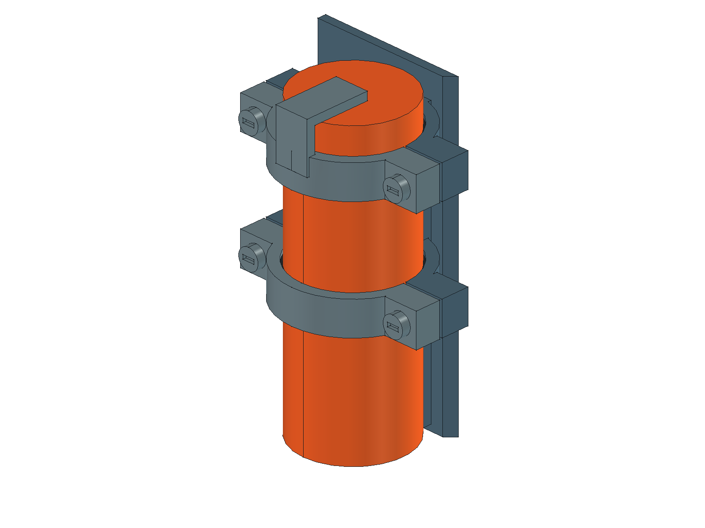
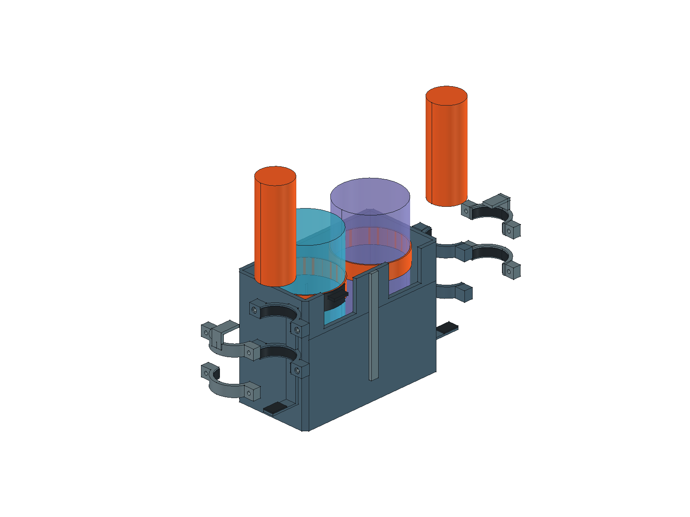
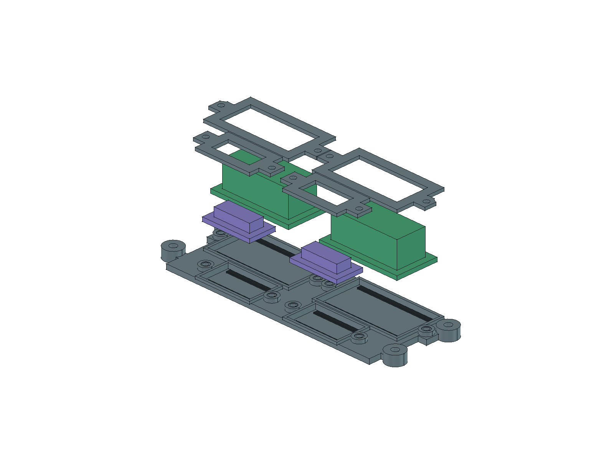

# 0.48 前方效果线、前舱入线与点火 MOS

2026-10-25。0.42背包夹持保持；0.43按用户要求补充四块低压板的固定与局部接线空间，并增加承板下方装配余量。本轮为被动机械结构候选，未设计高压引线、电极、驱动或通电集成。主模型为[CyberTrack.FCStd](../hardware/model/CyberTrack.FCStd)，[专项检查](../hardware/model/effects-mount-audit.json)与[本轮变更范围](../hardware/model/effect-board-change-audit.json)分别记录路径和几何保留情况。

0.48以[前舱入线与点火MOS候选](ignition-routing.md)取代外沿路线：电机顶面内侧→前肩入壳→前脸四孔。新电池116×70.5×19.5释放12 mm高度，新增第三块P01独立可拆托架供两只点火模块共用。模块端接入、弯曲、护口和完整电气接口尚未完成。以下0.42／0.43尺寸与结果为各自历史基线。

## 2026-10-25 前方效果位置需求

用户指定在底盘前方左右分别伸出两根线，按每侧一组、每组两根、共四根记录，用于两侧火花效果；替代原头顶效果位置要求。两只点火模块本体仍采用背包外侧机械候选位置，头顶脊翼保留外观。

用户随后要求在模型中设计。0.45在左右前护甲外侧各增加两根封闭端效果线及两个根部护套，共8个外观对象；头部、底盘壳体、背包本体与内部布局保持。线体采用橙色便于辨认，没有裸露导体或火花实体。

0.46按用户要求将前伸长度由18 mm增至28 mm，根部、护套与上翘角度保持。以下尺寸均为造型假设：每侧根部中心分别为(X±44，Y−109，Z62)和(X±54，Y−109，Z53)，线端中心分别为(X±44，Y−137，Z约68.22)和(X±54，Y−137，Z约59.22)，0.46线体外观直径3 mm（0.47已按用户输入修正为1.5 mm）、封闭圆端，根部护套外观直径6 mm、长3 mm，贴前护甲Y−106表面。每侧两根沿护甲斜边错开，前伸28 mm并上抬约6.22 mm，0.46圆端最前缘Y−138.5（0.47变为Y−137.75）；这些尺寸不是线材、电极或放电间距选型。

新增对象为`FrontEffectLeadL1/L2/R1/R2`与`FrontEffectSleeveL1/L2/R1/R2`；生成入口为[front_effects.py](../scripts/front_effects.py)。[静态与回读检查](../hardware/model/front-effects-fit-audit.json)及[变更范围检查](../hardware/model/front-effects-change-audit.json)记录几何证据；本次仅四根线加长的范围见[0.46检查](../hardware/model/front-effects-length-change-audit.json)。未开穿壳孔，未设计内部高压引线路径、固定工艺、电极或驱动；实际出线、绝缘、防触碰及喷水／泡泡共存仍待评估。

本轮更新FCStd、STEP与模型预览；原装配PDF尚未同步这8个外观对象，仍为0.44图纸。固件未改。

## 布局与尺寸依据

| 项目 | 当前包络／位置 | 依据与待确认项 |
|---|---|---|
| 点火模块本体 ×2 | Ø25.5×70；中心X±74、Y85，Z54…124 | 沿用用户历史规划，非实测；端部、引线和实际可夹区域未知 |
| MOS ×2 | 左右33×前后17×高12；中心X±23，Y−40.75…−23.75，底Z68 | 33×17来自通用商品图；总高12继续标注候选 |
| 降压板 ×2 | 左右20×前后11×高5；中心X±18.5，Y−55.25…−44.25，底Z68 | 用户提供20×11×5；焊锡、端子和出线范围未单独确认 |
| 薄承板 | 低位底板Z66.5…68.5；浅座深1；四耳厚4；四孔X±47、Y−49／−26.5 | 不设PCB孔；开窗压框、板边垫及线束为候选，真实接触区待测 |

两套MOS／降压板按水枪、泡泡枪各一套规划；不表示新增采购或泡泡枪电气接线已经完成。原头壳、面包板与超声波、双枪、履带、充电宝、液瓶的位置保持。前斜坡外表面不抬高、不穿孔。

## 本体夹持

每侧两道分体夹环，中心高度Z86与Z114。内半环、后方连接肋和底托并入背包护壳；外半环可独立拆下，上外半环带顶部轴向限位。本体由底托支撑，上限位防止直接向上脱出；夹持衬垫只按名义接触建模，不假定已具备可靠摩擦保持力。

- 夹环外径31.5、衬垫座孔26.5；内外半环分缝0.6 mm。
- 每半环两个M2.5级候选螺钉，整机共8颗螺钉和8个盲孔嵌件；从各自外侧操作。
- 夹环软衬0.5、底垫1 mm，材料、压缩量、热性能和灌封壳接触位置待实测。没有规定真实螺纹、拧紧扭矩或生产公差。
- 固定结构最外侧X±89.75，收在履带X±114内；最后侧Y107.5，比原后脊条Y97后伸10.5 mm。此前A03裸本体仅后伸0.75 mm，不能继续用于含夹具后的外形描述。
- 固定肋从背包侧壁外侧连接，保留原液瓶舱实体；没有把机械间距、软垫或原湿舱隔板当作高压绝缘／液体隔离验收。

本体拆出顺序：断电并解除、收置待确定的实际线束，托住本体；退出本侧4颗螺钉，分别将两外半环和外衬向外移35 mm；本体向上取90 mm。装入按相反顺序，先核实底垫与夹持区。内衬和底垫留在固定侧，另一模块、两液瓶及现有吸管保持。

液瓶仍按原步骤移开本侧吸管、解绑带后向上150 mm，模块夹具无需拆除。拆装图同时移出多件仅为展示方向，不表示它们连接成一个组件。

## 薄承板与四块板固定

四个承板固定点调整为X±47、Y−49／−26.5，孔距94×22.5 mm。四耳厚4，底部开沉台；4颗M2.5级候选螺钉头底为Z66.6，收进盘底Z66.5上方0.1 mm。顶盖内柱随位置调整，原头壳、前斜坡、充电宝及背包夹持几何保持。

每块板设置1 mm深浅座、两条0.5 mm板边垫和一个独立开窗防脱压框。板底Z68，PCB厚1.6及四边2.5 mm无元件区均为新增假设；PCB上表面Z69.6，框下表面Z70，留0.4 mm防脱活动量，不以压紧元件固定。侧向余量0.5；浅座剩余底厚1 mm、板底中央空隙0.5，焊脚、板边材料、局部强度、散热和振动保持仍须实测。

MOS压框靠后固定耳处增加圆弧让位，距耳外缘名义0.5、距顶盖内柱约0.7 mm，仍需公差和强度验证。四框各2颗M2级螺钉，共新增8颗和8个短嵌件。型号、螺纹、拧紧力与材料未定，不是采购或生产规格。CAD将每板分为假设PCB和内缩元件区，仍保留原外包络的最大长宽高；这个元件区不是从实物照片确认的，必须先测可固定板边。元件占满外包络时会与框冲突，检查报告保留该反例。

整盘拆出：断电，拆底部维护盖、充电宝及内托架，收置中央电源线并断开整盘对外接线；托住承板，退出4颗承板螺钉，再向下取100 mm。四板、压框和盘内局部线束随盘移动；真实接头和手部空间未验。

单板拆出在机外进行：先断开／收置本板接线，退出本框2颗螺钉并向上退20，压框上取20，再将板卡上取20。其他三板和压框可留装。预览中同时展开多件用于辨认，不表示同时拆卸或刚性连接。

## 接线空间

每板内外端各一个候选空间：MOS为4×8×4.5和4×4×4.5，降压板两端各4×4×2.5 mm；4 mm为板外伸出预算。中央5×4 mm截面共享交接通道、两侧Ø3线路预算用于局部低压分配。空间与端部的重叠表示同一布线预算，不能重复计为多条独立已完成回路。

这些方向、位置、尺寸均未实测；不是选定端子、实际线径或弯曲半径，也未确定针序。完整供电、主控和枪体端接仍待补齐。若真实MOS端子或降压板焊线需要更大空间，须调整布局，不能削减真实尺寸以沿用通过结论。

## 0.5 mm 间隙与装配余量

旧0.42螺钉头最低Z65，距充电宝顶Z64.5仅0.5 mm；这是偏紧的名义间隙，不能保证实物不碰。0.43将头部凹入侧耳，得到：

- 承板最低Z66.5，距充电宝 **2.0 mm**。
- 螺钉头最低Z66.6，距充电宝 **2.1 mm**。
- 承板并未整体抬高；抬高／后移方案会挤占顶盖和L298N区域，因此保留低位承板并改进固定方式。

2 mm是当前候选装配空间预算，不是通用标准或已验证的安全系数。必须量测充电宝最大外形、螺钉头及沉台深度，计入打印／加工偏差、承板翘曲、安装偏移和垫片／贴膜叠加；按最不利组合重新核算净距，再做实物试装。不能另加垫片后仍沿用此值。压框和端子处也存在较小净距，均需公差核对。

## 检查与证据边界

保存回读409个对象有效，1108对静态检查无超阈值干涉；原348个对象几何保持，顶盖差异限于内部固定柱允许区，原顶盖实体未删减。头壳、背包夹持、双枪、液瓶、驱动及充电宝几何保持。

生成入口：[effects_mount.py](../scripts/effects_mount.py)调用[板卡固定模块](../scripts/effect_board_mount.py)。[板卡专项](../hardware/model/effect-board-fit-audit.json)和[整机回读](../hardware/model/readback.json)记录静态、局部接线区、整盘及盘内线束下取、机外压框／板卡／螺钉退出和工具杆检查。保留螺钉、压框和无空白板边等反例必须阻挡对应动作。

[0.43范围审计](../hardware/model/effect-board-change-audit.json)以0.42为基线：只允许效果板对象和顶盖内柱局部变化；头部、背包、双枪、液瓶、驱动、充电宝保持。原顶盖实体不允许删减。0.42背包夹环及其拆装检查继续回归；外半环各21姿态仍为离散检查，不扩大为连续验证。STEP仍仅供布局交换，原生FCStd为几何依据。

CAD检查不涵盖手柄／手掌、柔性线束、衬垫变形、拧紧力、强度、制造公差、散热、高压绝缘、EMC或液体共存验收。MT3608、分线器和保护器件未在本轮新增安装占位。

## 方案沿革与清理

A02曾研究中央抬高前舱，用户因下部臃肿否定；A03将裸本体转到背包左右外侧，保留原前斜坡。0.42在该方向上增加夹持及薄承板固定，取代两套独立研究副本。已清理两套旧候选模型、预览、研究脚本及本轮自动备份，共20个文件；原始部件资料与其他历史方案不属于本轮清理范围。文件清单和删除前哈希见[清理记录](../hardware/model/effects-cleanup-audit.json)。

0.43补充低压板固定与接线预算；0.42清理记录是历史记录，不对应本轮模型哈希。
