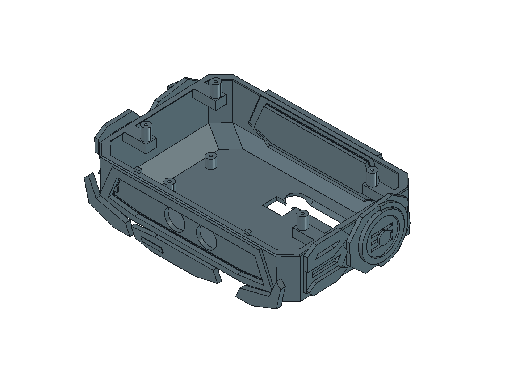

# 0.58 头部整体打印与现有螺丝适配

2026-10-26。按用户最新要求，将头部下壳、固定装饰及超声波传感器面板合成一个大件，冠盖和面包板托盘保持独立；本任务不改底盘。原生几何以 `hardware/model/CyberTrack.FCStd` 和设计源档为准，本轮局部证据见[专项报告](../hardware/model/head-shell-print-audit.json)。

## 文件与分件

| 文件 | 用途与朝向 |
|---|---|
| [PP07-HeadShell.stl](../hardware/model/print-parts/PP07-HeadShell.stl) | 头部下壳＋固定装饰，179 × 122.5 × 55.1 mm；开口向上，已居中落地，无需再旋转 |
| [PP07-HeadShell.FCStd](../hardware/model/print-parts/PP07-HeadShell.FCStd) | 独立查看用原生打印实体，与 STL 同方向 |
| [PP05-Crown.stl](../hardware/model/print-parts/PP05-Crown.stl) | 配套更新的冠盖；装饰面朝上、内侧加支撑；内侧增加四处接收柱让位，必须与新 PP07 配套 |
| [Head-ElectronicsTray.stl](../hardware/model/print-parts/Head-ElectronicsTray.stl) | 保持原几何的独立面包板浅托盘，底面朝下 |
| [Head-ScrewFitCoupon.stl](../hardware/model/print-parts/Head-ScrewFitCoupon.stl) | 导孔试拧件，含一条三柱基体和三片独立盖片；不是一个连续实体 |

PP07 合并 34 个原特征：固定下壳、前脸内框、左右颊甲、下颌及识别片、两侧太阳穴护甲、耳部护罩／阶梯环／格栅／饰片／护弧、后脑护框／衬板／脊甲／识别条／六片格栅饰条。原特征仍保存在设计源档；交付主模型中只保留 PP07，不重复打印原特征。

用户后续要求将前脸一起合并：`SensorMask` 和 `SensorStatusStrip` 均并入 PP07，前脸两侧另补连接；两探头孔保持原 Ø16.6、中心距26 mm。软护口、线束、设备和金属件不并入。冠盖的装饰归 PP05，不重复并入 PP07。

## 连接处理

头壳和固定装饰原有8个分离实体，加上面板／色条共9个。本轮补 14 处连接：下颌背侧两条、左右颊甲各一条、每侧耳格栅上下各一条、每侧中心饰片背面一根短圆柱，面板左右各一条连接，前脸与后脑衬板各一圈接缝连接带。每处均检查与至少两个目标特征存在真实体积交叠，最终 PP07 为一个有效连续实体。

- 接缝连接带：沿前脸及后脑衬板的原边界各扩0.6 mm、前后厚1.2 mm，消除只接边产生的非流形网格；不封堵探头孔。
- 面板连接：每侧6 × 3 × 4 mm，跨接面板与前脸内框，避开探头和PCB包络。
- 下颌筋：6 × 8.5 × 3 mm，藏在下颌背侧。
- 颊甲筋：6 × 3 × 4 mm，跨过颊甲与下壳间隙。
- 耳格栅连接：2.5 × 4 × 4 mm，上下各一；保留主体格栅开口。
- 耳中心连接：Ø7 × 3.5 mm，位于中心饰片背后。

这些连接不改变主要外轮廓；螺丝柱则有意向头舱上方延伸，并在冠盖内侧配套让位。CAD 连通不代表抗摔或层向强度通过。

## 已确认的螺丝与候选孔

用户已确认：外径 Ø2.5 mm、含帽总长 8.6 mm、帽径 Ø3.9 mm、帽厚 1 mm、帽底近乎平；帽下长度据此为 **7.6 mm**。外观像粗牙自攻，牙距、牙底径和实际塑料保持力仍未测，不能称为已确认的 M2.5 机牙。

本轮仅适配头部 **冠盖 4 颗＋托盘 4 颗**：取消这 8 处原候选嵌件，接收端按 Ø2.1 mm 自攻导孔候选建模。底盘、枪托、履带、电机等其他紧固位置不沿用本次变更。

| 接口 | 几何 |
|---|---|
| 冠盖接收柱 | 外径 Ø7，顶部整机 Z216.1；原孔位 X±64、Y−52／7 保持 |
| 冠盖下侧让位 | Ø7.5，止于 Z216.35；与柱顶留 0.25 mm 轴向间隙 |
| 冠盖螺丝承压面 | Z218.6；保留原 Ø3 通孔和 Ø5 头部空间，承压面下最小轴向厚度 2.25 mm |
| 冠盖螺丝 | 尖端 Z211，名义进入柱内 5.1 mm；盲孔底 Z210，尖端余量 1 mm |
| 托盘螺丝 | 承压面 Z174，尖端 Z166.4，名义进入柱内 5.1 mm；孔底 Z164.5，余量 1.9 mm |

5.1 mm 是光杆包络进入塑料柱的长度，未扣螺丝尖端无效牙段；不能当作实测有效啮合。托盘外形、面板主体与探头孔位保持，冠盖仅改内部让位；旧 PP05 打印件不能直接配新加高柱使用。

**先打试拧件再打大壳。** 三组从左到右为 Ø2.0／2.1／2.2 导孔，对应一／二／三道边缘缺口；三片盖厚 2.5 mm、通孔 Ø3，复现同款螺丝的轴向装配长度。使用与头壳相同材料、层高和墙层数，确认能坐实、不劈柱、不顶底，重复拆装后不明显滑牙，再决定是否采用当前 Ø2.1 候选。若需变更孔径，应改 `scripts/head_shell_print.py` 的参数，在保留其他任务更新的基线上重生成，不能整体缩放头壳补偿。

## 打印方向与切片检查

**三件最终快速配置（2026-10-26接续）：** [交付与检查](../hardware/model/print-parts/PP07-slicing/head-set-speed/README.md)。头壳4小时9分；冠盖单独2小时55分、托盘单独36分，也可使用冠盖＋托盘共盘（历史中间文件 `Head-Crown-Tray-PLA-Basic-FAST.3mf`，已清理）约3小时24分，总计两盘7小时33分。冠盖保持装饰面朝上，改用贴合式普通支撑，四个螺丝承压座局部100%填充／4墙；托盘保留3墙与实心底板。三件实际网格与装配尺寸保持，单件及共盘关键截面路径已检查；下文Generic PLA方向比较与独立件耗时保留为历史记录。

**后续快速打印要求：** 用户不追求精细外观，确认耗材为 PLA Basic，并继续要求缩短时间。当前建议使用宽线快速版 3MF（历史中间文件 `PP07-P2S-PLA-Basic-wide-fast.3mf`，已清理）：拓竹 PLA Basic 预设、0.28 mm 层高、两圈 0.60 mm 宽墙、8% 立方体填充及单墙树状支撑，预计 **4 小时 9 分、154.3 g**。几何与拆装尺寸保持，八个螺丝柱及十二处连接截面的挤出路径已抽查；宽线不等于实物强度或配合已验证。三圈宽墙方案约 4 小时 45 分，原三圈细墙快速版约 5 小时 19 分，均保留。后续 Arachne 候选可降至约 3 小时 57 分，但连接截面更稀疏且未通过既定覆盖筛查，暂不采用；其他调整仅省几十秒。见[19 组对比及边界](../hardware/model/print-parts/PP07-slicing/speed-study/README.md)。

采用 **开口向上、下壳底面朝下**，保留整机轴向。下表为原方向比较基线：P2S 0.4 mm 标准喷嘴、Generic PLA、纹理 PEI、0.20 mm 层高、4 圈墙、15% 陀螺仪填充、5 mm 外侧 brim。自动树状支撑允许从模型表面生成，顶部 Z 间隙 0.20 mm、XY 间隙 0.35 mm、2 层支撑接触面；不要开启“仅在打印板生成”。

| 方案 | 切片预计耗时 | 切片预计耗材 | 判定 |
|---|---:|---:|---|
| 开口朝上、支撑可落在模型上 | 约 7 小时 16 分 | 177.1 g | 选用；未支撑悬空警告为空 |
| 背面朝下 | 约 9 小时 16 分 | 223.6 g | 仍有 4 处无法生成支撑，弃用 |
| 倒置、开口朝下 | 约 10 小时 54 分 | 222.5 g | 可切片，但支撑和耗时增加 |

尚未并入前脸的初始方案，开口朝上且“仅在打印板生成”的试切片有 8 处未支撑区域，不能沿用。上表比较基于同一最终头壳（含前脸、螺丝适配与接缝修正），均为切片估算。STL 不包含支撑配置；保存的[切片配置与结果](../hardware/model/print-parts/PP07-slicing/README.md)记录精确文件哈希。

清理时从上方开放舱口、前脸孔和外侧取支撑；先处理耳格栅和颊甲附近的细支撑，避免以装饰为撬点。孔中及接收柱顶面保持干净。托盘底面朝下、试拧件按导出方向放置，另行切片均无悬空警告，预计分别约 50 分钟／26.4 g 和 19 分钟／3.1 g；见[独立件结果](../hardware/model/print-parts/PP07-slicing/independent-parts.json)。

冠盖保持装饰面朝上，内侧允许树状支撑，单独切片无未支撑悬空警告，预计约 7 小时 10 分／131.7 g。该摆向保留外侧装饰面的朝上表面，内侧支撑需要从开放底面清理；未穷举冠盖摆向。

## 检查范围与再生成

- PP07 单实体、有效；STL 闭合、无非流形边、单一连通网格。冠盖及独立托盘网格也回读检查。
- 新头壳对其余保留物理件与规划线束检查静态体积干涉；冠盖和新头壳无体积交叠。
- 冠盖上提 65 mm使用离散姿态检查；超声波模块后退11 mm再上提70 mm使用连续立方体／圆柱胶囊包络，托盘上提85 mm使用连续保守扫掠，另查托盘螺丝 Ø8 工具通道。先拆盖、退出螺丝并收置线束；不将采样检查写成连续路径证明。
- 保存回读；未改对象用去显示网格 BRep 比较，不一致时用布尔双向差集核对。底盘及 PP01–PP04、PP06 保持；PP02既有冲突仍保留。
- 超声波实际PCB外形、模块固定件与线束仍未定；固定前脸后若孔距或安装位置变化，需要重打大壳。
- 旧整机图册、树审计和六件合并报告保留原哈希，仅作历史证据；当前局部检查以本页专项报告为准，未重新宣称全机验收通过。

生成入口：在 FreeCAD Python 环境运行 `scripts/update_head_shell_print.py`。它针对尚未加入 PP07 的六组合并基线作局部更新，不运行整机重建；`--root` 可指向包含主模型、源档和 `readback.json` 的副本目录。已应用且哈希一致时不重复写入；检测到后续编辑时停止，避免覆盖并行修改。完整重建六组合并基线后需再运行此局部步骤；不能只运行旧生成器后把六件结果当作 0.58。

当前统一打印入口：[18件／4盘项目](../hardware/model/print-ready/README.md)，已在Bambu Studio打开；采用PLA Basic重新切片，底盘3小时59分、配套件4小时17分、头壳4小时9分、冠盖与托盘3小时24分。此前独立版保留作为比较，不重复打印。
