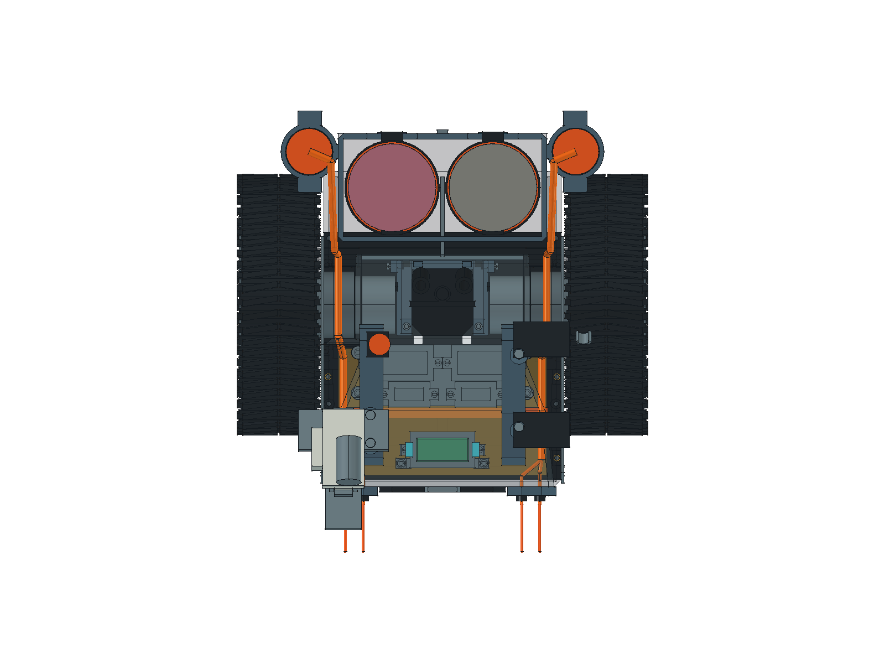
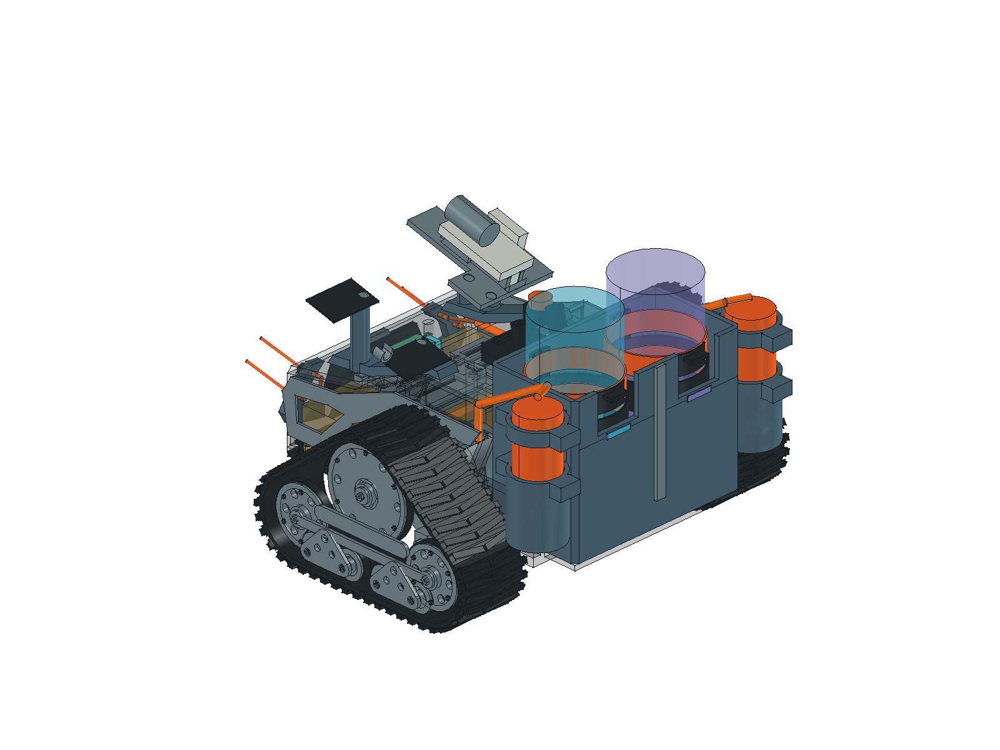

# 0.48 前舱入线与点火 MOS 安装候选

2026-10-25。用户给定每根点火线外径 **1.5 mm**、每侧两根；否定原 0.47 外沿／履带上方绕行，进一步明确不要求全程在底盘内部，只需在底盘前段入壳、从前脸出来。当前模型已撤销原外沿路线。

## 路线与机械开孔

每侧独立经过：**背包模块上方待接入区 → 向内收至电机顶面内侧 → 前舱肩部入壳 → 电池上方 → 前脸两孔**。本体实际输出端尚未知，起点只是机械交接区，不是假定模块中段出线。

| 区段 | CAD 中心线／空间预算，mm |
|---|---|
| 后部交接 | 从 X±74、Y85、Z130，经 X±62、Y80、Z130先向内收，再到 X±60、Y30、Z100；避免压在履带俯视投影内 |
| 电机上方内侧 | X±58、Z79，Y28…−17；收在动力固定结构内侧，不沿履带上方外缘走线 |
| 前舱入壳 | 从 X±58、Y−17、Z79 斜向 X±55、Y−29、Z59；LowerTub 局部通孔预算 Ø4.8 |
| 前舱内部 | X±55、Z59，向前至 Y−86；双线空间预算 Ø4，不是绝缘距离或最终保护管规格 |
| 前端分支 | 经前护甲和根部护套，分别到 X±44／Z62、X±54／Z53；四处通孔预算 Ø2.6、单线空间预算 Ø2 |
| 前伸外观 | 四根 Ø1.5 封闭端外观线；前伸 28、上抬约 6.22，保持已确认位置 |

实际修改的穿线结构仅为下底盘前肩／前壁、左右前护甲及四个根部护套。未在液瓶底托、后湿舱隔板或电机固定端面开孔。通孔和折线是可检查的机械空间候选，尚未定义护口材质、应力释放、线夹、完整护盖、线弯圆弧或加工公差；不能把两根线的外径直接当作保护结构或电气绝缘依据。

## 新电源与第三块 MOS

电源替换为[辰克 5 V 电池包](../hardware/components/ck-5v-battery/README.md)，用户尺寸 **116 × 70.5 × 19.5 mm**。暂保留原低位平放位置，底部 Z33、顶部 Z52.5，比旧充电宝低 12 mm。原四板承板底部 Z66.5，几何间隙由 2 增至 14 mm。拉带同步缩小；旧充电宝长边插头盒已移除，中央低压线束保留为待接入预算。

用户确认两只点火线圈共用**一块与水枪、泡泡机相同的 P01 双 MOS 开关模块**，由 ESP32-S3 控制。因此现有两块效果 MOS 保留，新增第三块；不是每只线圈各加一块。此处仅记录分组需求，未实现接线、GPIO 分配或驱动。

新模块位于前舱中央、电池上方、原效果承板前方：

| 项目 | 候选尺寸／位置，mm |
|---|---|
| 板卡 | 沿用 33 × 17 × 12 包络；总高、PCB 厚 1.6 与无元件边 2.5 均为待测假设 |
| 板卡范围 | X±16.5、Y−89…−72、Z56…68 |
| 独立托架 | 盘底 Z54.5，低于板边支承 1.5；两条软垫、开窗压框及两颗压框螺钉候选 |
| 托架固定 | 顶盖内侧两吊柱，X±23、Y−88；底部两颗 M2.5 级候选紧固件 |
| 电池间隙 | 盘底 2.0、固定螺钉头 2.1；是名义 CAD 间隙，未计热缩包起伏、变形和公差 |
| 接线预算 | 板端左右各 4 mm；实际端子、输入／输出及控制线朝向未定 |
| 维护 | 断电并取下底盖、电池／内托架，断开模块外部低压线后，卸两颗固定螺钉，整托架向下取出；机外拆压框再取板 |

## 验证和未完成事项

[走线检查](../hardware/model/ignition-routing-audit.json)单列意外交叠、前端预期交接、分支连通和“预留空间留装”的原维护姿态；[MOS 检查](../hardware/model/ignition-mos-audit.json)覆盖静态空间及整托架下取 80 mm 的连续几何扫掠。范围和履带位置检查见[变更审计](../hardware/model/ignition-routing-change-audit.json)。整机保存回读与既有检查见[readback.json](../hardware/model/readback.json)，不把原路线检查或旧电源台架结果迁移为新方案通过。0.48保存回读440个对象有效，1154对静态检查无报告干涉；原有专项、预留走廊留装的原维护姿态及新MOS整托架下取检查均通过。整机STEP回读954个实体，包围盒一致，但严格体积差约3.106 mm³超过0.01阈值，不能视为原生几何等价。范围审计确认相对0.47有408个原对象几何保持、18个对象按本轮范围改变，新增14个MOS安装及空间对象；下底盘差异仅来自前部穿线孔，原顶盖材料未删减。左右路线对履带俯视包围矩形的保守投影检查均通过。

后端交接区位于模块上方，模块上取前必须先释放并移开实际引线；不能据裸模块原检查宣称引线留装也能上取。

仍需核对模块输出端、可用线长及最小弯曲半径，再确定护口、固定和弯曲细节；折线长度不能直接裁线。新电池引线／接头占用、固定、实际板高、端子与焊脚、温升和负载能力尚未验证。两只线圈共用 MOS 的总输入电流、启动瞬态、关断与保护，以及高压绝缘、液体共存、防触碰和 EMC 均未验收。CAD 修改不包含高压接线或 ESP32 固件控制。

本方案于0.48建立；0.49延长两侧镂空侧框，当前0.50再将模块桶座和环带并入双瓶背包；走线和MOS安装几何保持。模块上取前仍需解除并收置本侧引线。FCStd 是几何依据，整机 STEP 仅用于布局交换，既有 PDF 仍为 0.44。六个 `IgnitionRoute*` 对象均为 `clearance`，在模型树的“07 点火线走线（橙色空间）”组中默认以橙色显示，可整组开关；壳内段可隐藏下底盘／顶盖或使用专项透视图查看；它们不是采购或打印件。生成入口为[走线](../scripts/ignition_routing.py)、[MOS 托架](../scripts/ignition_mos.py)和[替换电池](../scripts/battery_layout.py)。
