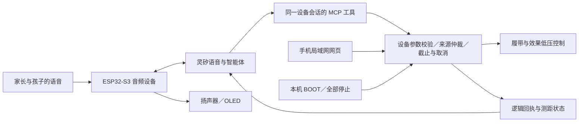

# 灵矽亲子机器人解决方案

CyberTrack 的 AI 交互基于灵矽。项目面向家长陪同的亲子用户，把灵矽的语音与智能体能力连接到可观察、可停止、可维护的实体机器人，探索从对话体验到硬件产品交付的完整路径。本章是比赛方案主线；技术接入细节见[灵矽接入](linx-integration.md)和[角色维护](agent-role.md)。

以下区分当前实现、开发计划和对平台的建议。不代表灵矽官方产品承诺、认证、商业合作或量产验收。

## 1. 从“能聊天”到“共同创作”

核心场景是家长和孩子共同提出、理解并观看机器人行为。当前支持语音对话、状态查询、行走、喷水、泡泡与组合动作；“小D 泡泡剧场”的 ct45 源码候选已将行走／泡泡组成三段可编辑短表演：先预览、允许修改，再由家长明确启动。亲子台词作为网页提示，机器人台词播报与表情联动是后续方向；候选尚未部署，见[编排操作与证据](show-composer.md)。

灵矽承担自然语言理解、角色表达与工具选择，CyberTrack 将其转为有限、可验证的设备行为。价值假设是让不懂编程的家庭也能参与机器人创作，而不是要求孩子记忆全部按钮或开发接口。通过五组家庭的独立上手与主动重玩行为验证，尚未获得这些用户结果。

## 2. 当前实际接入链路

日常设备路径不需要电脑代理或另建用户云服务。电脑用于开发、验证及 SolidCue 辅助设计，不能将设计工具的存在误写成机器人运行依赖。

现用 `esp32-audio/` 基于固定小智版本，保留设备绑定、音频、OLED 与唤醒路径，新增十一个 `self.tank.*` 工具。当前部署依据见[状态入口](current-status.md)；独立联网台架的认证与许可机制不是当前面包板的部署事实。

## 3. 让模型调用稳定落地：明确的能力契约

| 问题 | CyberTrack 的做法 | 可复用交付物 |
|---|---|---|
| 自然语言有别名、否定、引用和歧义 | 角色规定语义与默认值，模型只选择受限业务工具；含糊时澄清 | 版本化角色源、80 条工具语义回归集 |
| “先做／同时做”容易被多次调用打乱 | 一次提交有界序列，设备负责步骤内并发与步骤间时序 | 序列参数、解析、取消与独立截止测试 |
| 网络或模型重试可能重复动作 | 参数、来源、请求时效及会话内重复校验；失败不自动补做 | 工具返回约定与过期／重复测试 |
| 返回成功容易被理解为物理完成 | 区分传输成功、请求接受、逻辑运行和物理反馈 | 状态字段、错误分类与真实结果话术 |
| 云端延迟不应阻塞本地停止 | BOOT、截止、断线处理与近距离保护在设备执行 | 本地控制实现和实机验收矩阵 |

上述机制限制的是软件行为，不能替代器件保护或物理停止性能验收；现用会话防重放不承诺跨启动持久化。

## 4. 家长陪同体验与角色设计

小D 用简短、可理解的语言回应；当前动作成功静默，异常才说明原因，避免连续播报打断体验。候选编排模式只在明确进入编排后解释和预览，不改变普通直接指令的既有语义；实际灵矽意图路由仍需用增量用例验证。

家长负责连接、启动、停止与设备管理，孩子参与提议、修改和观看。首次亲子流程不含点火或狂暴模式。具体年龄、场地、隐私说明与适用性需通过后续研究和实物验收确定；不能因角色友好或使用陪同就宣称儿童使用通过。

对灵矽落地的贡献是可复用的场景角色、工具约束、家庭上手卡和异常对话素材，进度见[执行计划](improvement-plan.md)。

## 5. 软件与硬件共同定义可交付的设备

模型工具表达“移动”“吹泡泡”等业务能力，不暴露任意 GPIO。电机驱动、电源分域、受控回流、保护、线束和维护结构由设备工程约束。更换模块时，须同步接线、固件、原理图、部件模型与验证，不以提示词掩盖电气差异。

[I12 硬件架构专项](../hardware/architecture/README.md)已交付电源树、负载预算工具、保护与断电、音频噪声、接口和部件造型的设计资料；定值与实物证据继续闭合。SolidCue 接入提供带位置与版本的三维评论和受限原生修改，服务硬件迭代；它是设计工具，不是灵矽现有云端 CAD 功能。

这使解决方案可以交付“设备能力契约＋角色＋参考硬件＋验证方法”，而不止一段提示词和演示视频。

## 6. 联网、异常与日常使用

当前已实现普通多 Wi-Fi 按顺序尝试、OLED 地址、局域网网页控制及断线停止规则。云端语音和局域网页面是并列入口，云端不可用时不能假装继续完成 AI 对话；已有局域网条件下的网页控制另按实际连接状态使用。

ct43 候选已加入[基于真实回执的“为什么没动”解释](status-explanation.md)，尚未部署：只报告已知的占用、冷却、受阻、取消或异常，不自动启动、不静默重试、不把无回波当作无障碍。工程采集需要区分设备联网、云端会话、模型工具选择、控制接受和物理输出，才能定位灵矽落地过程中具体在哪一层失败。

## 7. 用可复现证据帮助方案推广

| 验证层 | 记录什么 | 不应替代什么 |
|---|---|---|
| 文本工具评测 | 模型标识、角色哈希、输入上下文、工具名／参数、禁止动作错误 | 真人语音识别、物理执行 |
| 真人语音 | 识别文本、噪声条件、工具与回执、分段时延 | 任意家庭和全部口音泛化 |
| 本地主机／编译 | 参数、并发、取消、断线及真实适配代码测试 | 带载、温升、停止距离 |
| 设备与硬件 | 固件版本、电源／负载、输入与输出时间、异常和测量方法 | 量产及儿童使用认证 |
| 用户体验 | 独立上手、求助次数、主动重玩、家长使用场景与顾虑 | 已证实的购买意愿或商业规模 |

新增评测工具目前只证明评分器和材料已实现，线上模型及真人结果尚待执行。未来报告分别公布各层通过率、失败样本和环境，不用单一“成功率”混合所有证据。

## 8. 可复用方案包与推广路径

已提供[参考材料打包工具](../tools/lingxi-solution/README.md)，通过明确清单导出角色、契约、评测和架构资料，并附文件哈希与证据范围。完整体验与设计交付仍按以下结构逐步完善；参考包不代表下列内容全部完成。

1. **体验包**：家长上手卡、角色介绍、三个短表演、可见的取消／停止方式与演示脚本。
2. **设备接入包**：固定上游版本、工具能力清单、参数及回执、GPIO／电源／接口说明和安装配置。
3. **验证包**：文本／真人用例、主机检查、固件与提示词版本、故障矩阵和实际证据。
4. **设计包**：FCStd、打印清单、原理图、BOM、维护说明与 SolidCue 受限单件工作流。

推广顺序为现有样机 → 小规模陪同体验 → 维护与成本收敛 → 可复现参考方案；教育活动、展览互动或其他执行器变体作为后续验证方向，不将其列为已经支持的产品。价格、付费方式和批量成本需要实际数据，不预设市场规模或成本节省比例。

## 9. 给灵矽平台的反馈建议（非当前平台事实）

- 提供可导入导出的角色、工具契约和版本绑定，减少平台配置与固件不一致。
- 提供无执行器的工具试运行与回归环境，允许捕获模型调用而不驱动硬件。
- 在日志中关联设备会话、模型调用、设备接受和完成／取消回执，方便定位延迟及失败。
- 支持按设备实际能力展示工具，清楚表达“未连接／未验证／暂不可用”。
- 为方案提供分层验收模板、异常样例与参考硬件版本，避免把演示通过当成可交付。

以上为基于 CyberTrack 开发过程提出的待验证建议，不声称平台已有或将承诺提供，也不擅自向第三方发送反馈。
