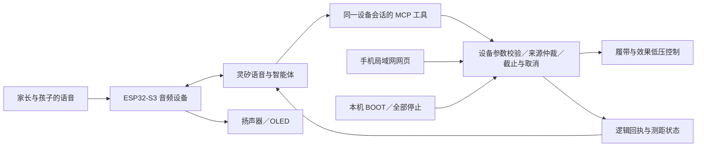

# 灵矽语音与设备控制

家长和孩子可以用一句话指定行走、喷水或泡泡，也可以表达先后或同时执行。面包板与灵矽在同一会话交换音频和工具调用。ct80 候选提供九个工具，手机遥控直接走局域网。设备当前运行的版本与平台角色见[当前状态](current-status.md)。

设备校验参数、来源和截止时间。BOOT、全部停止、断线处理和前进保护在本地执行。回执能说明请求是否被接受、设备何时撤销逻辑输出；实际移动、喷水和停止距离需要现场观察。[固件接口](../firmware/CAPABILITIES.md) · [角色维护与语音回归](agent-role.md)

## 验证与复用

- 修改语音行为时，分别记录平台转写、模型调用、固件回执和实际播报。ct78 暴露的漏调速和否定尾句丢失仍是 ct79 的复测项。[失败样例](validation/ct78-stop-duration.md)
- 家庭体验按五组独立上手和主动重玩记录；由家长管理设备和停止，现场结果按原型与实机分别汇总。[观察方法](validation/README.md#家庭体验观察)
- 他人复核旧模型成绩时，可以生成离线包，按原语料回放。设备接线和角色变更从现行手册开始。[参考包](../tools/lingxi-solution/README.md) · [接线表](wiring.md)
