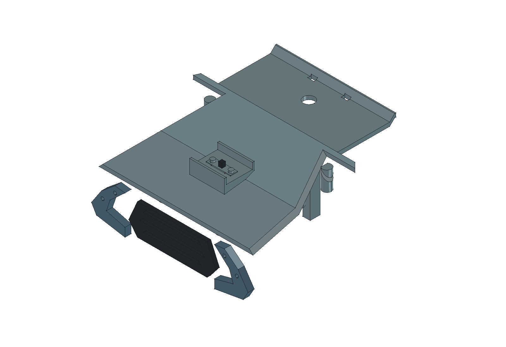

# 电源开关外装候选 0.53

用户于2026-10-26提供[开关照片与实测尺寸](../hardware/components/power-switch/README.md)，要求容易操作且不与其他部件相互干扰，明确不放左右侧面。候选区域为头顶、头后面、底盘折面顶盖；后续要求直接从外部安装并拧紧螺丝。

## 位置与固定

采用**底盘 · 折面顶盖中央前段**，中心X=0、Y=−64 mm。安装面为挂耳下表面，Z=81.1 mm；开关从上方落入本体开口，两侧挂耳压在顶盖外表面，两颗Ø2×6塑料用自攻螺丝从上方直接拧入打印安装座。取消内部螺母，不需要为了机械安装开关拆底盖或电池。

此处位于前方点火MOS托架和后方两路效果承板之间，靠近电池，手指从上方接近。无需把开关线束引到头部，也不占左右侧框、履带、瓶盖或枪管位置。

| 项目 | CAD候选尺寸／结构 |
|---|---|
| 本体通孔 | 11.2 × 6.4 mm，对10.6 × 5.8本体各留0.3 mm名义单边间隙 |
| 挂耳固定 | 实物两孔Ø2.6、中心距14.8 mm；挂耳置于面板外侧 |
| 螺丝 | 两颗Ø2×6塑料用自攻螺丝候选，无螺母 |
| 导孔 | Ø1.6 mm、深6 mm；按暂定0.5 mm挂耳厚度，名义拧入深度5.5 mm |
| 导孔旁壁厚 | 至本体开口1.0 mm，需按实际打印材料与螺丝试配 |
| 拨柄 | 相对安装面突出4 mm，顶端Z85.1 mm；行程6 mm |
| 护边 | 前后各一道，顶端Z86.1，比拨柄高1 mm；两侧开放供横向拨动 |
| 安装区 | X−14…14、Y−76…−52 mm，与原折面顶盖一体 |
| 接线预留 | 本体下方12 × 7 × 6 mm局部空间，未定实际线径与接头 |

0.53取代0.52的内装螺母方案：不再使用9.5 × 3.5拨柄面板槽，改为让整个本体穿入的通孔；拨柄及挂耳直接露在外部，旧螺母旁0.1 mm间隙问题随螺母移除而消失。

导孔是候选值，不能直接视为适合任意M2机牙螺丝。需用实际塑料用自攻螺丝和打印材料核对开裂、咬合、拧紧力及重复拆装。CAD螺丝仅画Ø1.6孔内芯径和头部，未建螺纹或验证咬合强度。挂耳厚0.5 mm、轮廓及对称位置仍为假设。

## 安装与维护

1. 断开供电，准备并绝缘开关引线；接头和线尾余量按实物确定。
2. 将本体从顶盖外侧放入开口，挂耳贴在安装面上。
3. 从上方拧紧两颗候选自攻螺丝。

维护时从上方卸下两颗螺丝，再提起开关。机械取出路径允许电池和底盖留在原位；真实引线需留出余量并可断开，未核实接头能否穿过本体开口，不把几何取出等同于带线维护已验收。

## 验证与边界

[专项报告](../hardware/model/power-switch-audit.json)检查静态几何、完整6 mm拨动扫掠、上方26 × 20 × 30 mm手指预算、局部接线预算、螺丝刀通道、两颗螺丝向上取出及保留电池的开关向上连续取出。反例保留螺丝时应阻挡开关提起；加宽手指预算应碰到护边；拨柄扫掠中的障碍应检出。

[范围审计](../hardware/model/power-switch-change-audit.json)核对相对增加开关之前的基线，仅改变折面顶盖 `KeelLid` 并新增4个开关／螺丝对象，头部与动力几何保持。主模型为305个零件；精确几何以FCStd为准，STEP仅供布局交换。

本次CAD检查通过：整机静态检查覆盖1091对对象且未检出重叠；专项拨动与拆卸检查及反例检查通过。范围审计确认411个原有对象不变，仅修改折面顶盖并新增4个对象；最终FCStd保存回读通过。

以上为名义CAD证据。实物尺寸、操作手感、打印公差、螺纹保持力、防误拨和电气能力未验收。历史装配PDF未新增本开关，安装尺寸以本说明、当前FCStd和专项报告为准。

