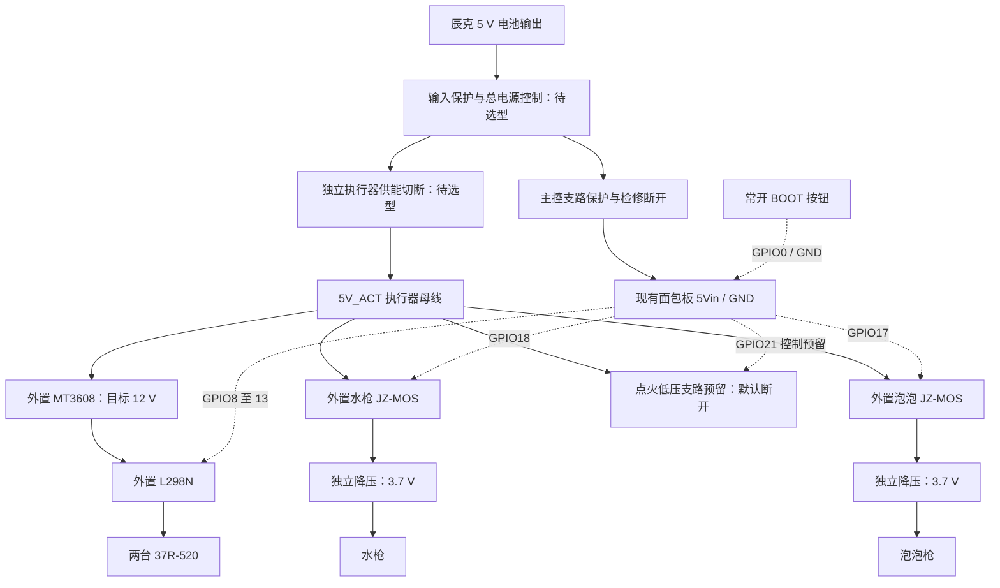

# CyberTrack 原理图设计与 PCB 打板

版本：设计说明 v0.3 · 2026-10-26。适用对象：原理图设计、PCB 布局、制板文件准备和首板检查。

**已完成 A1 模块级电气原理图，尚无 PCB 布线或 Gerber 生产文件，不能直接下单。** [KiCad 可编辑工程与说明](../hardware/schematic/README.md)及[五页 PDF](../hardware/schematic/CyberTrack-schematic.pdf)保留现有 ESP32-S3 开发板，按电气符号、端子和网络绘图。输入保护、主电源控制电路及元件数值／物理针序未冻结，仍以 `TBD` 标注。本文给出设计约束和交付标准；后续进度统一记入 [TODO](../TODO.md)，不以验收条件代替完成记录。

## 1. 设计范围与版本依据

首版候选采用**低压供电与接口转接板**：集中输入保护、供电分配、控制接口、默认关闭电路及测试点；现有面包板主控、L298N、MT3608、三块 JZ-MOS 和两块 3.7 V 降压板通过线束连接，暂不把模块电路重画为板载功率级。模块数量描述目标方案，不代表已到货或已完成全部接线。

这是一种便于逐项验证的设计建议，尚未冻结板尺寸和安装位置。若后续希望用 PCB 完整替换面包板，应另设计头舱主控／音频载板，先补齐主控实物排针、麦克风、功放、OLED 及按键电路资料；不能根据 GPIO 表直接完成音频板。

| 项目 | 本次采用的依据 | 对设计的影响 |
|---|---|---|
| 主电源 | [辰克 CK18650-1234S-NP](../hardware/components/ck-5v-battery/README.md)，标注 5 V，用户尺寸 116 × 70.5 × 19.5 mm | 输出电流、接头用途／极性及保护未知；不沿用旧 A110M 参数，不设计电芯充电电路 |
| 主控 | 现用 `bread-compact-wifi` 面包板 | 按实物丝印接线；独立 COREBOARD 的排针图不直接作为面包板封装依据 |
| 固件 | [apply_overlay.py](../firmware/esp32-audio/apply_overlay.py) 为 `2.0.3-ct20`（80% PWM，已刷写）；[输出实现](../firmware/esp32-audio/action_outputs.h)及[控制实现](../firmware/esp32-audio/cybertrack_tools.cc) | 固件引脚有源码依据；部署证据见 [ct20 记录](../firmware/esp32-audio/startup-ct20.json)，不等于新 PCB 验收 |
| 行走 | MT3608 目标 12 V → P13 L298N → 两台 37R-520 | 保留外置功率模块；核算升压输入、启动电流、驱动损耗及回灌 |
| 水枪／泡泡 | 用户确认均为 3.7 V；每路独立 MOS 和降压板 | 不能并成一个受控输出；保留两路独立回流 |
| 点火低压控制 | GPIO21 控制共用的一块 MOS；用户指定 5 V、单次最多 5 秒 | 只定义低压接口和禁用状态；不画高压输出、接线、电极及放电结构，不安排高压通电测试 |
| 总开关／BOOT | [电源开关](power-switch.md)及[外接 BOOT](boot-button.md)已有机械候选 | 开关额定能力未确认；BOOT 是软件停止输入，不是功率切断 |

现有接线与分项台架证据见[接线总表](wiring.md)、[电源与接口](power-and-interfaces.md)和[效果控制](effects-control.md)。这些页面包含历史版本；本页采用上表与当前源码，不继承旧版本的全部验证结论。

## 2. 总体电路框图

下图为目标连接关系。保护、切断器件均待选型，箭头表示供电路径，不是可直接接线的施工图。低压点火接口在首板验证中保持断开。



主控支路和执行器支路分别引出正负线。独立切断应能在 MCU 卡死或控制信号保持高时移除执行器供能；实现方式及断电后的储能释放仍待设计。2026-10-26 用户已确认：SW2 只切执行器，主控继续运行以保留语音／状态；此项已写入 A1。开关选型、残余能量与恢复供能行为仍待验证。

## 3. 原理图分图及必须画清的内容

当前 A1 使用 KiCad 原生工程，已用 KiCad 10.0.7 成功读取、执行 ERC 和直接导出 PDF。保存了项目及自定义符号库；符号 pin ID 表示 GPIO 或模块丝印，不代表连接器焊盘编号。尚无封装，所有符号均排除 PCB 转移和生产 BOM。当前分图如下：

| 页 | 内容 | 审图重点 |
|---|---|---|
| 1 / Power and isolation | 电池、保护和主电源控制待选电路、主控支路、执行器独立切断、支路保险及分图入口 | U2／U3 仍是待实现电路；保险、开关额定参数待选；不把功能矩形当成已购模块 |
| 2 / ESP32-S3 and BOOT | 同一开发板的 U1A／U1B、九路控制、BOOT 与保留外围信号 | 真实针序未冻结；X1 为已有外围的逻辑边界，不是新增 11 针连接器 |
| 3 / Motor drive | MT3608、L298N、两台电机及外部下拉候选 | 12 V 不进入主控；L298N +5V 不接；R1–R6 已选 10 kΩ、±1%、至少 0.1 W；整板偏置／失电行为待验 |
| 4 / Water and bubbles | 两路独立 MOS→降压→3.7 V 负载 | 受控负极分别命名，不能被系统地或另一支路短接 |
| 5 / Reserved ignition LV | 共用 MOS 的低压接口预留 | JP2 默认断开，U10／J9 在本审图装配中 DNP；不含实际点火负载或高压电路 |

后续板内电路设计仍须补齐保护器件、输入电容、测试点、实际连接器／封装和所需默认关闭电路，不能把模块级 A1 直接转为 PCB。当前 ERC 与 92 项网表／源码核对结果见[验证记录](../hardware/schematic/verification.json)。

### 3.1 电源与网络命名

| 建议网名 | 意义 | 允许连接与限制 |
|---|---|---|
| `5V_BAT` | 已核实电池输出的正极 | 仅进入输入保护；充电口不按此网处理 |
| `5V_SYS` | 输入保护及总电源控制后的 5 V | 分出主控和执行器支路；额定电压范围待核 |
| `5V_CTRL` | 主控支路保护、检修断开后的 5 V | 只进入面包板 `5Vin`；不进入 `3V3` 或 GPIO |
| `5V_ACT` | 独立执行器切断后的 5 V | 各支路经自己的保护／断开点去外部模块 |
| `GND_SYS` | 系统输入负极及控制参考地 | 功率回流与信号回流按路径布置；共地不等于共用细线 |
| `12V_MOTOR` | MT3608 输出正极 | 板外接 L298N `+12V`；首版不要求绕回转接板 |
| `WATER_SW_P/N` | 水枪 MOS 的 `VOUT+ / VOUT−` | 只接该路 P12 `IN+ / GND` |
| `BUBBLE_SW_P/N` | 泡泡 MOS 的 `VOUT+ / VOUT−` | 只接该路 P12 `IN+ / GND` |
| `3V7_WATER`／`3V7_BUBBLE` | 两路 P12 各自的输出正极 | 分别接对应负载；各负载负极回本路 `SW_N` |

**`WATER_SW_N`、`BUBBLE_SW_N` 和 `GND_SYS` 是三个不同的外部网络。** JZ-MOS 照片与低侧开关拓扑相符，但仍需断电通断核对；本设计沿用已有接法，避免绕过 MOS。不得通过第二块降压板、屏蔽层、测试夹、USB 地或监测电路把受控负极额外接到系统地。

每路水枪／泡泡的端点关系如下；两路各自完整复制，不能共用降压板的地：

```text
本路受保护 5V_ACT → JZ-MOS VIN+
GND_SYS           → JZ-MOS VIN−、控制 GND（实物内部关系待核）
本路 GPIO         → JZ-MOS TRIG/PWM
JZ-MOS VOUT+      → 本路 P12 IN+
JZ-MOS VOUT−      → 本路 P12 GND → 本路负载负极
本路 P12 VO+      → 本路负载正极（目标 3.7 V）
```

P12 的 EN 电平、默认偏置及可调状态未确认，不将 EN 直接接 GPIO。3.7 V 不在其资料的固定焊盘档位中，须核实实际调压方式。MOS 关闭不代表后级电容瞬间放空，停止延迟必须另测。资料见 [JZ-MOS](../hardware/components/jz-mos/README.md)和 [P12](../hardware/components/dc-dc-buck/README.md)。

### 3.2 控制信号表

表内为信号身份，不是连接器 Pin 1、Pin 2 的物理顺序。输出状态来自当前固件，外部下拉／缓冲及断电行为尚待电路验证。

| 建议网名 | 面包板 GPIO | 外部端点 | 正常关闭／作用 |
|---|---:|---|---|
| `MOTOR_A_EN` | 8 | L298N ENA | 低；固件使用 1 kHz PWM |
| `MOTOR_A_IN1` | 9 | L298N IN1 | 低 |
| `MOTOR_A_IN2` | 10 | L298N IN2 | 低 |
| `MOTOR_B_EN` | 11 | L298N ENB | 低；固件使用 1 kHz PWM |
| `MOTOR_B_IN1` | 12 | L298N IN3 | 低 |
| `MOTOR_B_IN2` | 13 | L298N IN4 | 低 |
| `WATER_EN` | 18 | 水枪 MOS TRIG/PWM | 低；当前为开关控制 |
| `BUBBLE_EN` | 17 | 泡泡 MOS TRIG/PWM | 低；接线与负载待验 |
| `IGNITION_EN` | 21 | 共用点火 MOS 的低压控制端 | 低；首板保持该支路禁用 |
| `BOOT_STOP_N` | 0 | 常开自复位按钮，另一端接 GND_SYS | 按下拉低；松开不恢复旧动作 |

L298N 的 ENA／ENB 常高跳帽应取下；独立的稳压跳帽沿用已核对的模块状态，`+5V` 端不接主控。A／B 对应车体左右及前进方向仍待装车标定。不能把 H 桥电机端任一根线固定接地。

下列资源已用于现有音频／显示／按键，不分配给新执行器。已核对当前导出构建的 `bread-compact-wifi/config.h`，可追溯说明见[面包板工程](../firmware/esp32-audio/README.md)：

| 功能 | GPIO |
|---|---|
| 麦克风 WS／SCK／主控 DIN | 4／5／6 |
| 功放主控 DOUT／BCLK／LRCK | 7／15／16 |
| OLED SDA／SCL | 41／42 |
| 说话按键、音量增加／减少 | 47、40／39 |
| 板载 LED | 48 |

音频供电、麦克风声道选择、功放增益／关断、扬声器阻抗和 OLED 上拉电压尚未完整记录；本版沿用现有模块连接。编码器、超声波、MG90S 和继电器没有冻结的整机接口，不从“剩余 GPIO”擅自分配；需要预留时标记未连接，后续核对资源和电平。

### 3.3 默认关闭、总开关与检修

- ENA／ENB 和三路 MOS 控制必须评估外部默认关闭电路，方向信号也应有明确状态。电阻值、串联保护和缓冲器按模块输入阈值、内部偏置、漏电及失电容限计算，不把同一个阻值套到所有模块。A1 的 R1–R6 已依据 L298 芯片输入参数选为 10 kΩ、±1%、至少 0.1 W，封装目标 0603；MOS 的 R7–R9 仍待实物输入偏置资料。计算和适用条件见[参数清单](../hardware/schematic/parameter-confirmation.md#r1r6-的定值依据)。
- 核查主控未上电、复位、下载、线束断开及 MCU 卡死时的行为。外部下拉只能处理浮空，不能抵消 MCU 持续输出高电平；独立供能切断须不依赖这些 GPIO。
- [现有拨动开关](../hardware/components/power-switch/README.md)的三个焊脚尚无触点定义或直流额定依据。未确认前不能串入整机大电流回路；若后续采用其控制功率开关的方案，必须重新审查关断及失效状态，不把电子关断等同于物理隔离。
- 外接 BOOT 与板载 BOOT 并联，只接 GPIO0／GND_SYS。GPIO0 在复位时拉低会进入下载模式；附加上拉、滤波及 ESD 器件不得破坏启动绑带和原下载电路。依据：[乐鑫启动模式说明](https://docs.espressif.com/projects/esptool/en/latest/esp32s3/advanced-topics/boot-mode-selection.html)。
- 外部 `5Vin` 与电脑 USB 默认不同时供电。首版提供主控外部 5 V 的明确检修断开点；未完成反灌验证前不新增双源自动切换承诺。USB 烧录时断开执行器功率，并核查信号线不能反向供电。
- 点火只保留低压功能接口，首次装配默认不装通往该支路的供电连接件／保持线束拔除，并标注 `DNP / 禁用`。本文不改变[效果控制](effects-control.md)的高压验证边界。

## 4. 电流预算与器件定值

四类动作允许并行；喷水／泡泡网页长按可持续续租，不能按“每次只工作几秒”选用只满足瞬态的线缆、稳压器或接头。软件定时不能代替热保护。当前点火单次上限 5 秒，间隔至少等于本次实际软件开启时长；不把这一规则当作硬件热额定值。

采用各支路折算到 5 V 输入端后的合计值：

```text
I5_total = I5_ctrl
         + (P_motor + P_driver_loss) / (V5 × η_boost)
         + P_water / (V5 × η_water)
         + P_bubble / (V5 × η_bubble)
         + I5_ignition_pair + I5_aux
```

峰值与连续值分别计算，并包含同时启动、低电量、线束压降及转换损耗。若直接测得某支路的 5 V 输入电流，使用该读数，不能再重复加算其内部损耗。

[37R-520 资料](../hardware/components/37R-520/README.md)的双电机额定点合计为 12 V × 1.10 A = 13.2 W；假设升压效率 85%，仅电机部分折算到 5 V 就约 3.11 A，尚未计 L298N 和其他支路。该数字是资料推导，用于说明必须补预算，不是新电池或 MT3608 的实测能力。

| 对象 | 定值前必须取得的数据 | 输出记录 |
|---|---|---|
| 电池及输入连接器 | 连续／峰值输出、保护阈值、极性、压降及低电量行为 | 允许输入范围、总预算及证据 |
| 升压与 L298N | 实际负载电流、效率、压降、温升、启动／制动瞬态 | 电机支路预算与保护要求 |
| 水枪／泡泡降压 | 允许电压、启动／持续电流、输出纹波、残余输出 | 每路稳压器、开关和连接器额定要求 |
| 三块 MOS | 实物拓扑、3.3 V 触发兼容、导通损耗、悬空与失电行为 | 控制级、保护和默认状态；点火仅作未验接口记录 |
| 保险／限流及反接保护 | 总线和各支路启动曲线、导线／接头承载能力、故障电流 | 具体型号、时间特性、损耗及配合关系 |
| 电容、钳位及滤波 | 电压容差、纹波／浪涌、负载与电源回灌能力 | 额定电压、容量／ESR、钳位范围和验证条件 |

不把电池容量换算成可用输出电流；不把 MT3608 的商品名“2A”视为 12 V 持续输出能力。感性负载保护按实际电路设计，不能在可反转电机两端随意并一只单向续流二极管。保护器件未选型前，不能宣称原理图已具备过流、短路或反灌保护。

## 5. 连接器与封装核对

候选接口按功能命名，**名称不代表已批准针序或采购型号**：

| 接口 | 应包含的网络／用途 | 冻结条件 |
|---|---|---|
| `J_BAT` | 电池输出正负极 | 明确充电口与输出口，核实极性及额定电流 |
| `J_CTRL_PWR` | 5V_CTRL、GND_SYS | 面包板真实针位、检修断开方式、线束压降 |
| `J_CTRL_IO` | 九路执行器控制信号及足够的参考地 | 可拆线束、返回路径、实物 GPIO 对照和防插反 |
| `J_BOOST_IN` | 受保护 5V_ACT、GND_SYS | 输入端电流预算；12 V 输出和电机线保持板外连接 |
| `J_MOTOR_CTL` | ENA、IN1、IN2、ENB、IN3、IN4、参考地 | 与 P13 丝印逐针对应；不得混入其 +5V 端 |
| `J_WATER`／`J_BUBBLE` | 各自 5 V 功率输入、功率回流、控制信号／参考地 | 决定功率与信号是否拆为两个接头，分别核定接触件额定值 |
| `J_IGN_LV` | 共用点火 MOS 的低压接口预留 | 默认断开，端子和供电额定未定，不含高压端子 |
| `J_BOOT` | BOOT_STOP_N、GND_SYS | 常开干接点、对插方向、低电流可靠性 |
| `J_SWITCH`／`J_ACT_CUT` | 总开关和执行器切断接口 | 电路选型完成后才确定承载电流和针数 |

每个接头形成一张受控针序表，至少包含：板端 Pin 号、网络、端子料号、线端配对型号、观察方向、锁扣方向、线规、接触件额定值和对端。板端视图与线端视图可能镜像，不能只写“从左到右”。

电源、3.7 V 负载和控制接口应采用可区分的防错连接方式，并提供应力释放。线色仅为辅助标识。模块封装必须来自对应实物尺寸图／测量；CAD 的长方体包络不能生成焊盘、孔距和禁布区。至少进行一次 1∶1 打印与实际器件叠合核对。

PCB 器件 BOM 单独列位号、数量、数值、封装、制造商料号、容差、额定值、替代料约束及 DNP 状态，再映射到[整机 BOM](../hardware/BOM.md)的 H03／H06／H13／H14／H15／H16。外置模块和线束进入整机装配清单，不混入贴片清单。

## 6. PCB 布局与布线要求

### 6.1 机械输入

板外形、固定孔、接头朝向和装配高度均待确定。先在[当前 FCStd](../hardware/model/CyberTrack.FCStd)中选定干舱位置，再纳入 PCB 外形和真实连接器模型。遵循 X 向左、Y 向后、Z 向上、前方 −Y 的整机坐标，记录 EDA 到 CAD 的旋转和平移。

必须检查板底焊点、隔离柱、螺钉头、接头拔插、线弯、端子工具、散热以及整板拆出路径；不能只验证裸 PCB 能放下。现有面包板包络、模块托架和电池空隙不是新 PCB 可直接占用的区域。STEP 用于交换，几何判断以原生 FCStd 及对应回读证据为准。

### 6.2 电气分区

- 按输入保护、功率分配、控制接口三个区域布置，尽量缩短输入和大电流回路。主控供电从分配点独立引出，电机与效果回流不经过主控地线或连接器。
- `GND_SYS` 的信号参考保持连续，避免信号跨越地平面缺口；通过布局和专用功率路径控制回流，不机械切碎地平面。受控 `SW_N` 若经过 PCB，使用各自独立铜区，禁止与系统地或另一支路合并。
- 功率焊盘、走线、过孔、铜皮和接头按最窄处核算；载流路径不能因焊盘热焊盘辐条或单个小过孔形成瓶颈。不能用“加锡”替代载流设计。
- 控制／BOOT 线远离升压开关节点、电机线和效果功率线，成组保留参考回路。保护器件靠近接口，去耦靠近对应电源入口；位置和取值与实际原理图一致。
- 若以后制作头舱载板，先识别实物天线类型，再按匹配的模组资料设置天线净空，不能在天线下任意铺铜或放金属紧固件；整机外壳与线束也纳入射频检查。参考[乐鑫 PCB 布局指南](https://docs.espressif.com/projects/esp-hardware-design-guidelines/en/latest/esp32s3/pcb-layout-design.html)。

### 6.3 制造参数与规则

首版转接板可从双层 FR-4、1.6 mm 板厚方案开始评估；这是候选，不是下单参数。层数、铜厚、表面处理、板厚公差、最小线宽／间距、孔径、孔环、铜到板边距离和阻焊规则，须结合功率预算、固定结构及选定板厂的实际能力冻结。更换为裸芯片主控或高密度载板时重新评估层叠。

建立至少三类网络规则：控制信号、5 V 主干／支路、受控功率回流。线宽依据连续／峰值电流、铜厚、长度、允许温升和压降计算；制造最小线宽不能作为电源线宽。测试点至少覆盖输入、保护后、主控 5 V、执行器 5 V、系统地、两路电机使能、三路 MOS 控制及 BOOT。受控负极测试点另加网名，不能标成普通 GND。

丝印标明板名、修订号、Pin 1、正负极、工作电压、接口功能、BOOT 和默认禁用支路。避免丝印压焊盘，固定孔周围按实际螺钉／垫圈建立禁布区。

## 7. 从原理图到打板的交付流程

| 阶段 | 必须产出 | 进入下一阶段的条件 |
|---|---|---|
| A. 输入冻结 | 电流预算、实物接口表、板框／孔位、器件与模块清单 | 影响本板供电、保护、封装和针序的 TBD 全部解决；排除功能明确隔离 |
| B. 原理图完成 | EDA 原文件、PDF、符号／封装对应表、ERC 报告 | 逐网核对供电与默认状态；无未解释的 ERC 错误；必要豁免有依据 |
| C. PCB 完成 | 布线源文件、3D 装配视图、载流／压降记录、DRC 报告 | 与原理图一致，未布通网络为零；无未解释的 DRC 违规；实物封装和装配检查通过 |
| D. 生产包冻结 | Gerber、钻孔、制造说明、版本及哈希清单 | 用独立 Gerber 查看器回读，板框／层序／钻孔与冻结 PCB 一致 |
| E. 首板制造 | 按冻结包制作的小批样板及板厂确认 | 下单参数与制造说明一致；板厂任何修改返回工程源文件复核 |
| F. 首板检查 | 装配版本、测量记录、问题与修订清单 | 按下节分阶段验证，不把裸板收货记为整机通过 |

ERC／DRC 只能检查已建模规则，不能发现所有错误针序、电流不足或模块资料错误。KiCad 的制造输出、钻孔与规则检查操作参考[官方 PCB Editor 手册](https://docs.kicad.org/9.0/en/pcbnew/pcbnew.html)；本项目需记录实际使用的工具版本和规则文件。

### 7.1 生产文件清单

当前原理图工程位于 `hardware/schematic/`；后续使用 `hardware/pcb/` 管理经过物理针序／封装映射的板内工程，按板名与修订号归档。尚未生成 PCB 生产文件。

| 文件类别 | 内容 | 交付对象 |
|---|---|---|
| 设计源 | `.kicad_pro`、`.kicad_sch`、`.kicad_pcb`、自定义符号／封装与库表 | 项目维护者；确保换电脑仍能打开 |
| 审图包 | 原理图 PDF、顶底层图、接口表、ERC／DRC 报告、机械核对记录 | 设计复核与装配 |
| 裸板生产包 | 所有铜层、阻焊层、使用的丝印层、板框 Gerber；PTH／NPTH 钻孔及槽孔说明 | PCB 板厂；不以屏幕截图代替 |
| 制造说明 | 外形、层数／层序、板厚与公差、铜厚、材料、表面处理、阻焊、数量、特殊孔槽及电测要求 | 与下单选项逐项对应 |
| 装配包（如需贴片） | BOM、坐标文件、顶底面装配图、Pin 1／极性、DNP 清单及钢网层 | PCBA 厂；手焊项目无需虚构贴片坐标 |
| 发布清单 | 板版本、源文件版本／哈希、生成日期、EDA 版本、各文件 SHA-256 | 防止不同修订混装 |

Gerber 回读核对层数、铜皮填充、板框闭合、孔槽／孔金属化、焊盘开窗和接口方向。坐标文件的原点、单位、旋转角和底面规则必须与装配厂约定一致；不能因 3D 视图正确就跳过生产文件检查。

## 8. 首板检查与记录

以下为未来低压首板验证顺序，尚未执行；不包含点火模块通电或高压接线。

1. **断电检查**：核对裸板和焊接外观、极性、料号、DNP；逐针通断对照接口表。检查输入正负极无异常短接，且各 `SW_N` 没有被转接板直接短到系统地或彼此短接。带有 MOS／电容的模块需按其电路解释读数，不能只听蜂鸣器判定。
2. **仅输入与保护**：先断开主控和全部负载，用限流低压电源验证输入路径、静态电流及切断功能。限流值依据已完成的预算和器件参数设定，禁止用未知能力的电池直接验证短路保护。
3. **仅主控**：核对面包板入口电压、启动、联网、声音与屏幕；检查上电、复位、下载、BOOT 和掉电过程中控制信号及主控反灌。实际执行器功率仍断开。
4. **低压假负载与故障状态**：按设计检查各受控支路、独立切断、主控失电与复位状态；确认软件退出后不会自动恢复。点火逻辑如需测量，只测隔离于实际点火模块的低压接口。
5. **获准的实际低压负载**：分别验证电机、水枪和泡泡的启动／停止、电源跌落、输入电流、连续工作与温升，再检查允许的并发组合。液路装配与用电条件单独确认，沿用[验证计划](verification-plan.md)；此文不启动现场带电操作。
6. **新电池整机工况**：在上述检查通过后，按已核实的电池能力验证同源供电、低电量、负载变化和故障切断；记录仪表、测点、采样条件、峰值／持续值与环境。万用表平均读数不能排除瞬态跌落。

首板记录至少含 PCB 修订、实际装配 BOM、跳线／DNP 状态、固件版本、供电设备、各阶段结果及异常。测量值与通过阈值分别记录，先定义阈值再判定；缺少允许范围的项目保持未验收。

本轮需要用户补充的优先项为电池输出规格、开关直流额定／触点关系、MOS／P12 断电识别和已有低压支路读数；完整编号、测点、已知值与回填模板见[待确认参数清单](../hardware/schematic/parameter-confirmation.md)。

## 9. 当前制板阻塞项

这些是本设计的放行条件，任务状态统一维护在 [TODO](../TODO.md)。

| 待补输入 | 不能提前冻结的内容 |
|---|---|
| 新电池的输出能力、接头用途与极性 | 总输入、保护、线规和总开关电路 |
| 双电机、两路 3.7 V 支路及主控的连续／峰值输入预算 | 铜厚／线宽、连接器、支路保护和散热 |
| 总开关额定值、触点关系、独立执行器切断方式 | 开关接线、硬件停止与故障恢复 |
| JZ-MOS／P12 实物拓扑和接口电气参数 | 默认关闭、受控负极、保护及停机残余输出 |
| 当前面包板与外置模块的真实接头／针序 | 符号映射、封装和防错线束 |
| 新 PCB 安装位置、板框、孔位、端子空间 | 机械尺寸和整板拆装 |
| 选定板厂能力、装配方式及可采购器件 | 制造规则、最终 BOM 和下单参数 |

截至本文版本，已完成设计说明、五页 A1 可编辑原理图、同源 PDF、KiCad ERC（0 条违规）及 92 项关键网表／源码核对。五页 PDF 已渲染逐页检查；ERC 使用本次记录的规则，默认忽略项保留在原始报告中，不将其表述为所有可能规则均已验证。PCB DRC、生产包回读、实板电气验证和整机验收均未执行，TBD 项仍阻止制造放行。
