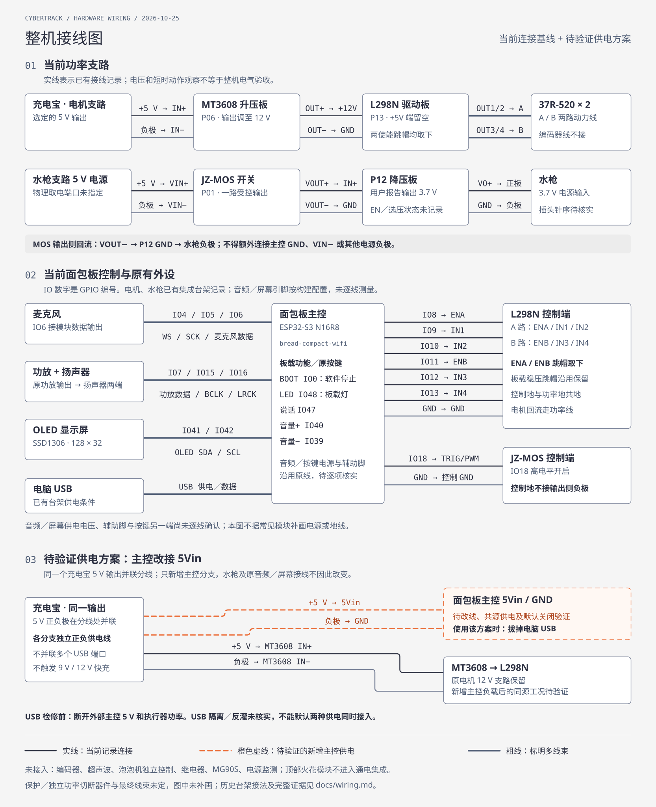

# 整机接线总表

更新：2026-10-25。集中记录已纳入项目的开发板、电子模块及电气负载，区分当前集成接法、历史台架接法和待确定项。机械件及液管安装见[装配说明](assembly.md)，器件编号沿用 [BOM](../hardware/BOM.md) 和[采购清单](../hardware/procurement.md)。

本表是接线查阅入口，不代表整机电气定版或实物验收。**当前集成控制器是 `bread-compact-wifi` 面包板；独立 N16R8 台架的 GPIO 表不能套用。**本文“当前”指仓库记录的连接基线，不表示设备此刻已通电，也不推定现场没有改线。

2026-10-25后续输入：主电源已换为[辰克5 V电池包](../hardware/components/ck-5v-battery/README.md)，具体接头与输出能力待核；下方原接线图仍描述更换前基线。用户要求两只点火模块共用第三块P01，由ESP32-S3控制；机械部分完成[安装位与走线空间](ignition-routing.md)；后续 ct13 分配 GPIO21 点火／GPIO17 泡泡的软件候选，未刷写、未接线，见[效果控制](effects-control.md)。

## 整机接线图

[打开矢量图放大查看](diagrams/wiring-overview.svg) · [浏览器版与可编辑源文件](diagrams/wiring-overview.html)

- **第 01、02 区为当前记录接法**：功率与信号分区绘制，同名主控、L298N 和 MOS 表示同一器件；粗线表示标签列出的多根线，不表示这些信号短接。音频／屏幕的 GPIO 来自构建配置，未确认的供电与辅助脚不补画。
- **第 03 区为待验证的供电变更**：橙色虚线是同一充电宝 5 V 输出新增至主控 `5Vin/GND` 的分支。它替换第 02 区的电脑 USB 供电，使用时拔掉电脑 USB；保留的电机支路不代表新增主控负载后的共源工况已通过。
- **MOS 输出侧负极保持独立回流**：`VOUT− → P12 GND → 水枪负极`，不额外并回主控 GND／VIN−。保护与独立功率切断器件最终接法未定，图中未补画；历史台架和待接入模块仍以下方表格为准。

图源为自包含 HTML 内的 SVG，文档使用同名 SVG 导出；修改时同步两份图形及下方对应表格。图中连线表示端点关系，不表示线色、物理位置、连接器针序或已完成全部实物验证。

## 状态与使用范围

| 标记 | 含义 |
|---|---|
| 当前接法 | 已有迁线／台架记录，或当前固件沿用的接口；各表另列证据范围 |
| 已选方案，待改线验证 | 用户已选择连接方案，但尚无改线完成和该供电工况的验证记录 |
| 历史台架 | 仅用于识别旧板、旧镜像及旧线束，不是当前整机接法 |
| 待确定／未接入 | 尚未分配引脚、未核实针序或未实现接入；不从空闲 GPIO、照片或线色补定 |

本表整理时核对的面包板工作区源码为 `2.0.3-ct11`：电机／水枪引脚见 [action_outputs.h](../firmware/esp32-audio/action_outputs.h)，BOOT 见 [cybertrack_tools.cc](../firmware/esp32-audio/cybertrack_tools.cc)。音频、OLED 和按键与该次导出构建的 `main/boards/bread-compact-wifi/config.h` 核对一致；可追溯配置及构建来源见[面包板工程](../firmware/esp32-audio/README.md)。源码配置证明软件使用的引脚，不替代逐线通断核对；后续版本与部署状态见[面包板工程记录](../firmware/esp32-audio/README.md)，实物分项结果见[集成记录](breadboard-integration.md)。

## 板卡与模块索引

| 板卡／模块 | 编号 | 接线状态与所在章节 |
|---|---|---|
| 面包板 ESP32-S3 N16R8 主控及原音频／屏幕组件 | H06–H08 | 当前控制器；见当前信号表。USB 供电有历史联调，5Vin 供电另列待验证方案 |
| L298N 双路电机驱动板 | H03／P13 | 当前 GPIO8–13，12 V 电机支路；独立台架接法另列 |
| 37R-520 电机两台／编码器 | H02 | 动力线接 L298N；编码器未接入 |
| 充电宝、MT3608 升压板 | H12／P11、H13／P06 | 电机 12 V 支路已有台架观察；主控同源分支待验证 |
| JZ-MOS 双 MOS 并联开关板 | H14／P01 | 当前 GPIO18 控制水枪支路；“双 MOS”是一路开关，不是两路独立输出 |
| DC-DC 降压板、水枪 | H14／P12、H09／P09 | MOS 后置降压至 3.7 V；见功率端接线表 |
| 泡泡机及自带风扇 | H10／P10 | 3.7 V 参数已记录；ct13 候选 GPIO17 独立 MOS 控制，未接线验证 |
| 超声波模块、MG90S、继电器模块 | H19／P04、H18／P03、H14／P02 | 待确定，尚无当前整机 GPIO 接法 |
| 前方双火花效果模块（本体位于背包两侧） | H11／P05 | [0.48机械走线及共用MOS安装位](ignition-routing.md)仅为候选；ct13 仅增加低压 MOS 控制候选；不进入当前通电集成，不提供高压接线 |
| 物理停止、总开关、保护、接头与线束 | H15／H16／H20 | 独立断电需求保留；最终器件、线径、针序及线长待确定 |
| 独立 N16R8／COREBOARD 台架板 | P07 板卡资料 | 历史电机、MOS、灵矽及无负载检查工程；与面包板分开识别，不合并两板输出 |
| DF-MD V1.3 驱动板 | 原 H03，已被 P13 替代 | 历史故障台架，保持断电、断线 |

## 当前接法：面包板信号

### 电机、水枪与停止

以下 GPIO 为 ESP32 信号编号，按实物 IO／GPIO 丝印定位，不是排针的顺序号。连接关系已在 ct6 迁线及基本台架中记录，本次核对的 ct11 源码沿用；不把旧版本的功能观察转移为新版本完整验收。

| 主控端点 | 模块端点 | 用途／默认关闭状态 | 证据与限制 |
|---|---|---|---|
| IO8 | L298N ENA | A 路 PWM 使能；关闭为低 | 当前源码＋集成台架记录 |
| IO9 | L298N IN1 | A 路方向 1；关闭为低 | 同上 |
| IO10 | L298N IN2 | A 路方向 2；关闭为低 | 同上 |
| IO11 | L298N ENB | B 路 PWM 使能；关闭为低 | 同上 |
| IO12 | L298N IN3 | B 路方向 1；关闭为低 | 同上 |
| IO13 | L298N IN4 | B 路方向 2；关闭为低 | 同上 |
| GND | L298N GND | 控制共地 | 电机功率回流走独立功率线，不经过面包板或主控排针 |
| IO18 | JZ-MOS TRIG/PWM | 水枪使能；高电平开启、关闭为低 | 当前源码＋控制线纠正后的喷水记录；不用 PWM 调水量 |
| GND | JZ-MOS 控制 GND | 控制共地 | 不连接 MOS 输出侧负极 |
| 板载 BOOT／GPIO0 | 板载按键，沿用板内连接 | 按下低有效，软件停止电机及水枪，释放不恢复 | 无新增外接停止线；不等于独立断电开关，不按住 BOOT 上电／复位 |

L298N **ENA、ENB 两个常高使能跳帽取下**，沿用已测台架的板载稳压跳帽保留状态；`+5V` 端不接主控 `5Vin`／`3V3`。迁线时原台架六根控制线及旧 ENB 接地线已要求移除，不并联两块 ESP32 的输出。跳帽状态只适用于已核对的这块 P13 板，见[台架接线](../firmware/esp32-motor-bench/README.md)。

A 路候选为车体左电机，B 路候选为车体右电机，左右按机器人自身视角。源码正向为每路第一方向输入高、第二方向输入低；空载组合已有观察，装车后的左右及前进方向仍需标定。应用配置后的低电平与内部下拉不保证上电前、复位或失电时关闭。

### 麦克风、功放／扬声器、OLED 与按键

这些连接沿用现有面包板，GPIO 已核对构建配置，声音和屏幕有功能观察；尚无完整逐线测量表。表中数据方向均以主控为参照，不能把主控 I²S 输出直接接无源扬声器。

| 主控端点 | 外设信号／端点 | 当前依据及未确定内容 |
|---|---|---|
| IO4 | 麦克风 WS | I²S 字选择；模块具体型号、端子位置待核实 |
| IO5 | 麦克风 SCK | I²S 时钟；沿用原线 |
| IO6（主控 DIN） | 麦克风数据输出 | 数据送入主控；麦克风端可能标 SD 等，以实物为准 |
| IO7（主控 DOUT） | 功放／音频输出模块数据输入 | I²S 数据从主控送出，模块输入丝印待核实 |
| IO15 | 功放／音频输出模块 BCLK | I²S 位时钟 |
| IO16 | 功放／音频输出模块 LRCK | I²S 左右声道时钟 |
| 功放扬声器输出 | 扬声器两端 | 沿用原连接；输出端标识、极性、扬声器阻抗／功率待核实，不自行将任一端接地 |
| IO41 | OLED SDA | 当前配置 SSD1306、128×32，I²C 数据 |
| IO42 | OLED SCL | I²C 时钟；模块电源与上拉电压待逐线核对 |
| IO47 | 按住说话按键／触摸输入 | 配置为 TOUCH_BUTTON_GPIO；模块型号、另一端及供电未形成接线记录 |
| IO40 | 音量增加按键输入 | 按键另一端、上拉及物理连接待核对，沿用原线 |
| IO39 | 音量减少按键输入 | 同上 |
| IO48 | 板载 LED | 板内连接，不另分配给执行器 |
| 原音频／屏幕供电与地线 | 麦克风、功放、OLED 的电源端 | 沿用现有连接；各模块 VCC 电压、GND 端及附加配置脚尚未逐项确认，不统一改接 5 V 或 3V3 |

麦克风声道选择脚、功放增益／关断脚等若实物存在，当前资料未给出其连接，不据常见模块接法补齐。当前原音频电路没有已确认的额外 I²C codec 控制接线。依据见[面包板 GPIO 表](../firmware/esp32-audio/README.md)及[音频联调记录](audio-board-validation.md)。

## 当前接法：功率端与接地

### 电机与水枪支路

| 来源端点 | 接到端点 | 电压／状态与依据 |
|---|---|---|
| 充电宝选定 5 V 输出正极 | MT3608 IN+ | 电机升压输入；端口及分线工况见[电源方案](power-and-interfaces.md) |
| 同一输出负极 | MT3608 IN− | 电机支路功率回流 |
| MT3608 OUT+ | L298N +12V | 已调至 12 V，台架有约 12 V 用户观察；保护／断电器件最终接法未定 |
| MT3608 OUT− | L298N GND | 独立功率回线，另保留主控控制共地 |
| L298N OUT1、OUT2 | 电机 A 两根已核实动力线 | H 桥换向，两根都不是固定地；不按线色猜插头针序 |
| L298N OUT3、OUT4 | 电机 B 两根已核实动力线 | 同上；编码器四根线分别绝缘，不接入 |
| 水枪支路 5 V 电源正极／负极 | JZ-MOS VIN+／VIN− | 已有喷水观察；不据记录推定与主控共用哪个物理 USB 口 |
| JZ-MOS VOUT+ | P12 降压板 IN+ | MOS 在降压之前 |
| JZ-MOS VOUT− | P12 降压板 GND | 属于受控输出侧回流，不额外接系统地 |
| P12 VO+ | 水枪电源正极 | 用户报告输出 3.7 V；插头编号／线色未定 |
| P12 GND | 水枪电源负极 | 仅回到 MOS 输出侧；不额外接主控 GND／VIN− |
| P12 EN、选压焊盘 | 保留已有设置，具体接法未记录 | EN 有效电平／偏置未知；3.7 V 不在资料固定档位中，不推定已桥接某个档位 |

依据：[MOS 端子实物](../hardware/components/jz-mos/README.md)、[降压板资料](../hardware/components/dc-dc-buck/README.md)、[水枪支路记录](mos-bench.md)、[面包板集成记录](breadboard-integration.md)。JZ-MOS 的照片走线与低侧开关相符，但未以原理图／通断测量完成拓扑验收；按既有接法隔离输出侧回流。**P12 GND／水枪负极不能额外并回主控 GND、MOS VIN− 或其他电源负极，以免绕过开关。**

控制地、功率输入负极与受控输出负极不能混为同一接线点。主控只连 L298N GND 和 MOS 控制 GND；大电流通过各支路功率线。水枪的 3.7 V 不供主控，也不接 GPIO。单次喷水及空载电机观察不证明整机电源预算、启动瞬态、温升或故障关断通过。

### 主控供电：已有 USB 记录与待验证的 5Vin 方案

| 状态 | 连接 | 边界 |
|---|---|---|
| 已有台架记录 | 电脑 USB → 面包板主控 USB；L298N 12 V 与 MOS 5 V 另行控制通断 | 历史联调的供电条件；具体维护端口按当前设备识别，不能据另一块台架板的 COM 经验推定 |
| 已选方案，待改线验证 | 充电宝同一个 5 V 输出在分线处并联：正极分别到主控 5Vin、MT3608 IN+；负极分别到主控 GND、MT3608 IN− | 已有主控正面照片确认针位，尚无该改线完成／共源运行结果 |
| 检修供电切换 | USB 烧录前断开外部主控 5 V 及执行器功率；外部 5Vin 供电时拔掉电脑 USB | USB 隔离／反灌保护未核实，不支持默认双源同时供电 |

照片方向为元件面朝观察者、天线朝上、双 USB 朝下，左排最下方为 GND、倒数第二针为 5Vin；仍以实物丝印核对。照片及证据边界见[供电针位记录](audio-board-validation.md#2026-10-25-面包板供电针位照片)。

同源方案只允许稳压 5 V 进入主控 5Vin；不把 MT3608 的 12 V 或 L298N 的 +5V 端接到主控。不并联多个 USB 输出口，也不对该共用输入触发 9 V／12 V 快充。主控和升压板各用独立正负供电线；电机电流不经过面包板电源轨。原音频／屏幕供电沿用，水枪支路也不因此改线。详细图、功率预算及待验证工况见[电源与硬件接口](power-and-interfaces.md)。

## 历史台架接法

以下按控制器和镜像分组，**不能同时套用，也不能与当前面包板输出并联**。历史板卡的 J1／J2 针号仅适用于[COREBOARD 资料](../hardware/components/ESP32-S3-N16R8/README.md)，不能当成 GPIO 号或直接移植到另一块实物板。

### 独立 N16R8：L298N 电机台架

| 阶段 | 台架主控 → 模块 | 供电、跳帽与未接端 |
|---|---|---|
| 双路 0.3.x，末次记录 0.3.2 | GPIO4→ENA、5→IN1、6→IN2；GPIO7→ENB、8→IN3、9→IN4；GND→L298N GND | 电脑 COM USB 供主控；MT3608 OUT+／OUT−→+12V／GND；OUT1／2→A，OUT3／4→B；ENA／ENB 跳帽取下、独立稳压跳帽保留、+5V 留空；编码器不接 |
| 单路 0.2.x | GPIO4→ENA、5→IN1、6→IN2；GND→L298N GND | 仅 A 接 OUT1／2；ENB 接 GND，IN3／IN4 当时留空、B 无电机；其余供电与跳帽同上。ENB 接地线不能留到双路／面包板接法 |

双路台架中 GPIO4／5／6／7／8／9 对应图纸 J1-4／5／6／7／12／15，GPIO8、9 并不紧接 GPIO7。BOOT 为 GPIO0。这里“历史”相对于当前整机集成，不表示独立工程已删除；详细接法及限定空载证据见[电机台架工程](../firmware/esp32-motor-bench/README.md)和[单路历史](motor-bench.md)。

### 独立 N16R8：MOS、水枪联网及无负载工程

| 工程／阶段 | 控制接线 | 功率及范围 |
|---|---|---|
| MOS 串口台架 `0.1.1-mos-bench` | GPIO4→MOS TRIG/PWM，GND→控制 GND；BOOT 为 GPIO0 | 与电机驱动全部断开后复用 GPIO4；5 V→MOS→P12 降压至 3.7 V→水枪，端子关系同上；一次最长 5 秒 |
| 灵矽独立联网板 `0.2.0-linx-water-bench` | 同上，仍用 GPIO4／GPIO0 | 本机单次授权后联网请求五秒喷水；不能套用面包板 GPIO18 或当前语音授权流程 |
| 更早联网只读 `0.1.0-linx-readonly` | GPIO4 保持低，BOOT 为 GPIO0 | 当时只开放状态／停止，不代表已有喷水动作能力 |
| `firmware/esp32` 无负载／BOOT 检查 | 仅 USB，后续 GPIO0 读取板载 BOOT | 无执行器 GPIO／PWM，不接电机或 MOS 输出控制线 |

来源：[MOS 工程](../firmware/esp32-mos-bench/README.md)、[灵矽工程](../firmware/esp32-linx/README.md)、[无负载工程](../firmware/esp32/README.md)。面包板较早 ct3–ct5 已用 IO18→MOS，ct6 才加入 IO8–13 电机；这些软件阶段不构成额外一套音频板。旧的“先降压 3.7 V 再进 MOS”曾为讨论方案，已撤销，不能作为已完成台架接法。

### DF-MD V1.3：已停用

| 历史来源端点 | 历史连接 |
|---|---|
| 独立 N16R8 GPIO4／GPIO5／GND | DF-MD E1／控制排针 M1／GND |
| DF-MD E2、控制排针 M2 | GND，第二路关闭 |
| 第一通道两个电机输出端子 | 已核实的两根电机动力线；控制排针 M1 与电机输出端不同 |
| MT3608 OUT+（当时 12 V） | 分别到 VS、VD；当时取下 VD／VS 选择跳帽 |
| MT3608 OUT− | DF-MD 电源 GND |
| 电脑 USB | 独立 N16R8 COM USB；BOOT 为 GPIO0 |

此表只转录[历史台架记录](../firmware/esp32-motor-bench/df-md-history.md)，该板有两路无输出／稳压异常记录，保持断电、断线；不作为重新上电步骤。更早按钮＋3V3 手动方案未执行，不列为已实现接法。L298N 没有可照搬的 VD／VS、E／M 接线。

## 待确定／未接入项

| 模块／接口 | 已知事实 | 尚缺信息与当前处理 |
|---|---|---|
| 两台 37R-520 编码器 | 每台预期 AB 两路输入，资料中的两套六针顺序冲突 | VCC、GND、AB、动力线针序、输出类型／电平及主控 GPIO 未定；编码器线逐根绝缘，不供电、不接 GPIO。见[编码器资料](../hardware/components/37R-520/README.md) |
| HC-SR04 类超声波 H19／P04 | 通用资料列 VCC／TRIG／ECHO／GND，但电源范围存在冲突 | 实物针序、供电、电平转换和 GPIO 未定；CAD 向上接头／线束只是空间占位，不是电气接入。见[部件资料](../hardware/components/ultrasonic/README.md) |
| 泡泡机及自带风扇 H10／P10 | 用户确认工作电压 3.7 V，可自吸 | 允许范围、启动电流、插头极性、独立 MOS／降压支路待验，ct13 候选 GPIO17 未接线；不直接复制水枪支路，不假设风扇有独立引脚。见[部件记录](../hardware/components/bubble-gun/README.md) |
| 继电器 P02 | 采购选项为一路 5 V 红板 | 未分配负载；实物针序、触发电平、供电及触点接法未定，不自行分配 IN 或 NO／NC／COM。见[采购核对](../hardware/procurement-web-review.md) |
| MG90S 舵机 H18／P03 | 已列入采购候选 | 用途、数量、供电、峰值电流、插头顺序及 PWM GPIO 未定，不按常见线色接线 |
| 顶部火花效果 H11／P05 | 仅记录输入 3–6 V、单次≤5 秒需求，当前模型已移除旧占位 | 安全、绝缘、液体共存及 EMC 未验收；ct13 候选 GPIO21 仅用于低压 MOS 控制源码，不进入通电集成或实现高压接线 |
| 独立物理停止／总开关 H15 | 要求能独立切断执行器供能 | 器件额定、两功率支路切断方式、保护／下拉和状态输入未定；BOOT 是软件停止，不能代替该项 |
| 电源监测 | 没有已选电压／电流传感器 | 无已确认接线或 ADC／总线分配，不声明已有电量／过流遥测 |
| 音频、OLED、按键辅助脚 | 当前功能及主信号 GPIO 有记录 | 型号、VCC、地、上拉、声道／增益等附加脚待逐线确认，沿用原线；见当前信号表 |
| 主控 5Vin 同源分支及整机线束 | 已选同一 5 V 输出分线方案 | 分线器、线径、线长、接头锁定／针序、保险与接地布线、默认关闭及反灌验证未完成 |

待办及验收状态继续在 [TODO](../TODO.md)、[开发板清单](../firmware/BOARD-INFO.md)和[验证计划](verification-plan.md)维护；本表不另立一套验收勾选清单。

## 引脚与维护约束

- N16R8 的 GPIO35–37 为八线 PSRAM 资源，不分配外设；GPIO19／20 涉及原生 USB，43／44 涉及 UART0，48 为板载 LED。GPIO0、3、45、46 涉及启动绑带；GPIO0 仅沿用已记录的 BOOT 用法。原 COREBOARD 的 GPIO39–42 默认 JTAG 资源说明不能推翻面包板已确认的 OLED／按键配置，也不能据此把另一块板认定为同版。完整排针资料见[板卡记录](../hardware/components/ESP32-S3-N16R8/README.md)。
- 焊接、迁线、刷写、复位或切换 USB 前先断开执行器功率；改线再断开主控。现有无外部使能下拉条件下沿用主控先启动、确认关闭后接执行器功率，收尾先断执行器的台架顺序；共同电源一次上电的默认关闭仍待验证。
- 新增或迁移接线时，同步本表的端点、状态、板卡／固件适用范围及证据链接，并更新受影响的工程 README、[电源与接口](power-and-interfaces.md)和必要 BOM／验证项。保留历史行，不把旧实测改写成新接法通过；未核实的端点继续标为待确定。

## ct13 新增控制信号候选

新源码分配泡泡 MOS 为 GPIO17、两只点火共用 MOS 为 GPIO21，水枪保持 GPIO18；这是板级配置静态核对后的候选，未确认实物排针／接线或复位电平。用户给定点火 5 V、≤5 秒，不提供高压端接线。泡泡保持 3.7 V 供电需求，三块 MOS 各一路的用途及验收边界见[效果控制](effects-control.md)。本节更新上文“GPIO 未定／未实现”的软件状态，不把旧水枪接线证据套用于新增负载。

ct13 图文同步状态：上方 SVG／HTML 整机接线图仍为旧基线，尚未绘入泡泡 GPIO17 和双点火共用 GPIO21；不能作为完整 ct13 接线图。新通道以本节及[效果控制](effects-control.md)为准，图示待后续同步。
