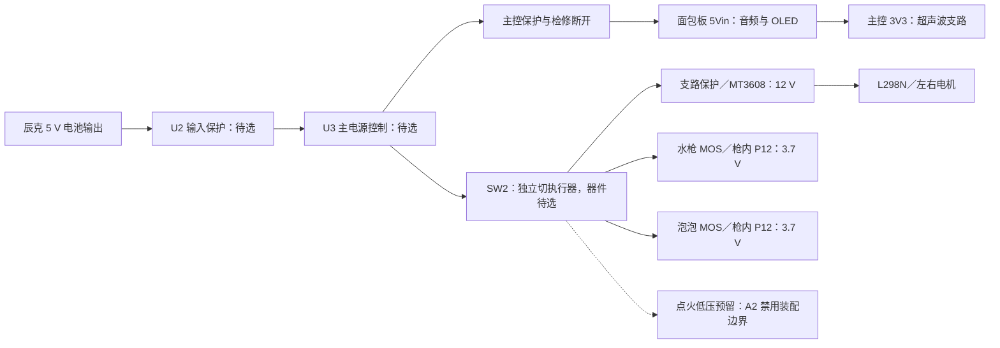

# CyberTrack 硬件架构

2026-10-31 设计基线。目标是让灵矽驱动的机器人同时具备可解释的软件行为、可追溯的供电设计和可维护的机械布局。当前为模块级设计与计算入口，电源能力、保护与装配尚未完成实物验收。执行进度以 [I12 / H01–H06](../../docs/improvement-plan.md) 为准。

## H01：电源树与预算



这是 A2 功能拓扑，不能据此接线。U2/U3、保险和具体额定值未冻结；SW2 只切执行器的功能已确认，主控实际保活与切断后残压待测。主控与执行器的现场供电来源必须在每次测量记录，不能由图推断已经按图接好。点火按 A2 的 JP2 断开、U10/J9 不装边界保留；不安排高压接线或通电。

[power-budget.json](power-budget.json) 将输入电流分成主控／音频、整个电机支路、喷水、泡泡及点火五个互不重复的负载域，记录 idle、run、start 三种工况。所有支路在每个场景都有一项；未启用的支路也不能自动忽略静态消耗。主控域包含音频、屏幕及由该域供电的超声波；电机域包含升压损耗、驱动板和两台电机。

```sh
python3 scripts/power_budget.py --output output/improvements/power-budget.json
python3 -m unittest discover -s tests/improvements -v
```

字段采用 `{value, kind, source}`。`kind` 区分 measured／vendor_spec／user_spec／assumption／derived／unknown；未知写 `null` 并说明缺口。首版真实数据尚缺，因此六个场景均应输出 `insufficient_data`。这是正确的待测结果，不能补造零值使表格变绿。

优先记录各域 **5 V 输入端的整域电流**。只有取得完整下游功率和对应工况效率时，才可改用 `output_power_w` 与 `efficiency`：`I输入 = P输出 ÷ (V输入 × η)`；二者不能与输入电流同时计入同一域。下游功率须包含驱动消耗，效率须覆盖相应转换链。计算仅为指定电压下的代数预算，不预测欠压时的恒功率吸流、线束压降或启动波形。

稳定场景只比较已填的电池持续额定值；启动峰值保留总和，不拿持续额定或未注明时间的峰值额定判通过。`within_stated_limit` 仅表示算术上低于填入值，始终不产生电气验收结论。续航待取得实测可用输出 Wh 和实际周期平均功率后另算，不将电芯铭牌 mAh 直接当作 5 V 可用容量。三次典型流程、采购成本与维护记录沿用[验证模板](../../docs/validation/README.md)。

## H02：电源管理与保护状态

| 状态／故障 | 软件与设计要求 | 尚需闭合的硬件证据 |
|---|---|---|
| 上电／MCU 复位 | 输出默认关闭；停止后不恢复旧动作 | 实际驱动输入偏置、供电先后及启动电平 |
| 语音或 Wi-Fi 中断 | 按当前固件来源规则停止；本地计时不靠云端 | 失联检测时间与机械停机时间分别测 |
| SW2 关闭 | 执行器供能切断，主控仍可解释状态 | DC 分断额定、残余储能、主控不断电、恢复不误动 |
| 电池掉压／保护动作 | 新命令需在设备正常恢复后重新发起 | 电池保护阈值／恢复条件、主控复位与各支路输出波形 |
| USB 与外部 5Vin 同接 | 按主控已核实供电入口设计 | 隔离／反灌资料，不能假设开发板自动隔离 |

欠压监测、硬件故障输入和主动电源管理尚未实现；不把普通状态回执写成电压／电流遥测。U2/U3、F1–F7、R7–R9 等以 [A2 参数清单](../schematic/parameter-confirmation.md)为唯一待选记录。器件选择顺序是确认负载及持续／瞬态条件，再核对开关、连接器、导线、保险与散热，最后冻结定值和封装。

## H03：回流、噪声与可区分的测量

主控、升压电机与效果功率支路应有明确的供电／回流路径。模块级分线优先让大电流回路直接返回电源分配点，避免通过音频、GPIO 或主控细线承载负载电流；未来 PCB 仍要依据信号回流设计连续参考面，不能机械地“割地”。具体端子以 A2 网表为准。

受控负极 `WATER_SW_N`、`BUBBLE_SW_N`、`IGNITION_SW_N` **不是 `GND_SYS`**。P12 的负极必须保持在对应 MOS 受控回流域内，不得因增加公共地线、屏蔽或测试接地而旁路 MOS。测量夹具与仪器地是否共地须先确认；本页不授权现地接线操作。

| 同步观察位置 | 能区分的问题 | 记录内容 |
|---|---|---|
| 电池输出与主控 5Vin | 电池掉压与主控分线压降 | 空闲／语音／电机起动波形、仪器与线束版本 |
| 电池输出与升压输入／12 V 母线 | 输入不足与升压限制 | 电流、最低电压、持续时间和负载条件 |
| 效果 MOS 输入与 P12 输出（对本路负极） | MOS／降压启动／关断残压 | 控制时刻、输出波形、实际效果起停 |
| 音频异常与上述电源时序 | 供电相关性与纯软件异常 | 固件回执和音频异常时间；不能仅据相关性定根因 |

局部储能与高频去耦的容量、耐压、ESR、浪涌及布局必须结合模块现有电路选择。增加电容可能改善瞬态，不能补足持续供电功率；当前不指定未经核实的电容定值。散热、RF 天线区域和功率线束保持独立的布置审查项。

## H04：接口与可维护单元

| 单元 | 接口依据 | 需要冻结的内容 | 独立维护目标 |
|---|---|---|---|
| 头舱面包板、音频、OLED | [接线表](../../docs/wiring.md)、A2 主控页 | 针位／电平、头颈线束线规与余量、USB 空间 | 头舱移开不牵拉焊点 |
| 电池与配电 | 辰克部件资料、A2 电源页 | 接头用途与极性、额定、固定与应力释放 | 可取电池，不借信号线受力 |
| 底盘升压与 L298N | A2 电机页、驱动板资料 | 模块版本、使能跳帽、电源端子、防松和散热 | 独立检查左右电机与升压 |
| 水枪、泡泡枪 | A2 效果页、P01/P12 记录 | 输入端接、受控负极、枪内降压布局 | 枪体拆卸不拆头舱，液路与电接点可分别维护 |
| 超声波 | A2 第六页 | 3V3 余量、TRIG 门限、ECHO 电平与真实针序 | 可拆换且不以照片比例补尺寸 |
| 停止接口 | BOOT/SW2 现有设计 | 外接按钮触点、SW2 功能与 DC 额定 | 家长能直接操作，不依赖云端 |

这张表定义单元和闭合任务，不新造连接器针序。原理图、线束、固件与 CAD 的实际接口必须同版本核对；不得以有防呆外壳替代逐线电气验证。选定连接器时记录插拔寿命、额定电流的温升条件、适配线规与端接工具，不只看最大宣传电流。

## H05：部件造型与设计工具

机械数据分四层维护：有来源的尺寸／外形、布局包络、禁布空间、操作与维护空间。包络用于碰撞筛查，不能生成未测的安装孔或焊盘；电池116 × 70.5 × 19.5 mm 是用户尺寸，不含未经测量的接头和线缆弯曲余量。天线、散热、插头拔出与螺丝工具空间分别记录，不能都等同于一个长方体。

[部件资产](../components/)保持只读来源与厂商标识；整机 [FCStd](../model/CyberTrack.FCStd)为几何依据。公差采用来源明确的设计值／打印试配结果，未知项不从照片估计。当前保留水瓶，泡泡液供给方式按现行需求继续核实，不沿用已删除的泡泡液瓶布局。

[模型辅助设计接入](../../tools/solidcue/README.md)已从独立单件研究扩展到完整整机：真实宿主评论触发处理，经 FreeCAD GUI 完成研究副本中的冠盖位置调整、保存重开、同一卡片更新与恢复，正式模型及其余 197 件保持不变。当前整机编辑限于受支持的静态零件位置调整；单件参数修改另有适用条件，不自动赋予任意整机特征参数编辑能力。正式零件仍须经过打印、装配与维护验收。

## H06：参考与采纳矩阵

以下资料于 2026-10-31 查阅，只引用与本项目相关原则，未复制原图或库文件；厂商资料和 KiCad 文档保留各自权利。若未来导入第三方符号、封装或模型，需单独记录其具体版本和许可。

| 来源 | 适用原则与本项目采纳点 | 不直接移植的内容／验证 |
|---|---|---|
| [Espressif ESP32-S3 PCB Layout Design](https://docs.espressif.com/projects/esp-hardware-design-guidelines/en/latest/esp32s3/pcb-layout-design.html)，latest，查阅日期如上 | 电源入口、短去耦回路与参考面；用于未来载板和头舱布局审查 | 现用完整面包板，不把裸芯片引脚电容和线宽直接加到未知模块；核对模块电路及带载波形 |
| [TI SLVA959B，2021-10 修订，§1/§5](https://www.ti.com/lit/an/slva959b/slva959b.pdf) | 区分低频储能与高频旁路，压缩功率回路；用于电机供电、局部储能和回流审图 | 文档面向 DRV 系列，不证明 L298N/MT3608 保护或热能力；实际模块、开关波形、温升另验 |
| [KiCad Library Conventions 3.0.67，F4.1/F4.5/M1/M2](https://klc.kicad.org/) | 数据手册优先、禁布标记、模型源文件／交换件及来源管理；用于自建部件库与 CAD 追溯 | 社区库规范不是电气认证；不移植其他坐标系、不重授权厂商资产；针脚／封装／模型逐件交叉核对 |

## 退出条件

当前交付了架构、接口边界、参考矩阵和可执行预算；没有取得新的实物读数，也未更改 A2 图纸、BOM 定值或生产 CAD。H01–H06 的最终完成仍需预算回填、器件选型和独立的装配／电气／停止／负载证据。现场条件不足时先保留明确的未知项，按[参数清单](../schematic/parameter-confirmation.md)逐项关闭。
