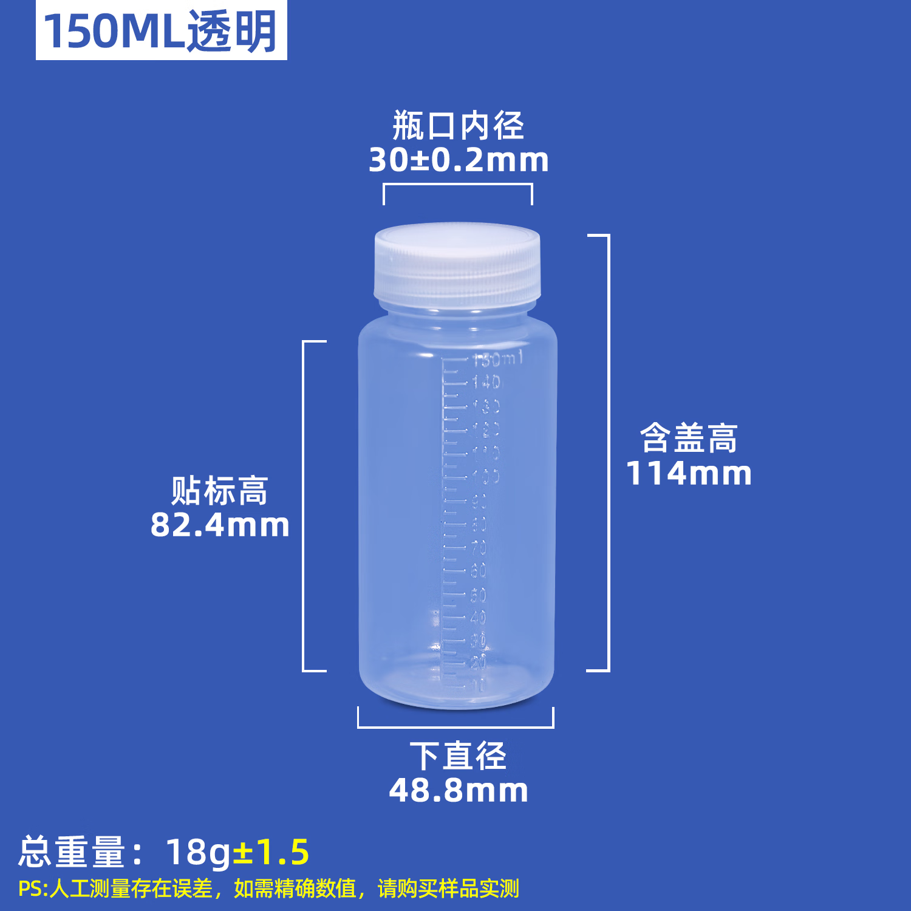

# 150 mL 成品液瓶包络

2026-10-25 用户指定两只150 mL瓶子，随后提供[京东商品链接（100222905645）](https://item.jd.com/100222905645.html)和下方尺寸原图，对应采购P14／BOM H23。商品页本次尝试读取但不可访问，以下仅依据用户提供的商品图片，不声称网页核验或实物测量通过；品牌、材料、订单及到货状态未提供。

| 商品图标注 | 数值 | 证据边界 |
|---|---|---|
| 规格 | 150 mL，透明 | 图示容量／外观规格；不推定树脂种类 |
| 下直径 | 48.8 mm | 不是已确认的整瓶或瓶盖最大外径 |
| 含盖高 | 114 mm | 商品图标称，未实测 |
| 瓶口内径 | 30 ± 0.2 mm | 不等于瓶颈外径、螺纹规格或盖外径 |
| 贴标高 | 82.4 mm | 不直接作为可夹持直筒长度 |
| 总重量 | 18 ± 1.5 g | 图示标称，未实物称重 |

图片注明人工测量存在误差，精确尺寸需样品实测。瓶盖最大外径、瓶肩轮廓、瓶口螺纹、材料及其余尺寸公差仍待核实。

原图按字节保留，未裁剪或改写；来源、标注转录和SHA-256见[来源记录](reference/source.json)，第三方权利不变。

独立[FCStd](Bottle150ml-envelope.FCStd)与[STEP](Bottle150ml-envelope.step)只表达完整圆柱外包络：轴向+Z，底面中心为原点，直径48.8、高114。**外圆柱体积不是液体容量**，不能据此推算内壁厚、瓶盖或瓶口；模型不为吸管削切。由[scripts/bottle_backpack.py](../../../scripts/bottle_backpack.py)首次生成，后续只读校验现存资产；[回读报告](readback.json)记录有效性、实体数、双向差集及文件哈希。

整机采用两个刚性平移实例，X=±28、Y=65、底Z40，不缩放。背包固定、顶部管路、上取路径见[0.36机械记录](https://github.com/miclle/cybertrack/blob/c25b0af729bd216b69779db2bba75f32f9475cdd/docs/mechanical.md#036-低位开放双瓶护舱)。瓶盖接管、补气防溅、软垫夹持与实物适配仍未验收。

0.36仅改变整机护舱、保持结构与管路；独立瓶包络和来源图片保持原文件。将Ø48.8作为完整含盖最大外包络属于现有建模假设；新图只明确其为“下直径”，须核实瓶盖与其他部位最大外径后再确认适配。护舱高90 mm（Z34…124），完整瓶包络在其上方外露30 mm；82.4 mm贴标高不用于推定瓶肩或夹持范围。
