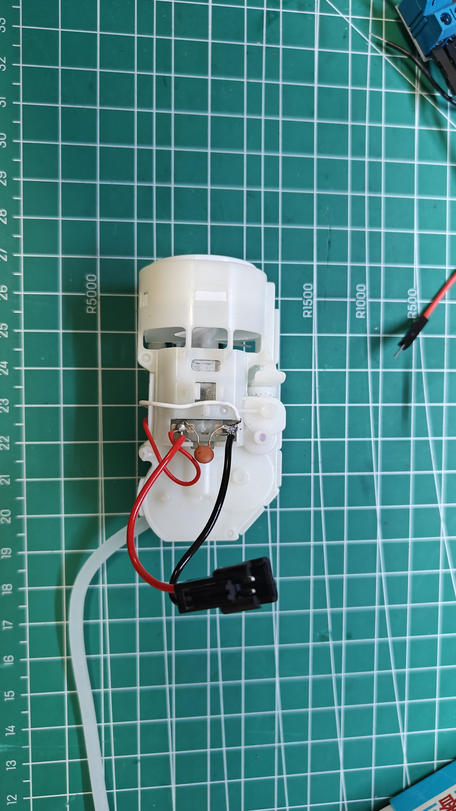
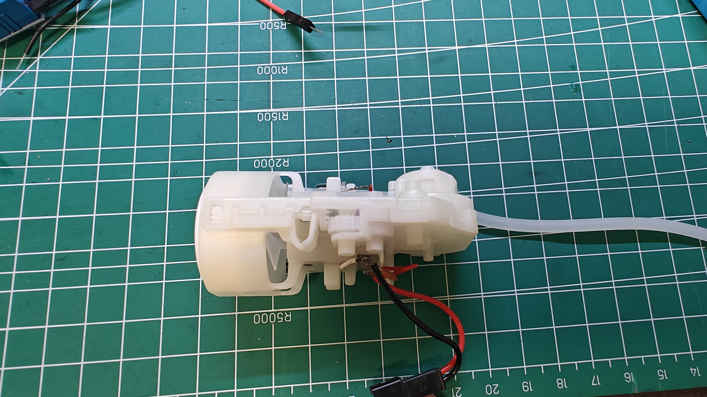
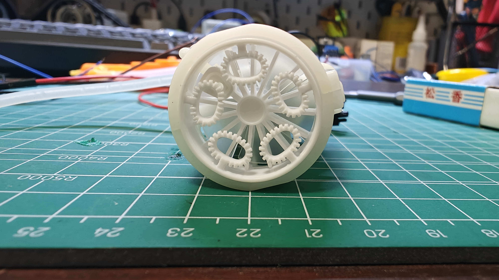
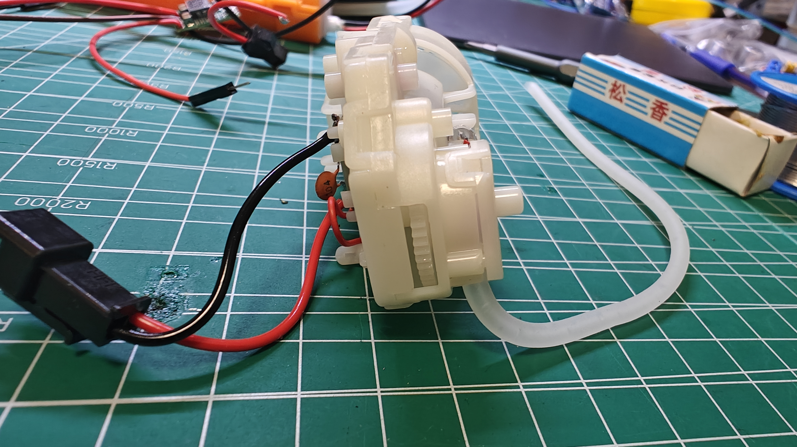
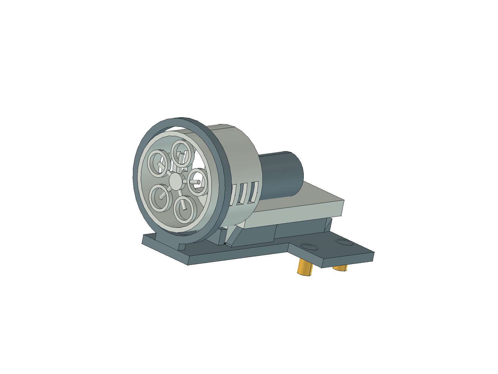
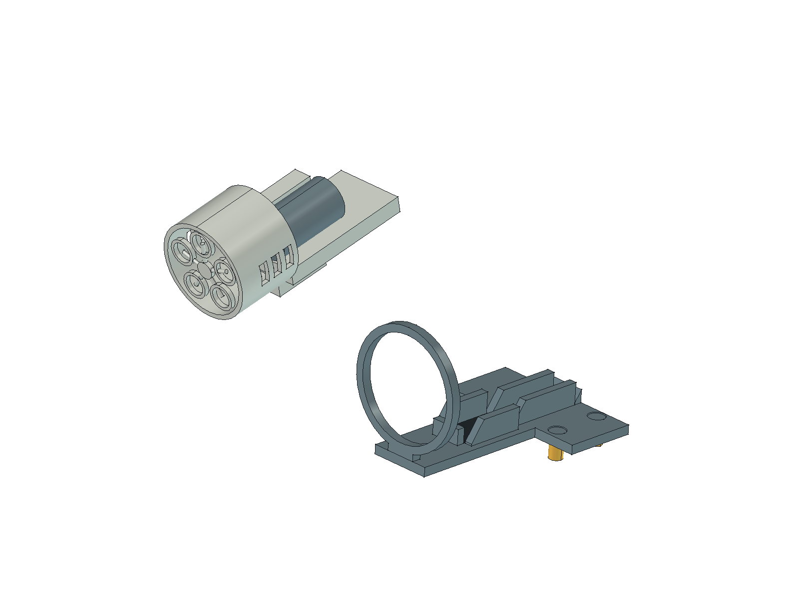
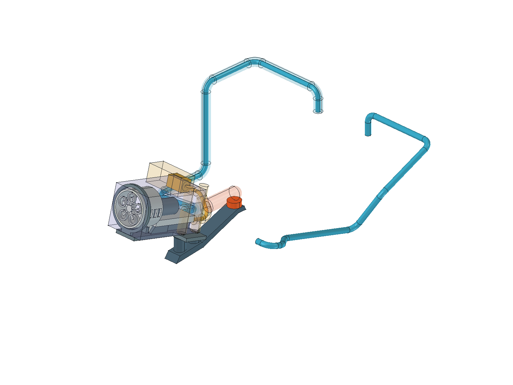

# 泡泡枪主体

对应采购 P10／BOM H10。来源：用户于 **2026-10-24** 提供的主体尺寸和 4 张实物照片。保留用户的“枪口最外端圆形直径／总高度／总长度”定义；测量工具、误差和逐项测量端点未提供，未从照片或切割垫比例推算尺寸。

## 用户提供的尺寸

| 项目 | 尺寸 | 范围与说明 |
|---|---|---|
| 枪口最外端圆形直径 | **31.5 mm** | 仅表示枪口最外端圆形，不等于主体最大宽度 |
| 主体总高度 | **35.8 mm** | 沿用用户总高度定义；测量基准及凸起包含范围待核对 |
| 主体总长度 | **67 mm** | 沿用用户总长度定义；前后端点及凸起包含范围待核对 |

结构化数据见 [dimensions.json](dimensions.json)。这些数据属于照片中的泡泡枪主体，与商品页完整泡泡机 **90 × 90 × 235 mm** 分开记录。主体最大宽度、分段轮廓、安装孔及液箱尺寸尚未提供；不能将枪口直径当成全长等截面宽度，或据此认定主体适配现有 Ø32 × 70 mm 液体占位。软管、引线、连接器及其弯曲／插拔空间需另行测量。

工作电压沿用用户此前确认的 **3.7 V**，见[电源与接口](../../../docs/power-and-interfaces.md)；本次照片与尺寸没有新增电气或出泡功能测试结果。

## 后端薄片、支承平面与阶梯槽（2026-10-24）

用户补充后端底部为**宽6、长25、高6.8 mm的薄片**，并明确6.8 mm不是额外向下凸出的高度。另测：枪体平放时，枪口圆形最低点离支承平面**4.7 mm**。要求前圆环＋后端固定槽，槽后段长25、名义宽6，前段名义宽10；详见[新增接口记录](mounting-tab-dimensions.json)。

原总高35.8与枪口直径31.5之差为4.3 mm，和新支承间距4.7相差0.4 mm。两次原始输入均保留，不把差异解释为已知制造公差。当前候选以枪轴水平、新支承面间距4.7定位，推导从平面到枪口顶为36.2 mm；这不是用户重新测得的总高。

薄片居中、尾端齐平仍为位置假设。前段槽长按当前23 mm前筒轮廓推导为67−23−25＝19 mm；前段底部10×19×6.8只用于候选配合，不属于用户已测部件形状。

## 实物照片

以下按本次附件顺序保存；视角名称仅用于辨认照片，不定义整机坐标或安装朝向。

### 照片 1：电机与引线侧

### 照片 2：主体侧视

### 照片 3：枪口正面

### 照片 4：主体后侧斜视

照片可见白色主体、前端出泡环、侧面机构、软管及红黑引线／黑色连接器。可见孔、凸起的用途及固定基准未核实；不凭线色确定针序或极性。

原始附件按原字节保存，未裁切、压缩或重绘，保留可见标识及原有权利归属。文件与附件对应关系及 SHA-256 见 [sources.json](sources.json)。

## 与整机及验证衔接（0.18）

当前使用[薄片修订版FreeCAD模型](revisions/rear-tab-2026-10-24/BubbleGun.FCStd)、[STEP](revisions/rear-tab-2026-10-24/BubbleGun.step)及[回读记录](revisions/rear-tab-2026-10-24/readback.json)。原三尺寸模型及其 STEP／回读报告已于 2026-10-25 从工作树移除，可从 Git 提交 `b83c388` 查阅；原始照片、测量数据与薄片修订版继续保留。新版本收窄后底部并分出6×25×6.8薄片，不在旧外形下方再加一块；其余不规则壳体、前段承托部和接口仍为示意。

正面看左泡泡、右水枪；两枪均采用上仰 5° 候选。泡泡枪口中心为 (−55, −126.65, 115.75) mm，水枪为 (55, −137.16, 122.61) mm。水枪旋转后另前移 10、下移 4 mm，以避让头壳；左右位置不交换。两支独立部件模型不改变，只在整机内作刚性变换。

以下支架和装拆尺寸采用上仰前的模块坐标。泡泡枪基准原点 (−55, −129, 110)，先绕 (−40, −62, 85.95) 的 X 轴旋转 −5°。水枪绕 (42.5, −18, 100.7) 的 X 轴旋转 −5°，再沿世界 Y 前移 10、Z 下移 4。完整变换及管线点见整机报告 `gun_pitch`。平放时 4.7 mm 支承间距仍为原测量；倾斜后不将它当成世界 Z 方向距离。预留最大宽 35.8、薄片居中与尾端齐平仍是假设。

### 整体前圆环与两段底槽

- 前圆环不分体，无紧固耳、前环螺钉和内衬；孔径 34、外径 39、厚 3 mm，枪口径向间隙 1.25 mm，为抬尾穿装预留。环与底座相接，CAD 中按功能分对象；不表示需要拆开或另装上半环。
- 保留两颗右肩梁基座 M3 级紧固候选；支柱承托面和孔轴随安装倾角重建。螺钉、嵌件和制造工艺未定。
- 后槽名义宽 6、长 25，前槽名义宽 10；净宽 6.4／10.4，各侧余量 0.2。前段长 19 是分段假设。槽端增加导入斜面，让底部随抬尾转动退出；名义槽宽在承托面处定义。
- 槽底垫厚 0.6，模块坐标承托面 Z89.55。圆环、阶梯槽及前后止挡定位；前止挡依赖尚未实测的前底轮廓，须试配。
- 用户拟使用热熔胶或胶水辅助固定。胶点设在可接近的环口间隙及槽外缘，避开内部运动件；模型未模拟胶层。胶材、用量、材料兼容性、保持力及可清除性未验证，拆卸前必须清胶。

### 线管、工具及拆装

1. 断电排液、清除辅助胶，先拔插头并移开尾线，再断开软管。
2. 在模块坐标中，绕前环中心抬尾 15°，向后退 10 mm 脱离整体环。
3. 沿模块上方抬 3 mm，再向车体右侧（−X）移出 90 mm；安装反向。
4. 若拆空底座，卸两颗基座螺钉，沿底板法向抬 6 mm、向 −X 移 90 mm。

主体取出路径以示意实体检查 102 个姿态：转动步长 0.5°，后移／抬升步长 0.5 mm，侧移步长 2 mm；这是采样检查，不是转动全过程的连续证明，也不能证明未测真实外形通过。基座螺钉与空底座另做保守连续扫掠。

泡泡管 Ø4、线束 Ø3，中心弯曲半径 8，各留 Ø8 空间。后端接管沿模块后方拔 25，另留 Ø12 空间；插头候选 16×10×10，向 −X 拔 16。前环不需工具，基座工具在主体取出后使用。原停止按钮保留前方 Ø12 指端空间；不包括整手或把手。水管储液端不动，枪侧路线随上仰重新衔接；实际管径、接口及弯曲限制待测。

最新几何结果见[整机回读](../../model/readback.json)与[变更核对](../../model/archive/reports/bubble-gun-change-audit.json)。5°为设计候选，工作倾角、出泡、滴液／倒流须实物验证。0.4 mm 高度冲突、薄片偏置、前底轮廓、胶粘保持、紧固及强度仍未验收。

生成入口为 `scripts/build_tank.py --render`；主体位于 `scripts/bubble_gun_layout.py`，支架及检查位于 `scripts/bubble_gun_mount.py`，双枪姿态和承托变换位于 `scripts/gun_pitch.py`。独立薄片版本按哈希复用，4 张原图保持；整机 STEP 只供布局交换，以 FCStd 为几何依据。
