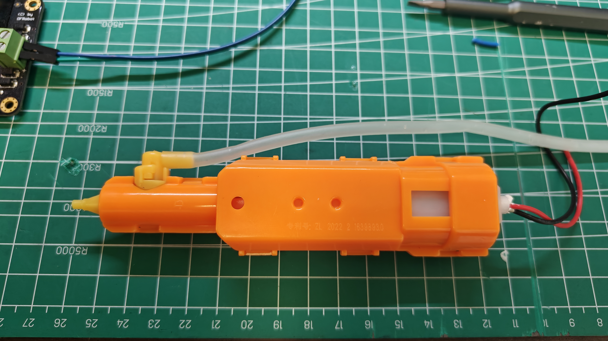
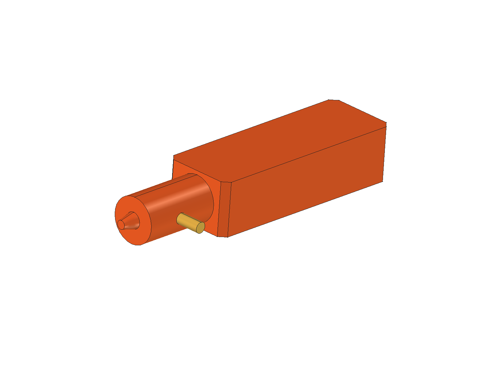

# 一体高压脉冲连发水枪：拆出发射枪

对应采购 P09／BOM H09。来源：用户于 2026-10-24 拆解后提供的实测数值和实物照片；未提供测量工具、误差或逐项测量照片。以下保留用户的长、宽、厚命名，0.12 布局暂将长度映射为 Y、宽度映射为 X、厚度映射为 Z，需在安装前核实对应面。

## 电气参数

2026-10-24 用户确认水枪工作电压为 **3.7 V**。该值为用户提供的参数，不是本项目的电压实测或带载验收结果。用户随后通过 5 V→MOS→DC-DC 3.7 V→水枪的台架，确认一次 5 秒正常喷水并自动停止，见[MOS 实测记录](../../../docs/mos-bench.md)。允许电压范围、启动／运行电流、内部控制／扳机依赖与完整启停边界仍待核实；供电规划见[电源与硬件接口](../../../docs/power-and-interfaces.md)。

## 用户实测尺寸

| 项目 | 尺寸 | 测量范围与说明 |
|---|---|---|
| 发射枪长度 | 138.5 mm | 用户报告的拆出发射枪长度；端点是否包含喷嘴、尾部凸起需在安装前核对 |
| 最粗处宽度 | 33.2 mm | 不含水管；前端较细，具体轮廓及分段尺寸未测 |
| 最粗处厚度 | 24.6 mm | 不按等截面实体理解 |
| 带水管宽度 | 38.5 mm | 用户报告的带管宽度；不代表软管全部走向或弯曲、插拔空间 |

裸发射枪可先用 **长 138.5 × 宽 33.2 × 厚 24.6 mm** 作为初步尺寸输入，带管宽度另按 **38.5 mm** 记录。固定件、线尾、接头操作空间和装配余量需另加；不能由带管宽度推定其他两个方向的完整包络。前端缩小量、过渡位置和安装孔不得从照片比例补定。

这些尺寸属于拆出发射枪，不是网页整枪 392 × 62 × 155 mm，也不包含已经确认尺寸的独立水箱；网页约 350 mL 不作为拆出总成容量。

## 实物照片

照片可见左端喷嘴、较细前段、橙色主体、侧接软管及后端红黑引线。可见孔和凸起的用途尚未核实，不直接定义为安装孔或安装基准；线色不作为额定供电或极性依据。照片没有证明启停或喷水性能。

原始附件按原字节存档，保留可见标识，未裁切或重绘；不变更原有权利归属。

- 文件：`images/disassembled-2026-10-24.jpg`
- SHA-256：`6b20aa8c851ca7ffb4166abcb932f31e1ed641d8f9c30a0435ae98cb83cbc40e`

## 与整机设计衔接

已生成[独立 FCStd](PulseWaterGun.FCStd)、[STEP](PulseWaterGun.step)及[回读记录](readback.json)，并纳入[整机模型](../../model/CyberTrack.FCStd)。独立部件局部坐标以喷嘴端中心为原点，+Y 朝后、+X 沿宽度朝侧接管、+Z 沿厚度；0.13 整机仅平移 (55, -129, 117) mm，不缩放；独立部件文件和回读保持不变。

总长 138.5、宽 33.2、厚 24.6、带管宽 38.5 mm 与实测一致。喷嘴长 8、半径 2→4、前段半径 10.5／Y7…45、主体 Y43…138.5／角部切角 3、侧接头中心 Y24／Z0／半径 2.5 均为显式示意假设，记录在回读 JSON，不是从照片得到的测量。未画安装孔或模拟内置机构。长度是否包含喷嘴端点、尾部凸起仍需核实。

原前脸位置两种朝向的最大包络均有干涉。0.12 改在头舱下方、颈架左侧朝前放置：完整矩形最大包络 X35.4…73.9、Y−117…21.5、Z104.7…129.3；Ø32 × 70 mm 喷水区仍仅为储水功能分配，与发射枪分别建模。软管 Ø4 与路线仍为假设，已绕开停止按钮并接至示意侧接头。

最大矩形包络沿全长单独检查，最近间距 1.40 mm（颈架端盖），背包壳约 2.53 mm、头壳 6.70 mm；不含接管连接面，不是公差或电气间距。断开线管、释放待设计夹持后，沿 −Y 抽出 150 mm 的完整包络连续扫掠通过；其他 13 组维护动作的整段包围盒对该包络也无相交。未包括未测引线、固定件、软管弯曲、手部及工具。完整结果见[整机回读](../../model/readback.json)。

生成入口为 `scripts/build_tank.py --render`，水枪部件和放置逻辑位于 `scripts/water_gun_layout.py`，固定及服务空间逻辑位于 `scripts/water_gun_mount.py`。本次仅更新整机固定结构，独立部件文件与原始照片按哈希校验后复用，不重写。

## 0.13 固定与服务空间

水枪在 0.12 基础上向左外移 3、前移 12 mm，采用左肩梁支承的托架和两道侧拆压盖；上下 1 mm、内侧 0.6 mm 软垫按名义接触建模，不在原壳钻孔。压盖通道留 0.2 mm 名义间隙，后止挡距枪尾 0.5 mm。接触面、预紧、摩擦保持力及材料强度待验证。

水管暂按 Ø4、尾线束 Ø3、中心弯曲半径均为 8 mm，分别另留 Ø8 路线空间；侧接管留 +X 30 mm／Ø16 拔插区，尾线插头暂按 16 × 10 × 10 mm 并留 +X 16 mm 拔出空间。线尾导向鞍及扎带槽为候选，抗拉未测。

先断电排液、断开线管，卸两颗外侧螺钉，压盖连上垫向 +X 抽出 50 mm，再沿 −Y 抽出水枪 150 mm。空托架另可用短臂内六角拆基座两螺钉，上提 2 mm 后向 +X 移出 60 mm。线管、批头与内六角空间，以及分步拆卸路径已检查；不包含手掌和软管／电线真实柔性变形。详见[机械记录](../../../docs/mechanical.md#013-水枪托架线管预留与拆装)及[拆装视图](../../model/water-gun-service.png)。

## 待补资料

- 确认长度测量端点、宽／厚对应面；测前段分段长度、截面、喷嘴中心与外形。
- 测接头位置、软管内外径与弯曲需求、尾部引线空间；明确 38.5 mm 包含哪些接头及管段。
- 确认可固定部位、孔径／孔距／深度、支承与检修方式，补重量和储水方案。
- 工作电压已由用户确认是 3.7 V；已取得一次 5 秒正常喷水和自动停止的用户观察；继续核实允许电压范围、启动／运行电流、扳机依赖、重复启停／停止边界、自脉冲、断电残液及允许工作时间；保留 Q03 和 V05／V09 为未完成。
