# CyberTrack 履带交互机器人模型

当前整机为 **0.51 六组合并打印候选**：58个设计特征归并为6个单实体；冠盖新增四处连接筋，固定颈架横梁填平配合间隙。主模型只保留“01 双履带与动力参考”分组，其他对象全部一级显示；58个重复融合输入和59个隐藏检查空间仅在独立[设计源档](source/CyberTrack-design.FCStd)保留，主模型保留20个默认隐藏的设备／线管占位，见[树结构检查](model-tree-audit.json)。见[合并说明](../../docs/print-consolidation.md)、[打印文件](print-parts/README.md)及[检查报告](print-consolidation-audit.json)。下述0.50说明记录此前基线。

[历史 CAD 报告归档](archive/README.md)：旧报告按原字节保留；当前生成与图纸检查使用的报告仍位于本目录。

主模型的零件名称统一为“部位 · 零件 · 方位/序号”，例如“电源 · 承托架固定螺钉 · 左前”“L298N · 侧压螺钉 · 左1”。序号从 1 开始；设备包络、规划线管和检查空间分别标注“占位”“规划”“审查区”。6 个合并打印件保留 PP01–PP06 编号及名称，“01 双履带与动力参考”分组不变。301 个零件名称各不重复，其中 295 项重命名。

原名称中的尺寸、候选说明和验证备注保留在 FreeCAD 的描述属性 `Label2`，原有 `EvidenceBasis` 也保留；简化后的名称不改变验证状态。内部对象标识 `Name` 和设计源档保持不变，历史报告仍使用原名称。[命名回读报告](part-names-audit.json)记录当前名称、原描述和文件校验值；[命名脚本](../../scripts/model_labels.py)在模型树展平后应用规则。命名步骤只修改名称与描述，几何数据及 GUI 状态文件逐字节一致。

零件列表随后按相邻组件集中排列，组件按各零件包络中心高度的中位数从高到低排序，组件内再按高度、前后和左右位置排序。冠盖与紧固件、双枪与各自底托、各板卡与固定件、电池与承托件分别相邻；底部检修盖与螺钉置于末尾。履带动力参考组内部先左侧、后右侧，不新增分组或名称前缀。[排序回读报告](part-order-audit.json)记录 272 个一级条目（271 个零件及 1 个分组）和 30 个组内对象的显示顺序，已核对 FreeCAD 实际树视图。排序只修改显示顺序和组内成员顺序，保留名称、几何、颜色和可见性；[排序脚本](../../scripts/model_order.py)在命名之后执行。

当前整机为 **0.50 双瓶背包一体点火模块桶座**：下半段封成有底圆筒，完整上下环带及连接耳合入 `BackpackShell`，取消顶部倒 L 压件及独立夹环紧固件，见[结构与拆装](../../docs/effects-mount.md)和[变更范围](ignition-housing-change-audit.json)。保留0.49侧框后伸：左右后端各延长30 mm，见[侧框说明](../../docs/mechanical.md#049-左右镂空底座侧框后伸)。保留0.48前舱入线与点火MOS安装；采用新电池包116×70.5×19.5，取消外沿／履带上方走线，改为前肩入舱、前脸四孔，新增第三块P01独立托架，见[本轮布局](../../docs/ignition-routing.md)。沿用[0.44 MT3608布局](#044-mt3608-升压板包络)。沿用0.43四板固定、接线空间与承板装配余量候选，见[结构与拆装](../../docs/effects-mount.md)。保留0.41头部共存结构。新增PCB／背面／向上接头／线束包络及托盘前缘49×2让位，详见[集成记录](../../docs/ultrasonic-head.md)。整组100×85×36规划包络，头部外形保持，旧头舱主控／独立扬声器／电弧占位撤出头部布局，详见[浅托盘记录](../../docs/breadboard-tray.md)。保留0.39双枪15°：泡泡枪与水枪由10°上调至15°，肩梁承托、孔轴及枪侧管路同步调整，见[仰角记录](../../docs/mechanical.md#039-双枪上仰15)及[范围与净距检查](gun-pitch-audit.json)。保留0.37头舱整体上移25 mm方案：头壳底面Z161、顶部Z228；颈架和斜撑同步延伸，中央电源线束接至新头舱入口。双瓶与底盘保持，详见[加高记录](../../docs/mechanical.md#037-头舱整体上移25-mm)、[间隙检查](head-lift-audit.json)及[范围核对](head-lift-change-audit.json)。沿用0.36双瓶护舱：护舱高90 mm，完整瓶包络Ø48.8×114含盖、上部外露30 mm，固定和独立拆装见[机械记录](../../docs/mechanical.md#036-低位开放双瓶护舱)、[专项检查](bottle-backpack-audit.json)及[变更范围](bottle-backpack-change-audit.json)。此前0.34驱动板结构保留。

2026-10-25 · **装配候选 0.34**：保持 [L298N 独立包络](../components/L298N/README.md)及下部竖装位置，增加顶盖一体吊架、独立开口托框、可调侧压件和接线／通风空间。两张用户正反面原图已保存。完整托框组件的连续下取、批头通道和干涉检查见[支架专项](l298n-mount-audit.json)；实际 PCB 接触、插头、温升和制造未验收。

2026-10-25 · **沿用的 0.32 结构基线**。电机固定面与底盘一体，取消独立端板及其4颗锁紧螺钉、前干舱隔板、电源上内隔板和旧托座跨舱横梁；后湿舱隔板、中央分隔、电源内托架及一体底盖保留。动力接口、左右各14 mm外移及132 mm等宽下部保持；换电机先取出电源内托架、移开本侧履带，再沿原XY位置下取电机。双探头按 Ø16、中心距 26、离面板高 10.3 mm 更新，双孔 Ø16.6 为候选，状态条上移。水枪采用底部双面软胶、左右定位挡板与外侧前后双托管槽；尾线导向鞍／扎带槽已融合进底托同一实体；喷水管按用户实测外径5 mm重建。两枪自吸能力由用户确认；两路液管从液舱顶部插入，经侧面接前枪；后护甲和舱侧管孔全部封回，后护甲完整镜像对称。水枪夹具顶部开放。按用户确认采用正面看左泡泡、右水枪的前置布局；两枪采用上仰15°候选，水枪旋转后前移10、下移4 mm避让头壳和底座。泡泡枪新增右肩梁支承托架、整体前圆环、两段阶梯槽、线管及工具预留，枪口朝前。宽度、分段固定面、线管与材料仍为候选，CAD检查不代表实物适配。

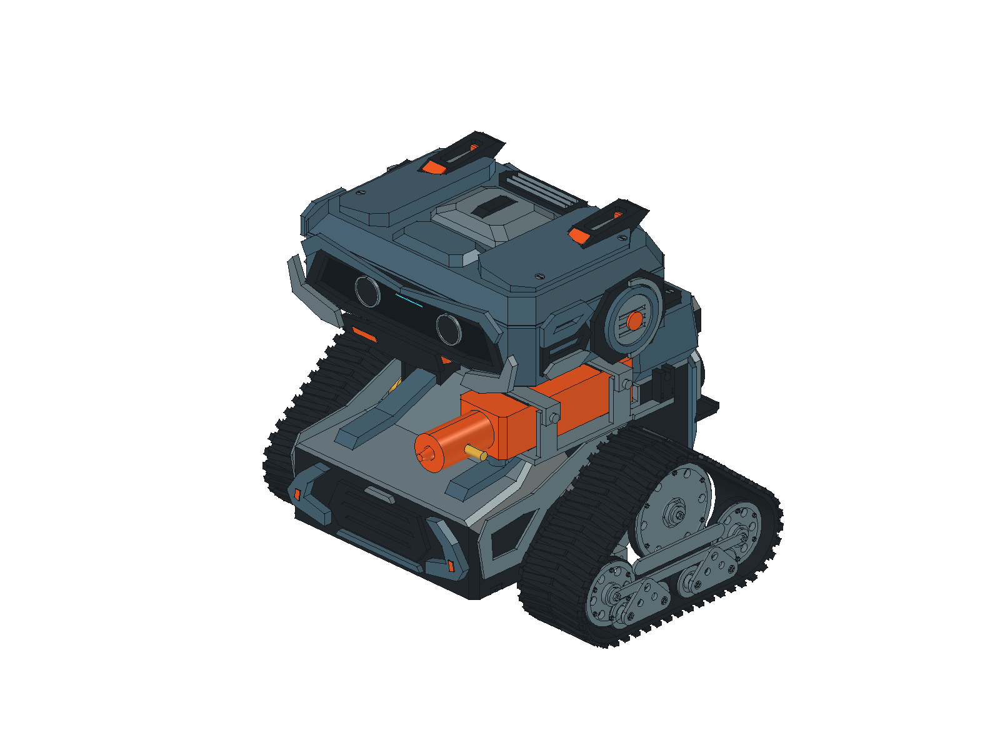

## 扬声器尺寸更新（2026-10-24，历史独立布局）

0.40将设备并入整组面包板规划包络；旧视图已清理，本节专项保留为历史，不能证明当前组内适配。

`AudioModule` 已按用户提供尺寸改为 **69.5 × 31.5 × 16.5 mm**，长沿 X、宽沿 Y、高沿 Z，范围 X±34.75、Y−72.75…−41.25、Z171…187.5。保留原 XY 中心和底面；只替换扬声器包络，麦克风、功放与固定件未据此定型。

历史预览已清理；[专项检查与保存回读](archive/reports/speaker-fit-audit.json)。包络完全位于头舱内，无实体或预留空间重叠。距托板 0.5 mm、头壳最近约 2.482 mm、前部面罩 5.25 mm、上方电子占位 5.5 mm、天线审查区 3.15 mm。固定、接口／线缆、声孔与实物适配待验。

扬声器专项更新最初按新包络被旧包络包含沿用维护结果；后续0.25水枪双托槽／后引水管重建已纳入该尺寸，重新执行整机静态和维护检查，并同步PDF。STEP不包含设备占位包络。

## 0.26 超声波双探头与前脸（2026-10-24）

按[用户尺寸](../components/ultrasonic/README.md)更新双探头为 **Ø16 × 10.3 mm**，中心距 **26 mm**、外沿总宽 **42 mm**、净距 **10 mm**；中心 **X±13、Z163 mm**。高度基准暂按前脸面板外表面 **Y−81 mm**，圆柱前端 **Y−91.3 mm**。这是假定面板基准的机械候选；PCB、背面器件、固定孔及接头空间未建模。

原中心距 58 mm 的孔补回，改为双 **Ø16.6 mm** 贯穿候选孔（单边 0.3 mm 名义间隙），状态条移至探头上方 **Z172.5…173.5 mm**。圆柱端面的金属／暗色分区仅为外观，合并后为完整实心圆柱；专项干涉检查使用完整包络。

[前脸近景](ultrasonic-front.png) · [斜视](ultrasonic-layout.png) · [专项检查与回读](ultrasonic-fit-audit.json)。完整圆柱与实体／预留空间无超过 0.01 mm³ 的重叠；到孔壁 0.3、边框 2.0、状态条约 2.735、眉甲约 4.890、头壳 6.0、扬声器 8.25 mm。[逐对象对比](archive/reports/ultrasonic-change-audit.json)确认仅双探头的 4 个分色实体、前脸面板与状态条共 6 件几何变化，其余 286 件几何保持。整机 691 对静态、16 组 232 个维护姿态及主控／双枪／扬声器专项通过；这些是名义 CAD 检查，整模块安装、制造公差、声学效果和实物试配仍待验证。

## 文件与视图

- [0.41 超声波 PCB／接线与面包板共存集成](../../docs/ultrasonic-head.md)：已合入主模型和PDF；独立副本已清理。保留头壳外形；在探头内退3.5 mm的待确认基准下，比较后插头冲突、向上出线及托盘前缘让位后的拆装。PCB、接头和固定接口未实测。

- [CyberTrack.FCStd](CyberTrack.FCStd)：主要设计文件，中文对象树；设备包络及服务／天线审查区默认隐藏；点火走线例外，单列“07 点火线走线（橙色空间）”组并默认显示。
- [CyberTrack.step](CyberTrack.step)：不含设备包络及审查区的布局交换文件；严格体积比较未通过，以 FCStd 为几何依据，不宣称曲面等价。
- [0.50 总装与检修图纸 PDF](CyberTrack-assembly-and-service.pdf)：保留为合并前的特征级参考，0.51打印边界与连接筋见[合并打印图册](print-parts/print-parts.pdf)。72页A3横向；第1–29页为当前装配／检修图，第30页为MT3608专页，第31页为可点击系统索引，第32–72页为242张图卡，逐项覆盖412个CAD对象（含65个非实体空间）。每项含CT编号、独立消隐轴测图、CAD名称、安装位置／说明及坐标；对称件和重复紧固件合并。清理7页重复展示或历史对比，固定方式未定处明确保留，详见[装配说明](../../docs/assembly.md#全对象装配图纸2026-10-25)及[覆盖记录](assembly-annotation-audit.json)。用于结构评审，不是加工图。
- [面包板布局](breadboard-layout.png) · [俯视](breadboard-top.png) · [浅托盘](breadboard-tray.png) · [工具入口](breadboard-access.png) · [整盘上提](breadboard-service.png)：整组规划包络，组内元件与防脱保持待实测。
- [保存回读报告](readback.json)：对象有效性、静态检查、导出与视图哈希、最终保存及显示状态。
- [顶部效果位轴测](crown-effects.png) · [顶部效果位俯视](crown-effects-top.png)：两处后掠凹槽为效果位置占位，橙色块不是电极。
- [拆装示意](service.png) · [电线／软管路线](routing.png) · [装配说明](../../docs/assembly.md)。
- [前方透视](assembly.png) · [后方透视](rear-assembly.png) · [正面](front.png) · [左侧](side.png) · [右侧](right.png) · [背面](rear.png) · [俯视](top.png) · [内部布局](layout.png) · [底层布局](lower-layout.png)。固定正交相机；前方 −Y，左侧视沿 −X，右侧视沿 +X。

当前结构与可见部件外包络约 **宽 228.00 × 长 222.33 × 高 203.00 mm**。计入候选管线与设备包络约为 228.00×235.33×203.00 mm。坐标为 +X 向左、+Y 向后、+Z 向上，单位 mm。

## 0.32 简化一体底盘与电机维护

[固定结构](drive-mount.png) · [开放干舱与后湿舱隔板](drive-frame.png) · [一体电机固定面](drive-integrated-face.png) · [底盖](drive-bottom.png) · [拆卸示意](drive-service.png) · [当前动力专项](drive-mount-audit.json) · [相对0.31范围审计](drive-service-change-audit.json)。

用户选择一体化优先，接受换电机前移开本侧履带。电机固定面融合进`LowerTub`，取消独立端板、4颗端板锁紧螺钉、短脚、承压台阶及止挡配合。前干舱隔板`FrontBulkhead`、电源水平内隔板`BatteryRoof`和旧托座两道跨舱横梁移除；外顶盖、后湿舱隔板`RearBulkhead`及中央分隔`WetDivider`保留。电源底部托架、承托条及固定柱实际支承电源，继续保留。

电机端面X±73／厚4、PCD31／Ø3.4、四个完整安装座、轴线Z57及履带面X±87／孔距56.2不变；下底盘仍前后132等宽，动力仍左右各外移14。先开一体底盖、断线并取出电源内托架，解除联轴器锁定；本侧履带螺钉内退35.5、下取80，履带总成外移60。卸4颗电机端面螺钉后，电机连轴直接下取80，不再内退28。详见[装配说明](../../docs/assembly.md#032-简化一体底盘与电机维护)。

历史记录：[0.29动力专项](archive/reports/drive-mount-0.29-audit.json)、[0.29范围审计](archive/reports/drive-mount-change-audit.json)、[0.30动力专项](archive/reports/drive-mount-0.30-audit.json)、[0.30范围审计](archive/reports/drive-service-0.30-change-audit.json)、[0.31动力专项](archive/reports/drive-mount-0.31-audit.json)、[0.31范围审计](archive/reports/drive-service-0.31-change-audit.json)。旧可拆端板及免拆履带路径不作为当前装配方案。所有CAD通过均不证明打印材料、螺纹、公差、疲劳、液体密封或实物工具通过。

## 0.28 顶部插管与后护甲完整镜像（历史）

本节为历史方案；尺寸和取盖路径已由0.36低位双150 mL护舱替代，当前专项JSON与PDF随0.36重建，0.28逐对象比较仍为历史证据。

水枪和泡泡枪均可自吸（用户2026-10-24确认）。水枪吸管从X−24／Y49、泡泡吸管从X24／Y49的液舱顶部插入；两路经顶部错层和车体两侧接前枪，不绕后护甲。顶部贯通孔Ø9、管端距原舱底基准5 mm、中心R8弯曲及Ø8路线预留均为候选；水管Ø5为用户实测，泡泡管Ø4未实测。顶部护口、管口固定、通气防溅及真实储液舱尚未定版。

后护甲旧Ø9孔、泡泡舱侧孔、水舱及共用壳体原侧向走管切口全部封回。`RearBaseArmor`前后截面沿用0.27的单侧参数镜像生成，保存后直接对完整实体、16个表面和顶点核对，无孔洞豁免；实体双向差和表面面积差为0。图纸L组图卡展示后护甲单体，第19页展示顶部供液与拆瓶前置步骤。

开任一补液盖前先处理残液并抽出两路吸管，再按原上6、后12、再上34 mm路径取盖。维护检查以两路管均已移除为前提，尚未模拟柔性抽管。自吸能力不代表当前吸程、首次引液、低液位、气密及通气防溅通过实物验证。

[顶部插管检查](top-feed-audit.json) · [完整后护甲镜像检查](rear-armor-symmetry-audit.json) · [与0.27逐对象比较](archive/reports/top-feed-change-audit.json)确认16件供液相关几何改变，其余276件保持。0.27与0.26几何一致的[历史记录](archive/reports/rear-armor-change-audit.json)保留；以下旧后部管孔描述均已由0.28取代。

## 0.21 后部遗留清理与对称切面（历史）

旧后向泡泡出口的 Ø31 大圆孔已补回，仅保留 Ø9 液管穿板孔候选；孔轴沿 +Y，中心 X24、Z76，穿过 Y74…82 的后护甲。液管候选外径 Ø4、路线预留 Ø8，孔壁到路线预留单边余量 0.5 mm。孔径是设计预留，护套、密封件、实际管径和装配方式尚未定版。

0.19 已移除滴液唇并补回其切槽；旧出口短颈、扩口和独立护框继续不进入总装。两枪、液舱及线管布局保持。前部停机滴液／倒流和后部湿舱最低点排液仍待设计与实测。0.20变化见[穿板孔核对（历史记录）](archive/reports/rear-hose-port-audit.json)，0.19变化见[滴液唇移除核对（历史记录）](archive/reports/rear-drip-removal-audit.json)。

0.21 将泡泡液舱侧壁的旧 Ø25 出口收为同轴 Ø9 管孔候选；液舱接头、密封和防磨仍待设计。移除后底座单侧饰板及三条盲槽并补回凹槽，使左右造型切面对称，单侧液管功能孔保留。后脑、上部双嵌板、中央脊甲、底部饰条、双枪、液舱位置和管路保持。生成器取消旧短颈／扩口／护框的先建后删逻辑及旧枪位重算；历史结果保留在历史报告中。0.21变化见[后部清理与对称检查（历史记录）](archive/reports/rear-symmetry-audit.json)。

## 泡泡枪前置固定与检查

[独立部件与完整说明](../components/bubble-gun/README.md) · [布局](bubble-gun-layout.png) · [固定托架](bubble-gun-mount.png) · [拆卸示意](bubble-gun-service.png) · [线管与工具](bubble-gun-spaces.png)。

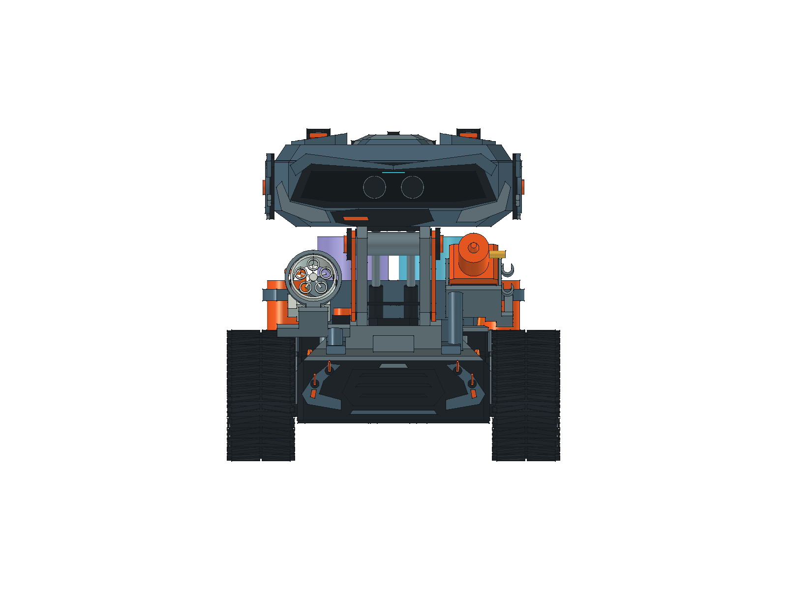

泡泡枪口中心 (−55, −120.49, 126.52)，水枪口中心 (55, −131.00, 148.17) mm，两者朝前上仰 15°。水枪保持原侧，旋转后前移10、上移3 mm，以让出底托尾部和顶盖的间隙。肩梁承托和孔轴同步调整，储液端不动、枪侧软管重新衔接。独立部件几何不变，变换见报告 `gun_pitch`。

前环为整体，孔径 34、外径 39、厚 3 mm，无分缝、前环螺钉或内衬，径向间隙 1.25 mm。底槽名义后 6宽／25长、前10宽；候选净宽6.4／10.4，各侧0.2。前长19、居中、尾端齐平及前底轮廓是假设。槽端增加导入斜面及前后止挡，槽底0.6垫。用户使用热熔胶／胶水辅助固定，胶点须可接近清除，保持力、兼容性及强度未验。

用户平放测得枪口底高4.7，按枪轴水平推导安装高36.2，与原总高35.8差0.4；两次输入保留。该间距随模块倾斜，不是安装后的世界竖直尺寸。薄片不是额外向下凸出。新部件保存在 `revisions/rear-tab-2026-10-24/`，旧部件及照片保持。

断电排液、清胶、先断尾线再断管；在模块坐标中抬尾15°，后退10、上抬3、向−X移90，反向安装。主体102个离散姿态检查不构成连续转动证明。空底座卸两颗基座螺钉后沿底板法向抬6、向−X移90；基座螺钉及空底座另做保守连续扫掠。前环无需工具。

宽度、前底轮廓、薄片偏置、胶粘保持、倾斜工作、滴液倒流、材料与实物操作待核对。环槽按示意实体检查，不能证明未测实物或完整长方体能穿过夹具。

## 水枪候选与检查

[独立部件](../components/pulse-water-gun/README.md) · [布局图](water-gun-layout.png) · [侧视](water-gun-side.png) · [包络与邻件](water-gun-clearance.png) · [部件示意](water-gun-component.png)。

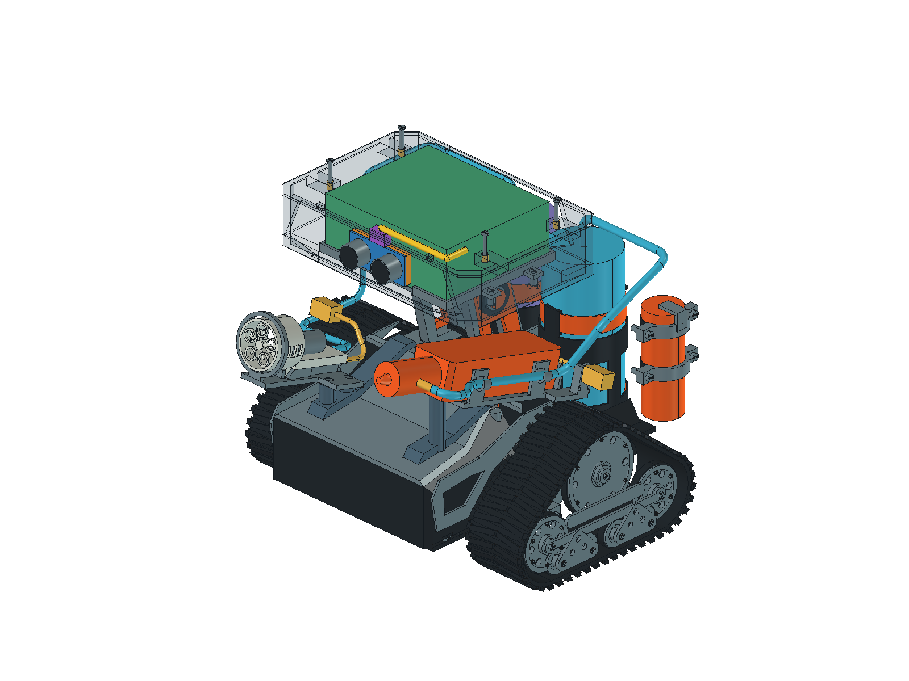

水枪实测长 138.5、最大宽 33.2、厚 24.6、带管宽 38.5 mm，安装后上仰 15°。底部采用用户选择的双面软胶；主底板宽 **38.4**、长 **74**、厚 **3 mm**，胶区两片各暂按 31.2 × 20 × 1 mm，并避开基座螺钉孔。胶厚 1 mm 为假设，两处后挡距枪尾 0.5 mm，仅用于定位。

[胶粘底托](water-gun-mount.png) · [脱胶后取出示意](water-gun-service.png) · [线管与基座工具](water-gun-spaces.png)。

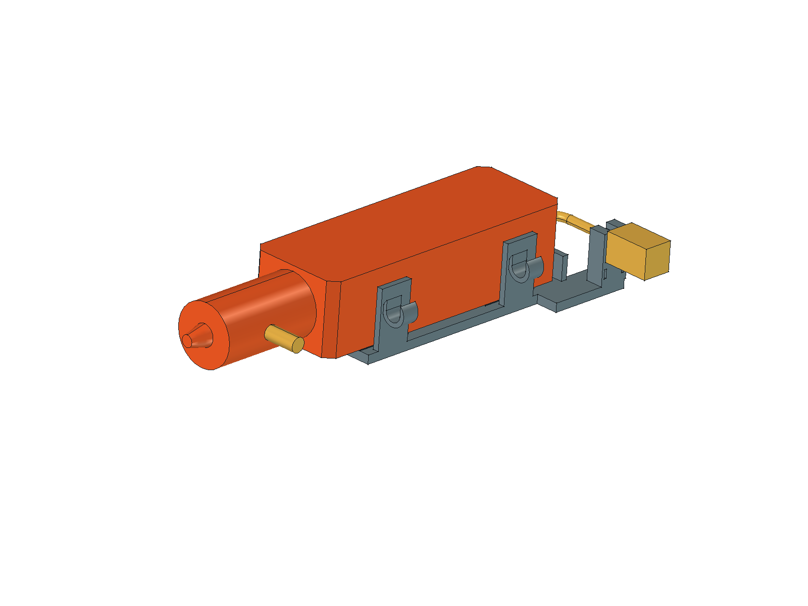

左右各两段定位挡板，净宽34.4、每侧间隙0.6，挡板长12、高20、厚2 mm；顶部开放，不设压盖或侧垫。前后双托管槽紧贴外侧挡板、无支臂，槽径5.6、长6、中心距52，向上开口，适配实测Ø5水管。尾线导向鞍与扎带槽已融合进底托。底托通过 2 颗 M3 级候选紧固件连接左肩梁。断电排液、断开水管并从双托管槽上提，断开尾线并释放导向鞍后，先充分解除底部粘接，再沿倾斜底板法向抬起 2 mm、沿枪轴前方取出 150 mm。空底托仍可卸基座螺钉后上提 2、外移 60 mm。拆装图中枪体前移 110 mm 仅为露出胶区，不代替检查位移。

裸枪最大矩形对挡板及整机、带管最大矩形对夹具以外障碍、示意接头分别检查静态和两段连续扫掠。喷水管实测Ø5；托管座槽Ø5.6，名义径向余量0.3。尾线Ø3、中心R8、路线Ø8及插头尺寸仍为候选；Ø8路线审查区仅在托座处允许重叠，实际管体另检。两处局部6 mm直管段向上10 mm的连续扫掠不代表整条软管柔性拆卸。胶材、厚度、保持力与脱胶操作尚未实测，详见[装配说明](../../docs/assembly.md#025-双托管槽与一体尾线导向鞍)。

## 本轮造型与布局

| 区域 | 当前结构候选（0.44） |
|---|---|
| 电源 | 独立内部承托架四处固定；开底盖时电源保留，更换电源或电机时连托架下取；原充电宝包络不变 |
| MT3608 升压板 | 实测37×18×6包络位于L298N左上方干舱；两端接线预算，固定待设计；下取前需先拆L298N托框和左电机 |
| 插头检修 | 开六颗螺钉固定的一体底盖后操作插头；端口具体位置、真实拔插和线束停放空间待实测 |
| 头舱 | 在 Z206…206.25 形成分缝，上半壳、顶甲及前后眉甲整体上取；四处顶面紧固，内部承台及前缘定位键 |
| 顶部效果位 | 脊翼中心 X=±51.5，护框外包络 16 × 47 × 11，Z217…228；内凹槽 8 × 25，封闭衬面与橙色标识随冠盖上取，全部为造型设计值 |
| 点火模块本体 | 背包左右外侧竖放，双分体夹环、底托与上限位；每侧4颗外侧螺钉，解除后向上取90；无高压引线 |
| 效果板薄承板 | 低位底板、四耳沉台，四孔X±47／Y−49、−26.5；4颗底部螺钉固定，4个独立开窗压框；先拆充电宝再向下取100，机外拆框取板 |
| 电子设备 | 100×85×36整组；105×90浅托盘、内区101×86、承托面Z174；侧耳四孔X±57、Y−40／−5 |
| 补液 | 两只150 mL成品瓶，90 mm护舱与可释放绑带；瓶盖接管未定；只移开目标吸管与绑带，整瓶上取150，在机外开盖补液清洗 |
| 走线 | 输出长侧面朝后，中央干区线束上端延长25 mm；两路吸管从顶部插入，经两侧接前枪；喷水管仍通过外侧双托槽。喷水管外径5为用户实测，泡泡管外径4和弯曲R8为假设 |
| 泡泡枪 | 枪口端中心 (−55,−120.49,126.52)，前向上仰15°；右肩梁托架、前圆环／两段底槽及线管候选，宽35.8与固定面待实测 |
| 水枪 | 喷嘴端中心 (55,−131.00,148.17)，前向上仰15°；底部双面软胶固定，主底板宽38.4；左右挡板净宽34.4，外侧双Ø5.6托管槽；无压盖，脱胶后抬起再前抽 |

后脑浅槽采用封闭衬板，是造型细节；0.36背包为低位双瓶保护壳、后抓取空间及绑带操作缺口，没有据此认定散热或防液体进入的性能。详细参考见[造型方向](../../docs/style-direction.md)。

## 已知尺寸与设计分配

**用户提供充电宝外形：长 120 × 宽 73 × 厚 31.5 mm；产品净重 373 g。** 净重按用户转述的商品参数记录，购买链接及来源见[采购记录 P11](../procurement.md)，尚未经实物称重核对。 模型采用 120 mm 沿 X、73 mm 沿 Y、31.5 mm 沿 Z 的前下方平放方案。范围 X±60、Y−96…−23、Z33…64.5，包络几何中心 Z=48.75 mm；该数值不是实测质心。用户已确认输出口位于 120 × 31.5 mm 长侧面，本轮设计朝 +Y；端口具体 X/Z、按键、插头和弯曲空间仍待实测。电源位置沿用已认可方案，实际质心及固定强度仍未验证。

| 区域 | 尺寸依据 | 当前位置 |
|---|---|---|
| 充电宝 | **用户实测 120 × 73 × 31.5 mm** | 前下方平放，范围见上文；底部维护盖 Z28…31，承托垫 Z31…33 |
| 点火模块本体 ×2 | 历史用户暂定Ø25.5×70，非实测 | 背包外侧X±74、Y85、Z54…124；夹持仍为机械候选 |
| 喷水成品瓶 | 用户指定150 mL、Ø48.8×114 mm含盖完整包络 | X=28、Y=65，Z40…154 |
| 泡泡液成品瓶 | 用户指定150 mL、Ø48.8×114 mm含盖完整包络 | X=−28、Y=65，Z40…154 |
| ESP32-S3 | 裸板历史实测63.6×28.2×13.2，不等于现有整组尺寸 | 由BreadboardEnvelope整组100×85×36规划占位替代 |
| 面包板整组 | 用户批准100×85×36规划包络 | X±50、Y−70…15、Z174…210 |
| 扬声器 | 保留用户69.5×31.5×16.5尺寸资料 | 现有接线随面包板保留，组内位置未建模 |

两瓶采用未削切的完整含盖圆柱外包络；瓶内吸管仅作隐藏审查空间，150 mL不是外圆柱体积。最大直径含盖范围、瓶肩、公差和瓶口仍待核实。用户已拆出水枪并提供[实测与照片](../components/pulse-water-gun/README.md)：长 138.5 × 最粗处宽 33.2 × 厚 24.6 mm，带管宽 38.5 mm，前端较细；0.25 采用底部双面软胶、左右挡板、双托管槽与一体尾线导向鞍，重新检查Ø5喷水管、基座工具及解除粘接后的分包络取出路径，粘接保持力和实物适配仍未验证。当前头舱改用面包板整组规划包络；旧独立电子／音频位置与USB／天线检查不再作为当前适配证据。新增黄色电源线／插头和青色软管也是假设包络，详见[装配说明](../../docs/assembly.md)。

2026-10-25新增需求：双火花效果区域改为底盘前方左右各两根线、共四根，替代顶部效果位置；0.45 CAD已加入这些线的外观占位与根部护套，本体与冠盖造型保持；实际高压出线未设计。详见[位置需求](../../docs/effects-mount.md#2026-10-25-前方效果位置需求)。

## 功能与结构边界

- P04 前脸双探头仍为外观候选，型号、直径、间距与模块形式未定；未增加摄像头或自动避障需求。
- P09 以拆出发射枪替代旧短喷口，喷嘴端中心 (55,−131.00,148.17) mm，前向上仰15°；分段轮廓、喷嘴、接头均为假设，完整实测最大包络单独检查。
- P10 泡泡枪前置，枪口端中心(−55,−120.49,126.52) mm、前向上仰15°；−X侧液舱采用150 mL成品瓶包络，候选液管从顶部插入，沿车体右侧接前枪，未增加第二个风扇。
- H08 扬声器已采用用户尺寸；H07 麦克风、功放及两侧护罩仍为候选区域，不代表必须采购多套扬声器。
- P03 MG90S 用途开放；头舱、颈架、斜撑均固定，圆形横梁不代表活动关节或已验证的承载机构。
- 0.10 将两条脊翼细化为顶部效果位置护框，保留后掠轮廓和最高点。封闭凹槽、衬面及橙色端部标识是被动造型，不是电极，也没有规定拉弧间距。0.40不布置内部电弧模块；原Ø25.5×70资料保留，不据此生成新的夹持、引线或电气集成。

前部外壳下部宽 132 mm，上半部向内切斜；后龙骨宽 96 mm，底部 Z=28 mm。折面顶盖前缘在 Y=−101、Z69…72，经 Y=−59、Z74…77，过渡到颈架 Z90…93、背包 Z94…97；电源上内隔板在0.32取消。当前动力固定面与底盘一体，孔位与维护条件见上方0.32说明；承载及实物紧固仍待验证。

装配方式、紧固候选、补液与走线边界见[结构与装配候选](../../docs/assembly.md)。冠盖视为一个维护组件，中央顶甲随冠盖拆装；CAD 中各饰片仍分对象，后续需确定一体成形或定位固定工艺。对象的 `ServiceGroup` 属性标识刚性维护组。

历史双模块拆卸候选（0.40不再适用）：先移去冠盖、拔 USB 并断开相关线管，再移去设备托板；每只模块先抬升 2 mm、内移 24.5 mm，再继续上提 83 mm（总上提 85 mm），避开下壳固定支柱。每侧 24 个离散姿态及三段裸圆柱连续平移扫掠通过；另一只模块仍作为障碍物。圆柱与托板通道的几何余量不代表电气安全间距；尚未添加夹持或引线。

端口真实拔插、手部与工具空间、其余维护组的连续路径、柔性线管、密封、排液、声学和承载未完成验收。底部维护须垫高并托住电源；低位包络中心不等于整机稳定性通过。

## 主控安装与接口边界（历史裸板方案）

0.40已由[整组浅托盘](../../docs/breadboard-tray.md)替代；以下USB／天线与排母检查不适用于当前面包板。

双排母座只按图纸的排距 25.4、首末针距 53.34 作候选；CAD 用连续槽和条带简化，不是已经选型的连接器，也不在开发板上新增螺钉孔。小托架新增 4 处 M2.5 级紧固，防脱压架新增 2 处，压架与最高元件包络留 0.5 mm 假设间隙。压架防止向上脱出，不预压板上元件；实际触碰位置、拔插力、刚度与紧固工艺待试装。

用户确认直头 USB-C。当前按 18 × 10 × 8 mm 插头候选，USB/COM 中心 Y=-15.5/-2.5、Z=173.8，沿 -X 拔出 12 后向上移 35；这些位置和尺寸待实测。调试时拆冠盖，不能据此把线夹在冠盖分缝中；双口可达不表示可同时供电。主控尾线候选 Ø3，沿小托架下方绕至导向环，未定义 GPIO 或电气连接。

天线末端 X17.6…24 是设计假设；审查体积 X17.6…39、Y−38.1…20.1、Z154.2…185.8 不允许新增线束或金属件。保留馈电侧原板，朝外、两侧、上下各按 15 mm 探索，参见[乐鑫指南](https://docs.espressif.com/projects/esp-hardware-design-guidelines/en/latest/esp32s3/pcb-layout-design.html#general-principles-of-pcb-layout-for-modules-positioning-a-module-on-a-base-board)。实际天线边界、射频通路、壳体材料及整机通信表现未验证；空间检查通过不是 RF 验收。

五个审查体积不当成实体零件参与总装碰撞；USB 在移去冠盖的条件下另查，天线检查仅排除主控自身。检查范围与结果单独记录在 `controller_clearance_check`。0.11.2 两处插头、两处 USB 线尾及天线审查区均未发现超阈值重叠；当前两模块到头壳的最短几何距离均为 0.75 mm，右模块到两处 USB 线尾审查区均为 0.55 mm。这些余量未扣除尺寸公差、固定件或变形；候选空间通过不等于真实线缆弯曲或 RF 验收。

## 来源与验证

[独立动力部件包](../components/drive-layout/README.md)中的 30 个叶子对象作为来源，原包未修改。0.5 对左右两组分别整体外移 14 mm，本轮保留该位置，报告记录相对来源的变换；不能再把整机放置描述为原位复制。初次提取未保留旧底盘、检修盖和示意固定螺钉；0.29按用户新授权另存功能端部及履带螺钉基准，重建本项目底盘与检修盖，不引入旧整机外壳。混合参考和旧提取脚本已移至系统废纸篓，项目目录不再保留，忽略规则继续防止误入库；当前重建读取独立动力包及[功能接口基准](../components/drive-interface/README.md)，无外部仓库运行依赖。

包围盒统一采用 `optimalBoundingBox(False)`，从几何曲面计算，不使用显示三角网格的近似边界；静态与拆卸检查采用同一方法。原生文件保存后逐对象检查有效性；BRep 序列化不同时做双向差集，阈值 0.00001 mm³。静态检查覆盖新结构之间、新结构与动力、设备包络与其他对象，重叠阈值 0.01 mm³。当前对象、静态检查及维护结果见[回读报告](readback.json)和[动力专项](drive-mount-audit.json)。0.32的电机下取检查明确先移去电源内托架和本侧履带，保留另一侧动力；真实联轴器释放与编码器尾部仍待确认。范围变更见[0.32范围审计](drive-service-change-audit.json)。0.32原16组维护动作共232个离散姿态通过；0.36更改单瓶独立上取路径后，当前姿态数以回读报告为准；旧头舱双模块各三段裸圆柱检查仅作历史；0.42背包模块与夹具见当前专项。水枪解除粘接后的裸枪／示意接头及外部带管包络分别抬起／前抽、托座局部管段上提和空底托拆出连续扫掠，以及其他维护组对水枪的整段包围盒检查通过。泡泡主体另有102姿态的抬尾、后退和侧移采样，未做连续转动证明；7项服务空间、3项基座连续扫掠和1项出泡通道检查通过。其余维护组对其他障碍仍仅检查离散姿态。

[0.18与0.17原生文件逐对象比较（历史记录）](archive/reports/bubble-gun-change-audit.json)记录双枪刚性姿态、整体环、导入槽、肩梁承托和管线变化；两枪独立主体轮廓保持。当时保留旧独立部件与原图，新薄片版本单独生成并回读；当时的模型、STEP和32张视图按哈希核对。旧三尺寸泡泡枪模型现已移至 Git 历史保存，原图与薄片修订版保持。

STEP的实体数、包络及体积比较以[当前回读](readback.json)为准；严格体积差未通过时仅供布局交换，以FCStd为几何依据。独立水枪 STEP 的体积差在 0.01 mm³ 内；两者均不代替实物测量。上述检查不等于胶粘保持力、完整实物拆装、承载、供电或液体隔离验收。

## 0.33 L298N 布局与维护（历史基线）

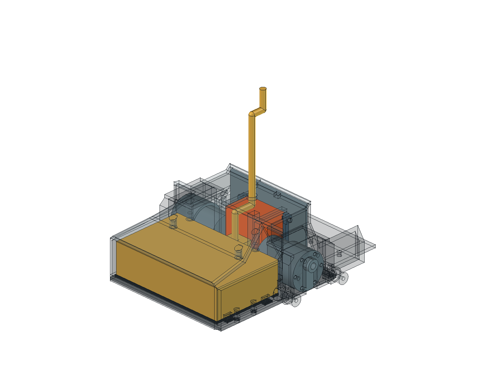

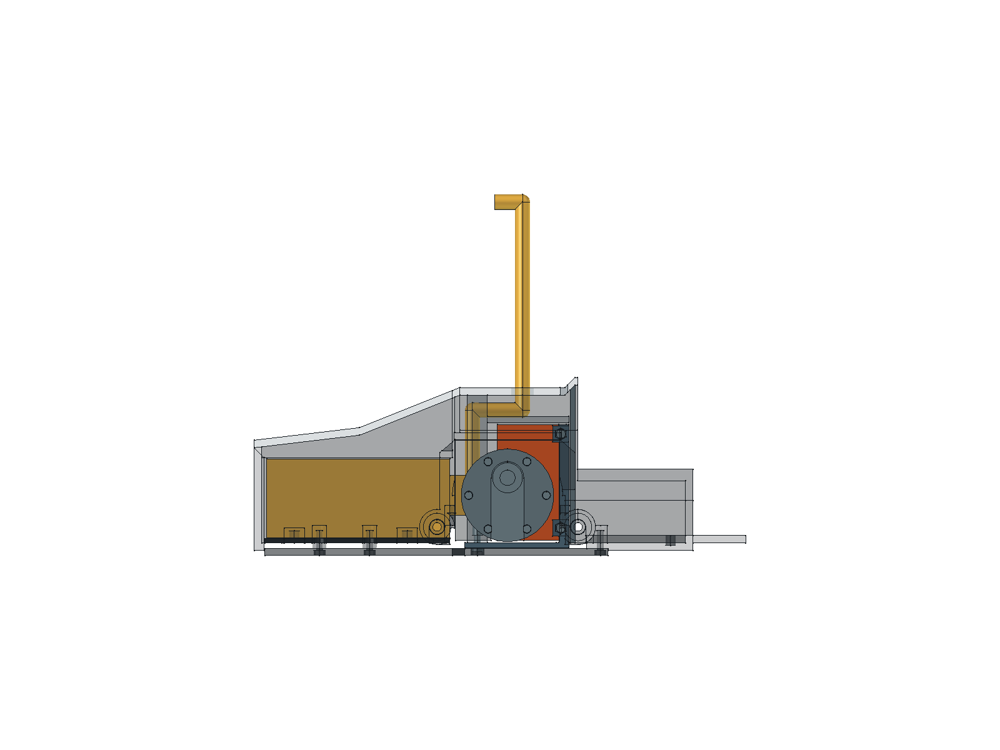

橙色矩形为整板保守包络，半透明为既有底盘与顶盖。距两侧电机各 4.45 mm、后湿舱隔板 1.5 mm、底盖 3.2 mm、现有电源插头占位 1.0 mm。插头包络保持原位，Ø6 示意电源线改为板前 Y=−14 上升至 Z=84，再向后接 Y=6 的原颈架通道。

拆下底盖及 6 颗螺钉、断开实际板卡线束并释放待设计固定件后，裸包络沿 −Z 下取 80 mm；专项做连续长方体扫掠，保留电源、两侧动力和现有电源线作为障碍，并检查保留底盖时确会阻挡的反例。其余既有维护流程随整机重新检查。0.33 当时尚未建模支架、连接器、线束弯曲、工具与手指空间，散热、固定、公差及实物装拆未验收。

独立 [FCStd](../components/L298N/L298N-envelope.FCStd)／[STEP](../components/L298N/L298N-envelope.step) 已保存回读；整机 FCStd 的 `Envelope` 组包含 `L298NEnvelope`，默认外观视图隐藏设备包络，可在树中单独显示。整机 STEP 延续排除包络的外观导出约定，单板交换使用独立 STEP。

## 0.34 L298N 支架与拆装

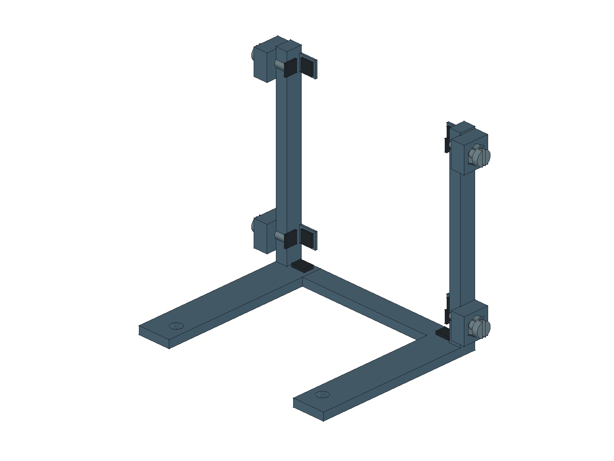

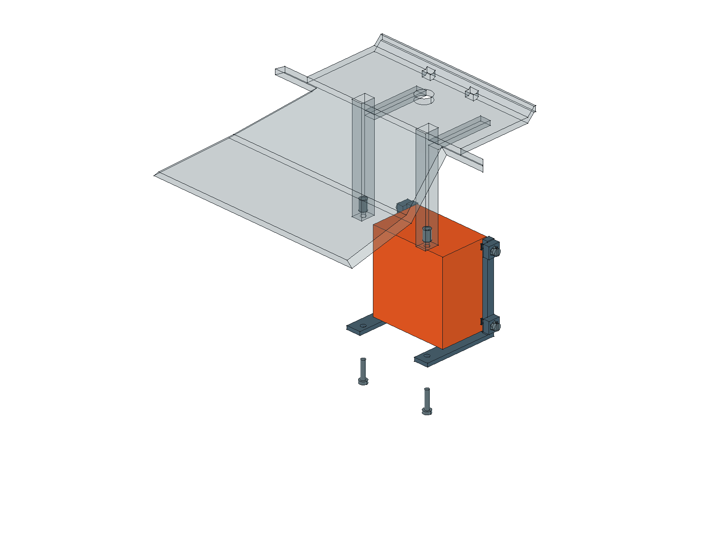

[照片原件](../components/L298N/reference/photos.json)确认器件分布，不提供精确孔位。散热器端朝上、元件面朝前（−Y），两侧接电机，下沿接电源／控制。板卡完整包络及电源线位置沿用 0.33，四点边缘夹持、后角限位与下沿承托均为待试配接触方案，不能把包络外表面当成已测 PCB 平面。

两根吊柱与 `KeelLid` 一体，独立 `L298NCarrier` 用两颗 M2.5 级锁紧件连接，底盖不承托驱动板。托框底板厚 2 mm、后柱 3×4 mm，四颗 M2 级侧压件在机外调整；背面中央避空，顶部止挡高于整板包络 0.8 mm。独立候选零件：[FCStd](parts/L298N-carrier-0.34.FCStd)／[STEP](parts/L298N-carrier-0.34.step)，采用整机坐标；螺纹、材料、夹紧力与制造未放行。

断电后拆底盖及其 6 颗螺钉，断开线束并托住托框，退两颗锁紧件后向下取出 80 mm；保留两侧电机、充电宝与原电源线。机外松四点侧压垫后再向上取出板卡。锁紧螺钉退出及 Ø3.6 直杆批头通道纳入检查，实际手柄、手指、插头和线弯仍待核实。

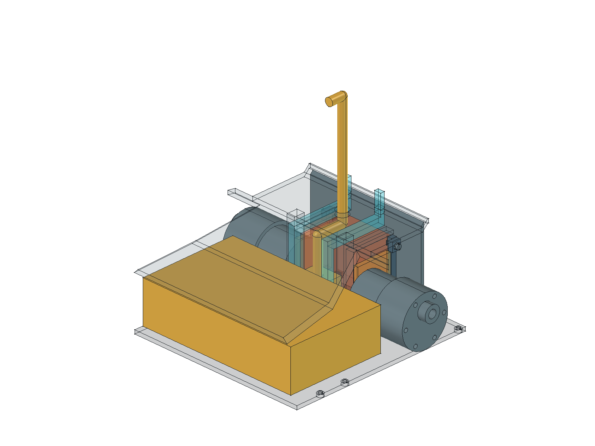

两侧电机引线廊各宽 3.25 mm，下沿接口区 32×11.5×10 mm。底盖两个 5×5 进风口、顶盖两个 5×3 排风口，空气预留与接线预留不交叠；没有证明风量或温升，通风口未防水，后湿舱隔板未打孔。底盖另设两处 Ø5.6 锁紧头避让孔，允许托框保留时单独取下底盖。

| 完整托框组件至 | CAD 名义最小净距 |
| --- | ---: |
| 左／右电机 | 各 2.96 mm |
| 后湿舱隔板 | 0.50 mm |
| 底盖 | 0.40 mm |
| 充电宝 | 6.26 mm |
| 原电源线占位 | 1.00 mm |

后隔板及底盖间隙应重点做公差和实物试配。检查入口：[支架专项](l298n-mount-audit.json)、[本轮范围核对](l298n-mount-change-audit.json)、[整机回读](readback.json)。静态、连续拆装与通道检查不能替代 PCB 接触、连接器、强度、防松、绝缘和热验证。

## 再生成

双探头布局与完整圆柱检查位于 [ultrasonic_layout.py](../../scripts/ultrasonic_layout.py)。顶部吸管孔、占位避让和回读检查位于 [top_feed.py](../../scripts/top_feed.py)。后护甲截面镜像与回读检查位于 [rear_armor.py](../../scripts/rear_armor.py)。动力接口基础位于 [drive_mount.py](../../scripts/drive_mount.py)，当前维护结构及专项检查位于 [drive_service.py](../../scripts/drive_service.py) 和 [drive_service_check.py](../../scripts/drive_service_check.py)。L298N 独立包络、放置与专项检查位于 [l298n_layout.py](../../scripts/l298n_layout.py)，支架／通风／接线及整组拆装检查位于 [l298n_mount.py](../../scripts/l298n_mount.py)。生成入口为 [scripts/build_tank.py](../../scripts/build_tank.py)，检修结构与路径检查位于 [refine_assembly.py](../../scripts/refine_assembly.py)，现行浅托盘与专项位于 [breadboard_layout.py](../../scripts/breadboard_layout.py)，范围审计位于[audit_breadboard_change.py](../../scripts/audit_breadboard_change.py)；旧主控生成阶段位于[controller_layout.py](../../scripts/controller_layout.py)，最终由整组布局替换，泡泡枪主体及空间检查位于 [bubble_gun_layout.py](../../scripts/bubble_gun_layout.py)，泡泡枪固定与线管候选位于 [bubble_gun_mount.py](../../scripts/bubble_gun_mount.py)，水枪固定与线管候选位于 [water_gun_mount.py](../../scripts/water_gun_mount.py)，当前 macOS 环境执行：

```sh
PYTHONPATH=/Applications/FreeCAD.app/Contents/Resources/lib \
/Applications/FreeCAD.app/Contents/Resources/bin/python scripts/build_tank.py --render
```

首次生成新的薄片版独立泡泡枪模型，随后校验并复用，保留旧三尺寸版本；会校验并保留独立水枪资产，更新整机模型、STEP、当前视图（含5张面包板专项；旧arc／controller／speaker预览已清理）与报告；静态、维护路径、面包板专项、水枪、泡泡枪、超声波、后护甲镜像、顶部供液、动力固定、双瓶或 L298N 专项失败时，脚本在写出报告后以非零状态退出。完整交付使用 `--render`。脚本重建会覆盖当前输出；手工修改 FCStd 前应保存副本，并同步参数、文档和验证。

当前装配PDF仍为0.44，未包含0.45新增的8个前方效果线外观对象；当前外观以FCStd及本轮预览为准。

## PDF 图纸再生成

以下为旧装配图册的生成说明；`build_drawing_pdf.py`仍带0.44历史基线断言，不能用于直接重建0.51图册。本轮六件补充使用 `python3 scripts/build_print_parts_pdf.py`，在整机 `--render`生成和检查成功后运行。旧图册保留为0.50特征级参考。

旧图纸以其生成时保存的 FCStd 为依据，不改动模型。矢量正投影由 FreeCAD 的遮挡线消隐生成，曲线显示容差设为 0.08 mm；标注尺寸来自精确几何边界与已核对的固定点。每个视图独立标明方向与比例，按 A3 原尺寸打印；打印缩放后仍以标注数字为准。当前没有制造公差、螺纹或物料定版，不能据此加工。

```sh
PYTHONPATH=/Applications/FreeCAD.app/Contents/Resources/lib \
/Applications/FreeCAD.app/Contents/Resources/bin/python scripts/export_drawing_geometry.py
python3 scripts/build_drawing_pdf.py
```

当前图纸使用默认检查入口，要求静态、维护路径、面包板专项、水枪、泡泡枪、超声波、后护甲镜像、顶部供液、动力固定及 L298N 专项全部通过。`--allow-review-conflicts` 仅供生成明确标示失败的评审图，不会改变检查结果。第二步需要 ReportLab、Pillow 及 macOS 的 STHeiti 字体。矢量投影缓存写入 `tmp/pdfs/`，按原生模型 SHA-256 校验；PDF 脚本同时校验模型、STEP、本轮预览图及关键标注。模型修订后需复核图纸文字、特征标注和版面，再更新脚本的修订检查。交付文件为 `hardware/model/CyberTrack-assembly-and-service.pdf`，与原生模型一同管理；文件名明确表示总装与检修图纸，临时生成文件继续忽略。

本轮依据见[0.25 双托管槽与一体尾线导向鞍](../../docs/mechanical.md#025-双托管槽与一体尾线导向鞍)及[变更核对](archive/reports/water-gun-routing-audit.json)。[0.23 胶粘固定核对](archive/reports/water-gun-adhesive-audit.json)为历史记录。尾线导向鞍已直接并入 `WaterGunCradle`，不再有独立 `WaterGunLeadGuide`。双托管座分别命名为 `WaterGunHoseSupport`／`WaterGunHoseSupportRear`，制造合并需包含三者。旧 0.18 支架 STL 带压盖，不能作为当前水枪底托输出；试打包及专用导出脚本已移除。仓库当前没有可用于现行双枪支架的试打 STL 包，需按当前模型重新导出并验证。

[0.22 水枪尺寸与范围核对（历史）](archive/reports/water-gun-fit-audit.json)记录两道夹持带的几何净空、相对 0.21 的修改对象及独立部件资产校验。

## 0.32 历史回读结果

304 个几何对象保存回读有效；911 对静态检查无超阈值重叠。动力专项的 22 项固定接口、21 段连续扫掠、两侧履带各 61 个外抽姿态、18 项工具杆及 14 个反例检查通过；原 16 组、232 个维护姿态及所有既有专项重新检查通过。

相对 0.31 的范围审计通过：303 个保留对象几何不变，仅 `LowerTub` 改形；移除两只端板、4 颗端板锁紧螺钉、前干舱隔板和电源上内隔板。后湿舱隔板、中央分隔、电源及内托架、一体底盖和 30 件动力参考均保持。41 张视图及 27 页 PDF 已同步，动力固定和维护详图见第 24–27 页。

STEP 回读为 872 个有效实体，包络一致；体积差约 0.8231 mm³，仍超过 0.01 mm³ 阈值，仅供布局交换，以 FCStd 为几何依据。以上为 CAD 检查，未完成打印强度、真实工具与线缆、紧固或物理装拆验收。

### 电机输出端与下开槽间隙

2026-10-25 用户提供穿过固定面开口的电机输出端外径 **Ø11.9 mm**，并确认保留 **13 mm** 槽宽及顶部 **Ø13 mm** 圆弧。总名义间隙为 **13 − 11.9 = 1.1 mm**；居中时单边名义间隙为 **0.55 mm**。

此处为输出端避让／下取通道，电机仍由每侧四颗端面螺钉固定；不是紧配合定位孔。间隙未扣除打印误差、收缩、翘曲及装配偏心，需实物试配。Ø11.9 mm 为用户提供值，不替代商家标称的 Ø6 mm D 轴尺寸；本次未改写只读动力部件几何或改变 0.32 模型。

## 0.33 保存回读与范围核对（历史结果）

305 个几何对象保存回读有效，916 对静态布尔检查无超过 0.01 mm³ 的重叠；原 16 组、232 个维护姿态及动力、主控、水枪、泡泡枪等既有专项重新通过。新增 L298N 专项覆盖其他 304 个对象、干舱内包含关系和裸包络向下 80 mm 连续扫掠；保留底盖的反例会阻挡下取。

相对本轮开始时保存的 0.32，新增 `L298NEnvelope`，仅 `PowerCableRoute` 改形，303 个既有对象几何不变，没有删除对象。独立板卡 FCStd／STEP 回读双向差集为 0；整机 STEP 保留原有约 0.8231 mm³ 体积差，仅供布局交换，FCStd 为几何依据。44 张视图及 28 页 PDF 同步，第 28 页为 L298N 布局与验证边界。

### 0.34 保存回读结果

333 个几何对象回读有效；1,055 对静态检查无超过 0.01 mm³ 的重叠，既有 16 组、232 个维护姿态及全部专项通过。新增托框连续下取 80 mm、闭盖反例、两颗锁紧件及批头、机外取板、五处功能预留和四个通风口检查通过。相对 0.33，新增 28 个支架／空间对象，仅顶盖与底盖两件改形，其余 303 个对象几何保持。

独立托框 FCStd／STEP 回读均为有效单实体、双向几何差集为 0。整机 STEP 为 895 个有效实体，包围盒一致；严格体积差约 0.5166 mm³，仍超过 0.01 mm³ 阈值，保留失败状态并以原生 FCStd 为几何依据。47 张预览与 29 页 PDF 已同步；图纸第 28–29 页对应 L298N。以上均为 CAD 证据，不是制造或实物验收。


## 0.36 低位双瓶背包视图

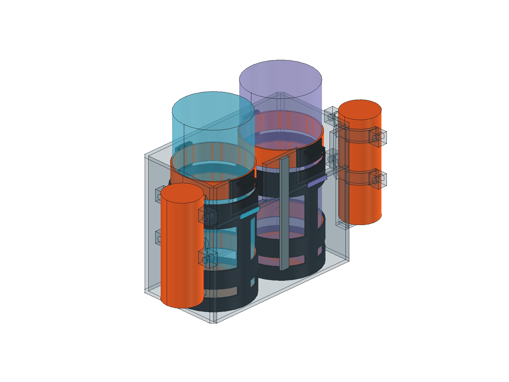
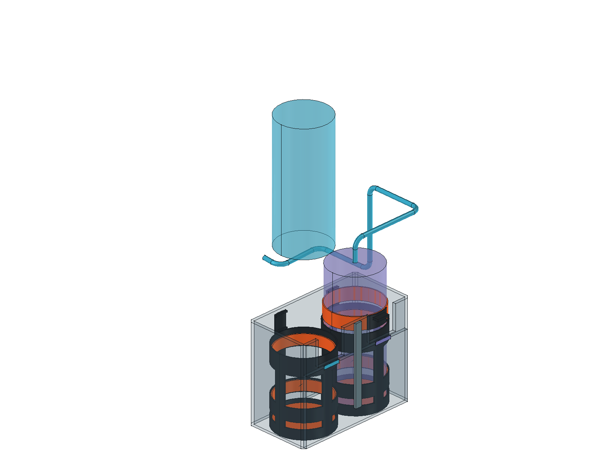
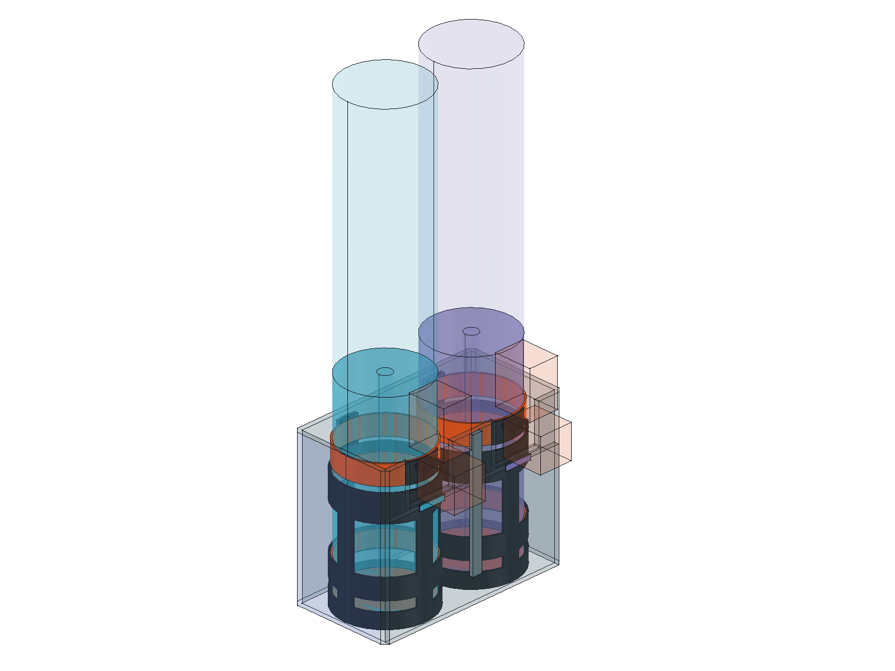

生成及专项检查由[bottle_backpack.py](../../scripts/bottle_backpack.py)维护。护舱90 mm，瓶顶包络外露30 mm；无打印上盖、顶垫或盖螺钉。只移开目标吸管与可释放绑带，整瓶连续上取150 mm，另一瓶及其管路保留；自身软管未拔时阻挡取瓶的负向检查一并记录。底托螺钉及工具、后抓取、绑带拉片空间另检。绑带依赖张紧摩擦，柔性抽管／开带／收置与实际保持力未验证。其他维护路径仍按各自离散或连续方法检查，不能统一称为连续路径全部通过。

0.35历史证据保存在[旧双瓶专项](archive/reports/bottle-backpack-0.35-audit.json)与[旧范围审计](archive/reports/bottle-backpack-0.35-change-audit.json)；当前[范围审计](bottle-backpack-change-audit.json)对比0.35与0.36，由[audit_low_backpack_change.py](../../scripts/audit_low_backpack_change.py)生成。


## 0.37 头舱加高

头舱全部实体、内部部件及主控审查空间沿+Z整体上移25 mm，尺寸和内部相对位置保持。固定颈架延长开窗侧板，横梁与鞍座抬升；斜撑重定倾角、下端入座、鞍座两侧补齐接触面，中央电源线束延伸。双枪与双瓶位置保持，瓶顶Z154、头壳底面Z161，7 mm是高度基准差，不是最短空间距离。

[0.37专项检查](archive/reports/head-lift-0.37-audit.json)分别报告完整头舱至瓶体、实际软管、软管审查区、整瓶连续上取空间及手指／绑带操作区的最短距离；[范围核对](head-lift-change-audit.json)逐对象检查头舱刚性上移及无关部件保持。实际瓶盖外径、柔性抽管收置、手部操作、颈架强度、振动和稳定性待实测。


## 0.38 双枪上仰10°

用户要求两枪再抬高一点，以尝试增加射程；本轮选择由5°增至10°的安装候选，尚未通过实际射程或允许工作倾角验证。旋转中心与泡泡枪定位基准保持；水枪仍前移10 mm，取消原下移4 mm，以避开底托尾部与顶盖干涉，双枪固定件和尾线／工具空间随动，肩梁承托面及孔轴重建；瓶端管路保持，枪端软管重新衔接。头舱加高25 mm、双瓶、动力与底盘保持。

[专项检查](archive/reports/gun-pitch-0.38-audit.json)比较保存几何，核对枪体刚性变换、范围外部件不变和双枪至头舱／颈架／底盘／瓶体净距；[整机回读](readback.json)覆盖静态与既有维护检查。射程、出泡、滴液／倒流、软管弯曲、胶粘保持及实物拆装仍需试验。


## 0.39 双枪上仰15°

按用户要求从10°调至15°试装候选；水枪安装基准较0.38再上移3 mm，肩梁承托和孔轴同步。泡泡外侧管段中心线Z96降至94，保留瓶端插入位置。头舱加高25 mm、颈架、双瓶与底盘保持。检查与物理未决项见[机械记录](../../docs/mechanical.md#039-双枪上仰15)、[范围审计](gun-pitch-audit.json)和[整机回读](readback.json)。

## 0.40 面包板浅托盘

现有面包板整组按100×85×36规划，不要求先拆散组内接线。浅托盘主体105×90、内区101×86、底厚2.5、围边高3，侧耳总宽122；四孔X±57、Y−40／−5。包络Z174…210，到冠盖名义净距4。头壳仅改内部支柱，所有外部造型与0.39比较；颈部以下电源线及双枪／双瓶／动力保持。

[专项与连续拆装检查](breadboard-fit-audit.json) · [范围与外形核对](breadboard-change-audit.json) · [尺寸、装配及边界](../../docs/breadboard-tray.md)。防脱压片、材料／柱根强度、真实接头与线束、屏幕／声学／RF仍待实物确认。

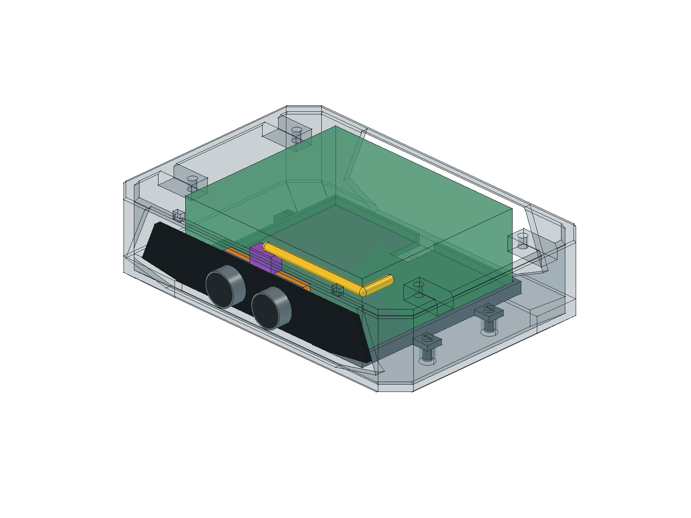

范围审计在重建后执行，参数为重建前保存的0.39原生文件；该基线的SHA-256写入审计，与历史双枪图纸的来源核对。

```sh
PYTHONPATH=/Applications/FreeCAD.app/Contents/Resources/lib /Applications/FreeCAD.app/Contents/Resources/bin/python scripts/audit_breadboard_change.py /path/to/pre-change-0.39.FCStd
```

## 0.41 超声波与面包板共存

[结构与证据边界](../../docs/ultrasonic-head.md)、[集成专项](ultrasonic-integration-audit.json)、[0.40→0.41范围审计](ultrasonic-integration-change-audit.json)。PCB／背面／接头及线束为候选，头壳完整几何不变；双探头内退3.5，托盘前缘中央49×2让位。蓝色PCB、橙色背面、紫色接头、黄色线束与绿色面包板见[共存图](ultrasonic-coexistence.png)；[整盘拆出](ultrasonic-service.png)先收置超声波线束。独立研究副本已由正式生成流程替代。

## 0.42 背包外侧夹持与底盘薄承板

用户批准背包外侧方向，原前斜坡与头壳保持；每侧两道分体夹环、底托与上限位，8颗外侧M2.5级候选螺钉。底盘薄承板4颗底部螺钉固定到顶盖内柱，先拆充电宝再向下取。详见[结构说明](../../docs/effects-mount.md)、[专项](effects-mount-audit.json)、[范围审计](effects-change-audit.json)及[清理记录](effects-cleanup-audit.json)。

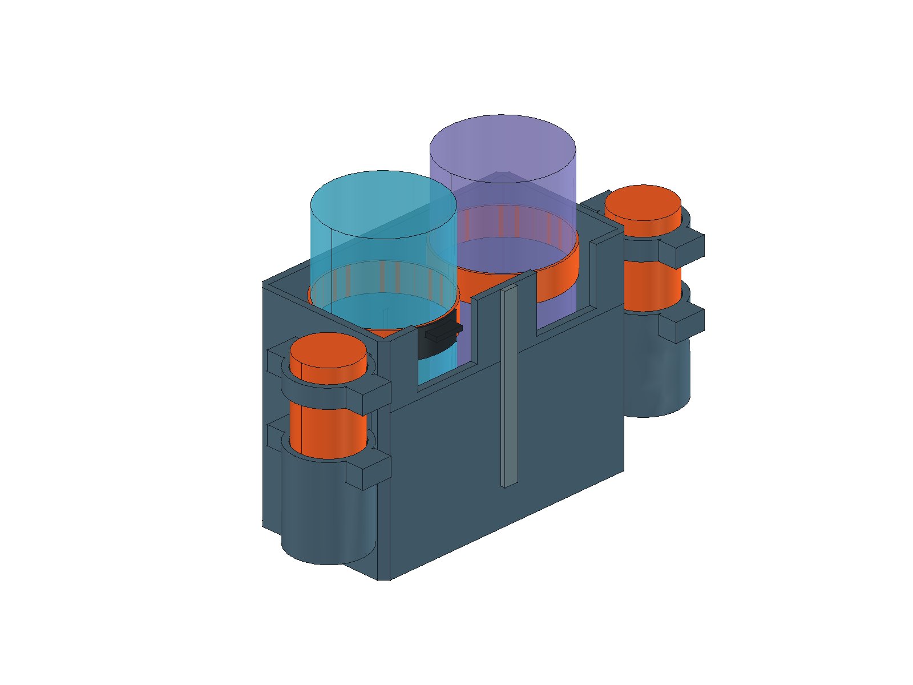


A02抬高前舱已被否定；A03独立占位由主模型替代，相关候选文件清理。点火本体、MOS总高、软衬及标准件仍标注候选；0.42时板卡自身固定和真实线束未完成；当前固定候选见下节，不包含高压电气集成。


## 0.43 四板固定与接线空间

水枪、泡泡枪各一块MOS和一块20×11×5降压板放在底盘薄承板；四个开窗防脱压框、8颗M2级螺钉和板边垫为候选。PCB厚1.6、四边2.5无元件区、MOS高12及所有端接空间须实测。局部通道不等于完整接线。

四点承板孔距94×22.5，螺钉头凹入侧耳，承板到充电宝2.0、头部到充电宝2.1 mm；替代0.42的0.5 mm最小头部间隙。需计入充电宝尺寸、加工偏差、翘曲、安装偏移和附加垫片的最不利公差组合后试装，不是实物适配结论。

[四板固定与机外拆装](../../docs/effects-mount.md) · [板卡专项](effect-board-fit-audit.json) · [本轮范围审计](effect-board-change-audit.json)。0.42范围及清理报告保留历史来源哈希。

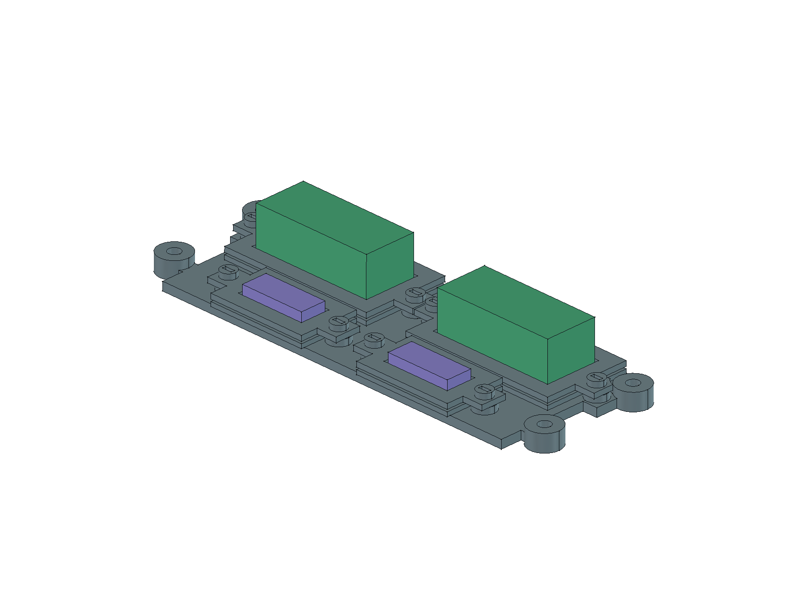
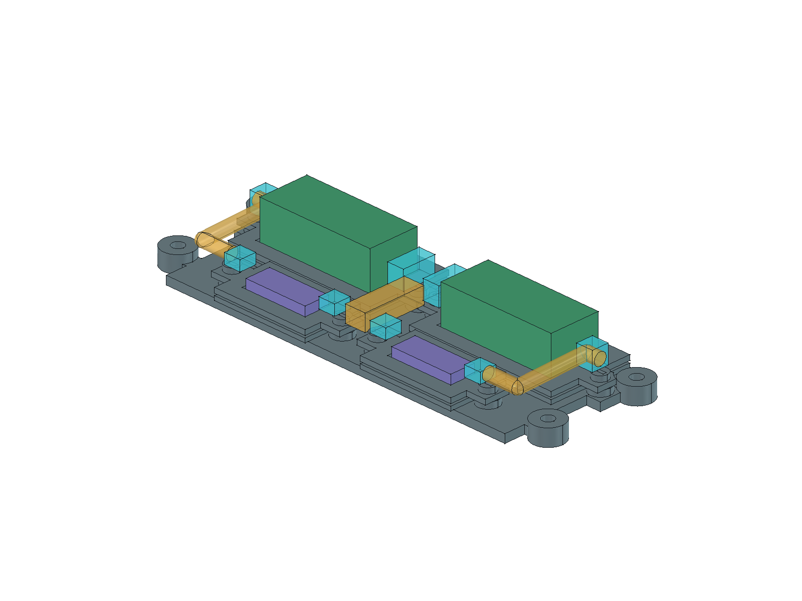

## 2026-10-25 旧双枪候选清理

已移除泡泡枪分体前圆环研究目录 `studies/bubble-ring-slot/`、0.18 支架试打包 `print-trials/gun-mounts-0.18/` 及其专用导出脚本 `scripts/export_gun_mount_stl.py`，以及泡泡枪根目录的原三尺寸 FCStd、STEP 和回读报告，共 16 个文件。上述路径为历史位置，删除前内容可从 Git 提交 `b83c388a749212abab94fef0a96cb1abc3d07ed8` 查阅；分体圆环由现行整体圆环／阶梯槽方案替代，旧带压盖水枪支架由胶粘底托方案替代。

当前整机、生成脚本、泡泡枪薄片修订版、原始照片和测量数据保持；当时保留的历史对比图已在后续清理中移除，旧检查报告集中至[归档索引](archive/README.md)。本次仅清理旧资料，不新增打印、装配或实物验收结果。


## 0.44 MT3608 升压板包络

P06／H13按用户实测 **37×18×6 mm** 建立[独立包络](../components/MT3608/README.md)，并放入L298N左上方、左电机上方干舱。长边沿+Y，宽边沿−X，厚度沿+Z；范围X25…43、Y−17…20、Z82…88 mm。

距底盘侧壁与顶盖均为2 mm名义净距，距L298N托框约3.83 mm；前后各4 mm接线预算不代表已测端子或完整线束。未推定安装孔、PCB接触面和电位器位置，固定结构待设计。

断电、断线后，按既有流程先拆L298N托框及左电机（包含先拆电源内托架与本侧履带），再解除待设计固定件，裸包络向下90 mm可取出；这是可达性候选，检修前置步骤较多。电位器调节暂按取出后操作，没有声明在位工具通道通过。

[静态／局部接线及裸板下取检查](mt3608-fit-audit.json) · [范围核对](mt3608-change-audit.json)：原409个对象保持，新增升压板包络和两个接线空间。完整生成入口已接入[mt3608_layout.py](../../scripts/mt3608_layout.py)。整机STEP继续排除设备包络，交换单板请使用独立STEP。

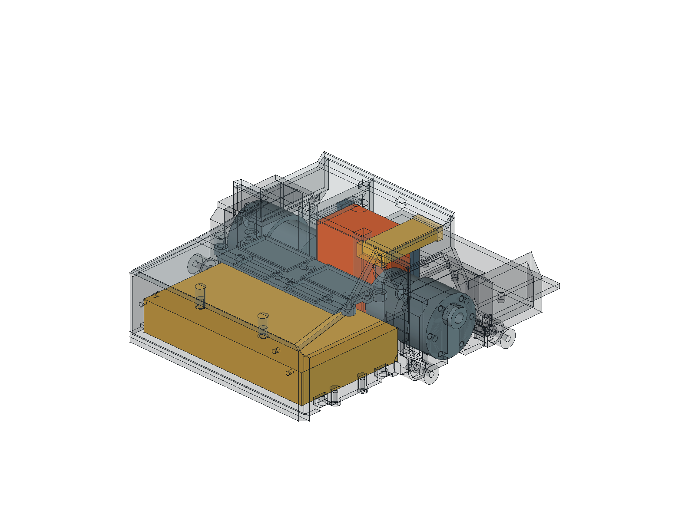

CAD检查不证明安装保持力、材料与公差、实际接线、调节、热稳态或整机供电通过。

## 0.45 前方效果线外观

底盘前方左右各两根，共四根橙色封闭端外观线，根部配四个深色护套；沿前护甲斜边错开，向前略微上翘。范围审计确认原有412个对象几何、标签与分类保持，新增8个对象，无删除。位置和尺寸见[设计记录](../../docs/effects-mount.md#2026-10-25-前方效果位置需求)，均为外观假设，不是高压线材、放电间距或固定接口规格。

[静态与保存回读](front-effects-fit-audit.json)及[范围审计](front-effects-change-audit.json)只验证CAD几何，不代表实物、电气、液体共存或制造验收。原PDF尚未同步；FCStd、STEP与当前预览已更新。

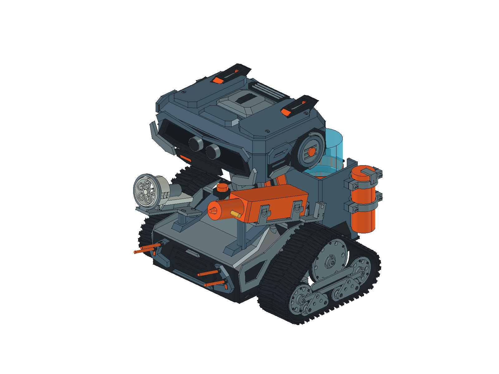

0.45检查结果：1,119对静态候选检查无超阈值重叠，现有拆装路径与专项检查通过，420个对象保存回读一致；新增8个对象均为有效单实体。STEP为942个有效实体、包围盒一致，但体积差约3.1105 mm³仍超过0.01 mm³严格阈值，仅供布局交换，以FCStd为几何依据。

## 0.46 前方效果线加长

四根外观线的前伸长度由18增至28 mm，每根增加10 mm；保持原根部、3 mm外观直径与上翘角度，因此抬高由4增至约6.22 mm。线端中心Y−137，封闭圆端最前缘Y−138.5。尺寸仍为造型假设，不是实际线材或放电参数。

本轮仅改变四根线体，护套及其他对象保持，见[范围审计](front-effects-length-change-audit.json)与[静态回读](front-effects-fit-audit.json)。本页前方效果线预览显示当前0.46；PDF仍为0.44。

0.46范围审计确认仅4根线体改形，其余416个对象保持；1,119对静态候选检查、现有拆装路径及保存回读通过。整机包络为228×246×228 mm，前后长度比0.45增加约6.98 mm。STEP严格体积差约3.1104 mm³仍未通过0.01 mm³阈值，以FCStd为几何依据；没有新增电气或实物验收结论。

## 0.48 前舱入线与第三块 MOS

[详细布局](../../docs/ignition-routing.md)、[新电池资料](../components/ck-5v-battery/README.md)、[走线检查](ignition-routing-audit.json)、[MOS检查](ignition-mos-audit.json)及[范围审计](ignition-routing-change-audit.json)共同描述本轮。旧0.47外沿候选已撤销。前伸仍为28 mm、单线外径1.5 mm；新增实体穿孔仅限前肩、前壁、前护甲和护套。模块真实输出端、护口与固定及完整端接仍待核。

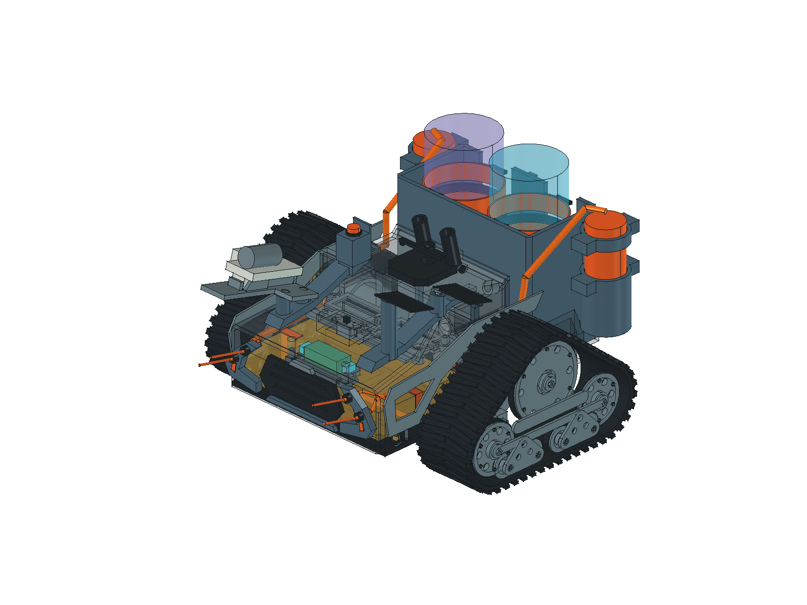

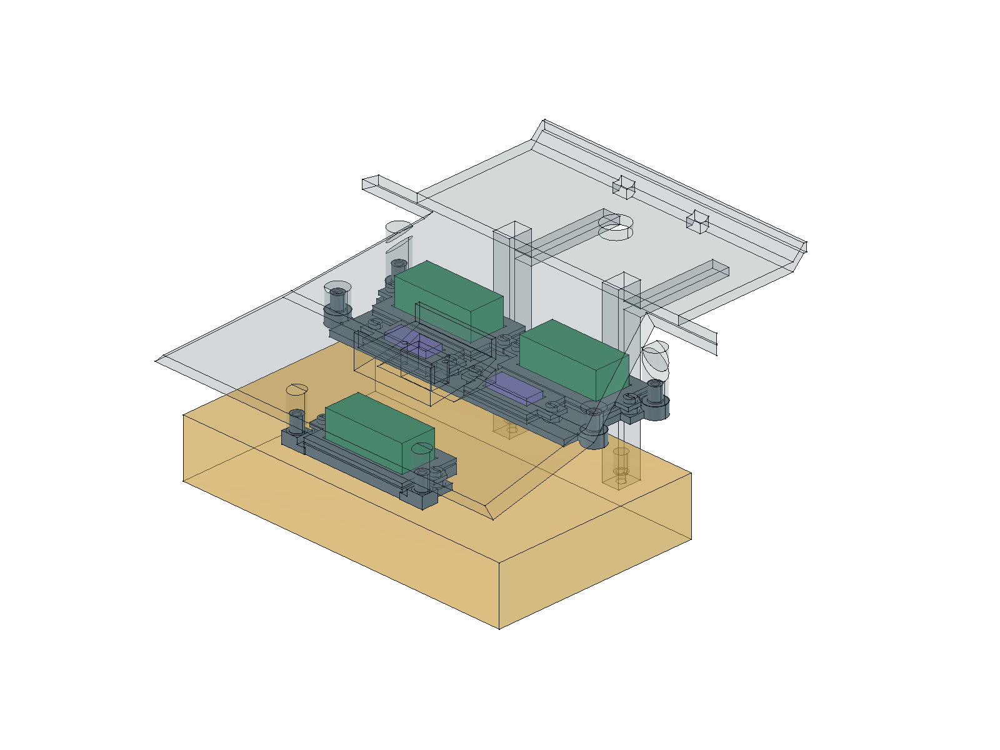

FCStd为几何依据，STEP仅作布局交换；现有装配PDF仍为0.44，未同步0.45–0.48。

## 0.49 镂空侧框向后延长

左右侧框后端Y8→38，保持1.5 mm厚、Z90顶高及原镂空；后伸30 mm为本轮设计候选。

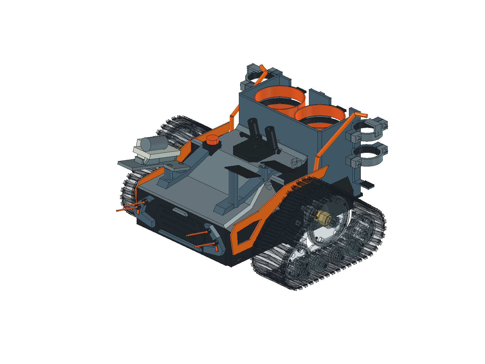

[侧视](side-frame-extension-side.png) · [范围与空间检查](side-frame-extension-audit.json)。原点火走线组仍默认可见。当前PDF仍为0.44；FCStd为几何依据。
