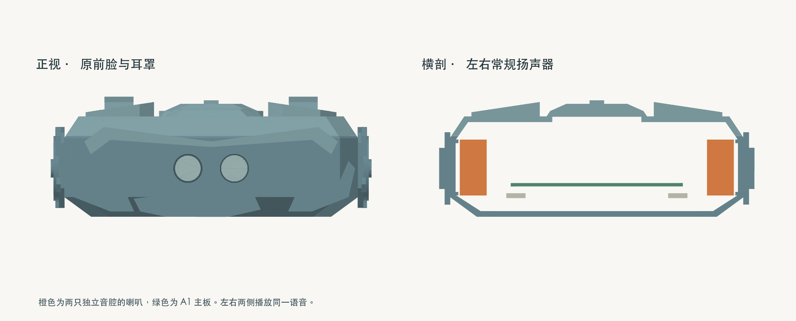

# CyberTrack 整机模型

日常查看打开 [CyberTrack.FCStd](CyberTrack.FCStd)。修改融合输入、特征或检查空间时，打开[可编辑设计源档](source/CyberTrack-design.FCStd)。[STEP](CyberTrack.step) 用于交换。坐标单位为 mm，+X 向左、+Y 向后、+Z 向上，前方为 −Y。

## v2 头舱电子装配

A1 定制主 PCB 安装在四柱托架上。左右各一只 PUI ASE02808MR-LW150-R，振膜朝向各自的耳罩。每侧声音由三个被原格栅实体遮住的内声口进入格栅后方空隙，再从原条缝出声。冠盖、前脸、外耳环及格栅造型沿用原版。[装配](../../docs/assembly.md#头舱与穿线) · [CAD 回读](pcb-speaker-fit.json)

顶部也核过一只常规喇叭的平放空间。振膜中心在（0，−20，213）mm 且朝上，按最大包络每面放宽 0.5 mm 后，至冠盖 2.94 mm、至 A1 主板 10.92 mm。该位置的正上方为 Z217–226 mm 实体，直接朝上出声需要另设声口。本版采用两侧原条缝，正面声像待闭盖试听。

## v2 装配与打印

清水瓶与泡泡液瓶直接放入背包，由 PP04 湿舱底面承托。去掉两瓶的绑带、搭接片、底托、底垫、侧垫、识别条及专用螺钉／嵌件，共 22 件。PP03 封平两处绑带缺口，PP04 填平四个嵌件孔。两只瓶下移 6 mm，顶部软管随瓶口接长。拔下目标吸管后，任一瓶均可沿 +Z 独立上提 150 mm，已通过 CAD 扫掠检查。实物抓握、行走稳定性和密封待验。[装配说明](../../docs/assembly.md#双枪与背包) · [CAD 与排盘回读](bottle-backpack-direct-fit.json)

Lean 21 件、Ready 20 件，各六盘。Lean 含 A1 托架，使用 Ready 时需单独打印托架。从前一版双瓶直放 CAD 和打印项目可复现此次内部装配调整。[修订脚本](../../scripts/fit_pcb_speaker.py) · [文件与排盘回读](pcb-speaker-fit.json)

| 工程 | 适用任务 |
|---|---|
| [Lean 排盘](lean-print/README.md) | 含 A1 主板托架及原 PP05 和内置双喇叭支座的 PP07。 |
| [Ready 排盘](print-ready/README.md) | 沿用用户排盘与工艺，盘号与 Lean 分开。 |
| [整机装配](../../docs/assembly.md) | 确认动力、开关、托盘、穿线、双枪和双瓶取放顺序。 |
| [头壳打印](../../docs/head-shell-print.md) | PP07 整体打印，冠盖与主板框架分别拆装。 |
| [原始部件资料](../components/) | 核对实测外形、厂商资料和接口假设。 |

在仓库根目录运行 `python3 scripts/check_print_release.py` 可复核现行 CAD 与两个 3MF 的文件哈希、六盘清单和需重切盘的缓存状态。

实物还需检查枪座配合、螺丝保持力、带线检修、满／空瓶移动与急停时的稳定性，以及电子舱隔液。[验收计划](../../docs/verification-plan.md)

## 历史图纸与回读

- [0.56 装配维护图册](CyberTrack-assembly-and-service.pdf)是 69 页 A3 评审快照，早于现行驱动支架、整体头壳和双瓶背包。图册输入与覆盖范围见[图纸审计](assembly-annotation-audit.json)。
- 旧整机生成器会覆盖后续局部修订。复现时使用对应 Git 版本与输入副本。按日期查找模型沿革、图册生成命令及旧检查报告，可从[清理前的设计记录](https://github.com/miclle/cybertrack/blob/89231fa08cb1a7ad633edb81b9e07aa895de519f/hardware/model/README.md)进入。

### 0.34 L298N 支架与拆装

早期支架及拆装间隙见[当版检查](l298n-mount-audit.json)。现行安装使用上表的底盖承载支架。

### 0.44 MT3608 升压板包络

模块长边沿 +Y、宽边沿 −X、厚度沿 +Z。尺寸来源、假设与维护空间分别见[部件资料](../components/MT3608/README.md)和[整机检查](mt3608-fit-audit.json)。
