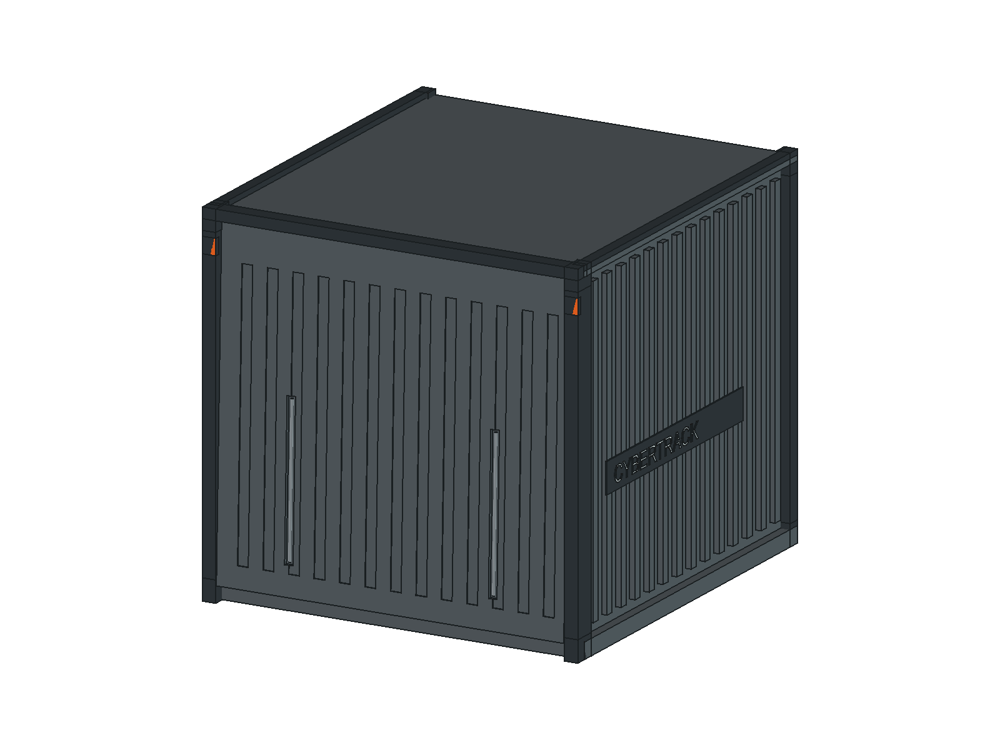
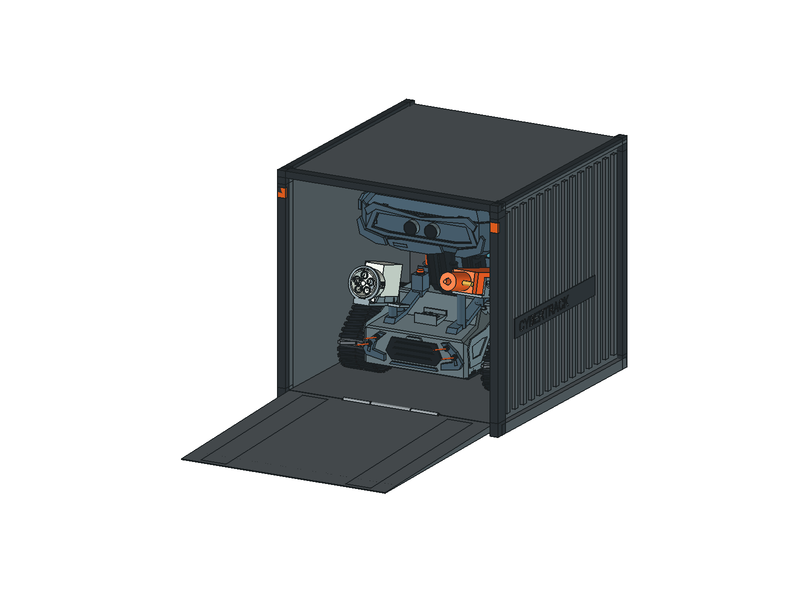
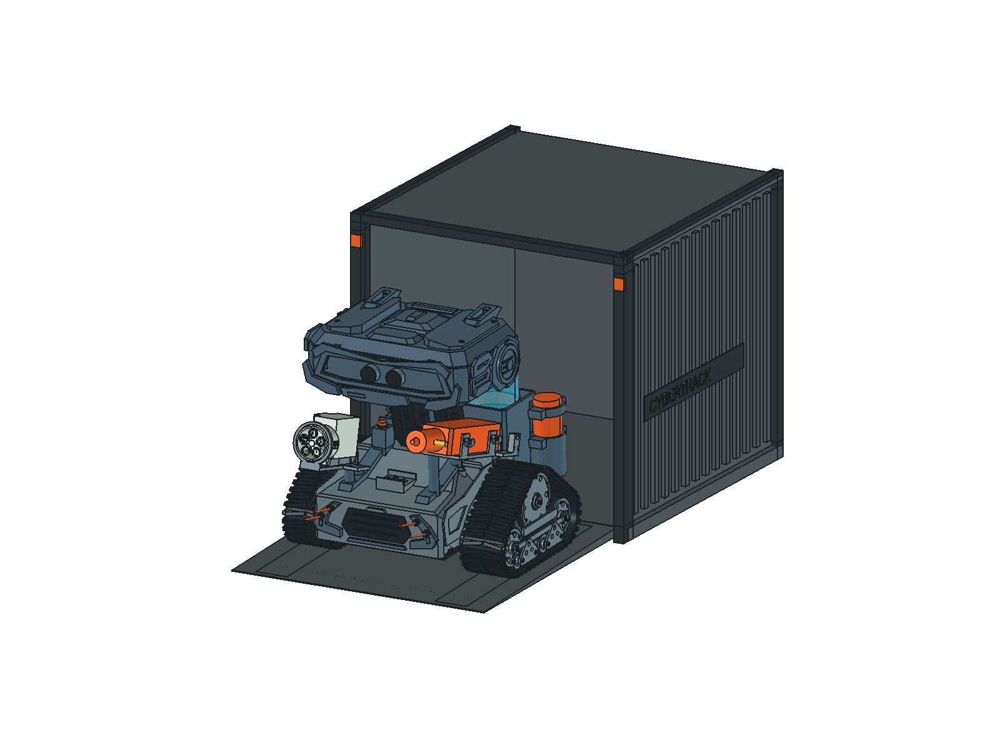
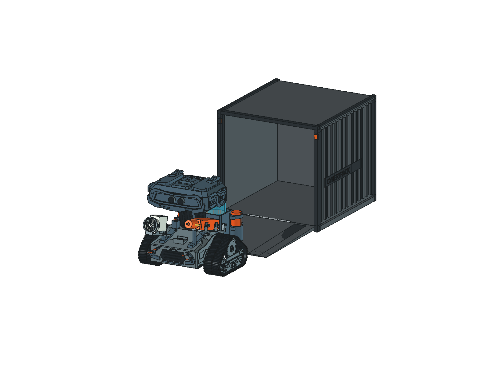

# 紧凑集装箱车库 · FreeCAD 空间候选

2026-10-27：已从外观概念推进到 FreeCAD 整合、开合／进出空间检查及保存回读。**当前为机械空间候选，不是制造放行。**

[打开 FreeCAD 模型](CyberTrack-container-garage.FCStd) · [参数](parameters.json) · [空间报告](spatial-validation.json) · [保存回读](saved-readback.json)

| 关门 | 下翻门打开、机器人在库内 |
|---|---|
|  |  |

| 机器人位于坡道 | 完全出库 |
|---|---|
|  |  |

[正面净距](front-clearance.png) · [移除侧壁／顶板后的坡道侧视](ramp-section.png) · [上一轮 AI 外观参考](appearance-closed-open.png)

## 已确认需求

独立全封闭收纳车库，集装箱外观，端面整块门板下翻兼作坡道，尺寸尽量紧凑。用户确认照片中的头顶线束是尚未安装顶盖造成的；装好顶盖后按模型设计高度确定箱高。后续已授权建立 FreeCAD 模型，放入机器人并验证关门、开门和机器人进出空间；不包含制造、自动门、自动泊车、提交或推送。

## 尺寸候选

单位 mm，表中为长（Y）×宽（X）×高（Z）。沿用 +X 向左、+Y 向后、+Z 向上；门在 −Y 端，底铰链轴沿 X。机器人倒车入库、正向驶出。

| 项目 | 数值 | 依据／边界 |
|---|---|---|
| 机器人包络 | 245.25 × 228 × 228 | 从当前 `../CyberTrack.FCStd` 的 229 个快照对象回读，包含设备包络，排除纯检查区及已被合并件代替的源对象；最终采用不依赖三角网格的最优包围盒 |
| 箱内净空间 | 280 × 260 × 250 | 扣除内部筋、门框、锁扣后的空间目标 |
| 有效净开口 | 宽 260 × 高 250 | 从地板顶面到上框底面；中部铰链位于履带之间，仍作为障碍参加检查 |
| 关闭模型外形 | 298 × 280 × 270 | 含边框的实体包围盒；上一轮 300 × 280 × 270 为预算，本轮未扩大 |
| 左右名义余量 | 每侧 16 | 假定横向居中 |
| 前后名义余量 | 前 17.373／后 17.377 | 机器人停放平移 Y=155.123、Z=12；前方为 −Y |
| 顶部名义余量 | 22 | 装好冠盖的模型基准；进出俯仰另查 |
| 地板离地／门板有效长度 | 12／249.5 | 门内面坡度 2.573°，由竖直关闭位置下翻 92.573°；已计入门前缘 0.8 mm 厚度 |
| 开门纵向占地 | 539.25 | 模型 Y−249.248…290；不含机器人完全驶出所需空间 |

较上一轮口头建议的 360 × 290 × 320 内部空间，净体积由约 33.4 L 减至 18.2 L，减少约 46%。这只是直线低速进出候选，不支持箱内转向的承诺。

## 外观与结构意图

- 深灰竖向波纹板、黑色角框、少量橙色锁扣／边角识别，侧面 `CYBERTRACK / UNIT 01` 标识。
- 同一块门外侧波纹与装饰锁杆、内侧平整及两条防滑行驶区。外侧凸起收在边框包络内，避免开门提前顶地。
- 同一块门在原位旋转：根部厚 8 mm，前缘厚 0.8 mm，外侧连续收薄；门内侧保持平面，外槽和装饰杆不凸出收薄包络。前缘外侧落地，行驶面末端名义小台阶约 0.80 mm。
- 底铰链位于两履带之间，销轴 Ø2.8、套筒内孔 Ø3.2、外径 Ø4.8；门根部同样贯通 Ø3.2 销轴孔。固定套筒位置另外避让，销轴／套筒与地板缺口全部参加开合检查。
- 上方左右机械搭扣闭锁；顶盖可拆，便于断电取车。低门槛与末端薄斜过渡、铰链缝隙和防夹边待细化。
- 优先板材箱体／门板配合打印角件和装饰。CAD 底板为 12 mm 等效承载体，外框、搭扣及收薄门仍需按材料和质量细化；内部节点连接、紧固、薄前缘强度尚未设计定版。两条防滑区仅为零厚度面标识，实际铺面厚度必须重新计入。
- 收纳前关闭动作并断电；本轮无箱内充电、照明、通电效果或自动门接口。

## 模型操作与复现

原生文件只有一套固定箱体、同一块门及一个机器人快照，没有用不同门板模拟开合。默认保存为开门在库姿态。模型树 `Pose` 的 `DoorAngle`、`RobotY`、`RobotZ`、`RobotPitch` 通过表达式控制两个 `App::Part`；姿态可直接编辑，尺寸由 [parameters.json](parameters.json) 和 [生成脚本](../../../scripts/container_garage.py) 重新构建，不能仅修改只读尺寸说明来改变几何。

在 FreeCAD 运行对应宏即可切换：[关门](show-closed.FCMacro)、[开门](show-open.FCMacro)、[坡道中途](show-ramp.FCMacro)、[完全出库](show-exit.FCMacro)。宏只改变该文档的姿态，不自动保存，也不关闭其他文档。反向依次经过同一路径表示倒车入库。

复现使用 GUI-enabled FreeCAD 1.1.4 及其 NumPy。将仓库 `scripts/` 加入 Python 路径后，依次运行 `container_garage.build()`、`prepare_validation()`、`validate()`、`counterexamples()`、`finish()`。构建拒绝覆盖已经打开的目标文档（按名称和真实文件路径核对）；先自行保存并关闭已有车库再重建。`validate()` 和 `counterexamples()` 仅操作已复制的几何，可放到后台；其余涉及文档／GUI 的步骤在主线程执行。机器人原文件不保存、不覆盖。

## 验证证据与边界

- 关门停放：机器人与固定箱体、关闭门板没有体积干涉；履带与地板的名义接触允许。前后、左右与顶部净距见上表。
- 门板：从 0° 到 92.573°，最大角步长 1°，共 94 个姿态；所有门板实体分别对固定箱体、停放机器人和地面做 OCCT 实体交集，阈值 0.01 mm³，最终无碰撞。
- 进出：从库内至整个机器人离开坡道，共 272 个姿态，Y 步长不超过 2 mm。利用真实履带下部三角网格（0.05 mm 离散精度）和地形折点求刚性接地姿态，平地／整段坡面采用解析解，转折处搜索 0…2.573° 俯仰，留 0.05 mm 接触计算裕量。每个机器人实体／设备包络分别与箱体、开门实体和地面做交集，未检出体积碰撞；该路径反向用于入库。
- 连续保守界：直线、无偏航、俯仰不超过坡面角时，左右各偏移最多 5 mm 后仍有不少于约 10.65 mm 的横向余量；全姿态顶部保守余量约 10.79 mm。门板主截面侧向余量 0.5 mm、顶部余量至少约 0.499 mm、门根与底板前缘余量至少约 0.641 mm。细部铰链与接地过程仍属于离散检查，不宣称全路径连续碰撞证明。
- 负例：净宽缩到 220、净高缩到 220、净长缩到 240 mm 的障碍均检出机器人实体碰撞；保持 8 mm 均匀门厚、按同一落地角打开的反例检出穿地。
- 修正证据：初轮门根漏开销轴孔，检出 94 处门板／销轴干涉，见 [修正前报告](spatial-validation-before-hinge-bore.json)。补孔后重跑全部门角；新门板相对旧门板新增体积为 0、移除约 100.531 mm³，且未改变履带接触区域，因此沿用此前全部进出姿态的无碰撞结果，复用依据写入最终报告。
- 保存回读：304 个几何对象的有效性、体积、最优包围盒及显示状态核对通过；机器人源文件前后 SHA-256 相同。
- 操作核对：[姿态宏与保护检查](inspection-checks.json)记录关门、开门、坡道、出库及恢复开门的实际属性；已确认旋转轴为 X，宏未保存文件。对已打开输出的重复构建被拒绝，文档对象数与文件哈希保持。

上述结果仅覆盖源模型中的刚性几何及所列设备／管线包络。未验证实物重心、摩擦、驱动力、履带变形、偏航／侧向转弯、线管动态摆动、薄前缘强度、门板挠曲、闭锁保持、防夹、防尘等级或儿童使用。尚无制造图、选定五金或物理验收。

下一阶段：结合实际整机质量选定门板／底板材料和铰链，细化紧固与搭扣、防夹和防滑材料，再做带载低速进出、门板承载和闭锁试验。

## 前轮外观资料

[AI 外观参考](appearance-closed-open.png)由内置 imagegen 生成，后以机器人图修正；[提示词](prompts.md)与[前轮算术检查](verification.json)保留历史。AI 图的投影、门长和结构细节不作几何证据；当前尺寸以本页及 CAD 空间报告为准。
