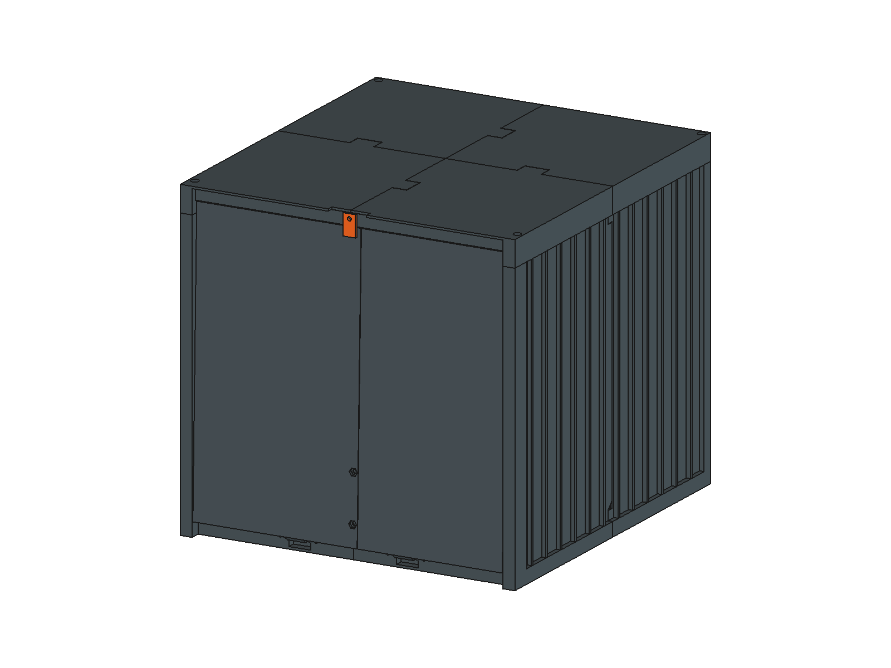
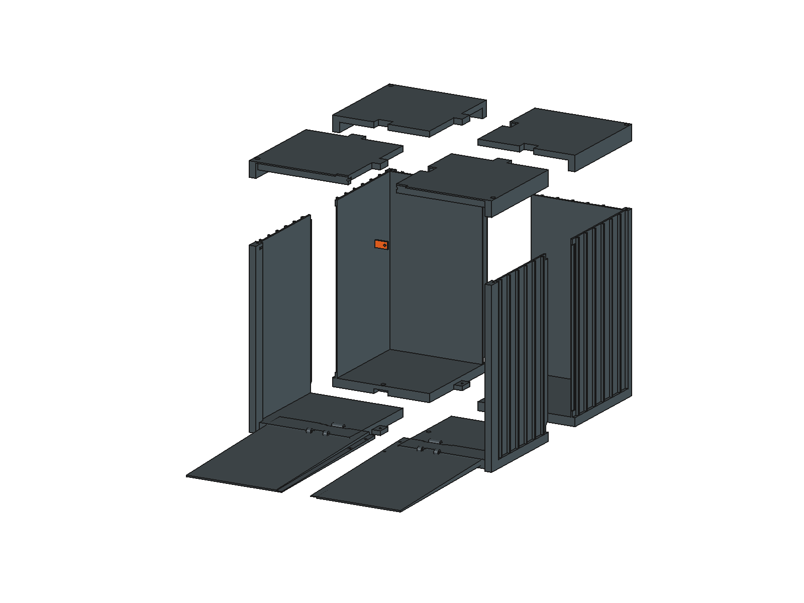

# 全打印集装箱车库 · 11 件制作候选

2026-10-27：用户确认尽量全部用 3D 打印制作，打印机为 P2SC、最大成型尺寸 256 × 256 × 256 mm；整机含电池和液瓶的质量尚未称量。本方案取代上一轮板材箱体的制作方向，保留旧空间模型作为历史证据。**这是已建模、已切片的试制候选，承载与实物装配尚未验收。**

[FreeCAD 原生模型](CyberTrack-garage-print-candidate.FCStd) · [11 件 STL](parts/) · [逐盘切片工程](slicing/) · [打印统计](slicing-summary.json) · [装配接口检查](detail-check.json) · [进出空间报告](spatial-validation.json) · [保存回读](saved-readback.json)

| 关门、门闩锁定 | 门闩转开、下翻门落地 |
|---|---|
|  |  |

## 尺寸与打印拆分

外形仍为长 298 × 宽 280 × 高 270 mm。沿用 +X 向左、+Y 向后、+Z 向上；门在 −Y 端。内部直线通道长 280、宽 260 mm；前门框底面 Z=258，地板面 Z=12，因此有效门口净高改为 **246 mm**。机器人冠盖模型高 228 mm，对前门框名义余量 18 mm；不以照片中临时线束增加箱高。直线进出，不在库内转向。

零件数共 **11 件**：4 个底板／侧壁一体角舱、4 片顶盖、2 片坡道门、1 个旋转门闩。角柱、波纹筋、铰链座、螺母槽均直接并入主体，不另做打印角码、装饰锁杆、独立门框或铰链块。用胶和少量 M3 五金连接，不打印细轴，也不使用热熔嵌件。

以下尺寸为 STL 已摆好打印方向后的 X × Y × Z 包络；详见 [parts.json](parts.json)。B01/R01 为 −X 前角、B02/R02 为 −X 后角，B03/R03 为 +X 前角、B04/R04 为 +X 后角。

| 零件 | 数量 | 打印包络 mm |
|---|---:|---|
| B01 | 1 | 152.00 × 161.00 × 248.00 |
| B02 | 1 | 152.00 × 149.00 × 248.00 |
| B03 | 1 | 140.00 × 161.00 × 248.00 |
| B04 | 1 | 140.00 × 149.00 × 248.00 |
| R01 | 1 | 152.00 × 161.00 × 22.00 |
| R02 | 1 | 152.00 × 149.00 × 22.00 |
| R03 | 1 | 140.00 × 161.00 × 22.00 |
| R04 | 1 | 140.00 × 149.00 × 22.00 |
| D01 | 1 | 137.50 × 248.41 × 11.40 |
| D02 | 1 | 129.50 × 248.41 × 11.40 |
| L01 | 1 | 10.00 × 18.00 × 2.40 |

角舱按正常方向直立打印；顶盖外表面朝下；门板外侧斜面贴床、内侧行驶面朝上，铰链孔轴保持水平。STL 已完成这些旋转和落床，无须自动朝向。L01 与 B01 同盘，其余各一盘，共 10 盘。最长平面边约 248.409 mm，加两侧各 2 mm brim 后约 252.409 mm；最高角舱 248 mm。均在用户给定 256³ 内，不能按 256 mm 直接满幅拼块。

本地切片使用 **Bambu Lab P2S 0.4 nozzle / Bambu PLA Basic** 配置；用户称呼为 P2SC，未把两者视为已核实的机型同一性。运行前在 Bambu Studio 选择实际机器和耗材后重新切片。官方 [P2S 规格](https://bambulab.cn/zh-cn/p2s/specs)也列出 256³ 成型空间；本设计的约束以用户提供数值为准。

## 厚度与连接

| 部位 | 设计尺寸 | 制作方式 |
|---|---|---|
| 侧壁、后壁 | 2.4 mm 壁厚 | 外侧竖筋凸出 3.6 mm、宽 2.4 mm、间距 22 mm，兼顾集装箱外观与刚度 |
| 一体角柱 | 横向宽 10 mm，角舱高 248 mm | 与壁、底板同件打印；顶端侧装 M3 螺母 |
| 底板 | 12 mm 结构总厚 | CAD 为闭合实体，切片为皮层＋12% 填充，非实心 12 mm 塑料板；上皮设 7 层、名义 1.96 mm，下皮 4 层 |
| 顶盖 | 面皮 1.8 mm、内筋高 6.2 mm、筋宽 4 mm | 周边下翻裙边总高 22 mm，与角舱顶部平接；四片先粘成一盖 |
| 门板 | 有效长 245 mm，根厚 8 mm，前缘厚 2 mm | 内侧平面、外侧连续收薄；取消外凸装饰条，保证打开时不提前顶地 |
| 拼缝 | 单侧设计避让 0.25 mm | 是试配起点，不是打印精度承诺；先试螺母槽、铰链和拼缝，再胶合 |

**箱体：** 底板四条半深搭接舌局部伸出 12 mm，每处 1 颗 M3 沉头螺钉，共 4 颗。孔中心为 (X,Y)=(6,70)、(6,215)、(−70,147)、(70,147)；螺母从底面装入，头部沉入行驶面。侧壁与后壁的竖缝设 6 mm 宽、半壁厚搭接边，起始端用 45° 斜坡减少悬空；全长薄涂适合实际耗材的胶，再用底板螺钉定位夹紧。胶层是连接的一部分，不能把四颗底板螺钉当作整条竖缝的抗弯连接。

**顶盖：** 四片通过局部全厚度定位齿拼接并胶合，避免再增加四组顶盖拼缝螺钉。胶合后成为一个可拆盖；四角各一颗 M3×12 内六角螺钉，从顶面深孔拧入角舱螺母。中心 (±135,5)、(±135,285)，螺钉承压台 Z=253，螺母槽 Z=241…243.7。螺母从箱内侧放入，再装顶盖；顶面 Ø6.6 通道需用细柄内六角工具。盖与箱体不胶死，仍可从上方取车。

**门板：** 两片沿 X=0 分缝；搭接宽 8 mm、约半厚，并有 0.25 mm 避让。整条拼缝胶合，在距铰链 18 和 58 mm 的两处用 M3×8 固定；孔 X=4，位于履带之间。螺钉头在内侧，外侧螺母沉入斜面。靠近 2 mm 薄前缘不再加螺孔。若胶缝或薄边在带载试验中变形，应修改门板，不能仅提高填充率就宣称通过。

箱体拼缝封胶后用于完整围合收纳；门边仍有运动间隙，未设计 IP 防尘／防水密封。未增加有厚度的防滑贴，坡道摩擦须实测。

## 铰链与门锁

铰链分为两个站位，中心 X=±45 mm，轴线 Y=0、Z=12，均在两履带之间。每站固定两耳、门上一个中间轴套：固定耳宽 6 mm、外径 7.2 mm；门轴套宽 16 mm、外径 6.8 mm；两侧装配间隙各 1 mm；所有轴孔 Ø3.4 mm。底板为转动留出局部缺口并保留 2 mm 底皮。

每站用 **M3×40 半牙螺栓＋两片平垫＋一只防松螺母**作轴，优先让光杆覆盖门轴套。两站从远离中心的一侧插入，螺母朝中心；不要拧紧到夹死转动。实际半牙长度、螺母厚度和垫片组合须用所购物料核对，孔必要时手工修整。CAD 检查包含打印耳和孔，未包含供应商五金实体或摩擦磨损验证。

门向下翻 **92.340°** 后前缘外侧落地，行驶面坡度约 **2.340°**，末端名义台阶约 2 mm；支承靠前缘落地与根部铰链，不另加拉索或支腿。机器人重量未知，尚无门板载荷等级。

门锁采用 **1 件手转 90° 门闩**，外形 10 × 18 × 2.4 mm，M3×16 为转轴，两片平垫分别放在螺钉头下和门框背面的防松螺母下；门闩背面直接贴门框，用适量摩擦保持位置。转轴 (0,−3,264)，锁定时向下覆盖门顶 7 mm；转平后让出门板。顶盖前唇已做转动避让槽。它是收纳门闩，不是带钥匙锁；无额外锁杆、弹簧、磁铁或电机。转轴预紧力、磨损后自转和保持力均待试验。

CAD 已按每 1° 检查 0…90° 解锁旋转；并用“锁定时强行开门 0.5°”的交集作为门闩挡门的反例检查。几何挡住不代表强度或防误开已通过。

## 五金用量与装配次序

| 五金 | 数量 | 用途 |
|---|---:|---|
| M3×12 沉头螺钉 | 4 | 底板四处搭接 |
| M3×12 内六角圆柱头螺钉 | 4 | 可拆顶盖四角 |
| M3×8 螺钉 | 2 | 门板根部两处搭接 |
| M3×40 半牙螺栓 | 2 | 铰链轴 |
| M3×16 螺钉 | 1 | 门闩转轴 |
| M3 普通六角螺母 | 10 | 底板 4、顶盖 4、门板 2 |
| M3 防松螺母 | 3 | 铰链 2、门闩 1 |
| M3 平垫 | 6 | 铰链 4、门闩 2 |
| 适配实际打印材料的胶 | 适量 | 箱体竖缝、底板搭接、门板拼缝、顶盖定位齿 |

共 13 颗螺钉／螺栓。标准孔 Ø3.4；普通螺母槽对边 5.8、深 2.7 mm；沉头孔顶径 6.4、深 1.8 mm。以上为名义接口，需按实际螺钉头型和螺母试配，不作为已核实厂商尺寸。保留少量备用五金，但备用数量不计入装配 BOM。

1. 先打印前角舱 B01 和门片 D01，试 Ø3.4 铰链、螺母槽和床面尺寸；未通过时先修公差，不批量胶合。
2. 打印其余零件，去除局部支撑和 brim；干装四角舱与两片门，确认平面与拼缝没有翘曲。
3. 装底板螺母，胶合箱体拼缝并拧入 4 颗沉头螺钉；胶合顶盖四片。按胶的说明固化。
4. 胶合两片门并装两颗根部螺钉；安装两根铰链轴，检查自由转动、落地与门槛。
5. 从箱内放入四角螺母，安装顶盖与旋转门闩。先空载检查开关，再按称重后的实际载荷测试门板和胶缝。
6. 装好机器人冠盖后，进行低速直线出入、停放关门与顶盖取车检查；记录真实耗时、耗材、挠度、松动和打滑情况。

## 切片与证据边界

| 打印盘 | 预计时间 | 预计耗材 |
|---|---:|---:|
| B01 + L01 | 4 小时 9 分 | 247.9 g |
| B02 | 6 小时 2 分 | 350.8 g |
| B03 | 4 小时 6 分 | 246.7 g |
| B04 | 5 小时 59 分 | 344.7 g |
| R01 | 1 小时 16 分 | 79.6 g |
| R02 | 1 小时 20 分 | 85.1 g |
| R03 | 1 小时 14 分 | 77.7 g |
| R04 | 1 小时 18 分 | 83.2 g |
| D01 | 1 小时 58 分 | 110.6 g |
| D02 | 1 小时 58 分 | 106.5 g |
| **合计** | **29 小时 21 分** | **1732.9 g** |

使用 0.4 mm 喷嘴、0.28 mm 层高、0.6 mm 线宽、12% gyroid、外侧 2 mm brim；角舱和门板 3 层墙，顶盖 2 层墙，底面 4 层。普通自动局部支撑、snug、只支撑关键区域；轴孔、螺母槽等仍有少量支撑，不能称为完全免支撑。

B02 两层墙实验相比三层墙节省约 32 分钟、8 g，减重约 2.3%。当前保留三层墙，优先通过一体角舱、薄顶盖、合盘门闩和取消装饰零件减少装配与打印工作。0.6 mm 线宽等工艺参数尚需实际材料试打；时间是切片器估计，不含取件、修整、装配与胶固化。

本轮 **94 个门板角度、269 个直线进出姿态无体积碰撞**，门闩 91 个角度无干涉，锁定反例能检出挡门。连续保守界为横向额外偏移 ±5 mm 后余量不少于约 10.66 mm、顶部约 7.80 mm；细部铰链与接地仍为离散检查。保存回读验证 240 个几何对象，机器人与上轮车库源文件哈希保持不变。

[空间检查](spatial-validation.json)覆盖关门、解锁后的门板运动和机器人直线进出；[接口检查](detail-check.json)覆盖打印件间干涉、门闩转动和锁定反例。顶盖定位齿和侧壁导入角的后续修改以 [集合差与运动区检查](joint-refinement.json)补充，门闩前唇修改只移除固定材料；相关证据写入最终报告。机器人源模型与上轮车库文件的 SHA-256 均须在保存回读时保持不变。

[切片回读](slicing-check.json)核对最终 STL 哈希、工艺参数、每个工程仅一盘及无越界标记；完整 G-code 保留在 3MF 内，移除了字节一致的外置重复文件。所有生产盘返回成功且切片警告栏为空，但这不替代实际机器重新切片与首件试打。

几何检查包含源模型设备包络，未涵盖实际五金、打印误差、螺钉头凸起、门板挠曲、胶强度、履带变形、液体晃动和重心变化。整机尚未称重，因此不标注“可承重 X kg”，也不安排自动打印或通电动作。称重后先以等效静载检查门板和根部连接，再进行实物低速进出；门槛 2 mm、摩擦与闭锁保持均须单独验收。

复现：FreeCAD GUI Python 加入仓库 `scripts/` 路径，调用 `container_garage_print.build()`、`prepare_validation()`、其 `base.validate()`、`finish()`；只有 `base.validate()` 可在后台执行，其余涉及文档／GUI 的函数在主线程执行。构建拒绝覆盖已打开候选。切片运行 `python3 scripts/slice_container_garage.py`，使用本机 Bambu Studio，输出到本目录；不会发送到打印机。`Pose` 中 `DoorAngle`、`RobotY`、`RobotZ`、`RobotPitch`、`LockAngle` 控制同一套装配，先将门闩转到 90° 再开门。
