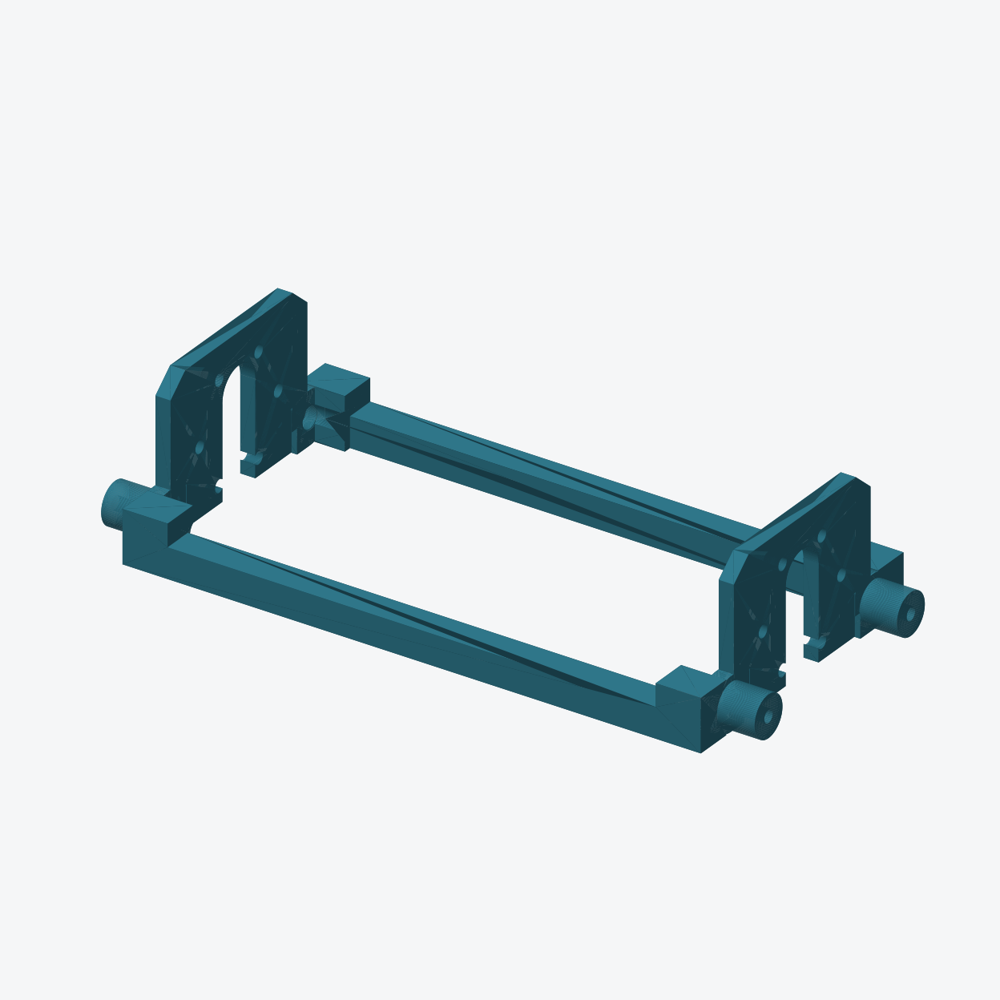

# VF01 电机与履带装配验证框架

2026-10-26：按用户要求，从现行底盘提取独立省料验证件，只验证底盘接口、两台电机、两个联轴器和左右履带的机械装配。正式底盘及只读动力部件资产保持原样。



## 文件和尺寸

- [打印 STL](VF01-DriveFitFrame.stl)：只打印这一件；单位 mm，最低点 Z=0，保留整机轴向，X 向左、Y 向后，前方 −Y。
- [FreeCAD 文件](CyberTrack-drive-fit.FCStd)：验证框架及默认隐藏的 42 个动力／紧固参考对象；“装配参考”组不打印。
- [检查报告](audit.json)：来源模型哈希、接口差集、承压座、工具通道、静态干涉、拆电机通道、保存回读和网格检查。

| 项目 | 完整 PP04 底盘 | VF01 验证框架 |
|---|---:|---:|
| 外包络，X × Y × Z | 174 × 196 × 66 mm | 174 × 80 × 41.6 mm |
| CAD 实体体积 | 142.517 cm³ | 40.369 cm³ |

实体体积减少 **71.7%**；此值不是切片耗材或打印时间的实测降幅。可放入用户提供的约 256 × 256 mm 平台，仍需为裙边／支撑及打印机禁用区域留空间。

## 保留与简化

- 两侧电机固定面和四个完整螺钉座直接截取正式底盘；固定板厚 4 mm，电机孔 Ø3.4 mm、分度圆 Ø31 mm，输出端保留 13 mm 下开槽和顶部 Ø13 mm 圆弧。
- 四处履带安装柱、通孔和沉孔保持。每侧孔中心 Y±28.1/Z37.4 mm，孔距 56.2 mm；电机安装端面 X±73 mm，履带安装件最近面 X±87 mm。左右位置不缩放、不移动。
- 删除前电源舱、后湿舱、隔板及上部外壳。前后各一根 8 × 8 mm 横梁连接两侧，端部局部加厚；安装柱 R7 根部与横梁过渡处增加连接材料，R5.5 柱芯、孔道和安装端面保持。中央及两侧电机下取口开放。
- 不安装头部、液体组件、电源或电子托架，不增加采购件。两台电机、两套履带／安装件及两个联轴器使用实物；电机端面每侧四颗、履带每侧两颗紧固件，长度和啮合深度按实物核对。

## 打印与试装

已完成 P2SC／0.4 mm／PLA 的方向与支撑设置及 Bambu Studio 切片检查，参数与历史结果见 [切片说明](slicing/README.md)。最终采用横梁朝下、0.24 mm 层高、热床树状支撑，预计 1 小时 21 分钟、33.97 g。STL 仍仅为本体几何；用户已完成打印并反馈静态试装正常，见下方实物记录。

断电试装顺序：先装两台电机并核对端面贴合，装联轴器，再装两侧履带／安装件；联轴器锁紧方式和实际操作顺序以实物为准。不要用强拧螺钉的方法把错位孔拉正。

- [ ] 记录打印材料、配置、耗材、耗时、翘曲和需要清理的位置。
- [ ] 四颗电机端面螺钉自然对孔，端面贴合，13 mm 槽与用户提供的 Ø11.9 mm 输出端不干涉。
- [ ] 两侧履带孔位、安装面和联轴器轴向位置适配；两履带平行，锁紧后框架不明显扭曲。
- [ ] 检查螺钉／工具操作空间、联轴器插入及锁紧、运动件间隙；只在传动允许手动转动的情况下检查转动，不强行回驱减速器。
- [ ] 移去目标侧履带、解除联轴器锁定并卸电机端面螺钉后，验证电机下取和尾线避让。
- [ ] 标注所有扩孔／打磨位置与改动量，反馈正式底盘设计。

CAD 检查已通过：一个有效实体；保护接口几何差集为零；8 个完整电机承压座保留；42 个参考对象静态配合无体积交叠；4 条履带螺钉送入通道及双侧电机连续向下 80 mm 包络对框架无干涉；保存回读一致；STL 单一闭合网格、无非流形边。完整整机的维护路径、线缆操作、实际螺纹与强度不在这些检查内。

这是接口试配件，刚度和载荷路径与完整底盘不同。不能用它认定正式底盘承载、整机维护、满载行走或耐久通过；本轮已获得打印完成与静态试装正常的用户反馈，尚未验证带电运行、载荷与耐久。

## 实物反馈（2026-10-26）

用户提供[装配照片](assembled-2026-10-26.jpg)，确认已打印并安装两台电机及左右履带；对修整／孔位、紧固贴合、联轴器配合和整体平行度／翘曲四类询问，用户反馈“都没问题”。这是用户的静态装配反馈，未提供螺钉具体长度、前后净距数值及实际打印耗时／重量；不把上述缺失数值补为已测。

用户确认两台电机**相对尾部最近凸起之间、包含编码器／接头的净距为 30 mm**。当前主模型 `MotorL/MotorR` 占位尾端 X±26.2，对应间距 52.4 mm，比实测多 22.4 mm。后续中央设备与接线布置不能继续使用 52.4 mm 作为实物可用间隙。30 mm 也不代表一个完整可用的长方体空间，接头插拔和线缆弯曲余量仍需单独核对。

安装面和固定孔位保持。仅凭总间距不能把差异平均分配成每台电机尾部延长 11.2 mm；电机本体、编码器和接头的分别尺寸与三维轮廓仍待补充。未覆盖只读部件资产或修改整机 CAD。原 CAD 检查仍是当时占位几何的结果，不证明新增尾部包络与中央设备无干涉。结构化记录见 [实物核对](physical-fit-2026-10-26.json)。

## 再生成

在 FreeCAD Python 控制台中，把项目 `scripts/` 的绝对路径加入 `sys.path` 后调用：

```python
import build_drive_fit_fixture
build_drive_fit_fixture.build()
```

也可用 `freecadcmd` 执行调用上述函数的包装脚本。生成器读取磁盘上的 `CyberTrack.FCStd::PrintLowerTub`，不读取未保存的 GUI 改动，不改写正式整机。重新生成前关闭本验证文件或保存需要另行保留的手工修改；输出目录内同名派生文件会被替换。

## 30 mm 尾部间距下的 L298N 布局检查

2026-10-26 按实测间距完成[独立布局研究](l298n-gap-study/README.md)：推荐板卡转 90°、前后导向与底部承托；居中检查假设下静态与下取扫掠通过。间隙偏心、安装紧固、真实接头和线束仍未确定，未改正式总装，也未输出制造支架。

## 后续固定方案（0.57）

用户补充两电机长度均 57 mm、L298N 插线最大厚度 28.5 mm 后，已完成[底盖承载支架及接线空间候选](../l298n-compact/README.md)，并同步正式 CAD。此前 27.5 mm 研究为历史；VF01 不含正式底盖六孔，不能直接锁装整组底盖托架。
