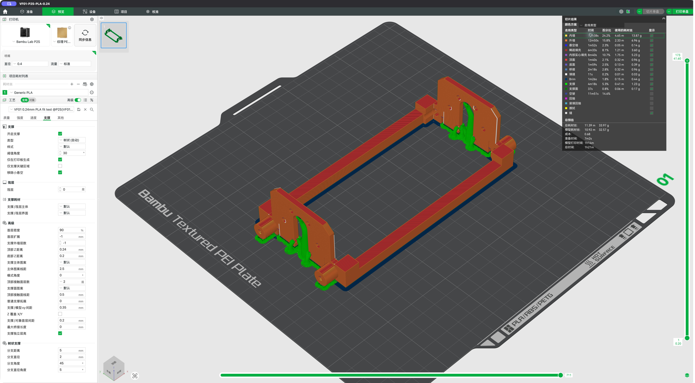
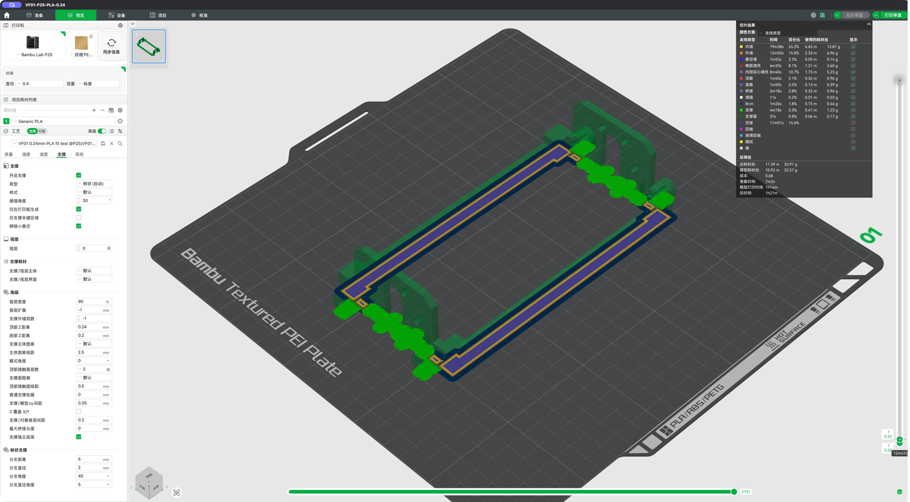

# VF01 历史切片参数与检查

2026-10-26 用户已完成打印及静态试配，反馈见[验证框架记录](../README.md)。该反馈不替代逐项尺寸、承载和长期运行验证。

历史工程 `VF01-P2S-PLA-0.24.3mf` 已清理；参数与结果保留如下，需要补打时由现存 STL 按实际设备重新切片。STL 本身不包含这些设置。

- 机器：用户确认 P2SC，软件配置为 Bambu Lab P2S，0.4 mm 标准流量喷嘴。
- 材料：单色 Generic PLA；纹理 PEI 板。打印时选择实际装入的 PLA，并核对所用热床板类型。
- 方向：两根横梁朝下，保持原始轴向，整件居中，无缩放。
- 层高 0.24 mm，首层 0.20 mm，启用精确 Z 高度，总高 41.6 mm、173 层。
- 3 层墙、10% 陀螺仪填充；外侧 3 mm brim；无筏层、无擦料塔、无换色。
- 自动树状支撑，仅在热床生成；阈值 30°，顶部间隙 0.24 mm，XY 间隙 0.35 mm，2 层顶部接触面。模型与支撑使用同一种 PLA。
- 预计总用时 **1 小时 21 分钟**、总耗材 **33.97 g**，支撑约 **1.40 g**；均为切片估算。

## 检查结果

Bambu Studio 02.08.04.57 已完成切片并在 GUI 打开预览；首层落点、完整支撑分布和尺寸已查看。支撑覆盖侧板脚底、安装柱下方及槽顶；切片结果没有未支撑悬空或越界警告。输入网格 10016 面，切片器未修复、删除或翻转面。实际支撑拆除、孔径及装配精度仍需逐项记录确认。

| 对比方案 | 预计时间 | 预计耗材 | 结果 |
|---|---:|---:|---|
| 横梁朝下，0.20 mm，树状支撑 | 87.4 分钟 | 33.63 g | 可切片 |
| 横梁朝下，0.20 mm，普通支撑 | 91.9 分钟 | 36.03 g | 可切片 |
| 横梁朝下，0.24 mm，树状支撑 | 80.9 分钟 | 33.92 g | 可切片 |
| 前侧朝下，0.20 mm，树状支撑 | 138.0 分钟 | 48.49 g | 两处无法生成支撑，弃用 |
| **最终：横梁朝下，0.24 mm，热床树状支撑、精确 Z 高度** | **81.0 分钟** | **33.97 g** | **选用** |

CLI 日志有一条 `Invalid T command (T65535)` 诊断。已核对该指令原样来自本机附带的 P2S 官方结束 G-code 模板，位于 AMS 退料段；没有改写机器起止代码。切片返回成功，GUI 预览正常完成；这不等于实机运行已验证。详见 [报告](report.json)、[切片原始结果](result.json)和[工艺配置](process.json)。

本次切片准备当时只生成本地文件，未发送或启动打印；后续用户打印与试配状态见页首。拆除支撑及 brim 后再进行断电机械试装。
