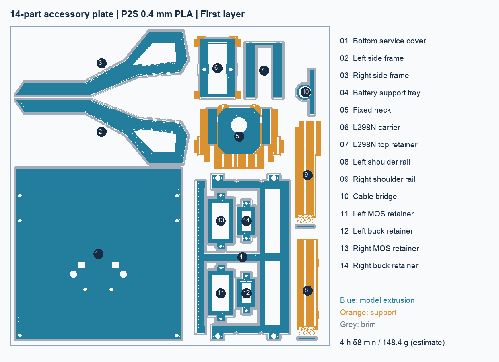

# 14 件底盘配套件共盘打印

本页 14 件清单与 Generic PLA 耗时为历史快照；4 个效果板压框已取消，现行 Lean 第 2 盘为 10 件，使用 PLA Basic。旧压框导出已清理，历史参数及检查结果保留。

**当前打印入口：** [27 件 Lean 六盘项目](../../lean-print/README.md)。本页为优化过程记录；重复独立工程和原始 G-code 已清理，参数、对比结果和检查报告保留。

历史候选 Accessories-14parts-P2S-PLA-FAST.3mf（历史中间文件 `Accessories-14parts-P2S-PLA-FAST.3mf`，已清理）。2026-10-26 从当时正式模型导出，原生几何未修改，零件保留独立对象，可在切片器中分别选择。

**一盘 14 件，预计 4 小时 58 分钟、148.42 g PLA。** 同一排版的普通配置为约 5 小时 22 分钟、159.29 g；优化节省约 23 分钟（7.2%）、10.88 g。底盖翻面、沉孔朝上，减少沉孔内支撑；仍保留原有固定壁线方式。树状支撑候选与颈架／L298N 托架冲突，未采用。

## 本盘零件

| 编号 | 零件 | 数量 | 独立 STL |
|---|---|---|---|
| 1 | 底部检修盖 | 1 | [STL](print-stls/LC03-BottomServiceCover-flipped.stl) |
| 2 | 左镂空侧框 | 1 | [STL](print-stls/KeelSideFrameL.stl) |
| 3 | 右镂空侧框 | 1 | [STL](print-stls/KeelSideFrameR.stl) |
| 4 | 电池内托板 | 1 | [STL](print-stls/BatteryHatch.stl) |
| 5 | 固定颈架 PP06 | 1 | [STL](print-stls/PrintNeck.stl) |
| 6 | L298N 托架 | 1 | [STL](print-stls/LC01-Carrier-upright.stl) |
| 7 | L298N 上压框 | 1 | [STL](print-stls/LC02-TopRetainer-flat.stl) |
| 8 | 左肩梁 | 1 | [STL](print-stls/ShoulderRailL.stl) |
| 9 | 右肩梁（含 BOOT 安装座） | 1 | [STL](print-stls/ShoulderRailR.stl) |
| 10 | 颈部线束限位桥 | 1 | [STL](print-stls/NeckCableBridge.stl) |
| 11 | 左 MOS 板压框 | 1 | `EffectRetainerLMOS.stl`（历史文件已清理，可从对应 Git 修订恢复） |
| 12 | 左降压板压框 | 1 | `EffectRetainerLBuck.stl`（历史文件已清理，可从对应 Git 修订恢复） |
| 13 | 右 MOS 板压框 | 1 | `EffectRetainerRMOS.stl`（历史文件已清理，可从对应 Git 修订恢复） |
| 14 | 右降压板压框 | 1 | `EffectRetainerRBuck.stl`（历史文件已清理，可从对应 Git 修订恢复） |

电池内托板内部放入 4 个独立压框，原生实体检查净距分别为 3.2／4.0 mm，没有材料相交；这些零件仍各自打印，不融合成一体。拆除 brim 后分开。压框对应现有低压板卡的机械安装候选，接触位置与实际板边仍需试装；不包含软垫、金属螺母、嵌件或任何接线。

## 方向与工艺

- 用户打印机 P2SC 沿用 Bambu Lab P2S、0.4 mm 标准流量喷嘴配置；Generic PLA，纹理 PEI 板。发送前匹配实际 PLA 与热床板。
- 底盖翻面平放（螺钉头沉孔朝上），电池托板平放；侧框翻平；上压框翻面，使较大的 U 形平面朝下；L298N 托架、固定颈架和肩梁保留竖立方向。托架背面朝下方案更慢、耗材更多，未采用。
- 0.24 mm 层高、0.20 mm 首层；3 层墙、顶部 5 层、底部 4 层；10% 立方体填充，内部填充线宽 0.6 mm。薄件不足上述层数时由切片器生成实心截面。
- 普通自动支撑、snug 贴合式，允许落在模型表面；本体间距 5 mm、顶部接触面 2 层、Z 间隙 0.24 mm、XY 间隙 0.35 mm。2 mm 外侧 brim，无筏层和擦料塔。
- 按层同时打印，**不是逐件打印**。保留机器起止代码、原墙面速度与 Generic PLA 的 12 mm³/s 流量限制。

## 检查与适用范围

14 件原生形体均为有效单实体，STL 封闭且无非流形边。最终 3MF 的顶点、三角面及摆放与输入逐件比较通过，没有网格修复。切片器执行路径冲突检查，所选方案无悬空／冲突警告；首层含支撑和 brim 的范围为 X3.07–249.18、Y3.07–253.73 mm，位于 256 mm 平台内。

已查看下方首层工具路径图，并核对 14 件均生成模型挤出及末层高度。4 个名义厚 1.2 mm 小压框的末层为 1.16 mm（层高离散误差 0.04 mm）；其他零件末层与网格总高一致至约 0.001 mm。未进行 GUI 全层巡视；这些检查不证明实物强度、层间结合、螺纹配合或支撑可拆性，薄侧框拆 brim 时应托住。

底盘主体 PP04 继续使用原快速版独立一盘（历史中间文件 `PP04-P2S-PLA-FAST.3mf`，已清理）。该历史盘未装入头壳、冠盖、背包和水枪底托等较大件；当时 PP02 有配合问题，LC04 有三个实体，均未混入；后续[四件修正](../../remaining-print/README.md)已消除 PP02 名义静态干涉并将 LC04 连成单实体，现已纳入 Lean。成品履带与电机、金属紧固件、柔性衬垫和纯检查包络不作为 PLA 打印件。

CLI 沿用的 P2S 官方结束代码仍产生 T65535 诊断，与此前 VF01／PP04 配置一致；切片返回成功。本次没有发送或启动打印。

[总报告](report.json) · [八组候选对比](comparison.json) · [3MF 与路径检查](project-check.json) · [镂空内排布检查](nested-layout-check.json)

