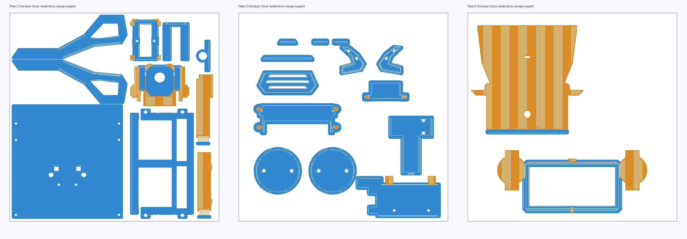

# 精简打印项目：27 件、6 盘

2026-10-27：当前为 **27 件、6 盘**。泡泡液瓶底托、识别条撤销，PP03 两侧筒内径改为 35 mm；第 **3、6 盘需重新切片**，旧 G-code 已清除，其他盘缓存保持。下文 29 件、时间和耗材是此前切片记录。见[当前调整与证据](../../../docs/backpack-35mm.md)。

2026-10-27：已进入样机联调与整机验证阶段，已有[制作过程、样机实拍与运行视频](../../../artifact/README.md)。照片和视频不替代逐项实物验收；打印公差、螺丝保持力、承载、线束维护、温升、供电及液体共存等未验证项继续保留。 已有打印件按实物需要补打；下列顺序为项目排盘顺序，不是尚未开工的阶段计划。

2026-10-26。当前文件：[CyberTrack-Lean-6plates.3mf](CyberTrack-Lean-6plates.3mf)。创建此版时用户确认旧第 2、6 盘未打印，因此另存项目；该记录不表示它们至今尚未打印。三块 MOS 改用热熔胶固定，两块降压板已由用户集成到枪体。

## 打印顺序

先完成动力与电控安装，再打印双枪固定件及头部；背包、顶盖留到最后。小饰件沿用已有空位共盘，不单独增加开机时间。两块 MOS 承板仍通过顶盖内柱安装，可提前打印备好，最终安装需要末盘顶盖。

| 新盘 | 内容 | 件数 | 估计时间 | 耗材 | 原盘 |
|---|---|---:|---:|---:|---:|
| 1 | 底盘（已打印则跳过） | 1 | 3小时59分 | 164.39 g | 1 |
| 2 | 底盖、电池托板、L298N 托架／压框、侧框、颈架、肩梁、线束桥 | 10 | 4小时11分 | 148.83 g | 2 |
| 3 | 水枪底托、泡泡枪座、两件 MOS 承托、双瓶托和前舱小件 | 13 | 2小时0分 | 80.51 g | 6 |
| 4 | 面包板托盘、冠盖 | 2 | 3小时23分 | 154.04 g | 4 |
| 5 | 头壳 | 1 | 4小时9分 | 154.22 g | 3 |
| 6 | 背包、顶盖（最后打印） | 2 | 4小时48分 | 240.59 g | 5 |

合计约 **22小时32分、942.58 g**；相比原 34 件项目少 **10分33秒、5.14 g**。这是相同设备和工艺的切片估算，已打印件不重复打印。

## 取消与保留

- 取消 `EffectRetainerLBuck`、`EffectRetainerRBuck` 两个降压板压框，以及 `EffectRetainerLMOS`、`EffectRetainerRMOS`、`IgnitionMOSRetainer` 三个 MOS 压框。对应 10 颗压框螺钉／10 个短嵌件候选及旧降压板垫、检修占位一并撤销。
- `EffectTray` 移除前侧降压板区域和压框柱，实体体积从 5124.56 降至 3155.31 mm³（约减 38.4%）。四个顶盖安装耳、MOS 浅座及板边垫保留。
- `IgnitionMOSCarrier` 去掉压框耳片与柱，实体体积从 1286.34 降至 1139.24 mm³；两处吊装接口、板底支承和接线位置保留。
- MT3608 是电机升压模块，继续保留；L298N 托架及压框继续保留。

两件承托结构提供原有安装位置和板底间隙，不能因改胶固就视为无用。胶固位置须按实物板边选择，不占端子、接头和散热区；胶固保持、带载温升及装配仍待实物验证。枪体中降压板的新坐标与外露线束未测，不在 CAD 中凭空定位。

## 验证与复现

[几何审计](geometry-audit.json)记录主模型与设计源的删除范围，除两件支架外的 234 个主模型几何保持；两件均为有效单实体，导出 STL 闭合、单连通、无非流形，STEP 回读体积差为零，无新增实体干涉。顶盖不改。

[交付检查](delivery-check.json)核对当前 236 个几何对象与 29 个打印件清单；原底盘、头壳和冠盖／面包板盘的 G-code 字节保持。其余三盘因减件或前移枪座重切，工艺／材料参数、既有孔位和模型朝向保持；水枪底托仅在盘面旋转 90°，点火托架移至空余位置。三个重切盘警告为空，碰撞检查已执行，全部层的挤出路径在平台内。37 个关键原生截面的路径覆盖筛查通过，非全体积强度或实物验收。

增量复现：在 FreeCAD Python 环境执行 `scripts/simplify_effect_mounts.py`，再执行 `python3 scripts/prepare_lean_print.py`，最后在 FreeCAD Python（含 Pillow）运行 `scripts/check_lean_print.py`。日常只读校验：`python3 scripts/check_print_release.py`。旧版 `build_tank.py` 和历史四／五／六盘实验脚本不是本次增量交付入口，不能用旧压框方案覆盖现行交付。

原始六盘文件已移至[固定校验基线](../archive/print-baselines/CyberTrack-34parts-6plates.3mf)，原哈希与缓存路径保持，复现脚本从该文件读取。用户另行重排并改为中文盘名的 Ready 项目保留在原位置；它仍有 34 件且保存时未包含缓存 G-code，不能用于 Lean 的历史路径对照，也不能把本页盘号直接套用到该项目。

2026-10-26 清理已取消的 5 个压框的 7 份独立导出，以及过期 FreeCAD／Finder 备份；清理文件可从本机废纸篓恢复，见[清理记录](cleanup-report.json)。原始资料、当前模型、单件接口、切片配置与验证报告保留。历史脚本若需旧压框独立导出，应从 Git 历史恢复；现行 Lean 生成和校验不依赖它们。
