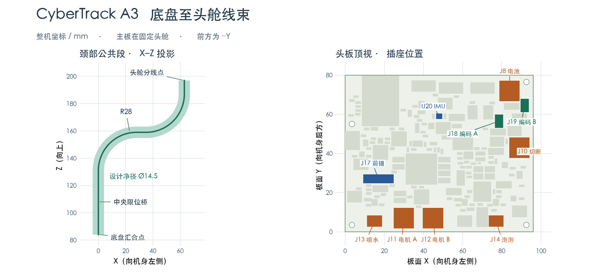

# A3 底盘至头舱线束

**采用头舱单板，中央通道改为 Ø14.5 mm。** 现有 Ø10 mm 通道不足以覆盖整束、护套和穿线余量。A3 专项模型给出底盘汇合点至头舱分线点的连续路线和五个改件，原 A1 整机与已排盘的打印项目仍对应各自版本。[改件 FreeCAD](CyberTrack-A3-neck.FCStd) · [几何与束径回读](clearance.json) · [A3 接口及生产文件](../../../pcb/motion-feedback/README.md)

## 一台车的线束

下表是建议裁线前的配线基准。按绝缘外径筛选线材，实际可用截面积还取决于持续电流、同时启动的压降、端子适配及束内温升。SW2 设在底盘干区可直接操作的位置，两路功率线均计入通道；右肩 BOOT 两线在颈部加入。J15 当前空置，IMU、摄像头、OLED、扬声器均在头舱内。

| 从底盘或肩部 | 头端 | 芯数 | 走向与候选线材 |
|---|---|---:|---|
| 低位电池 5 V、GND | J8 螺钉端子 | 2 | 从电池尾线沿干舱侧壁上行，保留电池托盘可拆插接点。18 AWG，设计外径 2.10 mm |
| SW2 主触点去、回线 | J10 螺钉端子 | 2 | ACT_FEED 与 5V_ACT 同束往返，全执行器电流经此触点。18 AWG，2.10 mm |
| 两台电机动力端 | J11、J12 螺钉端子 | 4 | 每侧两根绞合沿本侧电机上方进干区，再汇入中央。22 AWG，1.60 mm |
| 两个枪内降压输入 | J13、J14 两个 XH 口 | 4 | 各自沿枪座干侧回到顶盖下，受控 5 V 和对应 GND 成对，绕过瓶口和软管拆卸路径。24 AWG，1.42 mm |
| SW1、SW2 辅助干接点、右肩 BOOT | J9、J16、J6 | 6 | 各用独立双芯，按键与功率触点分开标识。26 AWG，1.20 mm |
| 两台电机编码器 | J18、J19 两个四芯 SH 口 | 8 | 在各侧电机六芯快拆处分为动力两芯和反馈四芯。每侧 VCC/GND/A/B 独立进头舱，AB 线束与电机 PWM 线分组绑扎。选适配 SH 压接端子的细绞线，预算按最大绝缘外径 0.80 mm |

完整上段 **26 芯**，肩部两芯加入前最多 24 芯。分支跨过限位桥的具体高度可以调整，上段按全部导线同时通过计算。电机 A、B 在两端均用同一标签，编码器与同侧 H 桥接口配对。两台电机尾部硬件最近净距实测 30 mm，须用原配六芯插头量取实际弯线空间。快拆放在拆开底盖可触及处；拆一侧前先释放本侧线夹和插头，再按原路径下取电机。[电机尾部记录](../../../components/37R-520/README.md) · [SH 压接端子与护套规格](https://www.jst-mfg.com/product/pdf/eng/eSH.pdf)

## 截面、路径与装配

按每芯带绝缘外径 d 和根数 n 计算，先以 √(Σn·d² / 填充系数) 估算包络直径，再加护套两侧共 0.8 mm、穿线直径余量 1.5 mm。填充系数和余量是装配预算，接头、胶布搭接、交叉绞合及实际弯曲均需试装。55%、65%、75% 填充时，对应的最低净孔分别为 **11.81、11.04、10.44 mm**。65% 时带套束径约 9.54 mm，Ø10 孔只剩约 0.23 mm 单边空隙。[计算输入和输出](clearance.json)

整机 +X 向左、+Y 向后、+Z 向上。主束在 **(0, 6, 84)** 汇合，经中央桥上行；理论折点为 **(0, 6, 159)** 和 **(63, 9, 159)**，沿车体左侧升至 **(63, 9, 197)**。两处转弯采用 R28 mm 中心线圆弧，这一段中心线约 152 mm。它只覆盖公共段，逐支裁线还需加上部件至汇合点、头舱分支、端接和检修余线；压接前在实车上用样绳逐支量取。

| 改件 | A3 改动 |
|---|---|
| 底盘顶盖 KeelLid | 放大中央入口，修整孔缘；入口保持在干区 |
| 中央限位桥 NeckCableBridge | 桥环外径 18 mm，名义净径 14.5 mm，环壁径向 1.75 mm，保留原横向连接 |
| 颈架 PrintNeck、头下壳 PrintHeadShell | 沿新圆弧让位，移除颈架旧孔壁尖端；头下壳采用 A2 前摄开窗、固定座和压片螺柱 |
| 主板托架 ElectronicsTray | 修整头舱转弯处的局部干涉，保留四柱与安装耳 |

在现行整机上，旧中心线的 Ø12 mm 通规会碰到桥和托架，Ø14 mm 还会碰到底盘顶盖、颈架和头下壳。A3 改件经实体布尔回读，五件各为一个有效实体；Ø14 mm 通规沿新路线与纳入检查的整机几何相交体积均低于 0.01 mm³。打印公差、局部壁厚和强度、线束活动及防磨仍由实件验证。[复现脚本](build.py) · [改件体积和干涉记录](clearance.json)

重新打开保存的 A3 头下壳，前摄窗口、固定座和两个压片螺柱所在区域与 A2 对应实体的体积差为 0 mm³。69° 光路检查体、相机、压片和排线均与壳体无体积干涉，Ø14 mm 通规也通过同一壳件。

将 A3 原生 STEP 放回头舱后，通规避开主板；新增和移位器件与检查范围内的壳体、托架和紧固件均无实体干涉。J18、J19 各按插座顶面以上 5 × 8 × 12 mm 的插头和上拔包络检查，周边器件和壳体均留有空间。A2 的 J17 开锁、夹持与排线拔出位置也避开了 A3 新增件。这里的包络按板端单个插头估算，成束引线的弹力和手指操作需试装。

**穿线和头内分线。** 断电、开冠盖、移开头板托架，从底盘向上分组引线。较大插壳和分支接点留在两端，穿过弯道后装壳或端接，避免依靠整组插头同时通过。桥两侧在干区固定外护，解除线夹后能释放托架；电机快拆与拔头板分别留松弛段。颈内两组靠不同侧排布，出颈后继续把编码器线与电机动力线分开。头部左后侧先分出 J8、J9、J18、J19，其余沿板外缘分到 J10、前侧两个电机口和效果口，给右前 J17 锁扣、摄像头排线、麦克风、天线及板盖螺钉留空。逐端检查极性、相序和插拔方向，再合上冠盖。线夹位置、每根裁线尺寸及上段分支的动态余量待带线首件确认。

## 单板放在哪里

| 架构 | 穿颈内容 | 影响与取舍 |
|---|---|---|
| **A3 主板留在头部** | 26 芯，含电池、SW2 功率往返、两路电机、效果、开关和编码器 | 沿用头部连接器、短 DVP 排线、麦克风声道和维护口。新增感测无需板间通信。采用新通道；试装优先测 J8 到板、J10 回路及两路电机的压降、串扰与闭盖温升 |
| 整块主板移到底盘 | 电机、编码器和效果就近；摄像头排线、扬声器、显示、按键、超声波等改为向上 | 即使假设 J17 的入口可放到 Z97 mm 的底盘顶盖高度，相机自由排线自 Z194.25 mm 出线，垂直落差已达 97.25 mm，超过现有 62 mm 自由长度。96 × 80 mm 板还要避让 116 × 70.5 × 19.5 mm 电池、电机、湿舱和下取路径；麦克风及天线也要重做。采用此方案需要更换或重新验证摄像头传输方案 |
| 头部逻辑板＋底盘动力板 | 若用半双工差分总线，可预算头部电源/地 2 芯、差分通信 2 芯、独立硬件许可及回线 2 芯；肩部 BOOT 再加 2 芯，上段约 8 芯 | 底盘就近升压、驱动和计数，SW2 在本地断电，前摄与音频留头部。代价是两块板的固定、干区、测试、线束与热设计，还要实现下板失联关断和复位防重启。8 芯是比较用的接口预算，两板方案尚未布板 |

底盘水平放板做了两个静态候选检查。用 96 × 80 × 18.5 mm 装配外包络，平面中心 (0, −57)、底面 Z54 mm 的电池上方案与顶盖相交约 3808 mm³；中心 (0, −35)、底面 Z69.5 mm 的电机上方案与顶盖相交约 17451 mm³，并占用肩轨和总开关。实体外包络是保守筛查，只排除了两种直接置入姿态。即使重做底盘让位，原排线长度仍限制前摄连接。

本版选择头舱单板。底盘整个放板的首要障碍是原装前摄排线；双板能显著减少穿颈功率线，但当前单板已能在 CAD 中给足通径。若首件反复拆装、端子拉力、并发压降、编码器误计数或头舱温升不达标，再以同一组工况评估双板。[A2 前摄排线几何](../front-camera/a2-service-check.json) · [头舱主板](../../../pcb/motion-feedback/README.md)
