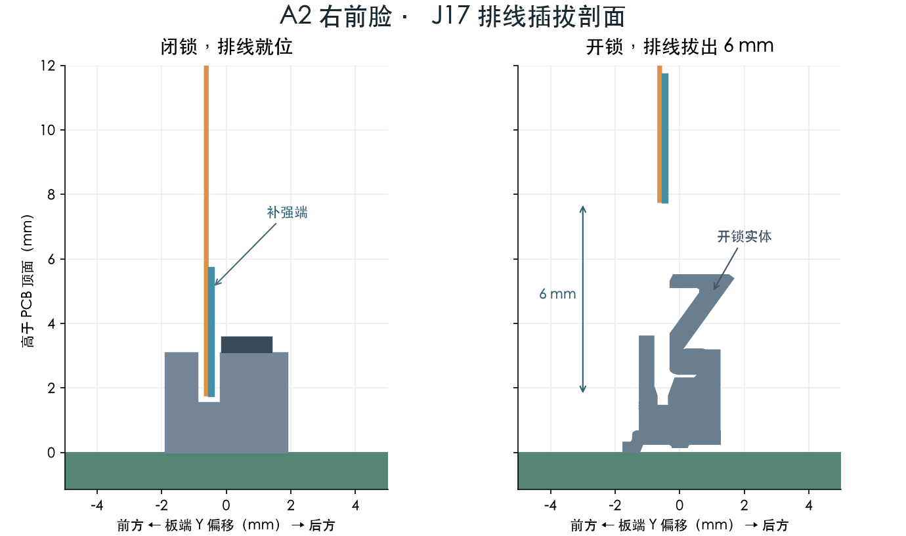
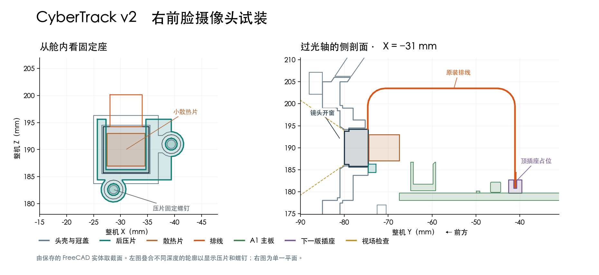

# CyberTrack v2 右前脸摄像头试装

## A2 主板插拔检查

打开 [A2 FreeCAD 试装总成](CyberTrack-A2-front-camera.FCStd)。默认显示闭锁装配；在“检查几何”中打开 J17 开锁 STEP、锁扣包络及上方工具通道。查看拔出状态时，隐藏就位排线和补强片，显示“排线竖直拔出 6 mm”。开锁 STEP 已包含连接器本体，查看它时同时隐藏闭锁示意件。板端安装中心 (−31, −40.5) mm，镜头仍在 (−31, −80, 190) mm。[原生主板装配 STEP](../../../pcb/CyberTrack-A2-STEP.zip) · [保存后回读数据](a2-service-check.json) · [生成脚本](build_a2.py)

装好模组、散热片与压片后，拆下冠盖，从上方把 J17 锁扣竖起。露铜面朝前（−Y）、补强面朝锁扣（+Y），将原装排线竖直送入并转动锁扣。取出时先开锁，再抓住补强段向上提。模型按 62 mm 等长自由排线、两个 R4 弯曲、4 mm 补强段和 0.30 mm 插端总厚复核；装入深度为截面配合假设。模型保留 J17 的开锁 STEP 实体，闭锁用厂商图纸包络。导出中 U1、U12–U15 为库参考方块，FreeCAD 以各自封装的保守外包络计入检查。[Hirose 图纸及操作指南](https://www.hirose.com/en/product/p/CL0586-0814-9-54)

| 状态 | A2 标称净距 |
|---|---:|
| 闭锁排线至冠盖 | 6.04 mm |
| 散热片至 J13 | 2.60 mm |
| 锁扣全行程包络至 F5 预留位 | 0.75 mm |
| 自上方伸入的双端 1 × 1 mm 工具至 J6 | 2.48 mm |
| 0.7 × 0.6 mm 薄爪从两侧夹补强段，至开锁实体 | 0.60 mm |
| 排线竖直抬升 6 mm，端头高出加余量的锁扣包络 | 2.05 mm |

以 0.5 mm 步长计算 13 个排线位置，距固定件最小 0.53 mm，在 PP07 出线处。锁扣检查包络长 15.8 mm、宽 6 mm，最高点在板面上 5.7 mm。F5 的最终保险料号、打印偏差、柔性件回弹、实际操作工具及线束要用首件复核。Seeed 端宽 12.5 ±0.10 mm、单触指宽 0.30 ±0.03 mm；Hirose 对 FPC 推荐 12.5 ±0.07 mm 和 0.35 ±0.03 mm。进料需核对触点面、补强厚度、端宽及触指重合，用同批实件验证插到底、闭锁、接触与振动后预览。[Seeed 承认书](../../../components/seeed-114993115/Seeed-OV5640-MJY5OAF-F3M-V1.pdf) · [Hirose FH12 系列图纸](https://www.hirose.com/en/product/p/CL0586-0814-9-54)

## A1 位置研究

打开 [FreeCAD 试装总成](CyberTrack-v2-front-camera.FCStd) 查看右前脸。按整机坐标，右侧为 −X，前方为 −Y。默认显示半透明头壳、超声波模块、A1 主板、摄像头和安装件。在模型树中切换冠盖、原壳对照和视场检查体，可以查看开窗前后、闭盖及排线状态。[回读记录](fit-check.json)

定焦长排线方案单独保存了[OV2640 FreeCAD 条件试装](CyberTrack-v2-OV2640-envelope.FCStd)、[回读报告](ov2640-fit.json)与[再生成脚本](build_ov2640.py)。两款沿用同一光轴；采购边界、零件净距与价格见[定焦方案](../../../pcb/camera-revision/ov2640.md)。下列尺寸对应 Seeed AF 试装。

## 安装尺寸

| 部位 | 本次设计 |
|---|---|
| 镜头与前壳 | 光轴中心 (−31, −80, 190) mm，水平朝前，低于原前表面 1.0 mm。PP07 局部壁厚 3.0 mm。开窗喉径 Ø8.30 mm，向外扩至约 Ø9.68 mm。69° 圆锥是对厂商视场的试装假设。 |
| 固定 | 8.5 × 8.5 × 5.4 mm 模组从舱内装入 8.96 mm 方座。前肩定位固定框，可拆后压片避开中心导热面与上方 FPC。两颗候选 ST2 × 5 螺钉分置外侧和下侧，压片厚 1.8 mm，导孔 Ø1.6 mm，名义啮合 3.2 mm。实件需核对 AF 全行程和固持面。 |
| 散热 | 7 × 6 × 7 mm 小散热片贴在背面，导热胶按 0.15 mm 占位。镜头端面至散热片末端共 12.55 mm。封闭头舱需测模组、胶层和相邻壳体温升。 |
| 排线 | 70.5 mm 是含摄像头的展开总长，扣除 8.5 mm 后，保留 62.0 mm 原排线。排线从镜头上方引出，以两段 R4 四分之一圆弧跨过板边后垂直向下，最高 Z = 203.5 mm。R4 是候选静态弯曲半径，须核对供应商要求、铜箔面、实件回弹与寿命。 |
| 主板端 | 96 × 80 mm A1 STEP 以 (−48, −67.5, 178) mm 平移至原托盘上方，是试装定位。下一版 24P／0.5 mm 顶插连接器按 15.1 × 3 × 3 mm 占位。排线尖端在 (−31, −41.076, 180.9) mm。插端补强总厚 0.30 mm，锁扣、焊盘、工具空间与触点面需按最终料号核对。 |

模组头部与排线外形取自承认书。模型简化了 AF 镜头与固定框的分界、排线变宽段及散热鳍片。左右装配间隙名义各 0.23 mm，计入模组最大宽度后仅各 0.13 mm，尚未计入壳件制造公差。压片接触面按标称尺寸布置，首件需检查过压、松动和对焦。[模组图纸与来源](../../../components/seeed-114993115/README.md)

## 回读结果

保存后重新打开 FCStd。摄像头、压片、散热片、胶层、线缆及插座占位与头壳、闭合冠盖、附近已有机构和 A1 STEP 做实体相交检查。座与 PP07 连成一个实体，后压片也是一个实体。两颗自攻螺钉的外径与导孔有预期啮合，其他受检实体之间无体积相交。69° 光路检查体从镜头向前延伸 14 mm，壳体和超声波前脸均未切入该检查体。[完整检查对象与结果](fit-check.json)

| 最近处 | 名义净距 |
|---|---:|
| 后压片 → 超声波背部包络 | 3.20 mm |
| 散热片 → 超声波背部包络 | 5.00 mm |
| 散热片 → A1 元件 | 2.60 mm |
| 排线 → 合上的冠盖 | 6.23 mm |
| 视场检查体 → 右侧超声波装饰环 | 0.70 mm |
| 顶插座占位 → A1 相邻器件 | **0.20 mm** |

**0.20 mm 只够说明标称模型能摆下。** 下一版布板需按实际 ZIF 的锁扣、焊盘和插拔工具重新安排邻近器件。视场对准、AF 全行程暗角、胶粘剂和排线寿命也需实测。主板支柱、板底绝缘、板外线束插头和装机工序属于整板机械设计，本研究只定位主板和摄像头相关部件。[A1 电气核对](../../../pcb/camera-dvp.md)

首件建议先贴小散热片，将模组从舱内放入定位肩，确认软排线能从上方槽引出，再锁后压片、装主板、插排线并锁扣。开盖装配后观察四角画面并遍历对焦，再合盖复测。检查振动后画面是否偏移、锁扣是否松脱，以及反复开启和持续预览时的温升。镜头外侧为通孔；若采用透明盖片，须连同其压框、反光及材料重新核对。

[生成脚本](build_fit.py) 读取仓库的整机 FCStd 与 A1 STEP 压缩包，生成独立研究文件和 JSON。可在带 GUI 的 FreeCAD Python 环境执行脚本，或在 FreeCAD Python 控制台用 `runpy.run_path(脚本绝对路径, run_name="__main__")`（先 `import runpy`）。本研究尚未进入 PP07 的 Lean／Ready 制造排盘。
