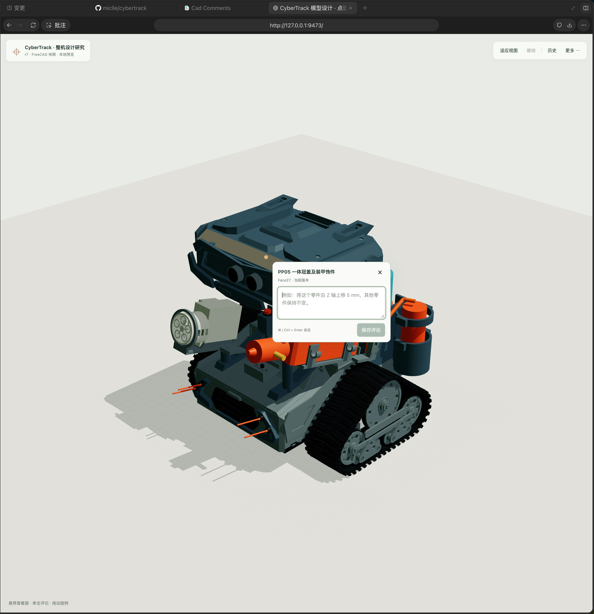
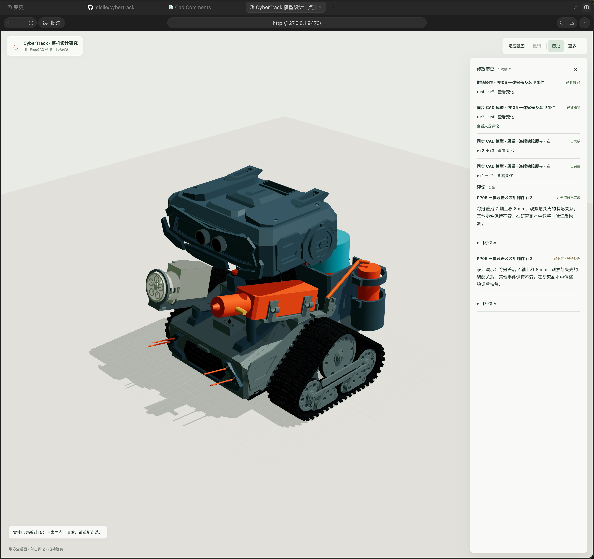

# CyberTrack 模型辅助设计工具

在完整机器人模型中选中零件或面，直接描述调整意图，由当前对话定位 FreeCAD 原生对象、执行修改并回读。模型、评论、修改历史和恢复结果保持版本关联。工具属于设计开发流程；机器人日常语音仍直接通过灵矽运行。

## 模型编辑能力

CyberTrack 模型辅助设计工具可以预览整机、定位零件，并在研究副本上调整和恢复零件位置。每次修改后，工具会与基线模型比对，核查其他零件的位置与几何。实现见[工具源码](../model-design/README.md)。

原生 FCStd 是几何依据。两条接入路径分别记录证据：

| 路径 | 用途 | 范围 |
|---|---|---|
| 整机原生预览 | 在整机上下文定位零件、面，调整独立研究副本中的位置 | 可见形状保留名称、颜色、坐标与版本内面 ID；首版编辑仅支持无约束静态 `Part::Feature` 的绝对 PlacementX/Y/Z |
| 单实体 STEP | 已有参数化研究件修改长度属性 | 有效单实体、已有可编辑且无表达式绑定的长度属性；STEP 回读与面映射检查 |

整机网格来自 FreeCAD 分面，不能替代 STEP 验证、装配约束求解、任意草图编辑或制造验收。正式整机多数是静态形状；修改外形仍需原生 CAD 建模，不把它们冒充参数化实体。面 ID 仅在当前版本及原生 fingerprint 下有效。

## 安装和启动

需要 Git、Node.js ≥24、npm、uv、Python 3.12、FreeCAD，以及已连接的 FreeCAD MCP。在 CyberTrack 根目录执行：

```sh
python3 scripts/solidcue.py prepare
python3 scripts/solidcue.py check
python3 scripts/solidcue.py start
```

`prepare` 按锁定版本安装依赖并构建模型设计工具。服务只监听 `127.0.0.1:9473`，不绑定 CLI 对话。整机数据在 `output/solidcue/assembly-data/`；早期单件数据 `output/solidcue/data/` 保留。数据、研究副本、依赖和生成目录不提交。端口已有服务时拒绝替换；`start` 需持续运行，不自动配置开机启动。

安装插件：

```sh
codex plugin marketplace add "$PWD/tools/model-design"
codex plugin add cad-comment-lab@cad-comment-local
```

若本机同名 marketplace 配置的路径与当前工具目录不符，先执行 `codex plugin marketplace remove cad-comment-local`，再执行上面的命令；原模型数据不会删除。插件技术 ID 沿用，显示名称为 **CyberTrack 模型设计**。升级后按下面步骤重新加载连接，再调用 `open_model` 并展开卡片。升级 UI 后须新开一次卡片；同轮修改和恢复使用同一卡片。

本地插件重载：等待当前操作保存后，使用 `⌘Q` 完全退出承载 Codex 的 ChatGPT 桌面应用，再重新打开并回到原对话；只关闭窗口不算退出。保持 FreeCAD 打开，不需要卸载插件或删除研究数据。若模型服务运行在应用管理的终端中，退出应用可能结束服务；重开后先检查 `127.0.0.1:9473`，确认没有服务监听时再运行 `python3 scripts/solidcue.py start`，沿用原数据目录。此流程依据 [OpenAI 本地插件说明](https://developers.openai.com/plugins/build/plugins#install-a-local-plugin-manually)；当前 CLI 的 `codex plugin`／`codex mcp` 没有 `reload` 子命令。返回对话后先核对工具描述与当前文档版本，再新开模型卡片；旧卡片仍可能保留旧 UI。

```sh
node scripts/check_solidcue_plugin.mjs
```

此命令核对安装缓存、13 个工具、UI 资源及实际服务路径，只做协议检查，不代替真实卡片验收。

## 整机研究流程

| 在零件上写评论 | 查看修改与撤销记录 |
| --- | --- |
|  |  |
| 点选冠盖表面，在评论里写明移动方向、距离和要观察的装配关系。 | 打开“历史”，可从冠盖的修改记录回看来源评论，核对修改和撤销各自对应的版本。 |

1. 执行 `python3 scripts/prepare_model_study.py`，取得带原文件哈希的独立整机副本。
2. 通过 FreeCAD MCP 打开返回的 `study` 文件。核对路径后添加字符串属性 `CyberTrackStudySource`，值为原始 FCStd 绝对路径；保存研究副本，不能把标记加到正式模型。
3. 用 `get_state.cadBridge.assemblyAdapterScript` 加载 `assembly_bridge.py`。`export_assembly(document_name, inbox, unique_snapshot_id)` 导出当前可见整机，包含网格、来源指纹和原生 FCStd 副本；生产文件不覆盖。
4. 在空白设计文档调用 `sync_cad_snapshot(mode=attach)`。在真实卡片点选目标、填写评论；核对文档、版本、评论 ID/hash、原生 UID 与 fingerprint。
5. `edit_placement(document_name, document_uid, object_name, expected_fingerprint, changes, inbox, baseline_snapshot_id, unique_snapshot_id)` 只接受明确的绝对毫米坐标。它校验整个原生场景基线；以事务修改，导出失败则回滚。
6. 调用 `sync_cad_snapshot(mode=edit, commentId, sha256)` 发布。服务核对目标、所有非目标零件、网格／FCStd 哈希及面索引；相同卡片更新并清除旧选择。
7. `undo_placement(document_name, document_uid, inbox, edit_snapshot_id, unique_snapshot_id)` 恢复原生位置，再调用 `sync_cad_snapshot(mode=undo, operationId)`。恢复必须匹配原始整机指纹；不能只切换旧预览。

同步超时或结果不明确时，先读 `get_state.cadSnapshotId`，不能盲目重复原生修改。整机 STEP 请从 FreeCAD 导出；整机预览不会提供未经验证的 STEP 下载。

## 单实体研究与历史证据

原电池承托垫 `BatteryPadN54N90` 为 5 × 5 × 0.2 mm 的矩形实体。`scripts/solidcue_freecad.py` 只在精确几何等价时建立独立 `Part::Box`，复杂形状拒绝转换；不会以包络盒替代实际外形。

```sh
PYTHONPATH=/Applications/FreeCAD.app/Contents/Resources/lib \
  /Applications/FreeCAD.app/Contents/Resources/bin/python \
  scripts/solidcue_freecad.py --object BatteryPadN54N90 --verify
node scripts/check_solidcue_sync.mjs <study_directory>
```

[单实体历史验证](verification-20261031.json)包含真实 FreeCAD 主机修改／恢复、旧指纹拒绝、六面映射和同步检查；[0.8.0 安装记录](verification-installed-20261031.json)是历史协议证据。2026-10-31 解锁后已通过实际 FreeCAD MCP 导出单件，并在宿主卡片保存评论、取得“宿主已接受消息”提示；原生修改前 FreeCAD 被重新启动，尚不构成完整闭环。

## 开发检查与验收

统一入口：`python3 scripts/verify_improvements.py --model-design`；已有 ct45 准备树时加 `--source build/xiaozhi-ct45-src`。报告包含每项退出码、日志和工具源码哈希，不自动安装依赖，也不连接实际设计服务。下列命令可单独运行对应检查：

```sh
npm --prefix tools/model-design test
npm --prefix tools/model-design run test:bundle
npm --prefix tools/model-design run test:ui
```

0.9.2 编译与 29 项模型／内核／同步／传输测试通过；打包、合成宿主界面和已安装插件检查通过。整机协议覆盖旧版本、错误目标、网格篡改、非目标改变及恢复；压缩预览按 geometry key 缓存，普通轮询不重复传输整机网格。

[整机验证记录](verification-assembly-20261031.json)：实际加载 198 个可见形状，在本地界面选择 `PrintCrown` 并保存评论，通过 FreeCAD 主机原生适配器完成 Z=0 → 8 → 0 mm，保存、重新打开核对；其余 197 个零件不变。MCP 快照同步使同一本地页面依次显示 r3 → r4 → r5；正式模型 SHA-256 保持不变。[README 截图](../../README.md#在完整机器人上直接说出修改想法)来自真实本地界面。

上述 r3–r5 为无界面原生记录。后续[真实 GUI 验收](verification-gui-20261031.json)已恢复 FreeCAD 1.1.4／MCP 0.1.28：在本地页面点选冠盖 `Face113`，核对 r5 评论后，通过 GUI MCP 完成 Z=0 → 8 → 0 mm，并在修改和恢复后分别保存、关闭、重开；198 个原生指纹、217 个显示状态回读一致，其他 197 件不变。同一本地页面经 MCP 发布更新 r5 → r6 → r7，README 使用 r6 实拍。

重启桌面应用后，新版连接的 `get_state`／`open_model` 已正常返回；本地服务随应用退出结束，确认端口空闲后从原数据目录恢复。[真实宿主卡片验收](verification-host-20261031.json)完成 r7 冠盖评论保存、宿主接受消息、MCP 显式读回与 AI 回执、GUI 修改／保存重开、同一卡片 r7 → r8 → r9 更新与恢复；README 使用 r8 宿主实拍。

后续[消息驱动完整验收](verification-message-20261031.json)已通过：在 r9 卡片提交一条尚未处理的新评论，实际 `mcp_app` 消息独立触发处理；校验文档、版本、评论 hash 与原生 UID／指纹后，冠盖 Z=0 → 4 → 0 mm，修改和恢复均经 GUI 保存重开，同一卡片依次更新 r9 → r10 → r11 并显示最终 AI 回执。其余 197 件与正式模型保持不变。此前迟到的 r7 评论已核对完成历史，仅更新结果回执，没有重复改模。

本轮观察到宿主消息在当前处理轮结束后投递；“宿主已接受”仍不等于模型已经修改，应以 AI 回执和版本历史核对结果。单次通过不代表延迟或吞吐保证。I11 接入验收完成，证据范围见 [执行计划](../../docs/improvement-plan.md)。

无界面导出的 FCStd 必须保留 `GuiDocument.xml` 及材质二进制的原始归档顺序，否则 FreeCAD GUI 可能以默认灰色打开。适配器已修复该顺序；2026-10-31 通过真实整机的无界面导出 → GUI 打开验证，198 个原生指纹、217 个对象的显示状态与原始模型一致。历史快照不重写；继续编辑请使用已核验的 GUI 研究副本或重新导出。

原生指纹排除 OCCT 三角网格缓存、瞬态拓扑标记及小于 1e-9 的数值序列化差异，避免仅保存／重开就误判改模；这不是制造公差。原生指纹不变的非目标零件复用经哈希校验的基线网格，保留面映射，避免重新分面造成误报。
